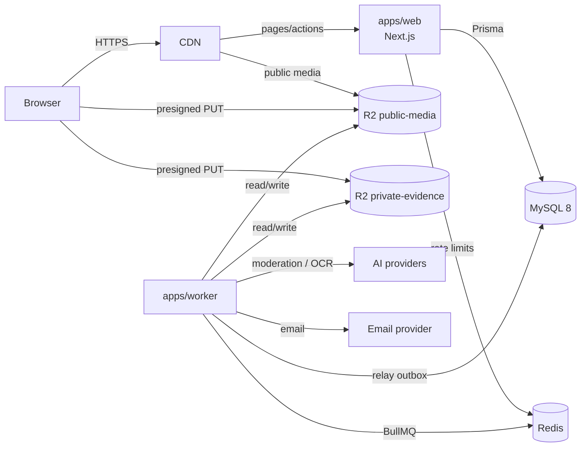

# ADR-0001: Technology stack and runtime topology

| | |
|---|---|
| **Status** | Proposed. Becomes *Accepted* when merged to `main` with CEO approval |
| **Date** | 2026-11-20 |
| **Deciders** | Software Architect (author). CEO (approval) |
| **Task** | #18 (M1.1) |
| **Related** | ADR-0002, ADR-0003, ADR-0004, [data-model.md](../architecture/data-model.md) |

## Context

The product is a responsive web review platform. It has AI-first moderation backed by human moderators, verified-buyer
proofs, media uploads, trust scores, comparison, and social features. The project brief already fixes the core stack:
**Next.js + Tailwind, Prisma/MySQL, S3/R2 object storage, and a background job worker with a queue** for moderation and media
processing. This ADR records how those pieces fit together and decides the details the brief leaves open.

Forces:

- **Every write goes through moderation and/or media processing.** Much of the work is asynchronous, must be retried,
  and must never be lost (a review must not stay `PENDING` forever because a job was dropped).
- **Calls to external AI providers** need rate limiting, back-off and concurrency caps.
- **Sensitive files** (receipts, business documents) must never be publicly reachable.
- **Small team.** Keep the number of runtimes and services small and keep the language the same end to end.

## Decision

### 1. Application

| Concern | Choice |
|---|---|
| Language | TypeScript (`strict`) end to end |
| Web framework | **Next.js (App Router)**, React Server Components by default. Mutations go through **Server Actions**. **Route Handlers** are used only for webhooks, upload callbacks and any future public API |
| Styling | **Tailwind CSS**. Logical properties (`ms-`/`me-`) are used so RTL stays cheap later (open question G-7) |
| Validation | `zod` schemas shared by Server Actions, Route Handlers and worker job payloads |
| ORM / DB | **Prisma ORM** on **MySQL 8.0.16+** (InnoDB, `utf8mb4`, `utf8mb4_0900_ai_ci`), with real foreign keys and CHECK constraints (ADR-0004). The schema draft uses Prisma 6 syntax and the exact major version is pinned at scaffold |
| Object storage | S3 API through the AWS SDK v3. **Cloudflare R2** is the default provider. Two buckets: **public-media** (served via CDN custom domain) and **private-evidence** (no public access, signed URLs ≤ 5 min, server-side encryption) |
| Queue | **BullMQ on Redis 7** (managed, persistence on, `noeviction`) |
| Async consistency | **Transactional outbox** (`OutboxEvent` table). Domain writes and outbox rows commit in one MySQL transaction, and a relay in the worker publishes them to BullMQ |
| Auth | First-party sessions + TOTP 2FA (ADR-0002) |
| Authorization | Code-defined RBAC + scoped seller roles + policy guards (ADR-0003) |
| Testing | Vitest (unit/integration against a MySQL container) and Playwright (E2E). Details are in the M1 test-strategy task |
| Observability | OpenTelemetry traces (web + worker share a trace via job metadata), structured JSON logs, error tracking (provider chosen at scaffold) |

### 2. Repository layout (pnpm workspaces)

```
apps/
  web/        Next.js app (UI, Server Actions, Route Handlers)
  worker/     Node process: outbox relay + BullMQ processors + scheduled jobs
packages/
  db/         Prisma schema, migrations (+ check-constraints SQL), client singleton
  core/       Domain services, authz policies (ADR-0003), zod schemas. No Next.js imports
  config/     Shared tsconfig / eslint / tailwind presets
docs/         Architecture docs and ADRs (this folder)
```

`packages/core` holds all business rules, so the web app and the worker enforce exactly the same
permissions and invariants. The web app and the worker are separate deployables built from the same commit.

### 3. Runtime topology



### 4. Queues (initial)

| Queue | Jobs | Notes |
|---|---|---|
| `moderation` | AI pre-moderation of reviews/replies/comments/posts/media, re-scans | Concurrency capped per AI provider. Escalates to human on failure after retries; never auto-approves on error |
| `media` | EXIF/GPS strip, image variants, video transcode/poster, perceptual hash, proof redaction + extraction | Large jobs are isolated from moderation by queue |
| `verification` | DNS TXT / meta-tag ownership checks, duplicate-proof detection | Outbound fetches go through an SSRF-safe fetcher (allow-list schemes, block private IP ranges) |
| `notifications` | In-app fan-out, email digests | Idempotent on `(recipient, groupKey)` |
| `trust` | Signal ingestion, debounced recompute, nightly decay | Writes `TrustScoreSnapshot` |
| `maintenance` (repeatable) | Enforcement expiry, retention purges, orphan media cleanup, session/token purge, outbox purge | Cron via BullMQ repeatable jobs |

Every job is **idempotent** and keyed by the domain id plus the version or event id, so at-least-once delivery is safe.

### 5. Upload path

The browser asks the web app for an upload slot. The web app creates `MediaAsset(UPLOADING)` with a server-generated key and returns a
presigned PUT restricted by content-type and content-length. The browser uploads directly to R2, then confirms. The web app
writes `OutboxEvent(media.uploaded)` and the worker processes the file. Application servers never proxy file bytes.

## Alternatives considered

| Option | Why not (for Phase 1) |
|---|---|
| **MySQL-backed job table** (`SELECT … FOR UPDATE SKIP LOCKED`) instead of Redis | One fewer service, but we would have to build retries/back-off, delayed and repeatable jobs, rate-limited concurrency and an ops UI ourselves. We also need Redis for auth rate limiting anyway (ADR-0002). We do keep the *outbox* in MySQL for transactional safety |
| **AWS SQS / Cloudflare Queues** | Managed and durable, but ties us to one cloud before hosting is decided (T-1), and gives weaker delayed and repeatable job support. Revisit if we standardise on one cloud |
| **Enqueue directly to BullMQ from request handlers (no outbox)** | Two writes that are not atomic: a crash between the DB commit and the enqueue leaves content stuck in `PENDING`, and an enqueue before commit can process data that was rolled back |
| **Next.js API routes / Vercel Cron as the worker** | Execution-time limits are too short for transcoding/OCR, there is no long-lived queue consumer, and cron granularity is too coarse |
| **PostgreSQL** | It would allow partial unique indexes and RLS, but MySQL is a given project constraint. Where we would have relied on Postgres-only features, ADR-0004 documents the MySQL workaround |
| **Separate backend service (NestJS/Fastify)** | Adds a network hop and contract maintenance for little gain at Phase 1 scale. `packages/core` keeps the option open |

## Consequences

**Positive**

- Single language, shared domain/authz package, and identical rules in web and worker.
- No lost jobs, thanks to the transactional outbox. Retries and rate limiting come built into BullMQ.
- Sensitive files are physically separated from public media (separate bucket and credentials).

**Negative / risks**

- Redis is one more stateful dependency. It must run with persistence and `noeviction`, or jobs can be lost.
- The outbox relay adds latency of up to one poll interval. Target: ≤ 1 s poll, or a NOTIFY-style nudge from the web app after commit.
- Self-managing a containerised worker (hosting is open question T-1).
- MySQL lacks partial unique indexes, so some invariants are enforced in the application and covered by tests (ADR-0004).

## Follow-ups

- Scaffold task: create the workspace layout, pin versions, wire up the Prisma migration and `check-constraints.sql`.
- M1.2 moderation pipeline: provider, thresholds, policy taxonomy.
- Threat-model task: SSRF fetcher, presigned-URL constraints, bucket policies, secrets management.
