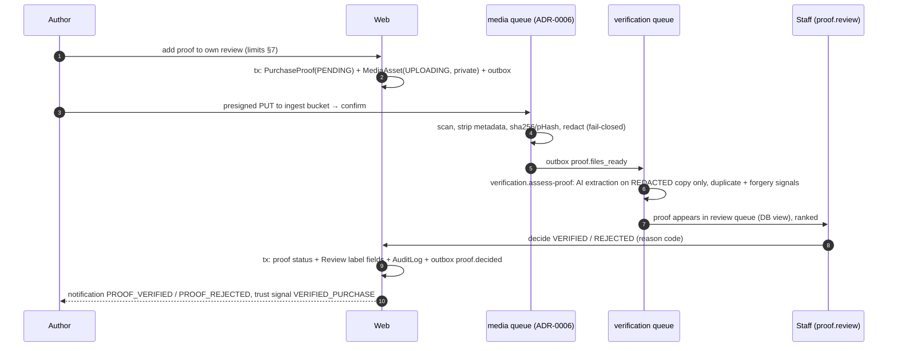

# ADR-0008: Verified-buyer approach

| | |
|---|---|
| **Status** | Proposed. Becomes *Accepted* when merged to `main` with CEO approval |
| **Date** | 2026-11-21 |
| **Deciders** | Software Architect (author). CEO (approval). Legal input pending (L-2, L-5, L-6, L-7) |
| **Task** | #24 (M1-T1) |
| **Related** | [data-model.md §6.2](../architecture/data-model.md#62-verified-buyer-proof-redaction-and-deletion), ADR-0003 (`proof.*` permissions), ADR-0004 §8 (PII minimisation), ADR-0006 (private evidence pipeline), ADR-0007 (jobs), [threat-model.md §3.4](../security/threat-model.md) (R-1..R-10, F-4) |

## Context

The "Verified buyer" label is one of the product's core trust features. Several forces shape it:

- **Regulation.** The EU Omnibus/UCPD rules require us to disclose *whether and how* reviews are verified. The US FTC rule (16 CFR 465) and the UK DMCC Act
  target fake and misleading reviews. A label that overstates what we checked is itself a legal risk (open questions L-2, L-15).
- **Privacy.** Purchase evidence (receipts, order emails) is full of PII: name, address, partial card number, order number. GDPR minimisation applies (L-5, L-6).
- **Fraud.** Edited, recycled and AI-generated receipts are cheap to produce (R-5). Proof spam can exhaust staff and AI budget (R-10).
- **Cold start.** At launch no sellers are integrated with us, so we cannot verify against merchant order data.

Pieces of this design already exist in data-model §6.2, the threat model and ADR-0003. This ADR records the decision as a whole, and adds the
provenance link `Review.verifiedProofId`.

## Decision

### 1. What the label means

> **"Verified purchase"**: the reviewer showed us evidence of buying this product, and a trained moderator accepted it.

- The label attaches **per review**, not per user. A trusted user's next review is not verified automatically.
- It is a **trust signal, not a guarantee** (R-5). The label tooltip names the method ("Verified purchase · receipt") and links to a public
  methodology page that explains what we check and what we do not. Legal reviews that copy (L-2).
- Products show the verified share ("38 of 120 reviews verified") and offer a "Verified purchases only" filter. Phase 1 rating averages include all published reviews.
  Whether trust or verification should weight the averages is open question T-9.

### 2. Evidence methods (Phase 1)

| `PurchaseProofMethod` | Evidence |
|---|---|
| `RECEIPT_UPLOAD` | Photo or PDF of a paper or e-receipt |
| `ORDER_CONFIRMATION` | Screenshot or PDF of an order confirmation email or page |
| `MARKETPLACE_ORDER_LINK` | Marketplace order reference plus a screenshot. We never log in to a user's marketplace account |

The following are deferred and would be additive enum values or tables: seller-issued review invitations bound to an order (T-7, `SELLER_INVITATION`),
merchant/order-API integrations, and payment-network verification.

### 3. Verification is independent of publication

- A review is moderated and published on its own (ADR-0005). A proof is **optional**, can be added at any time while the review exists, and **never
  blocks or delays publication**. The label appears once the proof is verified.
- Rejecting a proof does not affect the review. A proof that is fraudulent (not merely insufficient) goes to a moderation case and may lead to enforcement.

### 4. Humans decide. AI assists (Phase 1)

- Every proof is decided by a human with `proof.review` (MODERATOR+). The conflict-of-interest guard and audit rules come from ADR-0003.
- AI and OCR only **prepare** the decision: redaction, extraction (merchant, purchase date, product-match confidence), forgery and duplicate signals, and queue
  ranking. **There is no auto-verify and no auto-reject in Phase 1.** Reasons:
  - The fraud asymmetry: a wrongly granted label misleads every reader of the review.
  - Legal uncertainty about automated decisions (L-16).
  - There is no calibration data yet.
- A config flag `proof.autoVerify` is reserved and **off**. Turning it on requires a CEO decision based on shadow-mode precision data (open question C-3).
- If the daily AI/OCR budget is exhausted, proofs fall back to the human queue without AI hints. They are never approved automatically (R-10).

### 5. Pipeline

- **Queue.** File processing runs on the `media` queue (ADR-0006). Assessment runs as job `verification.assess-proof` on the existing **`verification`**
  queue, which also handles seller-claim checks. This resolves the "its own queue" note in moderation-pipeline.md §1 without adding a new queue.
- **Fail-closed redaction.** If OCR confidence is low, the job masks everything except the merchant, date and total regions, or asks the user to redact
  (R-2). Only redacted data ever reaches AI providers (R-3).
- **SLA.** The target is a decision within 3 days (configurable). A proof that reaches its SLA undecided becomes `EXPIRED`, the user is notified and may resubmit.

### 6. Data model

| Element | Rule |
|---|---|
| `Review.verifiedPurchaseAt`, `verificationMethod`, **`verifiedProofId`** (new, unique FK → `PurchaseProof`) | The label. These fields are **set and cleared together**, enforced by CHECK `chk_review_verified_label`. They are independent of the proof *files*, so the label survives purge (L-7) |
| `PurchaseProof` | Long-lived provenance record: method, status, reviewer, dates, `fileFingerprint`, `orderReferenceHash`, `merchantName`, `purchaseDate`. Files are redacted and then purged on schedule (data-model §6.2) |
| At most one VERIFIED proof per review | `verifiedProofId` is unique. `verifiedProof.reviewId = review.id` is enforced in `packages/core` and covered by an integration test (ADR-0004 §5 pattern) |
| `orderReferenceHash` | Keyed HMAC over (merchant, normalised order number). A match across accounts creates a `DUPLICATE_PROOF_DETECTED` trust signal and a case (R-5, R-6) |

### 7. Eligibility and limits

- Only the review author can submit (`proof.submit.own`). Members of the seller that owns the product cannot review it, and therefore cannot submit proof for it (L-8).
- At most 1 pending proof per review and 5 proof submissions per user per day ([threat model §5](../security/threat-model.md#5-rate-limit-baseline-proposal), R-10). `proof.maxAttemptsPerReview` defaults to 3.
  After that, the user must appeal the last rejection instead of resubmitting.
- The purchase date must not be in the future, and the extracted merchant and product must plausibly match the reviewed product. The moderator sees a mismatch as a flag, not as an automatic rejection.

### 8. Revocation, appeals and deletion

- **Revocation:** an `EnforcementAction(VERIFIED_LABEL_REVOKED)` clears all three label fields in one transaction, for example when a proof is later found
  fraudulent. The proof row stays unchanged as evidence. The subject can appeal through `Appeal.enforcementActionId`.
- **Rejected proof:** the user can appeal through `Appeal.purchaseProofId`. A different reviewer decides the appeal (ADR-0003).
- **User deletes the proof.** Before a decision the proof becomes `WITHDRAWN`. After `VERIFIED`, the files are purged within 24 h and **the label stays**,
  based on the retained attestation (working assumption, Legal L-7).
- **Account erasure:** the attestation row is unlinked from the person (R-8). Reviews follow L-4.

## Alternatives considered

| Option | Why not |
|---|---|
| Self-declared "I bought this" checkbox | Calling it "verified" would be misleading under EU and FTC rules. It has no fraud resistance |
| Merchant/order-API integrations only | Nothing to verify against at launch (cold start). Kept as the Phase 1.x path via T-7 |
| AI auto-verification above a confidence threshold | AI-generated receipts defeat image-only checks. There is no calibration data, and automated decisions are legally open (L-16). Reserved behind `proof.autoVerify` |
| Verify the *user* once (KYC) and label all their reviews | Proves identity, not a purchase of *this* product. It is also high-friction and collects more PII |
| Keep receipts as long as the review exists | Violates data minimisation and turns the private bucket into a high-value breach target (R-1) |
| Derive the label from proof-file existence | The label would vanish when files are purged or the user deletes them, which punishes privacy-conscious users |

## Consequences

**Positive**

- The label's meaning is honest and disclosed, and its provenance is explicit and auditable through `verifiedProofId`.
- No receipt is kept longer than needed, and AI providers only ever see redacted data.
- Publication is never blocked on the slowest step (human proof review).

**Negative / risks**

- Staff workload grows with proof volume, because every proof needs a human decision. Mitigation: AI ranking and pre-fill, a CEO decision on `proof.autoVerify` after calibration (C-3), and seller invitations (T-7).
- Determined forgers will still get through sometimes. Mitigation: duplicate and forgery signals, retroactive revocation, and the label is framed as a signal.
- Several retention and legal-basis points are still OPEN(LEGAL): L-5, L-6, L-7.

## Follow-ups

- **M4 (reviews and proof):**
  - Implement the pipeline, the review queue view, the label CHECK and invariant test, and the limits.
  - Build the methodology page, with copy reviewed by Legal.
  - Add the verified-share cache and filter on `Product`.
- **Legal:** answer L-5/L-6/L-7, and decide on G-10 (delete originals as soon as the redacted copy and the decision exist), see open question C-4.
