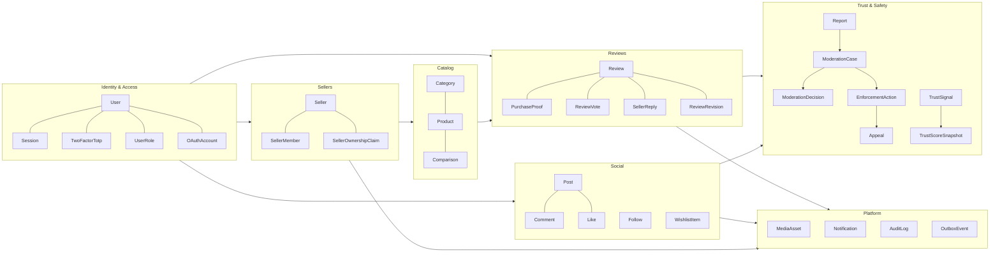
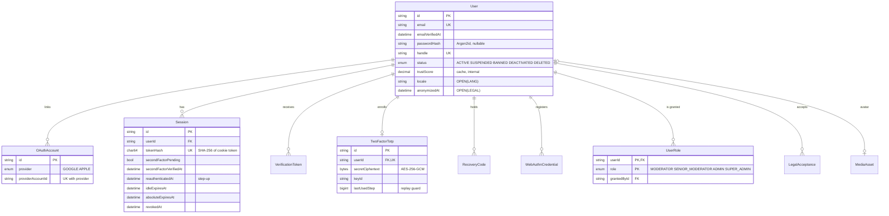
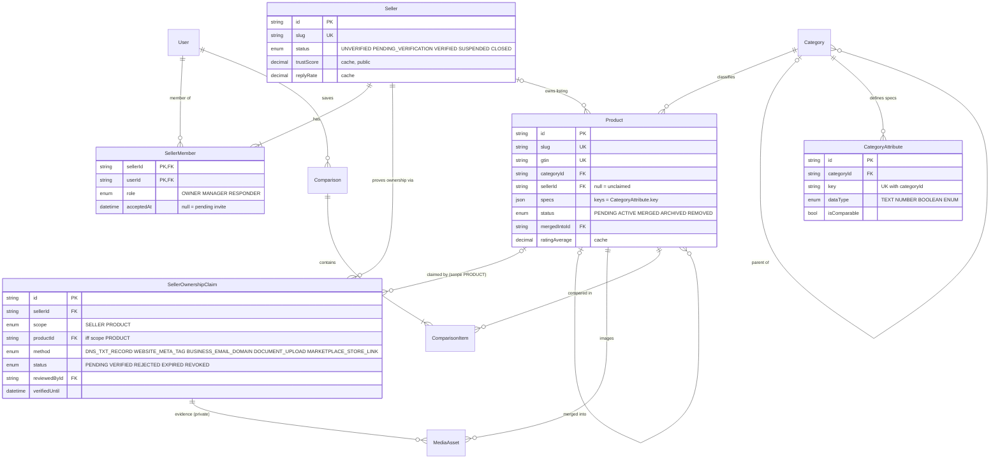
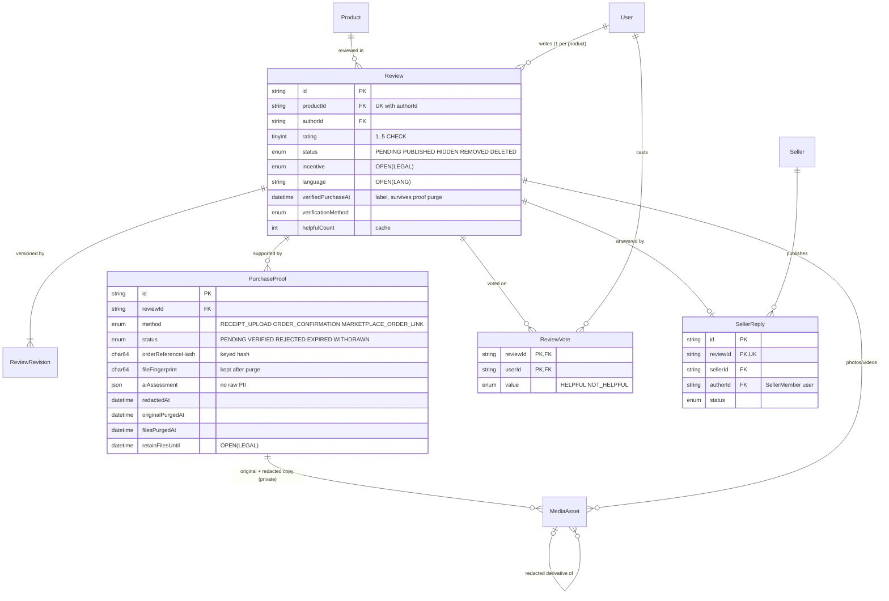
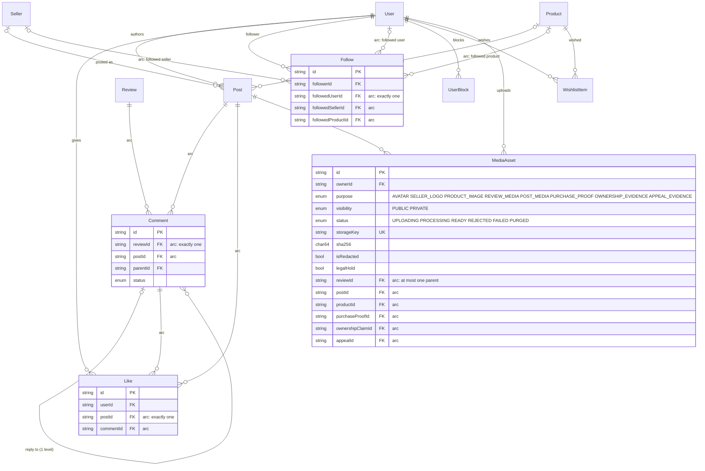
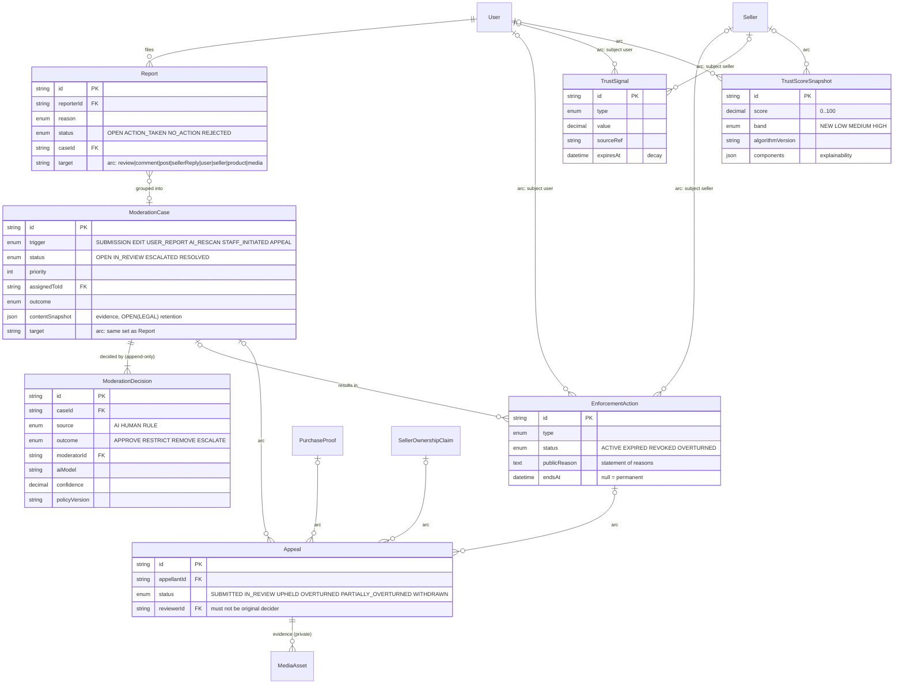
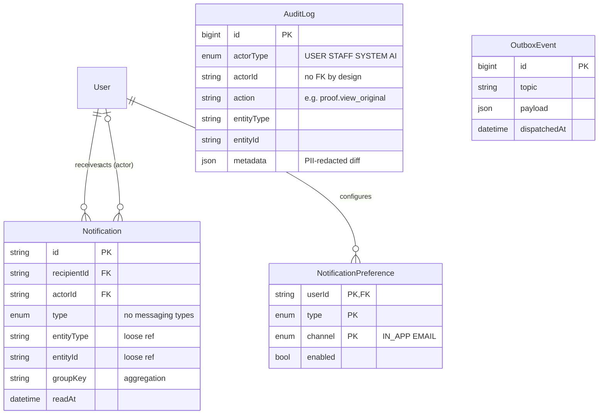
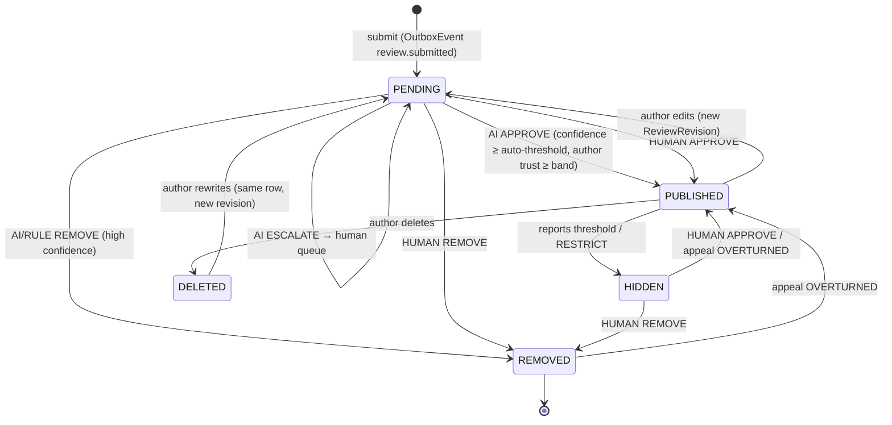
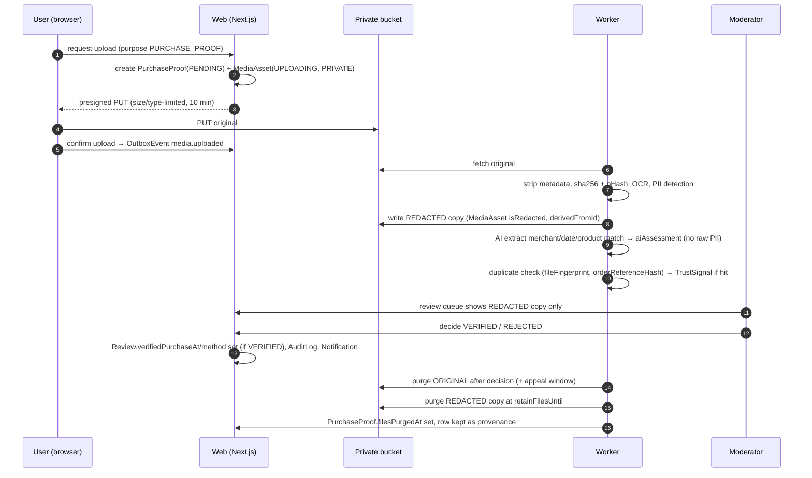

# Phase 1 Data Model

| | |
|---|---|
| **Status** | Draft for review (task #18, milestone M1.1) |
| **Owner** | Software Architect |
| **Source of truth** | [`schema.draft.prisma`](./schema.draft.prisma) + [`check-constraints.sql`](./check-constraints.sql) |
| **Decisions** | [ADR-0001 Stack](../adr/0001-technology-stack.md) · [ADR-0002 Auth](../adr/0002-authentication-and-2fa.md) · [ADR-0003 Permissions](../adr/0003-multi-role-permissions.md) · [ADR-0004 Data conventions](../adr/0004-data-model-conventions.md) |
| **Open questions** | [`open-questions.md`](./open-questions.md) (Legal, Language, others) |

The ERDs below show entities, keys and cardinality. To keep them readable they list only the
important attributes. The Prisma schema is authoritative for every column, type and index.

---

## 1. Scope

### 1.1 In scope (Phase 1)

| Capability | Models |
|---|---|
| Users, roles, 2FA | `User`, `OAuthAccount`, `Session`, `VerificationToken`, `TwoFactorTotp`, `RecoveryCode`, `WebAuthnCredential` (stretch), `UserRole`, `LegalAcceptance` |
| Sellers + ownership proof | `Seller`, `SellerMember`, `SellerOwnershipClaim` (+ `MediaAsset` evidence) |
| Products, catalog, comparison | `Category`, `CategoryAttribute`, `Product`, `Comparison`, `ComparisonItem` |
| Reviews | `Review`, `ReviewRevision` |
| Verified-buyer proof (redaction/deletion) | `PurchaseProof` (+ private `MediaAsset` original and redacted copies) |
| Votes | `ReviewVote` |
| Reports | `Report` |
| Seller replies | `SellerReply` |
| Moderation (AI-first + admin) | `ModerationCase`, `ModerationDecision` |
| Enforcement actions | `EnforcementAction` |
| Appeals | `Appeal` |
| Trust score inputs | `TrustSignal`, `TrustScoreSnapshot` (+ cached `User.trustScore`, `Seller.trustScore`) |
| Follows, likes, comments, posts | `Follow`, `Like`, `Comment`, `Post`, `UserBlock` |
| Wishlist | `WishlistItem` |
| Media uploads | `MediaAsset` |
| Notifications | `Notification`, `NotificationPreference` |
| Audit logs | `AuditLog` |
| Async processing | `OutboxEvent` (transactional outbox, see ADR-0001) |

### 1.2 Explicitly OUT of scope: Messaging (Phase 2)

Phase 1 contains **no messaging data model**. That means:

- No `Conversation`, `Message`, `MessageParticipant`, `MessageRequest` or attachment tables.
- No direct messages between users, no seller↔buyer chat, no group chat.
- No message-related values in `NotificationType`, `MediaPurpose`, `ReportReason` or the permission catalog.
- No inbox UI, unread-message counters or messaging preferences.

Phase 1 already provides some building blocks that Phase 2 can reuse without changing them (see §9):
`UserBlock`, the exclusive-arc pattern used by `Report`/`ModerationCase`, the extensible
`NotificationType` enum, and the reserved `message.*` permission namespace from ADR-0003.

### 1.3 Open questions affecting the model

- **Legal: OPEN.** Retention periods, erasure semantics, IP storage, incentive-disclosure rules, KYB for sellers, age gating, jurisdictions. Fields that depend on these are marked `OPEN(LEGAL)` in the schema. See [open-questions.md §1](./open-questions.md#1-legal-open).
- **Language: OPEN.** Launch languages, catalog translations, per-language review filtering, machine translation. Fields are marked `OPEN(LANG)`. See [open-questions.md §2](./open-questions.md#2-language--localisation-open).

---

## 2. Domain overview

---

## 3. Entity-relationship diagrams

### 3.1 Identity & access

### 3.2 Sellers, ownership proof & catalog

### 3.3 Reviews, verified-buyer proof, votes & seller replies

### 3.4 Social & media

### 3.5 Trust & safety

### 3.6 Notifications, audit & outbox

`AuditLog` and `OutboxEvent` have no foreign keys on purpose: audit entries must outlive the
rows they describe, and outbox rows are transient infrastructure.

---

## 4. Entity catalogue (key rules)

| Entity | Key rules / invariants |
|---|---|
| `User` | `email` normalized lowercase and unique. `status` is a **projection** of active `EnforcementAction`s (source of truth) and is maintained by the worker. Never hard-deleted: erasure anonymizes the row (§6.6). |
| `Session` | Opaque token, only its hash is stored. A session with `secondFactorPending=true` can only call the 2FA-completion endpoint. Bans, suspensions, password resets and role changes revoke sessions (ADR-0002). |
| `UserRole` | One row per active global staff role. Revoking a role deletes the row; history is in `AuditLog`. Roles only take effect if the user has 2FA enabled (ADR-0003). |
| `SellerMember` | A seller must always have ≥1 accepted `OWNER` (enforced in the application). The pair (seller, user) is unique. |
| `SellerOwnershipClaim` | `Seller.status = VERIFIED` requires ≥1 `VERIFIED` claim with `scope=SELLER`. For `scope=PRODUCT`, `productId` is required (CHECK). Approval sets `Product.sellerId`. |
| `Product` | `sellerId` null means unclaimed: anyone can review it, but nobody can post seller replies. Merging sets `status=MERGED` and `mergedIntoId`, and the worker re-points reviews. If both products have a review by the same author, the newer review is kept and the other is soft-deleted with an audit record. |
| `Review` | Unique on (`productId`, `authorId`) for the lifetime of the account, which blocks delete-and-recreate review bombing. Every edit creates a `ReviewRevision` and re-enters moderation. Authors who are members of the product's seller are blocked by policy (ADR-0003, conflict of interest). |
| `PurchaseProof` | Long-lived minimal provenance row. Its files are short-lived (§6.2). `orderReferenceHash` and `fileFingerprint` detect the same proof being reused across accounts. |
| `ReviewVote` | One vote per user per review, and users cannot vote on their own review (app rule). Vote weight comes from the voter's trust score at aggregation time, not when the vote is stored. |
| `SellerReply` | One per review. Allowed only if `Product.sellerId` is set, the seller is `VERIFIED`, and the author is an accepted member with the `seller.reply` permission. |
| `Comment` / `Like` / `Follow` | Exclusive arcs (CHECK: exactly one target). Users cannot follow themselves or follow/like/comment across a `UserBlock` (app rule). |
| `MediaAsset` | One row per stored object. Purposes `PURCHASE_PROOF`, `OWNERSHIP_EVIDENCE` and `APPEAL_EVIDENCE` must be `PRIVATE` (CHECK). `storageKey` is generated server-side (`{visibility}/{purpose}/{yyyy}/{mm}/{cuid}`) and never comes from user input. |
| `Report` | Exactly one target (CHECK). New reports on a target attach to that target's open `ModerationCase` if there is one, otherwise a new case is opened. |
| `ModerationCase` | At most one case per target is `OPEN`/`IN_REVIEW`/`ESCALATED` at a time (application rule). `contentSnapshot` keeps a copy of the content as evidence. |
| `ModerationDecision` | Append-only. The current state is the latest decision. Human decisions can override AI and rule decisions, and both are kept. |
| `EnforcementAction` | Exactly one subject (CHECK). `publicReason` is the statement of reasons shown to the subject. The worker expires actions whose `endsAt` has passed. |
| `Appeal` | Exactly one target (CHECK). One appeal per appellant per decision (unique). The reviewer must not be the person who made the original decision (policy, ADR-0003). |
| `TrustSignal` / `TrustScoreSnapshot` | Append-only. Snapshots record `algorithmVersion` and `components` so a score can be explained during an appeal. |
| `Notification` | Uses a loose entity reference so notifications survive target deletion. `ENFORCEMENT_ISSUED`, `APPEAL_DECIDED` and `SECURITY_ALERT` cannot be disabled. |
| `AuditLog` | Append-only. The app DB user gets INSERT/SELECT only on this table. Covers every staff action and every access to private proof/evidence files. |

---

## 5. Cross-cutting rules (summary; see ADR-0004)

1. **IDs:** `cuid()` strings, except `AuditLog` and `OutboxEvent`, which use `BIGINT AUTO_INCREMENT` (append-heavy tables that need ordering).
2. **Time:** UTC `DATETIME(3)` everywhere.
3. **Deletion:** user content uses `status` + `deletedAt` and is never hard-deleted by request handlers. Physical purge runs only in retention jobs, which delete children explicitly. This is needed because arc FKs are `Restrict`.
4. **Polymorphism:** exclusive arcs (nullable FKs, `Restrict`/`Restrict`, plus a CHECK) where integrity matters. Loose `entityType`/`entityId` strings only where the row must outlive its target (`AuditLog`, `Notification`).
5. **Counters:** denormalized caches (`helpfulCount`, `likeCount`, `ratingAverage`, ...) are updated asynchronously by the worker through the outbox and can be fully rebuilt from source rows.
6. **PII minimization:** store hashes instead of raw values where possible (`ipHash`, `orderReferenceHash`), encrypt secrets (`TwoFactorTotp.secretCiphertext`), and keep proof files in private storage with the shortest possible retention.

---

## 6. Key lifecycles

### 6.1 Review submission and AI-first moderation

- Every transition writes one `ModerationDecision` (except author actions) and one `AuditLog` row.
- Auto-approve and auto-remove thresholds are configuration owned by the moderation pipeline design (M1.2). The data model only records `confidence`, `labels`, `aiModel`, `policyVersion`.
- **Edits of published reviews:** the previous published revision remains visible while the edit is pending. This is resolved at read time from `ReviewRevision` + `status`. The scaffold/feature task decides whether to add a `publishedVersion` column for performance.
- The same lifecycle applies to `SellerReply`, `Comment` and `Post` (shared `ContentStatus`).

### 6.2 Verified-buyer proof: redaction and deletion

Goal: show a trustworthy **Verified buyer** label without keeping receipts (which are full of PII) any longer than necessary.

Rules:

1. **Redaction by default.** Moderators only see the redacted copy. Viewing the original requires `proof.view_original` (SENIOR_MODERATOR), step-up auth and a typed reason, and always writes an `AuditLog` entry (`proof.view_original`). Users can also redact client-side before upload; server-side redaction still runs.
2. **Original purge.** The original is deleted from storage once a decision is made and the appeal window has closed. The proposed appeal window is 30 days, pending Legal (`OPEN(LEGAL)`). `originalPurgedAt` is then set.
3. **Redacted copy purge.** The redacted copy is deleted at `retainFilesUntil`. The proposal is decision + 90 days, pending Legal. `filesPurgedAt` is then set. `MediaAsset.status = PURGED`, and the row is kept as a tombstone with no object behind it.
4. **User-initiated deletion.** The user can delete their proof at any time from the review's settings, and files are purged within 24 h by a job.
   - Before a decision: `status = WITHDRAWN`, and no label is granted.
   - After `VERIFIED`: **the label stays.** The platform's attestation (who verified, when, method, fingerprint) is retained in the `PurchaseProof` row. Legal must confirm this (open question L-7).
   - Deleting the review purges its proofs' files in the same job.
5. **Legal hold.** `MediaAsset.legalHold = true` blocks all purge jobs (litigation or authority request). Setting it requires ADMIN and is audited.
6. **What survives indefinitely:** the `PurchaseProof` row with method, status, dates, reviewer, `fileFingerprint` and `orderReferenceHash` (keyed HMAC, so not reversible without the key), plus `merchantName` and `purchaseDate`. It contains no images, names, addresses or payment data.
7. **Label revocation:** an `EnforcementAction` of type `VERIFIED_LABEL_REVOKED` (e.g. a fraudulent proof found later) clears `Review.verifiedPurchaseAt` and can be appealed.

### 6.3 Seller ownership proof

`UNVERIFIED → PENDING_VERIFICATION` once a claim is submitted, then `VERIFIED` once a claim with `scope=SELLER` is verified.

| Method | Verification | Who decides |
|---|---|---|
| `DNS_TXT_RECORD` | Worker resolves TXT `review-platform-verify=<challengeValue>` on the website's domain | Automatic (RULE). ADMIN spot-check |
| `WEBSITE_META_TAG` | Worker fetches homepage and checks the meta tag (SSRF-safe fetcher) | Automatic. ADMIN spot-check |
| `BUSINESS_EMAIL_DOMAIN` | Verification email to an address on `businessEmailDomain` (free-mail domains rejected) | Automatic |
| `DOCUMENT_UPLOAD` | Business registration / trademark documents (private media) | ADMIN |
| `MARKETPLACE_STORE_LINK` | Link to marketplace store with the challenge in the store description | ADMIN |

- Claims expire at `verifiedUntil` (proposed 12 months), after which re-verification is required. A revoked claim with no other valid claim moves the seller to `UNVERIFIED`, and seller replies are disabled.
- A `scope=PRODUCT` claim requires the seller to be `VERIFIED`. On approval it sets `Product.sellerId`. Disputes between sellers over a product go to an ADMIN case.

### 6.4 Reports → cases → enforcement → appeals

1. A user files a `Report`. It attaches to the target's open `ModerationCase` or opens a new one with `trigger=USER_REPORT`. Case priority increases with the number of reports and with reporter trust.
2. AI pre-assessment writes a `ModerationDecision(source=AI)`. If it is not confident, it escalates to a human.
3. A human decision may create `EnforcementAction`s, for example `CONTENT_REMOVAL` for the author or a `WARNING`. Repeat offences escalate by policy (strike rules are defined in M1.2).
4. The subject (or reporter, see open question L-3) can file an `Appeal`, once per decision. The appeal is assigned to a SENIOR_MODERATOR who did not take the original decision. The outcome is recorded on the `Appeal`. For content decisions it also appends a `HUMAN` `ModerationDecision` to the case, and it may set the enforcement action to `OVERTURNED` (and restore the content).
5. Reporters receive a `REPORT_RESOLVED` notification. The report outcome feeds the reporter's trust (`REPORT_UPHELD` / `REPORT_REJECTED`).

### 6.5 Trust score inputs

| Input | Stored as | Applies to |
|---|---|---|
| Account age, email verified, 2FA enabled | read live (state) | User |
| Verified purchases, published/removed reviews | `TrustSignal` | User |
| Helpful / not-helpful votes received (trust-weighted) | `TrustSignal` (aggregated daily) | User |
| Report accuracy (as reporter) | `TrustSignal` `REPORT_UPHELD` / `REPORT_REJECTED` | User |
| Content actioned against, enforcement actions, overturned appeals | `TrustSignal` | User, Seller |
| Velocity anomalies, duplicate proofs, linked accounts | `TrustSignal` (fraud jobs) | User |
| Seller verified, claim age, reply rate, reply removals | state + `TrustSignal` | Seller |
| Rating distribution anomalies on seller's products | `TrustSignal` `VELOCITY_ANOMALY` | Seller |

The worker recomputes a score when a new signal arrives (debounced) and nightly to apply decay. Each run
writes a `TrustScoreSnapshot` and updates the cached `trustScore` column. Seller scores are
public. User scores are **internal only** and are used for vote weighting, auto-approve thresholds
and case prioritization. The scoring algorithm itself is a separate design doc. The model only fixes the inputs and makes the result explainable.

### 6.6 Account deactivation and deletion

- **Deactivate:** `status=DEACTIVATED`, sessions revoked, profile hidden, and content stays visible as "deactivated user". The account can be reactivated by logging in.
- **Delete (erasure):** `status=DELETED` and `anonymizedAt` set. Email, handle, passwordHash, bio, avatar, OAuth links, sessions, 2FA and proof files are erased or purged. Reviews are either anonymized ("Former user") or removed, depending on open question L-4. Moderation evidence and audit entries are kept for their legal retention period, keyed by the tombstone id.

---

## 7. Retention (proposed defaults, all pending Legal: OPEN)

| Data | Proposed retention | Mechanism |
|---|---|---|
| Proof **original** file | decision + 30 days (appeal window) | purge job on `PurchaseProof.originalPurgedAt` |
| Proof **redacted** copy | decision + 90 days | `retainFilesUntil` |
| Ownership evidence files | decision + 90 days, unless the claim is active and the document is the only evidence | purge job |
| Appeal evidence | appeal decided + 90 days | purge job |
| Soft-deleted content | 90 days after `deletedAt` (unless an open case or appeal exists) | purge job |
| `ModerationCase.contentSnapshot` | 2 years | purge job sets it to null |
| Sessions | 30 days after expiry/revocation | purge job |
| Verification tokens | 7 days after expiry | purge job |
| Unattached media (`UPLOADING`/`READY` with no parent) | 24 hours | orphan-cleanup job |
| `AuditLog` | 2 years online, then archive | partition/archive job |
| `OutboxEvent` | 7 days after dispatch | purge job |
| `ipHash` values | 90 days | nulled by job |

---

## 8. Indexing & query patterns

| Query | Index |
|---|---|
| Product page: published reviews, newest first | `Review(productId, status, publishedAt)` |
| Profile: user's reviews | `Review(authorId, createdAt)` |
| Moderation queue | `ModerationCase(status, priority, createdAt)`, `(assignedToId, status)` |
| Proof queue | `PurchaseProof(status, createdAt)` |
| Duplicate proof detection | `PurchaseProof(fileFingerprint)`, `(orderReferenceHash)`, `MediaAsset(sha256)` |
| Notifications bell | `Notification(recipientId, readAt)`, `(recipientId, createdAt)` |
| Feed (fan-out on read for Phase 1) | `Follow(followerId, …)` uniques + `Post(authorId, createdAt)`, `Post(asSellerId, createdAt)` |
| Enforcement expiry job | `EnforcementAction(status, endsAt)` |
| Audit lookup | `AuditLog(entityType, entityId, occurredAt)`, `(actorId, occurredAt)` |

Search (product name/description, review text) is **not** modelled here. Whether to use MySQL FULLTEXT or an
external engine is an open question (T-3). Sorting by "most helpful" uses the cached `helpfulCount`, and a
trust-weighted helpfulness score can be added as a cached column once the algorithm is defined.

---

## 9. Phase 2 (Messaging) readiness, with no Phase 1 cost

| Phase 2 need | Already in Phase 1 |
|---|---|
| Prevent unwanted messages | `UserBlock` |
| Report / moderate messages | Add `messageId` to the `Report` / `ModerationCase` arcs (one migration + CHECK update) |
| Message notifications | Add enum values to `NotificationType` (additive migration) |
| Permissions | `message.*` namespace reserved in ADR-0003 |
| Attachments | Add `messageId` to the `MediaAsset` arc |

Nothing else is pre-built. In particular there are no empty messaging tables (YAGNI).

---

## 10. How this draft was validated

- Structural check (relations paired, relation names unambiguous, FK fields exist, enum defaults valid) was run as an inline script by the author. The repository has no Prisma toolchain yet.
- **Required before the scaffold task merges:** `npx prisma@6 validate --schema docs/architecture/schema.draft.prisma` and `npx prisma@6 format --check`, then apply the migration plus `check-constraints.sql` to a disposable MySQL 8.0.16+ container.
