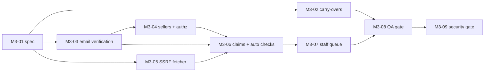
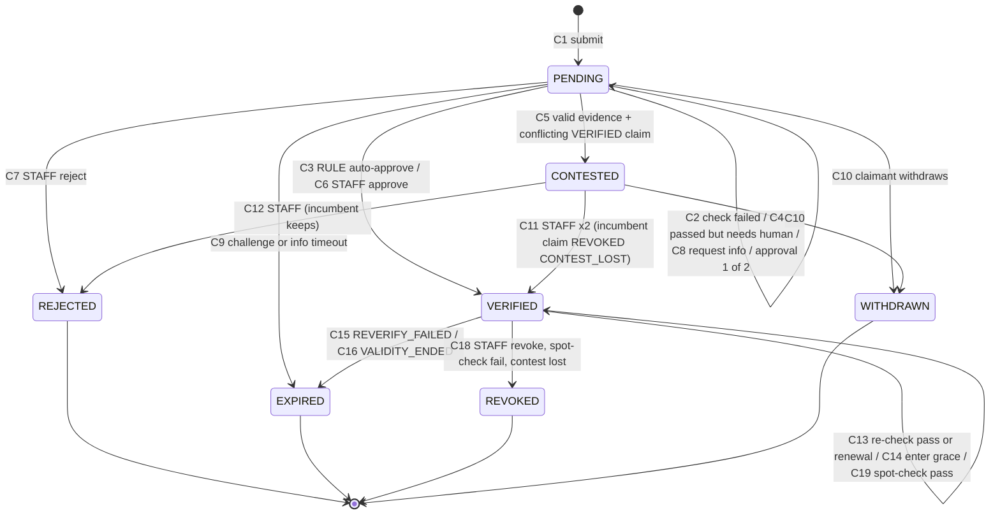

# M3 Spec: Sellers, Ownership Claims, SSRF-Safe Fetcher, Email Verification

| | |
|---|---|
| **Status** | Proposed. Task #44 (M3-01), Project Manager plan #8 (M3a). Becomes binding when merged with CEO approval |
| **Owner** | Software Architect |
| **Implements** | Threats O-1…O-7, P-2 and A-9/SEC-05 ([threat-model.md](../security/threat-model.md), [m2-security-review.md](../security/m2-security-review.md)). Catalogue cases `SEL-*`, `AZ-007`, `AZ-010`, `SEC-007` ([test-case-catalogue.md](../qa/test-case-catalogue.md)) |
| **Decisions** | [ADR-0014](../adr/0014-ownership-claim-verification.md) claims and auto-approval · [ADR-0015](../adr/0015-ssrf-safe-fetcher.md) SSRF-safe fetcher · [ADR-0016](../adr/0016-email-verification-and-generic-registration.md) email verification and generic register · [ADR-0017](../adr/0017-defer-ownership-transfer-and-seller-replies.md) transfer and replies deferred to M3b · [ADR-0018](../adr/0018-kyb-ownership-proof-only.md) KYB = ownership proof only |
| **Supersedes** | The seller section of [schema.draft.prisma](./schema.draft.prisma) (`Seller`, `SellerMember`, `SellerOwnershipClaim`) and the `VerificationToken` use for email verification. Amends [data-model.md §6.3](./data-model.md#63-seller-ownership-proof) and [moderation-pipeline.md §6.3](./moderation-pipeline.md#63-seller-verification-queue-sellerclaimreview) |
| **Open items** | [open-questions.md §4](./open-questions.md#4-m3-sellers-claims-email-verification-task-44) (M3-Q1 … M3-Q16) |

This is a docs-only spec. It contains no application code. Code shapes are given as Prisma or TypeScript signatures so
the implementing tasks share one contract.

---

## 0. Scope, baseline and assumptions

### 0.1 What M3a delivers and what moves to M3b

| In **M3a** (this plan) | Deferred to **M3b** ([ADR-0017](../adr/0017-defer-ownership-transfer-and-seller-replies.md)) |
|---|---|
| Email verification with a mail-provider interface and Mailpit for dev. Generic register response (closes SEC-05) | Ownership transfer and adding a second OWNER (SEL-006) |
| `Seller`, `SellerMember`, `SellerInvitation` (MANAGER/RESPONDER only), public seller page with server-rendered badge | Seller replies (`SellerReply`, reply moderation, `seller.reply` guard, the reply clause of AZ-010, link policy F-5) |
| `SellerOwnershipClaim` with all five methods, state machine, timers, re-verification grace and downgrade | Seller posts (`seller.post`), seller logo, seller trust score and reply rate |
| SSRF-safe fetcher in an isolated `verification-egress` worker group | Seller close, appeal of a claim rejection through `Appeal` (needs the M6 `Appeal` table) |
| Seller-verification staff queue: DOCUMENT / MARKETPLACE review, second reviewer, contest | |
| `EnforcementAction` (promoted from the draft) with `SELLER_SUSPENSION` for AZ-007 | |
| Seller-scope authz guard, cross-seller tests for every M3a seller permission (AZ-010 principle) | |

KYB stays out: verification is ownership proof only ([ADR-0018](../adr/0018-kyb-ownership-proof-only.md), legal L-9).

### 0.2 Code baseline this spec builds on (read at `ad3b7d6`)

| Area | Today | Consequence for M3 |
|---|---|---|
| `packages/db/prisma/schema.prisma` | `User` (has `emailVerifiedAt`), `UserRole`, `Category`, `Product` (no `sellerId`), `Review`, `ReviewRevision`, `OutboxEvent`, `ModerationCase` (review-only), `AuditLog`, `MediaAsset` (`reviewId` **required**, FK `Cascade`) | Seller tables, `Product.sellerId` and a `MediaAsset` parent arc are new migrations (§2.6) |
| `POST /api/auth/register` | Creates the user, returns 201 with the user, or 409 "Email or handle already in use" | Becomes the generic 202 flow (§3.2) |
| Email | No mail sending anywhere. No Mailpit in `docker-compose.yml` | New `MailProvider` (§3.5), Mailpit service added by M3-03 |
| Authz | `requireUser()` / `requireAdmin()` in `apps/web/src/server/session.ts`. No `authorize()`, no 2FA, no step-up | Seller-scope guard added (§4.4). 2FA/step-up interim control: M3-Q1 |
| Queues | `packages/core/src/queues.ts` already names `verification` and `notifications` | Reused. One new queue `verification-egress` (§6.7) |

### 0.3 Assumptions (cheap to reverse)

- **A-1.** Task numbers for the implementing work are assigned by the Project Manager. This spec uses the work-package
  labels in §1 (`M3-02` … `M3-09`). The PM maps them to task ids.
- **A-2.** Phase 1 is pre-launch with no production users, so no data backfill is needed. Seed scripts set
  `emailVerifiedAt` for seeded accounts.
- **A-3.** Enum value names for proof methods follow the task wording (`DNS_TXT`, `META_TAG`, `BUSINESS_EMAIL_DOMAIN`,
  `DOCUMENT`, `MARKETPLACE`). They replace the longer draft names. Nothing in code uses the draft names.
- **A-4.** "ADMIN case" for a contested claim (SEL-005) means the claim enters the seller-verification queue in status
  `CONTESTED`, which only `seller.claim.review` (ADMIN) can decide. It is not a `ModerationCase` row, because the real
  `ModerationCase` is review-only until M6 (M3-Q14).

---

## 1. Work packages and dependencies

| WP | Title | Contents | Migrations owned |
|---|---|---|---|
| **M3-01** | This spec (#44) | Docs, ADR-0014…0018, catalogue mapping, open items | none |
| **M3-02** | M2 security carry-overs | R-1 limiter fail-closed for login/register, SEC-09(c) PII-free audit metadata check, SEC-09(e) moderator tiers, SEC-07 runtime check, gitleaks in CI | none |
| **M3-03** | Email verification + generic register | §3. `EmailVerificationToken`, `MailProvider` (SMTP + fake), Mailpit in compose, worker email jobs, verify/resend endpoints and pages, email-verified gate, unverified-account purge | `…01_email_verification` |
| **M3-04** | Sellers, members, invitations, seller authz, suspension | §2 schema, §4. Seller CRUD, public page and badge, invitations, member management, `authorizeSeller()`, `EnforcementAction` + `SELLER_SUSPENSION` | `…02_sellers`, `…03_enforcement_actions`, `…04_ownership_claims` |
| **M3-05** | SSRF-safe fetcher + `verification-egress` group | §6. Fetcher, DNS TXT lookup, IP policy, corpus tests, egress worker group, network-policy doc for DevOps | none |
| **M3-06** | Claims: submit, automatic verification, state machine, timers | §5.1–§5.8. Domain policy (PSL), challenge, DNS/META/email checks, transitions, conflict → CONTESTED, spot-check sampling, re-verification grace, downgrade, sweepers | none |
| **M3-07** | Seller-verification staff queue | §5.9–§5.11. DOCUMENT evidence upload (private), MARKETPLACE review, second reviewer, contest decision, spot-check, revoke | `…05_media_claim_evidence` |
| **M3-08** | QA gate (M3a) | All M3a P0 cases in §9 green; SEC-007 corpus with zero bypasses | none |
| **M3-09** | Security review gate (M3a) | Review of M3-03…M3-07 against O-1…O-7, P-2, SEC-05 | none |



M3-03 comes before M3-04 because seller creation, claim submission and invitation acceptance require a verified
email, and the invitation and claim emails reuse the mail provider.

---

## 2. Final schema plan

Target file: `packages/db/prisma/schema.prisma`. Conventions follow ADR-0004 and ADR-0010: cuid ids, UTC
`DATETIME(3)`, snake_case plural tables via `@@map`, camelCase columns. Exclusive-arc and CHECK-carrying FKs use
`onDelete: Restrict, onUpdate: Restrict` (MySQL ER 3823).

### 2.1 Enums

```prisma
enum EmailTokenPurpose {
  ACCOUNT_EMAIL        // prove control of User.email
  CLAIM_BUSINESS_EMAIL // prove a mailbox on a claimed domain (method BUSINESS_EMAIL_DOMAIN)
}

enum SellerStatus {     // derived by computeSellerStatus(), §4.2
  UNVERIFIED
  PENDING_VERIFICATION
  VERIFIED
  SUSPENDED             // projection of an active SELLER_SUSPENSION EnforcementAction
  CLOSED                // reserved; no M3a endpoint sets it
}

enum SellerMemberRole {
  OWNER
  MANAGER
  RESPONDER
}

enum OwnershipClaimScope {
  SELLER                // control of the business / brand
  PRODUCT               // an existing product listing, for a VERIFIED seller
}

enum OwnershipProofMethod { // renamed from the draft (A-3)
  DNS_TXT               // was DNS_TXT_RECORD
  META_TAG              // was WEBSITE_META_TAG
  BUSINESS_EMAIL_DOMAIN
  DOCUMENT              // was DOCUMENT_UPLOAD
  MARKETPLACE           // was MARKETPLACE_STORE_LINK
}

enum ClaimStatus {
  PENDING
  VERIFIED
  REJECTED              // terminal
  CONTESTED             // new: valid evidence, conflicts with another seller's VERIFIED claim
  EXPIRED               // terminal
  REVOKED               // terminal
  WITHDRAWN             // new, terminal: claimant cancelled
}

enum ClaimEndReason {
  CHALLENGE_TIMEOUT     // automatic claim not proven within claims.challengeTtlHours
  INFO_TIMEOUT          // staff asked for info, no answer within claims.infoTimeoutDays
  VALIDITY_ENDED        // verifiedUntil + grace passed without renewal
  REVERIFY_FAILED       // periodic DNS/META re-check failed through the whole grace period
  CONTEST_LOST          // another seller won a contest for this domain/product
  SPOT_CHECK_FAILED
  STAFF_REVOKED
}

enum ClaimCheckOutcome {
  PASS
  NOT_FOUND             // no rp-verify record / tag / unconsumed email
  MISMATCH              // record present, value differs
  FETCH_BLOCKED         // fetcher policy refused (SSRF rules, §6)
  FETCH_ERROR           // timeout, TLS, status, size, content type
  DNS_ERROR
}

enum ClaimDecisionSource {
  RULE
  STAFF
}

enum ClaimDecisionOutcome {
  APPROVE
  REJECT
  REQUEST_INFO
  RENEW
  SPOT_CHECK_PASS
  SPOT_CHECK_FAIL
  REVOKE
}

enum EnforcementType {   // promoted unchanged from the draft; M3a issues only SELLER_SUSPENSION
  WARNING
  CONTENT_REMOVAL
  POSTING_RESTRICTION
  VOTING_RESTRICTION
  VERIFIED_LABEL_REVOKED
  SUSPENSION
  BAN
  SELLER_REPLY_RESTRICTION
  SELLER_SUSPENSION
}

enum EnforcementStatus { // promoted unchanged
  ACTIVE
  EXPIRED
  REVOKED
  OVERTURNED
}

enum MediaPurpose {      // subset of the draft enum; later milestones add their values
  REVIEW_MEDIA
  OWNERSHIP_EVIDENCE
}
```

### 2.2 Models

```prisma
/// Single-use email-control token. Only SHA-256(token) is stored, and only after the worker has generated and
/// mailed the raw token (§3.4). Replaces the draft VerificationToken for email purposes (M3-Q9).
model EmailVerificationToken {
  id            String            @id @default(cuid())
  userId        String
  purpose       EmailTokenPurpose
  email         String            @db.VarChar(254) // normalized target address at issue time
  claimId       String?           // CLAIM_BUSINESS_EMAIL only (CHECK chk_evt_claim_purpose)
  tokenHash     String?           @unique @db.Char(64) // hex SHA-256 of a 256-bit token; null until sent
  expiresAt     DateTime
  sentAt        DateTime?
  consumedAt    DateTime?
  invalidatedAt DateTime?         // superseded by a resend, address change or claim end
  createdAt     DateTime          @default(now())

  user  User                  @relation(fields: [userId], references: [id], onDelete: Cascade)
  claim SellerOwnershipClaim? @relation(fields: [claimId], references: [id], onDelete: Restrict, onUpdate: Restrict)

  @@index([userId, purpose, createdAt])
  @@index([claimId])
  @@index([expiresAt]) // purge job
  @@map("email_verification_tokens")
}

model Seller {
  id              String       @id @default(cuid())
  slug            String       @unique @db.VarChar(80)
  name            String       @db.VarChar(120)
  nameSkeleton    String       @db.VarChar(120) // UTS #39 confusable skeleton, casefolded (SEL-010)
  description     String?      @db.Text
  websiteUrl      String?      @db.VarChar(2048) // display only, never fetched (§6.1)
  countryCode     String?      @db.Char(2) // self-declared; no KYB (ADR-0018)
  status          SellerStatus @default(UNVERIFIED)
  verifiedClaimId String?      // the SELLER-scope claim that makes status VERIFIED (SEL-011)
  verifiedDomain  String?      @db.VarChar(253) // A-label copy of that claim's domain; null for DOCUMENT/MARKETPLACE
  verifiedAt      DateTime?
  nameReviewFlag  Boolean      @default(false) // SEL-010: similar to a VERIFIED seller's name
  closedAt        DateTime?
  createdById     String
  createdAt       DateTime     @default(now())
  updatedAt       DateTime     @updatedAt

  createdBy     User                  @relation("SellerCreatedBy", fields: [createdById], references: [id], onDelete: Restrict)
  // Composite FK: the verified claim must belong to this seller (§2.5, M3-Q15 for the fallback).
  verifiedClaim SellerOwnershipClaim? @relation("SellerVerifiedClaim", fields: [verifiedClaimId, id], references: [id, sellerId], onDelete: Restrict, onUpdate: Restrict)

  members            SellerMember[]
  invitations        SellerInvitation[]
  ownershipClaims    SellerOwnershipClaim[] @relation("ClaimSeller")
  products           Product[]
  enforcementActions EnforcementAction[]

  @@unique([verifiedClaimId, id])
  @@index([status])
  @@index([nameSkeleton])
  @@map("sellers")
}

/// Accepted membership only. Pending invitations live in SellerInvitation. ≥ 1 OWNER per seller (service, §4.3).
model SellerMember {
  sellerId     String
  userId       String
  role         SellerMemberRole
  invitationId String?          @unique // provenance; null for the creating OWNER
  createdAt    DateTime         @default(now()) // joined at
  updatedAt    DateTime         @updatedAt

  seller     Seller            @relation(fields: [sellerId], references: [id], onDelete: Cascade)
  user       User              @relation("SellerMembership", fields: [userId], references: [id], onDelete: Cascade)
  invitation SellerInvitation? @relation(fields: [invitationId], references: [id], onDelete: Restrict)

  @@id([sellerId, userId])
  @@index([userId])
  @@index([sellerId, role])
  @@map("seller_members")
}

/// SEL-007: 7-day, single-use, bound to the invitee's verified email. M3a roles: MANAGER, RESPONDER only.
model SellerInvitation {
  id           String           @id @default(cuid())
  sellerId     String
  email        String           @db.VarChar(254) // normalized lowercase
  role         SellerMemberRole // CHECK chk_invitation_role
  tokenHash    String?          @unique @db.Char(64) // set by the worker when mailed (§3.4 pattern)
  invitedById  String
  expiresAt    DateTime         // createdAt + invitations.ttlDays (7)
  sentAt       DateTime?
  acceptedAt   DateTime?
  acceptedById String?
  revokedAt    DateTime?
  revokedById  String?
  createdAt    DateTime         @default(now())

  seller     Seller        @relation(fields: [sellerId], references: [id], onDelete: Restrict)
  invitedBy  User          @relation("InvitationSentBy", fields: [invitedById], references: [id], onDelete: Restrict)
  acceptedBy User?         @relation("InvitationAcceptedBy", fields: [acceptedById], references: [id], onDelete: Restrict, onUpdate: Restrict)
  revokedBy  User?         @relation("InvitationRevokedBy", fields: [revokedById], references: [id], onDelete: Restrict, onUpdate: Restrict)
  member     SellerMember?

  @@index([sellerId, email])
  @@index([expiresAt])
  @@map("seller_invitations")
}

model SellerOwnershipClaim {
  id                   String               @id @default(cuid())
  sellerId             String
  scope                OwnershipClaimScope
  productId            String?              // iff scope = PRODUCT (SEL-012)
  method               OwnershipProofMethod
  status               ClaimStatus          @default(PENDING)
  domain               String?              @db.VarChar(253) // registrable domain, lowercase A-label (§5.2)
  challengeValue       String?              @unique @db.VarChar(64) // 256-bit base64url (43 chars); not a secret
  challengeExpiresAt   DateTime?
  evidenceUrl          String?              @db.VarChar(2048) // MARKETPLACE store URL; staff view only, never fetched in M3a
  requiresHumanReview  Boolean              @default(false)
  humanReviewReason    String?              @db.VarChar(32) // NAME_SIMILARITY | BRAND_CONFLICT | HIGH_VOLUME | MANUAL_METHOD
  requiredApprovals    Int                  @default(1) // 1 or 2 (SEL-004)
  conflictClaimId      String?              // other seller's VERIFIED claim (CONTESTED)
  contestResponseDueAt DateTime?
  infoRequestedAt      DateTime?
  checkAttempts        Int                  @default(0)
  lastCheckAt          DateTime?
  lastCheckOutcome     ClaimCheckOutcome?
  nextCheckAt          DateTime?
  spotCheckRequired    Boolean              @default(false)
  spotCheckedAt        DateTime?
  verifiedAt           DateTime?
  verifiedUntil        DateTime?
  renewalRequestedAt   DateTime?
  reverifyFailingSince DateTime?
  graceEndsAt          DateTime?
  endedAt              DateTime?
  endReason            ClaimEndReason?
  activeKey            String?              @unique @db.VarChar(320) // "<sellerId>|<scope>|<domain|productId|method>" while PENDING/CONTESTED/VERIFIED
  verifiedDomainKey    String?              @unique @db.VarChar(253) // = domain while VERIFIED: one seller per verified domain (SEL-003)
  submittedById        String
  createdAt            DateTime             @default(now())
  updatedAt            DateTime             @updatedAt

  seller        Seller                 @relation("ClaimSeller", fields: [sellerId], references: [id], onDelete: Restrict, onUpdate: Restrict)
  product       Product?               @relation(fields: [productId], references: [id], onDelete: Restrict, onUpdate: Restrict)
  submittedBy   User                   @relation("ClaimSubmittedBy", fields: [submittedById], references: [id], onDelete: Restrict)
  conflictClaim SellerOwnershipClaim?  @relation("ClaimConflict", fields: [conflictClaimId], references: [id], onDelete: Restrict, onUpdate: Restrict)
  conflictedBy  SellerOwnershipClaim[] @relation("ClaimConflict")
  verifiedFor   Seller?                @relation("SellerVerifiedClaim")

  decisions   SellerClaimDecision[]
  emailTokens EmailVerificationToken[]
  evidence    MediaAsset[]

  @@unique([id, sellerId]) // target of Seller.verifiedClaim composite FK
  @@index([status, createdAt])
  @@index([sellerId, status])
  @@index([status, nextCheckAt]) // due-check sweeper
  @@index([status, graceEndsAt])
  @@index([status, verifiedUntil])
  @@index([domain])
  @@index([productId])
  @@map("seller_ownership_claims")
}

/// Append-only decision log for a claim (replaces draft reviewedById/reviewedAt/decisionNote).
model SellerClaimDecision {
  id         String               @id @default(cuid())
  claimId    String
  source     ClaimDecisionSource
  reviewerId String?              // null iff source = RULE
  outcome    ClaimDecisionOutcome
  reasonCode String?              @db.VarChar(64)
  note       String?              @db.Text // staff-internal; never shown to the seller
  createdAt  DateTime             @default(now()) @db.DateTime(3)

  claim    SellerOwnershipClaim @relation(fields: [claimId], references: [id], onDelete: Restrict, onUpdate: Restrict)
  reviewer User?                @relation("ClaimDecisionReviewer", fields: [reviewerId], references: [id], onDelete: Restrict, onUpdate: Restrict)

  @@index([claimId, createdAt])
  @@index([reviewerId, createdAt])
  @@map("seller_claim_decisions")
}

/// Promoted from the draft. `caseId` points at the real (review-only) ModerationCase. `appeals` relation waits for M6.
model EnforcementAction {
  id                 String            @id @default(cuid())
  type               EnforcementType
  status             EnforcementStatus @default(ACTIVE)
  subjectUserId      String?
  subjectSellerId    String?
  caseId             String?
  reasonCode         String            @db.VarChar(64)
  publicReason       String            @db.Text
  publicReasonLocale String            @default("en") @db.VarChar(16)
  internalNote       String?           @db.Text
  issuedById         String?
  startsAt           DateTime          @default(now())
  endsAt             DateTime?
  revokedById        String?
  revokedAt          DateTime?
  createdAt          DateTime          @default(now())
  updatedAt          DateTime          @updatedAt

  subjectUser    User?           @relation("EnforcementSubjectUser", fields: [subjectUserId], references: [id], onDelete: Restrict, onUpdate: Restrict)
  subjectSeller  Seller?         @relation(fields: [subjectSellerId], references: [id], onDelete: Restrict, onUpdate: Restrict)
  moderationCase ModerationCase? @relation(fields: [caseId], references: [id], onDelete: SetNull)
  issuedBy       User?           @relation("EnforcementIssuedBy", fields: [issuedById], references: [id], onDelete: SetNull)
  revokedBy      User?           @relation("EnforcementRevokedBy", fields: [revokedById], references: [id], onDelete: SetNull)

  @@index([subjectUserId, status])
  @@index([subjectSellerId, status])
  @@index([status, endsAt])
  @@map("enforcement_actions")
}
```

Deltas on existing models:

```prisma
model Product {
  // … existing fields unchanged …
  sellerId String? // owning seller, set by a VERIFIED PRODUCT claim; null = unclaimed
  seller          Seller?                @relation(fields: [sellerId], references: [id], onDelete: SetNull)
  ownershipClaims SellerOwnershipClaim[]
  @@index([sellerId])
}

model MediaAsset {
  // … existing fields unchanged, except: …
  purpose          MediaPurpose @default(REVIEW_MEDIA)
  reviewId         String?      // was required; FK changes Cascade → Restrict (CHECK below)
  ownershipClaimId String?
  review         Review?               @relation(fields: [reviewId], references: [id], onDelete: Restrict, onUpdate: Restrict)
  ownershipClaim SellerOwnershipClaim? @relation(fields: [ownershipClaimId], references: [id], onDelete: Restrict, onUpdate: Restrict)
  @@index([ownershipClaimId])
}

model User {
  // … existing fields unchanged; new back-relations only …
  emailVerificationTokens EmailVerificationToken[]
  sellerMemberships       SellerMember[]          @relation("SellerMembership")
  sellersCreated          Seller[]                @relation("SellerCreatedBy")
  invitationsSent         SellerInvitation[]      @relation("InvitationSentBy")
  invitationsAccepted     SellerInvitation[]      @relation("InvitationAcceptedBy")
  invitationsRevoked      SellerInvitation[]      @relation("InvitationRevokedBy")
  ownershipClaims         SellerOwnershipClaim[]  @relation("ClaimSubmittedBy")
  claimDecisions          SellerClaimDecision[]   @relation("ClaimDecisionReviewer")
  enforcementsReceived    EnforcementAction[]     @relation("EnforcementSubjectUser")
  enforcementsIssued      EnforcementAction[]     @relation("EnforcementIssuedBy")
  enforcementsRevoked     EnforcementAction[]     @relation("EnforcementRevokedBy")
}
// ModerationCase gains `enforcementActions EnforcementAction[]`; Review gains nothing new (media back-relation stays).
```

### 2.3 Field changes against the draft

| Draft field | Final | Why |
|---|---|---|
| `Seller.businessEmailDomain` | Dropped | The domain lives on the claim. The verified one is copied to `Seller.verifiedDomain` |
| `Seller.logoMediaId`, `trustScore`, `replyRate` | Deferred (M3b / M5 / M7) | Need the media purpose `SELLER_LOGO`, the trust design and replies. Additive later (M3-Q12) |
| `Seller.nameSkeleton`, `verifiedClaimId`, `verifiedDomain`, `nameReviewFlag`, `closedAt` | New | SEL-010, SEL-011, SEL-009, CLOSED consistency |
| `SellerMember.invitedById`, `acceptedAt` | Dropped | Invitations are their own table. A member row exists only once accepted |
| `SellerMember.invitationId` | New | Provenance |
| `SellerOwnershipClaim.reviewedById`, `reviewedAt`, `decisionNote` | Moved to `SellerClaimDecision` | Second reviewer needs more than one decision; append-only audit |
| `SellerOwnershipClaim.domain`, `challengeExpiresAt`, `requiresHumanReview`, `humanReviewReason`, `requiredApprovals`, `conflictClaimId`, `contestResponseDueAt`, `infoRequestedAt`, check fields, spot-check fields, `verifiedAt`, `renewalRequestedAt`, `reverifyFailingSince`, `graceEndsAt`, `endedAt`, `endReason`, `activeKey`, `verifiedDomainKey` | New | §5 |
| `SellerOwnershipClaim.sellerId` FK | `Cascade` → `Restrict` | Sellers are never hard-deleted, and `sellers` → `claims` is now circular |
| `VerificationToken` (purpose `EMAIL_VERIFICATION`) | Replaced by `EmailVerificationToken` | Task requirement. `PASSWORD_RESET` / `EMAIL_CHANGE` are not built (M3-Q9) |

### 2.4 CHECK constraints

Appended by hand to each migration's `migration.sql` (as in `20261121000000_init`) and mirrored in
[check-constraints.sql](./check-constraints.sql) under "M3". None uses a column that carries a `CASCADE`/`SET NULL` FK.

| Name | Table | Expression | Case |
|---|---|---|---|
| `chk_claim_product_scope` | `seller_ownership_claims` | `(scope = 'PRODUCT') = (productId IS NOT NULL)` | **SEL-012** |
| `chk_claim_product_method` | `seller_ownership_claims` | `scope <> 'PRODUCT' OR method IN ('DOCUMENT','MARKETPLACE')` | SEL-015 |
| `chk_claim_domain_method` | `seller_ownership_claims` | `method NOT IN ('DNS_TXT','META_TAG','BUSINESS_EMAIL_DOMAIN') OR domain IS NOT NULL` | SEL-001 |
| `chk_claim_challenge` | `seller_ownership_claims` | `method NOT IN ('DNS_TXT','META_TAG','MARKETPLACE') OR (challengeValue IS NOT NULL AND challengeExpiresAt IS NOT NULL)` | SEL-001 |
| `chk_claim_marketplace_url` | `seller_ownership_claims` | `method <> 'MARKETPLACE' OR evidenceUrl IS NOT NULL` | SEL-004 |
| `chk_claim_approvals` | `seller_ownership_claims` | `requiredApprovals BETWEEN 1 AND 2` | SEL-004 |
| `chk_claim_verified_fields` | `seller_ownership_claims` | `status <> 'VERIFIED' OR (verifiedAt IS NOT NULL AND verifiedUntil IS NOT NULL AND verifiedUntil > verifiedAt)` | SEL-011 |
| `chk_claim_ended` | `seller_ownership_claims` | `(status IN ('REJECTED','EXPIRED','REVOKED','WITHDRAWN')) = (endedAt IS NOT NULL)` | SEL-014 |
| `chk_claim_end_reason` | `seller_ownership_claims` | `(status IN ('EXPIRED','REVOKED')) = (endReason IS NOT NULL)` | SEL-014 |
| `chk_claim_grace` | `seller_ownership_claims` | `(graceEndsAt IS NULL) = (reverifyFailingSince IS NULL) AND (graceEndsAt IS NULL OR status = 'VERIFIED')` | SEL-008 |
| `chk_claim_contested` | `seller_ownership_claims` | `status <> 'CONTESTED' OR (conflictClaimId IS NOT NULL AND contestResponseDueAt IS NOT NULL AND requiredApprovals = 2)` | SEL-005 |
| `chk_claim_active_key` | `seller_ownership_claims` | `(status IN ('PENDING','CONTESTED','VERIFIED')) = (activeKey IS NOT NULL)` | SEL-014 |
| `chk_claim_verified_domain_key` | `seller_ownership_claims` | `verifiedDomainKey IS NULL OR (status = 'VERIFIED' AND verifiedDomainKey = domain)` | **SEL-003** |
| `chk_claim_decision_source` | `seller_claim_decisions` | `(source = 'RULE') = (reviewerId IS NULL)` | SEL-018 |
| `chk_seller_verified_claim` | `sellers` | `status <> 'VERIFIED' OR (verifiedClaimId IS NOT NULL AND verifiedAt IS NOT NULL)` | **SEL-011** |
| `chk_seller_verified_pair` | `sellers` | `(verifiedClaimId IS NULL) = (verifiedAt IS NULL) AND (verifiedDomain IS NULL OR verifiedClaimId IS NOT NULL)` | SEL-009 |
| `chk_seller_closed` | `sellers` | `(status = 'CLOSED') = (closedAt IS NOT NULL)` | — |
| `chk_invitation_role` | `seller_invitations` | `role IN ('MANAGER','RESPONDER')` | SEL-017 |
| `chk_invitation_accepted` | `seller_invitations` | `(acceptedAt IS NULL) = (acceptedById IS NULL) AND (acceptedAt IS NULL OR tokenHash IS NOT NULL)` | SEL-007 |
| `chk_invitation_single_end` | `seller_invitations` | `NOT (acceptedAt IS NOT NULL AND revokedAt IS NOT NULL)` | SEL-007 |
| `chk_invitation_sent` | `seller_invitations` | `sentAt IS NULL OR tokenHash IS NOT NULL` | AUT-017 |
| `chk_evt_claim_purpose` | `email_verification_tokens` | `(purpose = 'CLAIM_BUSINESS_EMAIL') = (claimId IS NOT NULL)` | AUT-015 |
| `chk_evt_sent` | `email_verification_tokens` | `(sentAt IS NULL OR tokenHash IS NOT NULL) AND (consumedAt IS NULL OR tokenHash IS NOT NULL)` | AUT-017 |
| `chk_evt_single_end` | `email_verification_tokens` | `NOT (consumedAt IS NOT NULL AND invalidatedAt IS NOT NULL)` | AUT-015 |
| `chk_enforcement_one_subject` | `enforcement_actions` | `(subjectUserId IS NOT NULL) + (subjectSellerId IS NOT NULL) = 1` | AZ-007 |
| `chk_media_parent_by_purpose` | `media_assets` | `((purpose = 'REVIEW_MEDIA') = (reviewId IS NOT NULL)) AND ((purpose = 'OWNERSHIP_EVIDENCE') = (ownershipClaimId IS NOT NULL))` | SEL-019 |

### 2.5 Invariants the database cannot express (service + test + sweeper)

| Invariant | Where enforced | Backstop |
|---|---|---|
| **SEL-011** `Seller.verifiedClaimId` points at a claim with `scope = SELLER` and `status = VERIFIED` of the **same** seller | Same seller: composite FK `(verifiedClaimId, id) → claims(id, sellerId)`. Scope and status: `applyClaimTransition()` calls `recomputeSeller()` in the same transaction (§4.2) | Daily `maintenance.seller-consistency` sweeper: any violation → log at error, alert, recompute |
| ≥ 1 OWNER per seller | `SellerMemberService` under `SELECT … FOR UPDATE` on the seller row | Sweeper reports sellers with 0 OWNERs |
| One open invitation per (seller, email) | Creating an invitation revokes older open ones in the same transaction | — |
| `Product.sellerId` = the seller of the product's VERIFIED PRODUCT claim, or null | Claim transitions | Consistency sweeper |
| Lock order: seller rows by ascending id, then claims, then products | All claim/member services | Deadlock retry (3×) |

The complete M3 model set in §2.1–§2.2, merged into the current `packages/db` schema, passes `prisma validate`
(Prisma 6.19.3) during M3-01, composite relation included. If MySQL rejects the generated FK (M3-Q15), the fallback is a plain `verifiedClaimId` FK
(`Restrict`) plus the same service rule and sweeper. The CHECKs above do not change.

### 2.6 Migration order

Each migration is created with `prisma migrate dev --create-only`, then the CHECKs are appended. Migrations are
additive except step 5. There are no down-migrations (Prisma). Roll back by a forward fix.

| # | Name | WP | Contents | Notes |
|---|---|---|---|---|
| 1 | `20261201000000_email_verification` | M3-03 | enum `EmailTokenPurpose` (both values), table `email_verification_tokens` **without** `claimId`. CHECKs `chk_evt_sent`, `chk_evt_single_end` | `claimId` cannot reference claims yet |
| 2 | `20261202000000_sellers` | M3-04 | enums `SellerStatus`, `SellerMemberRole`; tables `sellers` (without `verifiedClaimId` FK), `seller_members`, `seller_invitations`; `products.sellerId` + FK + index. CHECKs `chk_seller_closed`, `chk_invitation_*` | `verifiedClaimId`, `verifiedAt`, `verifiedDomain` columns created nullable here |
| 3 | `20261203000000_enforcement_actions` | M3-04 | enums `EnforcementType`, `EnforcementStatus`; table `enforcement_actions`. CHECK `chk_enforcement_one_subject` | Needed for AZ-007 |
| 4 | `20261204000000_ownership_claims` | M3-04 | claim enums; tables `seller_ownership_claims`, `seller_claim_decisions`; unique `(id, sellerId)`; FK `sellers(verifiedClaimId, id)`; `email_verification_tokens.claimId` + FK. CHECKs `chk_claim_*`, `chk_claim_decision_source`, `chk_seller_verified_claim`, `chk_seller_verified_pair`, `chk_evt_claim_purpose` | Circular FK: insert seller → claim → update seller |
| 5 | `20261205000000_media_claim_evidence` | M3-07 | enum `MediaPurpose`; `media_assets.purpose` (default `REVIEW_MEDIA`, so existing rows are valid); `reviewId` nullable; drop FK `media_assets_reviewId_fkey` (Cascade), re-add as Restrict; `ownershipClaimId` + FK + index. CHECK `chk_media_parent_by_purpose` | **Only non-additive step.** Test fixtures that hard-delete reviews must delete media first |

Timestamps are placeholders after the latest existing migration (`20261123000000_media`). Implementers keep the
order and may change the timestamps.

---

## 3. Email verification and generic registration (M3-03)

Decision: [ADR-0016](../adr/0016-email-verification-and-generic-registration.md).

### 3.1 Rules

- Signing in with an unverified email is allowed. These actions need `User.emailVerifiedAt`:
  `review.create`, review media upload, `seller.create`, `seller.claim.submit`, invitation accept. The denial reason
  is `EMAIL_NOT_VERIFIED` (new `AuthzDenied` reason).
- Authz reads `emailVerifiedAt` from the database for each request (ADR-0003 "ActorContext per request"), not from the
  JWT. A user who verifies in another tab is unblocked on the next request.
- Tokens: 32 random bytes (256 bit) from `crypto.randomBytes`, base64url. Only the SHA-256 hex digest is stored.
  `ACCOUNT_EMAIL` and `CLAIM_BUSINESS_EMAIL` expire after 24 h. Single use. A token is valid only while
  `token.email` still equals the current target (`User.email`, or the claim's address).
- A resend invalidates every open token of the same (user, purpose[, claim]). Limits: 3 per hour and 10 per day per user.

### 3.2 `POST /api/auth/register` (closes SEC-05)

```
1. limitRegister(req)                       // unchanged: before hashing (SEC-03)
2. input = registerInput.parse(body)        // 400 on schema errors. These do not depend on stored data
3. handle taken?            → 409 handle_taken   // handles are public (profile URLs), so this is not an email oracle
4. hash = hashPassword(input.password)      // ALWAYS, on every path below
5. in one transaction:
     email unknown → insert User(emailVerifiedAt = null), EmailVerificationToken(ACCOUNT_EMAIL, tokenHash = null),
                     OutboxEvent user.email_verification_requested {tokenId}
     email known   → no change to the account; OutboxEvent user.registration_conflict {userId}
                     (worker sends at most one "account exists" email per hour)
6. 202 {"status":"verification_sent"}       // identical status, body and headers on both paths. No session is created
```

- A race on the email unique index (P2002 on `email`) maps to the "email known" path, not to an error.
- The "account exists" email says someone tried to register with this address. It links to sign-in, and to password
  reset once that exists (M3-Q9). It contains no token.
- `AuthForm` stops calling `signIn` after registering and shows "Check your inbox". The user signs in normally.
- Timing: both paths do one argon2 hash and one small write transaction. Mail is sent by the worker, so SMTP latency
  never reaches the response. AUT-014 asserts the same tolerance as AUT-001.

### 3.3 Verify and resend

| Route | Auth | Behaviour |
|---|---|---|
| `GET /verify-email?token=…` (page) | none | Renders a "Confirm email" button. **No state change on GET**, so mail-scanner prefetch cannot consume the token |
| `POST /api/auth/verify-email` `{token}` | none (Origin check applies) | Look up `sha256(token)`. Must be `ACCOUNT_EMAIL`, sent, not consumed or invalidated, not expired, and `email = User.email`. Then set `User.emailVerifiedAt`, `consumedAt`, invalidate the user's other open tokens, audit `user.email_verified`. 200 `{status:"verified"}`. **Every** failure gives the same 400 `invalid_or_expired`. Rate limited per IP. Does not sign the user in |
| `POST /api/auth/verify-email/resend` | signed-in, unverified | 202 always. Limits from §3.1 |
| `POST /api/claims/:id/email/confirm` `{token}` | signed-in **as `claim.submittedById`** | Same checks with purpose `CLAIM_BUSINESS_EMAIL`. Bound to the session user (O-2). On success → claim check `PASS` (§5.4) |

### 3.4 Token issuance without raw tokens at rest (worker-side generation)

The outbox carries ids only (ADR-0007 §4) and the database stores only hashes, so the **worker** creates the raw
token as it sends the email:

```
job notifications.email_token  key emailtoken__<tokenId>     (same pattern for invitations: invite__<invitationId>)
  row = load token; if row.sentAt or row.consumedAt or row.invalidatedAt → done (idempotent)
  raw = randomBytes(32).base64url
  UPDATE tokenHash = sha256(raw) WHERE id = row.id AND sentAt IS NULL      -- commit
  provider.send({ template, to: row.email, vars: { url: `${APP_URL}/verify-email?token=${raw}` },
                  idempotencyKey: jobId })
  UPDATE sentAt = now()
```

A crash between commit and send means the retry rotates the hash, so only the last mailed link works. The raw token
exists only in worker memory and in the email. It is never logged, put in a queue payload or stored (AUT-017).

### 3.5 Mail provider

```ts
// packages/core/src/mail.ts
export type MailTemplateId =
  | "verify_account" | "account_exists" | "claim_business_email" | "seller_invitation"
  | "claim_contested" | "claim_decided" | "claim_reverify_failing" | "seller_downgraded";

export interface RenderedMail { to: string; subject: string; text: string; html: string; }
export interface MailProvider {
  /** Must be idempotent on idempotencyKey where the provider supports it. Throws MailTransientError to retry. */
  send(mail: RenderedMail, opts: { idempotencyKey: string }): Promise<{ providerMessageId: string }>;
}
export function renderMail(template: MailTemplateId, locale: string, vars: Record<string, string>): RenderedMail;
```

| Implementation | Used by | Config |
|---|---|---|
| `SmtpMailProvider` (nodemailer) | dev via **Mailpit**, prod via an SMTP relay until T-2 is chosen | `MAIL_PROVIDER=smtp`, `SMTP_URL` (secret in prod; `smtp://localhost:1025` in dev), `MAIL_FROM`. Prod requires STARTTLS |
| `FakeMailProvider` | unit and integration tests | `MAIL_PROVIDER=fake`. Keeps sent mail in memory for assertions |

- **Only the worker sends mail.** The web app has no SMTP credentials.
- There is no console provider, because it would print tokens to logs. Startup fails if `NODE_ENV=production` and
  `MAIL_PROVIDER=fake`.
- Templates use ICU message keys (ADR-0009). English only. The link base URL comes from `APP_URL`, never from the
  request `Host`, which blocks host-header poisoning of links.
- Logs record the template id, `providerMessageId` and a keyed hash of the recipient. They never record the address,
  the token or the URL.
- **Mailpit (dev):** M3-03 adds a pinned `axllent/mailpit` service to `docker-compose.yml` (SMTP `1025`, UI/API
  `8025`). E2E tests read links through `GET http://localhost:8025/api/v1/search?query=to:<addr>`.

### 3.6 Unverified accounts

`maintenance.unverified-users-purge` (daily) hard-deletes users with `emailVerifiedAt IS NULL`, `createdAt` older than
`users.unverifiedPurgeDays` (7), and no reviews, media, memberships or claims. They cannot hold content (§3.1), so
nothing is lost. This frees an address squatted by someone who does not control the mailbox (A-2). This is an
exception to "users are never hard-deleted": M3-Q9.

---

## 4. Sellers, members, invitations and seller authz (M3-04)

### 4.1 Seller creation and the public page

- `POST /api/sellers` `{name, slug?, description?, websiteUrl?, countryCode?}` needs `seller.create` (verified email).
  It creates `Seller(status = UNVERIFIED)` and `SellerMember(role = OWNER)` in one transaction and audits
  `seller.created`. Limit: 3 sellers per user per day.
- `nameSkeleton` = UTS #39 skeleton of NFKC-casefolded `name`, with whitespace and punctuation removed. If it equals
  the skeleton of any VERIFIED seller, or is within Damerau-Levenshtein 1 of one (checked against candidates sharing
  the first 3 skeleton characters), then `nameReviewFlag = true`. Any claim of this seller then needs human review
  (**SEL-010**, P1).
- `websiteUrl` is stored for display only and rendered as plain text with `rel="nofollow ugc noopener"`. The fetcher
  never uses it (§6.1).
- **SEL-009.** The public page `/sellers/[slug]` and every seller DTO render the badge only when
  `Seller.status = 'VERIFIED'` is read on the server in that request. The DTO has no client-settable badge field. The
  page shows "Verified: `<verifiedDomain>`" as the **A-label** (punycode, e.g. `xn--exmple-cua.com`), so a homograph
  looks different from the real domain. DOCUMENT/MARKETPLACE verifications show "Verified owner" without a domain.

### 4.2 Seller status is derived

```ts
// packages/core/src/sellers/status.ts. Called inside every transaction that changes its inputs.
function computeSellerStatus(s): SellerStatus {
  if (s.closedAt) return "CLOSED";
  if (activeEnforcement(s, "SELLER_SUSPENSION")) return "SUSPENDED";
  if (verifiedSellerScopeClaim(s)) return "VERIFIED";         // earliest verifiedAt wins → verifiedClaimId
  if (openSellerScopeClaim(s))  return "PENDING_VERIFICATION"; // PENDING or CONTESTED
  return "UNVERIFIED";
}
```

`recomputeSeller()` writes `status`, and also `verifiedClaimId`, `verifiedAt` and `verifiedDomain` (taken from the
chosen claim, or null when none is VERIFIED). These stay set while SUSPENDED, so lifting the suspension restores the
badge without a new claim. A transition from VERIFIED to anything else is a **downgrade**. It emits
`seller.downgraded` (email to OWNERs and MANAGERs) and audits `seller.status_changed`.

### 4.3 Members and invitations (SEL-007)

| Action | Who | Rules |
|---|---|---|
| Invite | OWNER (MANAGER or RESPONDER); MANAGER (RESPONDER only) | Email normalized. Role must be MANAGER or RESPONDER (`chk_invitation_role`): **no invitation grants OWNER in M3a** (ADR-0017). Revokes any older open invitation for the same email. Limits: 20 open invitations per seller, 10 per day. Outbox `seller.invitation_created` → worker mails the token (§3.4). The response does not reveal whether the email has an account |
| Accept `POST /api/invitations/accept` `{token}` | signed-in user | One atomic `UPDATE … SET acceptedAt, acceptedById WHERE tokenHash = ? AND acceptedAt IS NULL AND revokedAt IS NULL AND expiresAt > now()`. It must affect exactly one row, then the member row is inserted in the same transaction. Requires `user.emailVerifiedAt` **and** `user.email = invitation.email`. Every failure gives the same 400 `invalid_or_expired`. Already a member → 409 `already_member` (only after the token is proven valid) |
| Revoke invitation | OWNER; MANAGER for RESPONDER invitations they sent | Sets `revokedAt` |
| Change role | OWNER | Only between MANAGER and RESPONDER in M3a. Interim step-up (M3-Q1) |
| Remove member / leave | OWNER removes anyone except the last OWNER. Any member may leave, except the last OWNER | `≥ 1 OWNER` under `FOR UPDATE`. Removal deletes the row; history is in `AuditLog` |

Invitation expiry is checked by time on every read, so no sweeper is needed. `maintenance.tokens-purge` deletes
invitations 7 days after `expiresAt` once they are no longer pending.

### 4.4 Seller-scope authorization (AZ-007, AZ-010)

```ts
// packages/core/src/authz/seller.ts
type SellerPermission =
  | "seller.profile.update" | "seller.member.invite" | "seller.member.manage"
  | "seller.claim.submit" | "seller.claim.review" | "product.update";
function authorizeSeller(ctx: ActorContext, perm: SellerPermission, resource: { sellerId: string }): Allow | Denied;
```

- **The scope comes from the resource, loaded on the server.** Seller routes take `:sellerId` from the path, because
  it identifies the resource. Claim routes load `claim.sellerId`, invitation routes load `invitation.sellerId`, and
  product routes load `product.sellerId`. Any `sellerId` in a request body is ignored for authorization and rejected
  by the zod schemas (`.strict()`).
- Guard order follows ADR-0003 §3: session → account state (`BANNED`/`DELETED`/`SUSPENDED`, then active
  `SELLER_SUSPENSION` for **this** seller removes every seller-scoped permission of **every** member, **AZ-007**) →
  2FA gate (interim, M3-Q1) → role in **this** seller (**AZ-010**) → conditions (MANAGER invites RESPONDER only, last
  OWNER) → COI (`seller.claim.review` is denied to members of the claiming seller **and** of the conflicting seller).
- Suspension: `POST /api/admin/sellers/:id/suspend` `{reasonCode, publicReason, endsAt?}` creates
  `EnforcementAction(type = SELLER_SUSPENSION, subjectSellerId)`, recomputes the seller and audits
  `enforcement.issued`. Lift: `…/unsuspend` sets `status = REVOKED`. `maintenance.enforcement-expire` (every 5 min)
  expires actions whose `endsAt` has passed and recomputes the seller.
- AZ-010 in M3a: the table-driven suite runs every permission above with actor = member of seller A and resource =
  seller B, for each role, and expects `NOT_IN_SCOPE`. The reply clause ("RESPONDER cannot reply on B's product") runs
  in M3b (ADR-0017).

### 4.5 Interim 2FA and step-up (until TOTP ships)

> **Superseded by [m3b-spec.md §2.9](./m3b-spec.md#29-authorization-gates-adr-0003-guard-3-az-008)** (task #54). The interim control below was never implemented.

ADR-0003 guard 3 needs 2FA for seller OWNER/MANAGER permissions, but no 2FA exists yet (SEC-09(d), target M8).
M3a interim control: OWNER and MANAGER actions (`seller.member.invite`, `seller.member.manage`,
`seller.claim.submit`, claim withdraw) require a **recent password sign-in** (`authTime` in the session ≤ 10 minutes,
otherwise 401 `STEP_UP_REQUIRED` and re-enter the password). The guard sits behind
`authz.sellerTwoFactorGate` (off in M3a). It switches to full 2FA when TOTP lands. This is a **launch blocker**
recorded as M3-Q1.

### 4.6 Ownership transfer (design for M3b, not built in M3a)

> **Superseded by [m3b-spec.md §3](./m3b-spec.md#3-ownership-changes-sel-006-o-6-adr-0020) and [ADR-0020](../adr/0020-seller-ownership-changes.md)** (task #54).

Recorded so M3b starts from an agreed design (SEL-006, O-6): OWNER A starts a transfer to an existing member B. It
needs **2FA step-up by A at start and by B at accept**. The state is `PENDING` for 72 h. All OWNERs get an email with a
single-use cancel link (any OWNER can cancel, and A can cancel). After 72 h, B accepts and becomes OWNER. A stays OWNER
unless the transfer is marked "and leave". Everything is audited. Needs a `SellerOwnershipTransfer` table (M3b).

---

## 5. Ownership claims (M3-06, M3-07)

Decision: [ADR-0014](../adr/0014-ownership-claim-verification.md).

### 5.1 Submission

`POST /api/sellers/:sellerId/claims` `{scope, method, domain?, productId?, evidenceUrl?, businessEmail?}` needs
`seller.claim.submit` (OWNER/MANAGER, verified email, interim step-up).

1. The seller is not `CLOSED` or `SUSPENDED`. At most `claims.maxActivePerSeller` (3) open claims. Limit 5 submissions
   per seller per day.
2. `scope = PRODUCT` needs the seller to be `VERIFIED`, the product to exist with status `ACTIVE`, and method
   `DOCUMENT` or `MARKETPLACE` (`chk_claim_product_method`).
3. A domain-bearing method runs the domain policy (§5.2) on `domain`, or for `BUSINESS_EMAIL_DOMAIN` on the domain
   part of `businessEmail`, which must also be under the claimed domain.
4. `activeKey` = `sellerId|scope|<domain or productId or method>`. A duplicate gives 409 `claim_exists`.
5. Conflict scan: another seller's `VERIFIED` claim with the same `domain` or `productId` (or a product whose
   `sellerId` is another seller), or a VERIFIED seller with the same `nameSkeleton`, sets `requiresHumanReview` and
   `requiredApprovals = 2` and stores `conflictClaimId` when it is a domain or product conflict. **Submission is not
   refused**, because the domain may have changed hands (O-4 in reverse). The conflict is resolved by contest (§5.7).
6. Effects: `challengeValue` + `challengeExpiresAt = now + 72 h` (DNS/META/MARKETPLACE), `nextCheckAt = now`
   (automatic methods). For BUSINESS_EMAIL an `EmailVerificationToken(CLAIM_BUSINESS_EMAIL)` is created. Then
   `recomputeSeller()`, audit `claim.submitted`, outbox `claim.submitted`.

### 5.2 Domain policy (SEL-002, O-2, O-3)

`assertOwnableDomain(input)`, used for every domain-bearing method and for the business email domain:

1. Lowercase, strip one trailing dot, convert IDN to an A-label (`domainToASCII`). Reject an empty result, IP literals
   (v4 in any notation, including decimal/octal/hex, and v6), single-label names, and labels or names longer than
   63/253 characters.
2. Parse with `tldts` using `allowPrivateDomains: true` and a PSL snapshot pinned in the repo, refreshed monthly by
   Dependabot. The input must **equal** its registrable domain, and the matched suffix must be in the **ICANN**
   section. A name under a private suffix (`*.github.io`, `*.myshopify.com`, `*.wixsite.com`, `*.netlify.app`,
   `*.vercel.app`, `*.pages.dev`, `*.blogspot.com`, …) is refused: those sellers use `MARKETPLACE`.
3. Refuse if the domain is in `denylist/shared-hosts.txt` (hosting and site-builder domains missing from the PSL
   private section) or, for `BUSINESS_EMAIL_DOMAIN`, in `denylist/free-mail.txt` (a pinned public list plus local
   additions: `gmail.com`, `googlemail.com`, `outlook.com`, `hotmail.*`, `live.com`, `yahoo.*`, `icloud.com`,
   `me.com`, `proton.me`, `protonmail.com`, `gmx.*`, `aol.com`, `yandex.*`, `mail.ru`, …).
4. `BUSINESS_EMAIL_DOMAIN` also needs at least one MX record (lookup through the egress resolver, §6.7).

The error is `domain_not_allowed` with a sub-reason (`shared_host`, `free_mail`, `not_registrable`, `no_mx`) shown to
the claimant.

### 5.3 Challenge (SEL-001)

- `challengeValue` = 32 random bytes, base64url (43 chars, 256 bit ≥ the 128-bit minimum), unique across all claims.
- It is **bound to one claim**, and through it to one seller and one claimant. A check compares only against the
  claim's own value, so a token placed by claim X never satisfies claim Y. This holds even on the same domain and
  even after X ends: a new claim always gets a new value.
- It expires at `challengeExpiresAt` (72 h). An expired challenge cannot pass, and the claim goes to
  `EXPIRED(CHALLENGE_TIMEOUT)`.
- Publication formats:
  - DNS: TXT record at `_rp-verify.<domain>` with value `rp-verify=<challengeValue>` (an underscore label, so the apex
    TXT set stays clean). This amends data-model §6.3, which said the apex.
  - META: `<meta name="rp-verify" content="<challengeValue>">` in the `<head>` of `https://<domain>/` or
    `https://www.<domain>/`.
  - MARKETPLACE: the literal `rp-verify=<challengeValue>` in the store description. A human checks it.

### 5.4 Methods and who decides (threat O-1)

| Method | Scope | Check | Decided by | Forced to human review when | Spot-check sample | Validity and re-check |
|---|---|---|---|---|---|---|
| `DNS_TXT` | SELLER | Worker TXT lookup via the egress resolver (§6.7). Pass = exactly one TXT string equal to `rp-verify=<value>` (strings concatenated per RFC 7208 §3.3, at most 20 records read) | **RULE (auto-approve)** | Name similarity, brand conflict (→ CONTESTED), seller has `nameReviewFlag` | 10 % | `verifiedUntil = now + 12 mo`, rolling. Monthly re-check, grace 14 d |
| `META_TAG` | SELLER | SSRF-safe fetch (§6) of `https://<domain>/`, then `https://www.<domain>/`. The final URL must be https and inside `<domain>`. Parsed with an HTML parser (not regex). Pass = a `meta[name=rp-verify]` (case-insensitive name) with content equal to the value | **RULE (auto-approve)** | Same as DNS | 10 % | Same as DNS |
| `BUSINESS_EMAIL_DOMAIN` | SELLER | Token mailed to `businessEmail` at the claimed domain. Consumed by the claimant's own session (§3.3) | **RULE (auto-approve)** | Same as DNS | 25 % (lower assurance: role mailboxes may be shared) | `verifiedUntil = now + 12 mo`. Renewal = a new email token from 30 days before expiry. Grace 14 d after `verifiedUntil` |
| `DOCUMENT` | SELLER, PRODUCT | Staff review of evidence images (business registration, trademark, invoice from the brand) | **STAFF**: 1 approval, or **2** under §5.10 | Always | — | 12 mo. Renewal = staff re-review (`renewalRequestedAt`). Grace 14 d |
| `MARKETPLACE` | SELLER, PRODUCT | Staff open `evidenceUrl` in their own browser and look for the challenge. **The platform does not fetch it** in M3a (U-10: no server fetch of user URLs) | **STAFF**: 1 or 2 | Always | — | Same as DOCUMENT |

**Auto-approval requires all of the following:** method in {DNS_TXT, META_TAG, BUSINESS_EMAIL_DOMAIN}, scope SELLER,
`requiresHumanReview = false`, no conflict, the claimant is still an OWNER/MANAGER with a verified email, the seller is
not SUSPENDED/CLOSED, and the challenge or token is unexpired. If any one fails after a passing check, the claim stays
`PENDING` and joins the staff queue marked "evidence passed, awaiting approval". **SEL-004:** DOCUMENT and MARKETPLACE
never auto-approve, which is also enforced by `requiresHumanReview = true` set at submit.

### 5.5 Claim state machine



| # | From → To | Actor | Guard | Effects (one transaction; locks per §2.5) |
|---|---|---|---|---|
| C1 | ∅ → PENDING | OWNER/MANAGER | §5.1 | Set `activeKey`, challenge, `nextCheckAt`. `recomputeSeller()` (UNVERIFIED → PENDING_VERIFICATION for SELLER scope). Audit `claim.submitted` |
| C2 | PENDING → PENDING | RULE | Check outcome ≠ PASS, challenge not expired | `checkAttempts++`, `lastCheck*`, `nextCheckAt` from the back-off 5 m, 15 m, 1 h, 6 h, 24 h, 48 h, then `challengeExpiresAt`. Audit `claim.check_failed` (outcome only) |
| C3 | PENDING → VERIFIED | RULE | Check PASS and every auto-approval condition (§5.4) | `verifiedAt`, `verifiedUntil`, `verifiedDomainKey = domain`, `spotCheckRequired = sample(rate)`, clear `nextCheckAt`. Decision `(RULE, APPROVE)`. `recomputeSeller()`. Outbox `claim.verified`. Audit `claim.verified` |
| C4 | PENDING → PENDING | RULE | Check PASS, auto-approval blocked, no domain/product conflict | `lastCheckOutcome = PASS`, clear `nextCheckAt`. Claim shows in the queue as "evidence passed" |
| C5 | PENDING → CONTESTED | RULE (auto methods) or STAFF (first approval of a manual claim) | Evidence valid, and `conflictClaimId` (re-scanned now) is VERIFIED | `contestResponseDueAt = now + 7 d`, `requiredApprovals = 2`. Outbox `claim.contested` → email to the conflicting seller's OWNERs (respond with evidence in the window) and to the claimant. Audit `claim.contested` |
| C6 | PENDING → VERIFIED | STAFF (`seller.claim.review`) | Count of distinct APPROVE decisions from **different** reviewers, none a member of the claiming or conflicting seller, reaches `requiredApprovals`. No conflict | As C3, with decision `(STAFF, APPROVE)`. For PRODUCT scope also set `Product.sellerId = sellerId` |
| C7 | PENDING → REJECTED | STAFF | `reasonCode` required | `endedAt`, clear `activeKey`. Invalidate tokens. `recomputeSeller()`. Outbox `claim.rejected`. One reviewer is enough to reject |
| C8 | PENDING → PENDING | STAFF | Manual or awaiting-approval claim | `infoRequestedAt = now`. Email to the claimant. Cleared when the claimant adds evidence or a note |
| C9 | PENDING → EXPIRED | RULE (`maintenance.claims-expire`, every 15 min) | Automatic: `challengeExpiresAt < now` without PASS (`CHALLENGE_TIMEOUT`; for BUSINESS_EMAIL the token expired unconsumed). Manual: `infoRequestedAt + 14 d < now` (`INFO_TIMEOUT`) | `endedAt`, `endReason`, clear `activeKey`. `recomputeSeller()`. Email with retry instructions |
| C10 | PENDING/CONTESTED → WITHDRAWN | OWNER/MANAGER of the claiming seller | — | `endedAt`, clear `activeKey`. Invalidate tokens. `recomputeSeller()` |
| C11 | CONTESTED → VERIFIED | STAFF ×2 | `now ≥ contestResponseDueAt`, or the incumbent has responded. Two distinct non-conflicted approvals | In order: incumbent claim → REVOKED(`CONTEST_LOST`) with `verifiedDomainKey` cleared (and `Product.sellerId` moved for PRODUCT scope), then the claimant → VERIFIED as C6. Recompute **both** sellers (incumbent downgraded unless it has another VERIFIED claim). Email both sides |
| C12 | CONTESTED → REJECTED | STAFF | `reasonCode` | As C7. The incumbent is untouched |
| C13 | VERIFIED → VERIFIED | RULE (re-check PASS) or STAFF/claimant (RENEW) | — | DNS/META: `verifiedUntil = max(verifiedUntil, now + 12 mo)`. Clear `reverifyFailingSince`/`graceEndsAt`/`renewalRequestedAt`. Decision `RENEW` for staff and email renewals |
| C14 | VERIFIED → VERIFIED (grace) | RULE | DNS/META re-check ≠ PASS with no grace yet, **or** `now ≥ verifiedUntil` for EMAIL/DOCUMENT/MARKETPLACE | `reverifyFailingSince = now`, `graceEndsAt = now + 14 d`. Email OWNERs/MANAGERs (`claim_reverify_failing`). DNS/META then re-check daily. The **badge stays during grace** |
| C15 | VERIFIED → EXPIRED | RULE (`maintenance.claims-grace`, hourly) | DNS/META: `graceEndsAt < now` and the latest re-check ≠ PASS | `REVERIFY_FAILED`. Clear `activeKey`, `verifiedDomainKey`. For PRODUCT scope `Product.sellerId = null`. `recomputeSeller()` → **downgrade** (§5.6) |
| C16 | VERIFIED → EXPIRED | RULE | EMAIL/DOCUMENT/MARKETPLACE: `graceEndsAt < now` without renewal | `VALIDITY_ENDED`. Same effects as C15 |
| C18 | VERIFIED → REVOKED | STAFF (`seller.claim.review`, interim step-up), or RULE inside C11 | `reasonCode`. `SPOT_CHECK_FAILED` / `STAFF_REVOKED` / `CONTEST_LOST` | Same effects as C15. Decision `REVOKE` or `SPOT_CHECK_FAIL` |
| C19 | VERIFIED → VERIFIED | STAFF | `spotCheckRequired` | `spotCheckedAt`. Decision `SPOT_CHECK_PASS` |

**Not allowed:** anything leaving REJECTED, EXPIRED, REVOKED or WITHDRAWN, and any transition not in the table. A
retry after one of these terminal states is a new claim with a new challenge. The negative matrix (every
status × action outside the table → `invalid_transition`, no row change, no audit row) is SEL-014.

All transitions go through one function, `applyClaimTransition(claimId, action, actor)`. It locks the seller and
claim rows, re-reads them, checks the table and writes the claim, decision, seller recompute, audit and outbox in the
same transaction. Route handlers and workers never update `seller_ownership_claims.status` directly.

### 5.6 Re-verification, grace and downgrade (SEL-008, O-4)

- `maintenance.claims-reverify` (daily) selects VERIFIED DNS_TXT/META_TAG claims with `lastCheckAt < now − 30 d`, or
  in grace with `lastCheckAt < now − 24 h`. It enqueues checks, rate limited per domain.
- `maintenance.claims-validity` (daily) sends renewal reminders at `verifiedUntil − 30 d` and `− 7 d` to
  EMAIL/DOCUMENT/MARKETPLACE claims, and applies C14 when `verifiedUntil` has passed.
- **Downgrade** happens when the last VERIFIED SELLER-scope claim leaves VERIFIED. `recomputeSeller()` moves the seller
  to PENDING_VERIFICATION (another open claim exists) or UNVERIFIED. It clears `verifiedClaimId`, `verifiedAt` and
  `verifiedDomain`. The badge disappears on the next render (server state, SEL-009). PRODUCT-scope claims of the seller
  stay as rows, but every seller privilege that needs `VERIFIED` (and later replies) is denied by the guard. OWNERs
  and MANAGERs get `seller_downgraded`.
- Grace is a period, not a status: the claim stays `VERIFIED` with `graceEndsAt` set (`chk_claim_grace`), so the
  badge and permissions continue for up to 14 days (M3-Q16). Staff can revoke at once (C18) if a takeover is
  suspected.
- Tested with a fake clock (TMR style): SEL-008 and SEL-016.

### 5.7 Contest (SEL-003, SEL-005)

- **Never two sellers verified on one domain:** `verifiedDomainKey` is unique and is set only while VERIFIED
  (`chk_claim_verified_domain_key`). For products, `Product.sellerId` is single-valued.
- A claim with valid evidence that conflicts with another seller's VERIFIED claim becomes `CONTESTED` (C5) and is
  never auto-approved. The incumbent's OWNERs are notified by email the same minute (outbox), and their claim is
  **unchanged** during the contest. They can respond within 7 days by adding evidence or a note through
  `POST /api/claims/:conflictClaimId/contest-response`.
- Decision by two ADMINs who are members of neither seller. The claimant wins (C11) or loses (C12). The incumbent never
  loses verification without a staff decision.
- In M3a a rejected claimant cannot appeal through `Appeal` (that table arrives in M6). They may submit a new claim
  with new evidence, and the rejection email names the support contact (M3-Q5).

### 5.8 Spot-checks

When a claim is auto-approved, `spotCheckRequired` is sampled with `claims.spotCheckRate.{dns,meta,email}`
(0.10 / 0.10 / 0.25, config). The sample is drawn with `crypto.randomInt`, so it cannot be predicted from ids. The
staff queue has a "spot-check" tab. A failure revokes the claim (C18).

### 5.9 Staff queue (M3-07; amends moderation-pipeline §6.3)

A DB view over `seller_ownership_claims` (status PENDING with `requiresHumanReview` or `lastCheckOutcome = PASS`,
status CONTESTED, and VERIFIED with `spotCheckRequired AND spotCheckedAt IS NULL`). It is a filtered list without
the moderation-pipeline §5 lease: `assignedToId`/`leaseExpiresAt` are not added in M3a because volume is low
(M3-Q14). The columns are those listed in moderation-pipeline §6.3, plus the approvals count, the conflict seller and
the contest due date. Actions: Approve, Reject (reason), Request info, Spot-check pass/fail, Revoke. SLA 3 business
days.

### 5.10 Second reviewer (SEL-004)

`requiredApprovals = 2` when any of these holds:

1. Another seller has a claim on the same domain or product in PENDING, CONTESTED or VERIFIED, or a VERIFIED seller
   has the same `nameSkeleton` ("brand with an existing claim").
2. High volume. PRODUCT scope: `product.reviewCount ≥ claims.highVolume.productReviews` (50). SELLER scope: the sum of
   `reviewCount` over ACTIVE products whose normalized `brandName` skeleton equals the seller's `nameSkeleton` is at
   least `claims.highVolume.brandReviews` (500).
3. The seller has `nameReviewFlag`.
4. The claim is CONTESTED (always 2, `chk_claim_contested`).

The two APPROVE decisions must come from different `reviewerId`s. The service refuses a second APPROVE from the same
reviewer, and a reviewer who is a member of either seller gets `CONFLICT_OF_INTEREST`. One REJECT ends the claim.

### 5.11 Evidence files (DOCUMENT)

- Uploads use the existing presigned-PUT pipeline with `MediaAsset.purpose = OWNERSHIP_EVIDENCE` and
  `ownershipClaimId`, at most 5 files of 10 MB each. **Images only in M3a** (JPEG/PNG/WebP, validated by content). The
  worker re-encodes them, which strips metadata and disarms embedded content. PDF is M3-Q4.
- Evidence is stored only in the private bucket. The image job writes one re-encoded `mediumKey` and no thumbnail.
  It is never served by public routes. Staff view it through a 60 s presigned GET from
  `GET /api/admin/claims/:id/evidence/:assetId`, which needs `seller.claim.review` and writes an audit row
  `claim.evidence_viewed` on every view (SEL-019).
- Retention: decision + 90 days, unless the claim is VERIFIED and the file is its only evidence (data-model §7). This
  is a purge job in the media retention set (L-5).

---

## 6. SSRF-safe fetcher (M3-05; SEC-007, O-5)

Decision: [ADR-0015](../adr/0015-ssrf-safe-fetcher.md). Location: `apps/worker/src/verification/safe-fetch.ts`. It is
**worker only**. An ESLint `no-restricted-imports` rule blocks it, and `node:http(s)`/`undici`, from `apps/web`.

### 6.1 Inputs

- The URL is **built by the server** from a claim domain that already passed §5.2: `https://<domain>/` or
  `https://www.<domain>/`. No user-typed URL is ever fetched (`websiteUrl` and `evidenceUrl` are never fetched, U-10).
- Methods: GET only, no body. Headers are a fixed set: `User-Agent: ReviewPlatformVerifier/1 (+<APP_URL>/verifier)`,
  `Accept: text/html,application/xhtml+xml`, `Accept-Encoding: identity`. There are no cookies, no auth, no Referer,
  and any `Set-Cookie` is ignored. Proxy environment variables (`HTTP(S)_PROXY`, `NO_PROXY`) are ignored.

### 6.2 Per-hop validation (initial request and **every** redirect)

```
validateUrl(u):
  scheme ∈ {http, https}                    else BLOCKED_SCHEME
  no userinfo (user:pass@)                  else BLOCKED_URL
  port: http → 80, https → 443; an explicit port is allowed only if it equals the default   else BLOCKED_PORT
  host: a DNS name that passes §5.2 step 1; IP literals in any form are rejected                else BLOCKED_HOST
resolveAndPin(host):
  A + AAAA via the egress resolver (§6.7), 2 s timeout   else DNS_FAILURE
  EVERY returned address must pass isPublicAddress()     else BLOCKED_IP   (one private answer blocks the host)
  pinned = the first allowed address (prefer v4)
connect(pinned):
  socket to pinned:port via a custom `lookup` that returns only `pinned`. TLS SNI and certificate check use `host`
  (rejectUnauthorized: true, minVersion TLSv1.2). After connect, assert socket.remoteAddress === pinned
```

The connection uses the pinned address and is never re-resolved, so DNS rebinding (a public answer at check time and
a private one at connect time) cannot redirect it.

### 6.3 Address policy (`isPublicAddress`)

Parsed with `ipaddr.js`. An IPv4-mapped (`::ffff:a.b.c.d`) or NAT64 (`64:ff9b::/96`) v6 address is unwrapped and
checked as v4. Everything else is **denied unless public unicast**. The explicit deny table (tests cover every row):

| Family | Denied ranges |
|---|---|
| IPv4 | `0.0.0.0/8`, `10.0.0.0/8`, `100.64.0.0/10` (CGNAT), `127.0.0.0/8`, `169.254.0.0/16` (link-local, incl. `169.254.169.254` metadata), `172.16.0.0/12`, `192.0.0.0/24`, `192.0.2.0/24`, `192.88.99.0/24`, `192.168.0.0/16`, `198.18.0.0/15`, `198.51.100.0/24`, `203.0.113.0/24`, `224.0.0.0/4`, `240.0.0.0/4`, `255.255.255.255/32` |
| IPv6 | `::/128`, `::1/128`, `::ffff:0:0/96` (after the unwrap check), `64:ff9b:1::/48`, `100::/64`, `2001::/32` (Teredo), `2001:2::/48`, `2001:10::/28`, `2001:db8::/32`, `2002::/16` (6to4), `fc00::/7` (ULA, incl. `fd00:ec2::254` metadata), `fe80::/10`, `fec0::/10`, `ff00::/8` |

### 6.4 Redirects

`redirect: manual`. At most **3** redirects: a 4th 3xx gives `TOO_MANY_REDIRECTS`. Each `Location` is resolved against
the current URL and goes through §6.2 in full (new resolve, new pin). An https → http downgrade gives
`BLOCKED_SCHEME`. For META_TAG the **final** URL must be https with a host equal to `<domain>` or a subdomain of it,
otherwise `REDIRECT_OFF_DOMAIN`. A tag found on another site proves nothing.

### 6.5 Limits

| Limit | Value | Error |
|---|---|---|
| Total wall clock (DNS + connect + TLS + all hops + body) | **5 s** (one `AbortSignal.timeout(5000)`) | `TIMEOUT` |
| Connect timeout per hop | 2 s | `TIMEOUT` |
| Body | **1 MB** (1 048 576 bytes, counted while streaming, abort on overflow). `Content-Length` over the cap aborts before reading. With a `Content-Encoding` other than identity, the cap applies to compressed **and** decompressed bytes | `BODY_TOO_LARGE` |
| Response headers | Node default 16 KB | `FETCH_ERROR` |
| Status | Only 200 gets parsed. 3xx is handled by §6.4. Anything else | `BAD_STATUS` |
| Content type | `text/html` or `application/xhtml+xml` | `BAD_CONTENT_TYPE` |
| Rate | 1 request per domain per 10 s. Concurrency 5 per process | delayed, not an error |

### 6.6 Result and logging

```ts
type FetchResult =
  | { ok: true;  finalUrl: string; status: 200; body: Buffer; hops: number; pinnedIps: string[] }
  | { ok: false; error: FetchError; hop: number; detail?: string };   // detail never contains the body
```

The log line holds domain, hop, pinned IP, status, bytes, duration and error code. It never holds body, headers or
cookies.

### 6.7 Isolation: the `verification-egress` worker group

- New queue `verification-egress` with jobs `egress.lookup_txt`, `egress.lookup_mx` and `egress.fetch_meta`. Payload:
  `{checkId, claimId, domain}`. A new deployment group `verification-egress` (ADR-0007 §6) consumes it.
- That group's environment has **only** `REDIS_URL`, with a Redis ACL user limited to the `verification-egress` and
  `verification` queue keys, plus `VERIFY_DNS_SERVERS` (public resolvers, default `1.1.1.1,8.8.8.8`, never the
  cluster DNS). There is **no** `DATABASE_URL`, S3 or SMTP credential. Startup asserts this and exits otherwise
  (SEC-016).
- Results go back as job `verification.record_check` on the `verification` queue. The payload is
  `{checkId, claimId, outcome, observedTokens: string[≤5, each ≤128 chars]}`. Observed tokens are random,
  non-secret values: a bounded exception to id-only payloads. The core group compares them to `challengeValue` with
  `timingSafeEqual` and applies C2–C5.
- Network policy (DevOps, M3-Q13): egress allows TCP 80/443 to the internet **except** RFC 1918, CGNAT, link-local,
  metadata and cluster CIDRs, plus UDP/TCP 53 only to `VERIFY_DNS_SERVERS`. Everything else is denied. The in-app
  checks (§6.2–§6.3) stay the primary control. The network policy is defence in depth.
- In dev, a single worker process runs all groups (`WORKER_GROUPS=core,media,verification-egress`).

### 6.8 Testability

`createSafeFetcher({ resolver, connect, clock })`. Tests inject a fake resolver (to script rebinding) and local
servers. Local servers sit on loopback, which the policy blocks, so tests pass `unsafeTestAllowlist: ["127.0.0.1/32"]`
**only to the constructor** and only for the response-limit tests. The policy tests run without it. A unit test
asserts that the production factory never sets it and that no env variable can.

---

## 7. Outbox events and jobs

| Outbox event | Routes (queue: job, key) |
|---|---|
| `user.email_verification_requested {tokenId}` | notifications: `notifications.email_token`, `emailtoken__<tokenId>` |
| `user.registration_conflict {userId}` | notifications: `notifications.account_exists`, `acctexists__<userId>__<yyyymmddhh>` (one per hour) |
| `seller.invitation_created {invitationId}` | notifications: `notifications.seller_invitation`, `invite__<invitationId>` |
| `claim.submitted {claimId}` | verification: `verification.check`, `claimcheck__<claimId>__0`. BUSINESS_EMAIL: notifications `notifications.email_token` |
| `claim.check_due {claimId, attempt}` (sweeper `maintenance.claims-due-checks`, every minute, `SKIP LOCKED`) | verification: `verification.check`, `claimcheck__<claimId>__<attempt>` |
| (job) `verification.check` | Loads the claim and enqueues `egress.*`, key `egress__<claimId>__<attempt>` |
| (job) `egress.*` → `verification.record_check` | key `record__<claimId>__<attempt>` |
| `claim.verified` / `claim.rejected` / `claim.expired` / `claim.revoked` `{claimId}` | notifications: `notifications.claim_decided`, `claimmail__<claimId>__<status>` |
| `claim.contested {claimId}` | notifications: `notifications.claim_contested`, `contest__<claimId>` |
| `seller.downgraded {sellerId, at}` | notifications: `notifications.seller_downgraded`, `downgrade__<sellerId>__<at>` |

Maintenance sweepers: `claims-due-checks` (1 min), `claims-expire` (15 min), `claims-grace` (hourly),
`claims-reverify` (daily), `claims-validity` (daily), `enforcement-expire` (5 min), `tokens-purge` (daily: tokens
and invitations 7 d after expiry), `unverified-users-purge` (daily), `seller-consistency` (daily). Retries follow
job-catalogue §3 (`exp30s`, 5 attempts). A `verification.check` that exhausts its retries records `FETCH_ERROR` and
does not move the claim to a terminal state.

## 8. Audit actions

`<entity>.<verb>` (ADR-0011), one row per transition. Metadata is PII-free (SEC-09(c)): ids, enums and outcome codes
only. Never emails, tokens or URLs.

`user.registered`, `user.email_verified`, `user.purged_unverified`, `seller.created`, `seller.updated`,
`seller.status_changed`, `seller.member.added`, `seller.member.role_changed`, `seller.member.removed`,
`seller.invitation.created`, `seller.invitation.accepted`, `seller.invitation.revoked`, `claim.submitted`,
`claim.check_failed`, `claim.check_passed`, `claim.verified`, `claim.contested`, `claim.rejected`, `claim.expired`,
`claim.withdrawn`, `claim.revoked`, `claim.renewed`, `claim.grace_started`, `claim.spot_checked`,
`claim.info_requested`, `claim.evidence_viewed`, `enforcement.issued`, `enforcement.revoked`, `enforcement.expired`.

---

## 9. Test-case mapping

### 9.1 Existing catalogue cases → implementing work package

| Case | Pri | M3a/M3b | WP | Spec section | Notes |
|---|---|---|---|---|---|
| SEL-001 | P0 | M3a | M3-06 | §5.3, `chk_claim_challenge` | Reuse by another account fails because the value is bound to the claim |
| SEL-002 | P0 | M3a | M3-06 | §5.2 | PSL ICANN-only rule plus deny-lists |
| SEL-003 | P0 | M3a | M3-06 (detection), M3-07 (resolution) | §5.1 step 5, §5.7, `chk_claim_verified_domain_key` | "Rejected or contested" → contested, then decided by staff |
| SEL-004 | P0 | M3a | M3-07 | §5.4, §5.10 | |
| SEL-005 | P0 | M3a | M3-07 (+ M3-03 mail) | §5.7, C5/C11/C12 | |
| SEL-006 | P0 | **M3b** | M3b | §4.6 | Deferred by ADR-0017. Not in the M3a gate |
| SEL-007 | P0 | M3a | M3-04 | §4.3, `chk_invitation_*` | |
| SEL-008 | P1 | M3a | M3-06 | §5.6, `chk_claim_grace` | Fake clock |
| SEL-009 | P0 | M3a | M3-04 (render), M3-06 (`verifiedDomain`) | §4.1 | |
| SEL-010 | P1 | M3a | M3-04 | §4.1 | |
| SEL-011 | P0 | M3a | M3-04 (CHECK + composite FK), M3-06 (`recomputeSeller`) | §2.4, §2.5 | |
| SEL-012 | P0 | M3a | M3-04 | §2.4 `chk_claim_product_scope` | |
| SEL-013 | P0 | M4 | M4 | — | Out of M3 scope. Uses M3 `SellerMember` data |
| AZ-007 | P0 | M3a | M3-04 | §4.4 | |
| AZ-010 | P0 | M3a + **M3b** | M3-04 (scope guard, every M3a seller permission), M3b (reply clause) | §4.4 | Split by ADR-0017 |
| SEC-007 | P0 | M3a | M3-05 | §6 | Zero bypasses (strategy M3 gate) |
| SEC-05 (m2-security-review) | Medium | M3a | M3-03 | §3.2 | New case AUT-014 |

### 9.2 New cases proposed for the catalogue (QA to confirm ids and wording)

| ID | Lvl | M | Pri | Case → expected | WP |
|---|---|---|---|---|---|
| AUT-014 | I | M3 | P0 | Register with a new email, an existing verified email and an existing unverified email → identical status (202), body and headers; timing within the AUT-001 tolerance; the existing-email path changes nothing and queues one `account_exists` mail per hour. Handle conflict → 409 regardless of email | M3-03 |
| AUT-015 | I | M3 | P0 | Email token: 256 bit, only the hash is stored, single use, 24 h expiry, invalid once the target address changes, GET does not consume, every failure returns the same 400. The claim-email token is only accepted from the claimant's session | M3-03 |
| AUT-016 | I | M3 | P0 | An unverified user can sign in. `review.create`, media upload, `seller.create`, claim submit and invitation accept → 403 `EMAIL_NOT_VERIFIED`; allowed after verification without signing in again | M3-03, M3-04 |
| AUT-017 | I | M3 | P0 | Canary: raw verification and invitation tokens never appear in DB columns, outbox payloads, queue payloads or logs | M3-03 |
| SEL-014 | U | M3 | P0 | Claim state machine: every row of §5.5 succeeds with one audit row. Every other (status, action) pair → `invalid_transition` with no change (generated matrix) | M3-06 |
| SEL-015 | I | M3 | P0 | Auto-approval only under the §5.4 conditions. PRODUCT scope with DNS_TXT/META_TAG/BUSINESS_EMAIL_DOMAIN rejected by `chk_claim_product_method` | M3-06 |
| SEL-016 | I | M3 | P0 | Downgrade: the last VERIFIED SELLER claim leaving VERIFIED → seller UNVERIFIED/PENDING_VERIFICATION and verified fields cleared in the same transaction; the badge is gone on the next request; OWNERs emailed | M3-06 |
| SEL-017 | U | M3 | P0 | The last OWNER cannot leave, be removed or be demoted. MANAGER can invite RESPONDER only. No invitation can grant OWNER | M3-04 |
| SEL-018 | I | M3 | P0 | Second reviewer: the same ADMIN cannot give both approvals; a member of the claiming or conflicting seller → `CONFLICT_OF_INTEREST` | M3-07 |
| SEL-019 | I | M3 | P0 | Ownership evidence: private bucket only, presigned GET for staff only, each view audited, 404 from every public media route | M3-07 |
| SEC-015 | I | M3 | P0 | META_TAG: a redirect off the claimed domain, an https → http downgrade or a non-https final URL → not accepted even though the tag is present | M3-05 |
| SEC-016 | U | M3 | P1 | The `verification-egress` process refuses to start if `DATABASE_URL`, S3 or SMTP variables are present | M3-05 |

### 9.3 Acceptance check for this task

- **Every M3 P0 case in the catalogue is covered:** SEL-001, 002, 003, 004, 005, 006 (designed in §4.6, deferred),
  007, 009, 011, 012, plus AZ-007, AZ-010 and SEC-007 (table 9.1). The P1 cases SEL-008 and SEL-010 are covered too.
- **Every schema field and CHECK** is listed in §2.2 and §2.4, including SEL-011 (`chk_seller_verified_claim` plus
  the composite FK and service invariant) and SEL-012 (`chk_claim_product_scope`).
- **Open items** are in [open-questions.md §4](./open-questions.md#4-m3-sellers-claims-email-verification-task-44).
