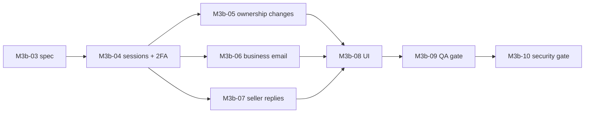
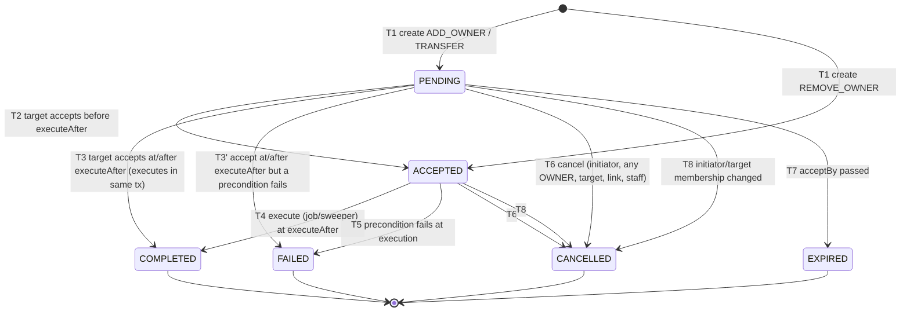
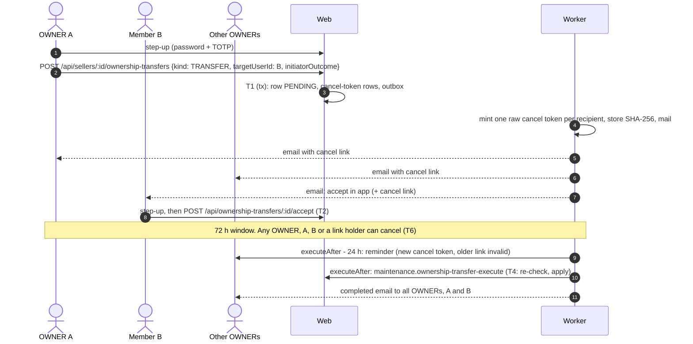
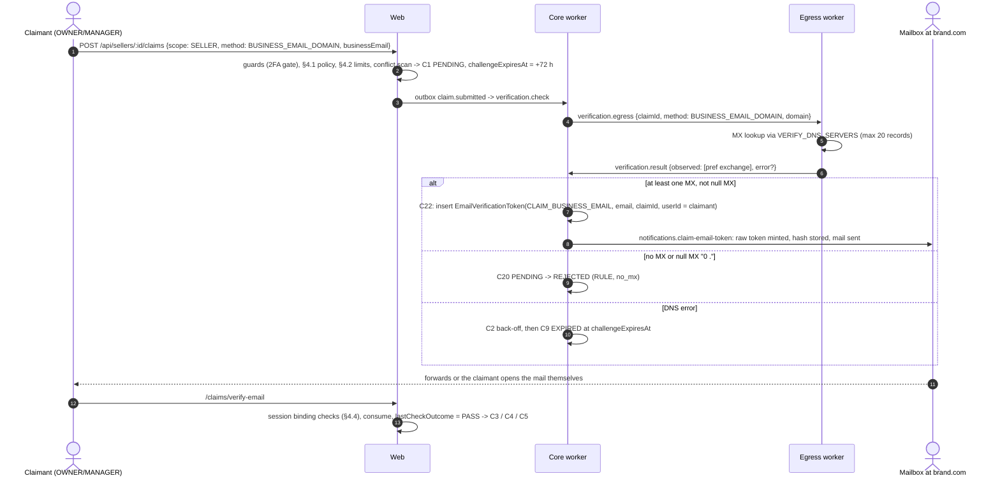
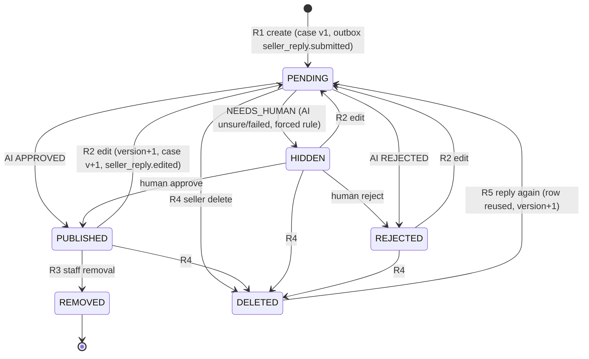

# M3b Spec: 2FA, Ownership Transfer, Business-Email Claims, Seller Replies

| | |
|---|---|
| **Status** | Proposed. Task #54 (M3b-03), Project Manager plan #9 (M3b). Becomes binding when merged with CEO approval |
| **Owner** | Software Architect |
| **Implements** | Threats A-1, A-3…A-8, A-14, O-2, O-6, F-5, P-2 ([threat-model.md](../security/threat-model.md)). M3 security review §6 "M3b" list and Low findings T-04, T-06 (guards), T-10 ([m3-security-review.md](../security/m3-security-review.md)). Catalogue cases `AUT-003…006`, `AUT-011`, `AUT-013`, `AZ-008`, `AZ-009`, `AZ-010` (reply clause), `SEL-006` ([test-case-catalogue.md](../qa/test-case-catalogue.md)) |
| **Decisions** | [ADR-0019](../adr/0019-two-factor-sessions-on-authjs.md) 2FA and step-up on the Auth.js baseline (amends ADR-0002) · [ADR-0020](../adr/0020-seller-ownership-changes.md) delayed two-party ownership changes (refines ADR-0017) · [ADR-0021](../adr/0021-seller-reply-content-policy.md) seller replies: plain text, no links, shared moderation |
| **Builds on** | [m3-sellers-spec.md](./m3-sellers-spec.md) (schema §2, seller authz §4.4, claims §5, egress §6.7). Replaces its §4.5 (interim step-up) and §4.6 (transfer sketch) |
| **Open items** | [open-questions.md §5](./open-questions.md#5-m3b-2fa-ownership-transfer-business-email-seller-replies-task-54) (M3b-Q1 … M3b-Q16) |

This is a docs-only spec. Code shapes are Prisma or TypeScript signatures so the implementing tasks share one contract.

---

## 0. Scope, baseline and assumptions

### 0.1 Scope

| In M3b (this spec) | Not in M3b |
|---|---|
| §2 TOTP 2FA, recovery codes, pending-2FA gate, step-up, DB-backed session rows, staff and seller 2FA gates | WebAuthn/passkeys (stretch), SMS/email OTP (never, ADR-0002), self-service 2FA reset (M3b-Q4), password reset (M3-Q9) |
| §3 Ownership changes: add a co-owner, transfer, remove/demote an OWNER, 72 h delay, cancel links | Staff-forced transfer through the API (stays the M3-Q3 runbook) |
| §4 `BUSINESS_EMAIL_DOMAIN` claims end to end (today `501 method_unavailable`), with T-10 (full PSL snapshot) | Subdomain mailboxes (M3b-Q6) |
| §5 Seller replies: model, policy, moderation, `SELLER_REPLY_RESTRICTION`, AZ-010 reply clause, T-04 COI on seller enforcement | Seller posts, user reports on replies (`Report` is M6), reply notifications to the reviewer (M7, M3b-Q9) |

### 0.2 Code baseline (read at `fc05007`)

| Area | Today | Consequence |
|---|---|---|
| Sessions | **Auth.js v5, `strategy: "jwt"`, Credentials provider only** (`apps/web/src/server/auth.ts`). `refreshJwt()` re-reads `User` on every request (status, roles, T-02 `sv`). No `Session` table. ADR-0002 §1 described first-party DB sessions | Revocation, pending-2FA and step-up need server-side state. ADR-0019 adds a `UserSession` row referenced from the JWT (§2.1) |
| Interim step-up (m3-sellers-spec §4.5) | **Not implemented**: no `authTime`, no `authz.sellerTwoFactorGate` in code | Nothing to migrate. §2.9 replaces it with the real gate |
| Seller authz | `authorizeSeller()` (pure, `packages/core/src/sellers.ts`) + `requireSellerPermission()` (web). Deny codes `ACCOUNT_INACTIVE`, `SELLER_SUSPENDED`, `NOT_IN_SCOPE`, `FORBIDDEN_ROLE`, `CONFLICT_OF_INTEREST` | Context gains 2FA and step-up facts; new codes (§7) |
| Business email | `POST …/claims` validates the domain, then returns `501 method_unavailable` (`apps/web/src/server/claims.ts:50`). `EmailVerificationToken(CLAIM_BUSINESS_EMAIL)` and `chk_evt_claim_purpose` exist. PSL is a pinned subset (T-10) | §4 builds the flow on the existing token table |
| Moderation | `ModerationCase.reviewId` **required**, FK `Cascade`. Worker `processModeration` returns `SKIPPED` for non-`REVIEW` subjects. Outbox route `seller_reply.submitted` is already in the job catalogue | ModerationCase gets a subject arc (§6.1). Worker gains a `SELLER_REPLY` branch |
| Egress | `verification-egress` group (T-01) does DNS_TXT and META_TAG; startup assertion forbids `DATABASE_URL`, `S3_*`, `SMTP_URL` | Adds the MX lookup (§4.3). The assertion also forbids the new 2FA secrets (§2.10) |

### 0.3 Assumptions (cheap to reverse)

- **B-1.** Pre-launch, no production users (as m3-sellers-spec A-2). Deploying M3b invalidates every existing JWT (no `sid`), so everyone signs in again. Seeded staff and seller OWNERs get a dev-only TOTP secret from the seed script, which refuses to run with `NODE_ENV=production`.
- **B-2.** Work-package labels `M3b-04 … M3b-10` (§1) are mapped to task ids by the PM.
- **B-3.** Library choice is left to the implementer within these constraints: a maintained RFC 6238 library (recommendation `otpauth`), Node `crypto` for AES-256-GCM and HMAC, `tldts` with a pinned full PSL snapshot, `libphonenumber-js` for phone detection. No external QR-code service: the QR is rendered in the browser from the `otpauth://` URI.
- **B-4.** All new tables follow ADR-0004/ADR-0010 (cuid, UTC `DATETIME(3)`, snake_case plural `@@map`). FKs used by CHECKs are `Restrict` (MySQL ER 3823).

---

## 1. Work packages and dependencies

| WP | Title | Contents | Migration |
|---|---|---|---|
| **M3b-03** | This spec (#54) | Spec, ADR-0019…0021, open questions | none |
| **M3b-04** | Sessions, 2FA, step-up, gates | §2. `UserSession`, `TwoFactorTotp`, `RecoveryCode`; login and pending flow; enrol/confirm/disable/regenerate; step-up; staff + seller 2FA gates; step-up on the ADR-0002 §4 staff actions that exist; T-06 guards (grant target ACTIVE + verified, locked SUPER_ADMIN count); revocation hooks | `…10_sessions_two_factor` |
| **M3b-05** | Ownership changes | §3. `SellerOwnershipTransfer`, cancel tokens, execute job and sweeper, OWNER removal through the delayed flow | `…12_ownership_transfers` |
| **M3b-06** | Business-email claims | §4. T-10 full PSL, address policy, MX in egress, token mail, session-bound consumption, deny link, renewal | `…11_claim_business_email` |
| **M3b-07** | Seller replies | §5. `SellerReply`, ModerationCase arc, policy validator, worker branch, render rule, `SELLER_REPLY_RESTRICTION` endpoints, T-04 COI on seller enforcement | `…13_seller_replies` |
| **M3b-08** | UI | 2FA pages (`/login/2fa`, account security), transfer pages and cancel page, business-email verify/deny pages, reply composer and rendering | none |
| **M3b-09** | QA gate | All P0 cases in §10 green, plus T-08 (SEC-07 runtime check on MinIO) | none |
| **M3b-10** | Security review gate | Review of M3b-04…08 against A-1, A-3…A-8, O-2, O-6, F-5, P-2 | none |



M3b-04 comes first: every other package depends on the 2FA gate (OWNER/MANAGER actions) or on step-up.

---

## 2. Two-factor authentication (ADR-0002 §3, ADR-0019)

### 2.1 Session model on the Auth.js baseline

Auth.js stays. The JWT becomes a **carrier** for three claims `{sub, sid, sv}`. All mutable session state lives in a
`UserSession` row (§6.2), which `refreshJwt()` loads by primary key on every request (it already reads `User` per
request, so this adds one indexed lookup).

`refreshJwt()` returns `null` (signed out) when any of these hold:

| Check | Reason |
|---|---|
| no `sid`, or no row, or `row.userId ≠ token.sub` | pre-M3b JWT or forged pointer |
| `row.revokedAt` set, unless the rotation rule in §2.4 applies | revocation is immediate (ADR-0002 requirement 1) |
| `now > row.absoluteExpiresAt`, or `now > row.lastSeenAt + idle` | lifetimes below |
| `row.secondFactorPending` and `now > row.pendingExpiresAt` | pending sessions live 10 minutes |
| user not `ACTIVE`, or `sv` mismatch (T-02, unchanged) | existing rules |

| Account | Idle | Absolute |
|---|---|---|
| any `UserRole` row (staff) | 2 h | 12 h |
| everyone else | 30 d | 90 d |

`absoluteExpiresAt` is fixed when the row is created. A role grant or revoke revokes all sessions of the target
(ADR-0002), so the next sign-in gets the right lifetime. `lastSeenAt` is written at most once per 5 minutes.

**Hard rule:** the `jwt` callback never copies anything from its `session` argument. In Auth.js, `trigger: "update"`
carries client-supplied data (`useSession().update(x)` posts it). `sid`, `pending` and `role` come only from the
database.

### 2.2 Sign-in with 2FA (sequence)

```mermaid
sequenceDiagram
  autonumber
  participant B as Browser
  participant W as Web (Auth.js)
  participant DB as MySQL
  participant R as Redis limiter
  B->>W: POST credentials (email, password)
  W->>R: limitLogin (per IP + account, fail-closed)
  W->>DB: verify Argon2id, user ACTIVE
  W->>DB: INSERT UserSession(pending = TOTP confirmed?, pendingExpiresAt = now+10m, authTime = now)
  W-->>B: JWT {sub, sid, sv}. Session API shows {pending: true} only
  B->>W: POST /api/auth/2fa/verify {code}
  W->>R: per-account 10/15 min, per-IP 30/15 min (fail-closed)
  W->>DB: tx: lock session row; failures < 5; check TOTP step > lastUsedStep (conditional UPDATE)
  alt code valid
    W->>DB: INSERT successor row (verified, method TOTP); old row revoked "rotated", successorId set
    W->>W: unstable_update() -> jwt callback claims successor (§2.4)
    W-->>B: new JWT {sub, sid = successor}. Audit auth.2fa.verified
  else code invalid
    W->>DB: failures = failures + 1 (5th failure: revoke row "second_factor_failed")
    W-->>B: 400 invalid_code (or 401 session_ended on the 5th)
  end
```

A user without confirmed TOTP gets a non-pending row at step 4 and is signed in directly. Staff and OWNER/MANAGER
permissions then stay inactive until enrolment (§2.9).

### 2.3 Pending-2FA gate: default-deny (A-5, AZ-009)

Three layers. Only the first two are security controls.

1. **The `session` callback hides the user of a pending session.** For a pending row it returns
   `{pending: true}` with no `user.id`. `requireUser()`, `requireAdmin()`, Server Components and any direct `auth()`
   reader therefore see "not signed in" and fail closed, with no per-route code. `requireUser()` returns
   `401 second_factor_pending` when it sees the marker (still a denial; the code only helps the UI).
2. **One function reads pending sessions.** `requirePendingSession()` is imported only by
   `POST /api/auth/2fa/verify` and `POST /api/auth/2fa/recovery`. Sign-out (Auth.js) and `GET /api/auth/session`
   (shows `{pending: true}`) are the only other endpoints that answer. A CI test enumerates the route registry and
   fails if any other module imports `requirePendingSession` (AZ-009).
3. Next.js middleware redirects pages to `/login/2fa` while pending. This is UX only.

**Workers** never act on session state. A job that executes a user's earlier decision (the ownership-change execute
job, §3) re-checks the 2FA **enrolment** of the people involved at execution time (A-5 worker note).

### 2.4 Session rotation (A-4, AUT-011)

On 2FA completion and on TOTP enrolment, the service creates a successor row and revokes the old row with
`revokeReason = "rotated"` and `successorId` set, in one transaction. The `jwt` callback swaps the token's `sid` when
all of these hold: the current row is revoked as rotated, `successorId` is set, `successorClaimedAt` is null, and the
rotation happened less than 60 s ago. The swap is one conditional
`UPDATE … SET successorClaimedAt = now WHERE id = ? AND successorClaimedAt IS NULL`. If no row is affected, the
token is signed out. A pending JWT therefore never becomes a full session (no fixation), and a successor is claimed
once. The verify route calls `unstable_update()`, so the claim normally happens inside the verify response.

Revocation triggers (ADR-0002 §1, now enforceable): sign-out (Auth.js `events.signOut`), 2FA enable/replace/disable
(all **other** sessions), recovery-code use by staff (all other sessions), role grant/revoke (all sessions of the
target), `SUSPENSION`/`BAN` (all), "sign out other sessions" (`POST /api/account/sessions/revoke-others`), and
password change when it is built (M3-Q9).

### 2.5 TOTP enrolment and confirmation (A-6, AUT-005)

Parameters: RFC 6238, HMAC-SHA-1, 6 digits, 30 s step, window ±1 step (M3b-Q14). Secret: 20 random bytes.

The secret is stored as AES-256-GCM `iv(12) | ciphertext | tag(16)` with key `TOTP_ENC_KEYS[keyId]` and
**AAD = `"totp|" + userId + "|" + rowId`**, so a ciphertext copied to another user's row fails to decrypt. Key
rotation re-encrypts rows to the active `keyId` (OPS-002).

```mermaid
stateDiagram-v2
  [*] --> NONE
  NONE --> ENROLLING: E1 start (verified email + step-up password)
  ENROLLING --> ENABLED: E2 confirm with valid code (before pendingExpiresAt)
  ENROLLING --> NONE: E3 pendingExpiresAt passed (sweeper or next read)
  ENABLED --> REPLACING: E4 start replacement (step-up password + current code)
  REPLACING --> ENABLED: E5 confirm new code (secret swapped) or E3' expiry (old secret kept)
  ENABLED --> NONE: E6 disable (step-up with code; refused for staff)
  ENABLED --> NONE: E7 staff recovery-code use (forced re-enrolment, §2.7)
```



| # | Rule |
|---|---|
| E1 | `POST /api/account/2fa/totp/enrol`. Needs a full session, a verified email and step-up (password) within 10 min. Writes `pendingSecretCiphertext`, `pendingKeyId`, `pendingExpiresAt = now + 15 min`, replacing any earlier pending secret. Returns `{otpauthUri, secret}` **once** with `Cache-Control: no-store`. Limit 5 per hour per user. Audit `auth.2fa.enrol_started` |
| E2 | `POST /api/account/2fa/totp/confirm {code}`. Code checked against the pending secret (shares the §2.6 counters). In one transaction: pending fields move to the active fields, `confirmedAt = now`, `lastUsedStep = matched step`, 10 recovery codes created (§2.7), all **other** sessions revoked, the current session rotated to a verified one (§2.4). Returns the recovery codes once. Event `auth.security_alert {TWO_FACTOR_ENABLED}`. Audit `auth.2fa.enabled` |
| E4/E5 | Same endpoints. The current secret stays valid until the new one is confirmed. On confirm, `lastUsedStep` is reset to the confirm step. Recovery codes are not changed. Audit `auth.2fa.replaced` |
| — | No endpoint ever returns the active secret (AUT-005). The secret, the URI and codes never appear in logs, audit metadata or error payloads (AUT-013 canaries) |

### 2.6 Verification and attempt caps (A-1, AUT-003)

A code check (TOTP or recovery code, at sign-in, at enrolment confirm or at step-up) passes all of these limits:

| Limit | Value | Storage | On breach |
|---|---|---|---|
| Per pending session | 5 failures | `UserSession.twoFactorFailures` (atomic `+1 WHERE twoFactorFailures < 5`) | 5th failure revokes the row (`second_factor_failed`): `401 session_ended`, password again |
| Per account, all sessions | 10 failures / 15 min sliding | Redis `2fa:acct:<userId>` | `429 too_many_attempts` + `Retry-After`. Not a lock-out: it expires by itself (ADR-0002 §5) |
| Per IP | 30 failures / 15 min | Redis `2fa:ip:<ipHash>` | `429` |
| Limiter unavailable | — | — | **Fail closed**: `503 limiter_unavailable`, no code is checked (R-1 precedent) |

TOTP acceptance is one conditional update:
`UPDATE two_factor_totps SET lastUsedStep = :s WHERE userId = :u AND (lastUsedStep IS NULL OR lastUsedStep < :s)`,
where `:s` is the matched step in `{now−1, now, now+1}`. Zero affected rows = replay → `400 invalid_code` (AUT-004).

Reaching the TOTP step proves the password was right. After the **3rd** failure on one account within 15 min, the
user gets `auth.security_alert {SECOND_FACTOR_FAILURES}` ("someone entered your correct password"), at most once
per hour.

### 2.7 Recovery codes (A-7, AUT-006)

- 10 codes, each 12 Crockford base32 characters (**60 bits**), shown as `XXXX-XXXX-XXXX`, once.
- Stored as `codeHash = hex(HMAC-SHA-256(RECOVERY_CODE_PEPPERS[keyId], normalized))`. Normalization: uppercase,
  remove `-` and spaces, map `I`/`L` → `1` and `O` → `0`. The pepper lives in the secret manager, not in the database
  or its backups, so a database leak alone cannot be brute-forced offline. **HMAC rather than Argon2id**: a check
  compares against up to 10 codes, and 10 Argon2id hashes per attempt (about 2.5 s CPU) would be a DoS lever (A-11).
  60 bits plus a secret pepper is above the A-7 bar. Verification computes the HMAC once per `keyId` present for the
  user (at most 2 during rotation).
- Use is `UPDATE … SET usedAt = now WHERE userId = ? AND codeHash = ? AND usedAt IS NULL` (single use). It shares
  every §2.6 counter with TOTP. The session is marked `secondFactorMethod = RECOVERY_CODE`.
- Every use: `auth.security_alert {RECOVERY_CODE_USED, remaining}`. At 2 or fewer remaining, the UI asks the user to
  regenerate.
- **Staff** (any `UserRole` row): in the same transaction the TOTP row is deleted, unused codes are invalidated and
  all other sessions are revoked. Event `auth.staff_recovery_used` alerts the security channel. The session works,
  but every staff permission returns `TWO_FACTOR_REQUIRED` until the user enrols again (E1 needs only the password
  in this state).
- Regenerate: `POST /api/account/2fa/recovery-codes/regenerate`, step-up **with code**, 3 per day. Old codes are
  deleted in the same transaction. Audit `auth.recovery_codes.regenerated`.

### 2.8 Step-up (ADR-0002 §4)

`POST /api/auth/step-up {password, code?}` sets `UserSession.reauthenticatedAt = now` when the password is right
and, if TOTP is enabled, `code` is a valid TOTP or recovery code. Password failures use the login limiter; code
failures use §2.6. Every failure returns `400 invalid_credentials`, whichever factor was wrong.
A guard that needs step-up returns `401 STEP_UP_REQUIRED` when `reauthenticatedAt` is older than 10 minutes.

| Needs step-up (M3b) | Code required when enrolled |
|---|---|
| TOTP enrol (E1); replacement (E4) | E1: no (password only). E4: yes |
| 2FA disable, recovery-code regenerate | yes |
| Ownership change create and accept (§3) | yes (2FA is mandatory for both parties) |
| Staff: role grant/revoke, seller suspend/unsuspend, reply restriction issue/lift, claim revoke (C18) | yes |

### 2.9 Authorization gates (ADR-0003 guard 3; AZ-008)

```ts
// packages/core/src/sellers.ts (extended)
interface SellerAuthzContext {
  // … existing fields …
  twoFactor: { enrolled: boolean; sessionVerified: boolean }; // TwoFactorTotp.confirmedAt set; session.secondFactorVerifiedAt set
  stepUpAt: Date | null;                                       // session.reauthenticatedAt
  emailVerified: boolean;
}
```

Guard order for seller permissions (amends m3-sellers-spec §4.4):
session (full, not pending) → account `ACTIVE` → `SELLER_SUSPENDED` (AZ-007) → `NOT_IN_SCOPE` (404, so membership
is not revealed) → role grant (`FORBIDDEN_ROLE`) → **2FA gate** → permission conditions → step-up.

- **2FA gate:** if the permission is exercised through the `OWNER` or `MANAGER` role, then `enrolled` and
  `sessionVerified` must both be true, otherwise `403 TWO_FACTOR_REQUIRED`. `RESPONDER` permissions
  (`seller.reply`) do not need 2FA (ADR-0003 row `seller.reply`, M3b-Q3).
- **Exemption:** cancelling an ownership change (§3.4) is protective and skips the 2FA gate.
- **Staff gate:** `requireAdmin()`, `requireSuperAdmin()` and every staff-permission check require
  `enrolled && sessionVerified`, otherwise `403 TWO_FACTOR_REQUIRED`. This brings the staff part of SEC-09(d) forward
  from M8 at low cost (M3b-Q2). No feature flag: dev seeds enrol staff (B-1).
- **T-06 guards** (same package): `grantStaffRole` requires the target `ACTIVE` with a verified email and 2FA
  enrolled. The "≥ 2 SUPER_ADMIN" count in `revokeStaffRole` is read under `SELECT … FOR UPDATE` on the SUPER_ADMIN
  role rows.

### 2.10 Endpoints, secrets and audit

| Endpoint | Session | Extra guards | Limits |
|---|---|---|---|
| `POST /api/auth/2fa/verify {code}` | pending only | — | §2.6 |
| `POST /api/auth/2fa/recovery {code}` | pending only | — | §2.6 (shared) |
| `GET /api/account/2fa` | full | — | — |
| `POST /api/account/2fa/totp/enrol` | full | verified email, step-up (E1/E4) | 5 / h |
| `POST /api/account/2fa/totp/confirm {code}` | full | unexpired pending secret | §2.6 |
| `POST /api/account/2fa/recovery-codes/regenerate` | full, 2FA-verified | step-up with code | 3 / day |
| `POST /api/account/2fa/disable` | full, 2FA-verified | step-up with code; `409 two_factor_required_by_role` for staff | 3 / day |
| `POST /api/auth/step-up {password, code?}` | full | — | login limiter + §2.6 |
| `POST /api/account/sessions/revoke-others` | full | — | 10 / h |

`GET /api/account/2fa` returns `{enabled, enrolling, recoveryCodesRemaining}` and never a secret. Disabling deletes
the `TwoFactorTotp` row and the codes, revokes other sessions and emits
`auth.security_alert {TWO_FACTOR_DISABLED}`. For a seller OWNER/MANAGER, those permissions go inactive (AZ-008).

**Secrets (names only):** `TOTP_ENC_KEYS` (JSON `keyId → base64 32-byte key`), `TOTP_ENC_ACTIVE_KEY_ID`,
`RECOVERY_CODE_PEPPERS`, `RECOVERY_CODE_ACTIVE_KEY_ID`. They are kept apart from database backups (A-14). The
`verification-egress` startup assertion (`apps/worker/src/groups.ts`) adds `TOTP_ENC_*`, `RECOVERY_CODE_*` and
`AUTH_SECRET` to its forbidden list. The core worker does not need them either.

**Audit** (metadata is PII-free per SEC-09(c); never codes, secrets or IPs, only `ipHash`):
`auth.session.created {pending}`, `auth.2fa.verified {method}`, `auth.2fa.failed {method, sessionFailures}`,
`auth.2fa.session_killed`, `auth.2fa.enrol_started`, `auth.2fa.enabled`, `auth.2fa.replaced`, `auth.2fa.disabled`,
`auth.recovery_code.used {remaining}`, `auth.recovery_codes.regenerated`, `auth.step_up {ok}`,
`auth.session.revoked {reason, count}`.

---

## 3. Ownership changes (SEL-006, O-6; ADR-0020)

### 3.1 Kinds

| Kind | Target | Result at completion | Target must accept |
|---|---|---|---|
| `ADD_OWNER` | existing MANAGER/RESPONDER member B | B → OWNER. Initiator A stays OWNER | yes, with step-up |
| `TRANSFER` | existing MANAGER/RESPONDER member B | B → OWNER, then A → `initiatorOutcome` (`BECOME_MANAGER`, `BECOME_RESPONDER` or `REMOVED`) | yes, with step-up |
| `REMOVE_OWNER` | another OWNER C | C → `targetOutcome` (`BECOME_MANAGER`, `BECOME_RESPONDER` or `REMOVED`) | no, but C can cancel |

Changes to m3-sellers-spec §4.3:

- **An OWNER can no longer remove or demote another OWNER directly.** Doing so returns `409 use_ownership_change`
  and goes through `REMOVE_OWNER`. Without this, a compromised co-owner could remove the others at once, and the
  72 h delay on additions would protect nothing.
- Leaving voluntarily (`leave`) stays immediate for an OWNER who is not the last one, because it only reduces
  privilege.
- Invitations still cannot grant OWNER (`chk_invitation_role`). The only path to OWNER is invite as MANAGER/RESPONDER
  → `ADD_OWNER` or `TRANSFER`.

### 3.2 State machine



Timing: `executeAfter = createdAt + 72 h` (config `sellers.ownershipChange.delayHours`, **floor 72 enforced by
`chk_transfer_delay`**), `acceptBy = createdAt + 7 d`.

| # | From → To | Actor | Guard | Effects (one transaction; lock seller row, then member rows by ascending userId, then the transfer) |
|---|---|---|---|---|
| T1 | ∅ → PENDING / ACCEPTED | OWNER A | §3.4 create guards. No open change for the seller (`openKey` unique). Limit 3 per seller per 7 days | Insert row (`openKey = sellerId`; `acceptedAt = createdAt` for REMOVE_OWNER). Cancel-token rows (`tokenHash` null) for every OWNER and for the target. Outbox `seller.ownership_transfer_requested`. Audit `seller.ownership_transfer.requested` |
| T2 | PENDING → ACCEPTED | target B | §3.4 accept guards, `now < executeAfter` | `acceptedAt`. Outbox `…_accepted`. Audit |
| T3 | PENDING → COMPLETED | target B | accept guards, `executeAfter ≤ now < acceptBy`, execution preconditions | `acceptedAt`, then the T4 effects |
| T3′ | PENDING → FAILED | target B (accept attempt) | `executeAfter ≤ now < acceptBy`, accept guards pass, an execution precondition fails | As T5. The accept call returns `409` with the failure reason |
| T4 | ACCEPTED → COMPLETED | SYSTEM (`maintenance.ownership-transfer-execute`) | `now ≥ executeAfter`; execution preconditions | Apply role changes (B → OWNER **before** A steps down); delete the member row for `REMOVED`. `endedAt = now`, clear `openKey`. Audit `seller.member.role_changed` per change + `…completed`. Outbox `…_completed` |
| T5 | ACCEPTED → FAILED | SYSTEM | a precondition fails | `endReason` ∈ {`INITIATOR_NOT_OWNER`, `TARGET_NOT_ELIGIBLE`, `TWO_FACTOR_MISSING`, `SELLER_BLOCKED`, `LAST_OWNER`}. No role change. Outbox `…_failed` |
| T6 | PENDING/ACCEPTED → CANCELLED | initiator, any OWNER, target, cancel-link holder, ADMIN (not a member) | — | `endReason` = `CANCELLED_BY_*`, `endedById` (null for link). Clear `openKey`. Outbox `…_cancelled` |
| T7 | PENDING → EXPIRED | SYSTEM (sweeper) | `now ≥ acceptBy` | `endedAt`, clear `openKey`. Outbox `…_expired` |
| T8 | PENDING/ACCEPTED → CANCELLED | SYSTEM, inside the membership service | the initiator or target is removed, leaves or changes role | `CANCELLED_MEMBERSHIP_CHANGED`, in the same transaction as the membership change |

**Execution preconditions** (T3, T4), re-read under the locks: seller not `SUSPENDED`/`CLOSED`; initiator is still an
OWNER, `ACTIVE` and has 2FA enrolled; for ADD_OWNER/TRANSFER, the target is still a MANAGER/RESPONDER member,
`ACTIVE`, with a verified email and 2FA enrolled; for REMOVE_OWNER, the target is still an OWNER; after applying, the
seller has ≥ 1 OWNER. These checks run as the SYSTEM principal applying an earlier, authorized decision (P-9).

**Not allowed:** anything leaving COMPLETED, CANCELLED, EXPIRED or FAILED, and any pair not in the table →
`409 invalid_transition`, no row change, no audit row (SEL-020). All transitions go through
`applyOwnershipTransition(transferId, action, actor)`.

### 3.3 Sequence (TRANSFER)



### 3.4 Authorization

| Action | Who | Guards |
|---|---|---|
| Create (`seller.owner_change.create`) | OWNER of the path seller | Full session; account ACTIVE; seller not SUSPENDED/CLOSED; **2FA gate**; **step-up with code ≤ 10 min**; target resolved server-side as a member of **this** seller (`409 target_not_member` otherwise). ADD/TRANSFER: target role MANAGER/RESPONDER, target ACTIVE with verified email and **2FA enrolled** (`409 target_two_factor_required`). REMOVE_OWNER: target is another OWNER. `initiatorId ≠ targetUserId` |
| View | OWNERs of the seller; the target | `GET /api/sellers/:sellerId/ownership-transfers` lists open and the last 20 ended changes |
| Accept | the target user only | Full session; **2FA-verified session**; **step-up with code**; status PENDING; `now < acceptBy` |
| Cancel (in app) | initiator, any OWNER, the target | Full session, ACTIVE account. **No 2FA gate and no step-up** (protective action) |
| Cancel (link) | holder of an unused cancel token | No sign-in. `POST /api/ownership-transfers/cancel-by-link {token}`: one conditional `UPDATE … SET usedAt WHERE tokenHash = ? AND usedAt IS NULL`, then T6 when the transfer is open. Every failure returns the same `400 invalid_or_expired`. Limit 10/min per IP |
| Staff cancel | ADMIN, not a member of the seller (`CONFLICT_OF_INTEREST`) | 2FA staff gate; reason code required |

The seller id always comes from the path or the loaded transfer row (AZ-010 principle). Body schemas are `.strict()`
and reject `sellerId`.

### 3.5 Cancel links and notifications

- Recipients: every OWNER at T1 (including A) and the target. MANAGERs are not notified (M3b-Q13).
- The token is 32 random bytes, base64url. The worker generates it when mailing and stores only SHA-256
  (m3-sellers-spec §3.4 pattern, `chk_tct_sent`). The link is `/ownership-transfers/cancel#t=<token>`: a **fragment**,
  so the token never reaches request logs (lesson from F-08). The page reads it and POSTs it after a confirm click. GET
  never mutates.
- A token is valid while its transfer is PENDING/ACCEPTED and unused. The reminder at `executeAfter − 24 h`
  re-mints the recipient's token, which invalidates the previous link.
- Mail content is a fixed template: seller public URL, kind, target and initiator **handles**, `executeAfter` in
  UTC, cancel link. No free text.
- Terminal transitions notify all OWNERs at that moment, the initiator and the target.

### 3.6 Invariants

| Invariant | Where | Backstop |
|---|---|---|
| ≥ 1 OWNER per seller | T4/T5 under `FOR UPDATE`; leave and remove services (existing) | `maintenance.seller-consistency` (extended) |
| ≤ 1 open change per seller | `openKey` unique + `chk_transfer_open_key` | — |
| No role change before `createdAt + 72 h` | `chk_transfer_delay`, `chk_transfer_completed_after_delay` (DB), service | — |
| Initiator and target membership stable while open | T8 inside every membership mutation | Sweeper fails changes whose parties no longer match |

---

## 4. `BUSINESS_EMAIL_DOMAIN` claims (O-2)

### 4.1 Address policy (`assertClaimableBusinessEmail`)

Pure function in `packages/core/src/domain-policy.ts`:

1. **Syntax.** ASCII dot-atom local part only (`[a-z0-9!#$%&'*+/=?^_\`{|}~.-]`, no leading, trailing or double dot),
   local part ≤ 64, whole address ≤ 254. Quoted local parts, comments, IP-literal domains (`[1.2.3.4]`) and non-ASCII
   local parts are refused (`invalid_email`). The domain is normalized as in m3-sellers-spec §5.2 step 1
   (lowercase, A-label).
2. **Domain.** `assertOwnableDomain(domain, "email")` with the **full pinned PSL snapshot (T-10)**: the mail domain
   must **equal** its registrable domain under an ICANN suffix. Private-section suffixes are treated as shared
   (`not_registrable`), and shared-host and free-mail deny-lists apply as today. A subdomain mailbox
   (`jane@mail.brand.com`) is refused with `subdomain_mailbox` (M3b-Q6). If `domain` is also sent, it must equal the
   mail domain.
3. **Local part.** It is classified on its base form: lowercase, cut at the first `+`.

| Class | List (`denylist/…`, Security owns it) | Effect |
|---|---|---|
| Reserved | `noreply`, `no-reply`, `donotreply`, `do-not-reply`, `mailer-daemon`, `bounce`, `bounces`, `unsubscribe`, `abuse`, `list`, `*-request`, `owner-*` | Refused: `email_not_allowed:reserved_local_part` |
| Role address | `info`, `contact`, `hello`, `hi`, `sales`, `support`, `help`, `helpdesk`, `service`, `care`, `office`, `admin`, `administrator`, `team`, `marketing`, `press`, `media`, `pr`, `enquiries`, `inquiries`, `orders`, `shop`, `store`, `billing`, `accounts`, `finance`, `hr`, `jobs`, `careers`, `feedback`, `webmaster`, `hostmaster`, `postmaster`, `security`, `legal`, `privacy` | Allowed, but `requiresHumanReview = true`, `humanReviewReason = "ROLE_ADDRESS"`. Never auto-approved, even after the token is used (C4). Role mailboxes are often shared, forwarded to ticket tools or publicly archived (O-2) |
| Personal | anything else | Auto-approval allowed (m3-sellers-spec §5.4), 25 % spot-check |

The address as typed (including `+tag`) is stored in `SellerOwnershipClaim.businessEmail` and receives the mail.

### 4.2 Abuse limits (the platform must not become a mail cannon)

Per user 5 BUSINESS_EMAIL submissions per day. Per target registrable domain 3 per 7 days across all sellers. One
open claim per address. Resend 3 per claim (§3.1 limits of the M3 spec also apply). Plus the existing 5 per seller
per day.

### 4.3 Flow (sequence)



The MX lookup runs **only** in the egress group (T-01/ADR-0015: attacker-chosen DNS names are resolved there). Core
never calls a resolver for claim domains. Egress returns observations only and core decides.

### 4.4 Consumption bound to the session user

`POST /api/claims/email-verify {token}` consumes a token only when **all** of these hold:

1. Full session (not pending), account ACTIVE, verified account email.
2. The token exists by hash, purpose `CLAIM_BUSINESS_EMAIL`, `sentAt` set, not consumed or invalidated, `expiresAt > now`.
3. `token.userId = session user = claim.submittedById` (renewal: the user who requested the renewal token).
4. The claim is PENDING (or VERIFIED for a renewal token), method BUSINESS_EMAIL_DOMAIN, and `token.email` equals the
   address the token was issued for.
5. `authorizeSeller(actor, "seller.claim.submit", claim.sellerId)` passes, including the **2FA gate**.

If 1–4 fail, the response is `400 invalid_or_expired` and **the token is not consumed**. A colleague who clicks the
link while signed in as someone else, or not signed in, cannot use it up or use it. If 5 fails, the response is the
guard's 403. The consume is an atomic conditional update followed by `applyClaimTransition(PROOF_PASSED)` in the
same transaction.

Why this binding matters: an attacker who claims a brand's domain makes our mail land in the brand's inbox. An
employee who clicks "verify" there must not complete the attacker's claim.

**"This wasn't me"** (C21): the mail also has a deny link (`/claims/deny-email#t=<token>`), which POSTs to
`POST /api/claims/email-verify/deny {token}` without sign-in. A valid unconsumed token is invalidated. The claim goes
to `REJECTED` (RULE, `mailbox_owner_denied`), the seller gets `nameReviewFlag = true` (every later claim needs human
review, SEL-010) and `claim.mailbox_denied` alerts staff. The mailbox controls the domain, so its veto is
legitimate. Limit 10/min per IP.

### 4.5 Claim transitions added (extends m3-sellers-spec §5.5)

| # | From → To | Actor | Guard | Effects |
|---|---|---|---|---|
| C20 | PENDING → REJECTED | RULE | BUSINESS_EMAIL MX result has no usable MX | Decision `(RULE, REJECT, "no_mx")`, `endedAt`, clear `activeKey`, invalidate tokens, `recomputeSeller()`. Email to the claimant |
| C21 | PENDING → REJECTED | RULE (mailbox holder) | deny link with a valid unconsumed token | Decision `(RULE, REJECT, "mailbox_owner_denied")`. As C20, plus `nameReviewFlag` and staff alert |
| C22 | PENDING → PENDING | RULE | MX PASS and no open token | Token row created (`tokenHash` null). Outbox `claim.business_email_token_requested`. Audit `claim.email_token_issued` (no address in metadata) |

Consumption uses the existing C3/C4/C5 (`lastCheckOutcome = PASS`, `lastCheckAt = now`). Expiry is C9: the token
expires after 24 h and the claim at `challengeExpiresAt` (72 h). The claimant may resend (new token, older ones
invalidated) until then. The T-05 rule "fresh check < 24 h at final staff approval" does **not** apply to
BUSINESS_EMAIL: the proof is the consumption inside the claim window, as implemented in M3b-01.

### 4.6 Renewal

From `verifiedUntil − 30 d`, any OWNER/MANAGER may call `POST /api/claims/:id/renew-email {businessEmail?}`. The
address must be on the **same** domain, and §4.1 is re-applied (a role address marks the renewal for human
approval). The token is bound to the requesting user. Consumption applies C13 (`RENEW`) and stores the address on the
claim. Without renewal: C14 grace at `verifiedUntil`, then C16 `VALIDITY_ENDED` (unchanged).

### 4.7 Mail rules

Fixed template. It contains: the platform name, the domain (A-label, plus U-label when it differs), the seller's
public URL on our domain (`/sellers/<slug>`, slug `[a-z0-9-]`), the verify link and the deny link, both as fragments.
**It contains no seller-controlled free text** (name, description), so the mail cannot be used for phishing. Headers:
`Auto-Submitted: auto-generated` (RFC 3834) and a plain-text part. The `From` address is on the platform domain.

### 4.8 Schema

`SellerOwnershipClaim.businessEmail String? @db.VarChar(254)` with `chk_claim_business_email_method` and
`chk_claim_business_email_present`. It is personal data:
it is never in audit metadata, logs or job payloads (payloads carry `tokenId`/`claimId` only), and it is cleared
90 days after the claim ends (`maintenance.tokens-purge`, L-5/M3-Q11).

---

## 5. Seller replies (F-5, P-2; ADR-0021)

### 5.1 Model and rules

- One `SellerReply` per `(reviewId, sellerId)` (unique). `sellerId` = `product.sellerId` at creation.
- Body: plain text, NFC, 1 to 1500 characters (`chk_reply_body_len`), at most 15 line breaks, runs of more than 2
  blank lines collapsed. There is no revision table: an edit bumps `version` and is moderated like a new submission,
  and the reply is non-public until approved (moderation-pipeline §3).
- Deleting sets `DELETED`. A new reply by the same seller on that review reuses the row (status → PENDING,
  `version + 1`, `deletedAt` cleared). `REMOVED` (staff, after publication) is final in M3b (appeals are M6).

### 5.2 Content policy (`checkReplyPolicy`, packages/core, pure)

Runs synchronously on create and edit. Hard violations return `422 reply_policy_violation {reasons[]}`, which the
seller sees so they can fix the text (deterministic rules, safe to disclose). Soft flags do not block, but force the
moderation case to NEEDS_HUMAN.

| Rule | Hard / soft | Detection |
|---|---|---|
| `link` | **hard** (`replies.linkPolicy = "none"`, the Phase 1 default) | URI schemes (`[a-z][a-z0-9+.-]*:` followed by `//`, plus `mailto:`, `tel:`, `javascript:`, `data:`), `www.`, and bare host names whose last label is a PSL ICANN TLD. Before matching, fullwidth and ideographic dots (`．。｡`) and `[.]`/`(.)` are mapped to `.`. Spelled-out forms ("brand dot com") are a soft flag |
| `email` | hard | `local@domain.tld` after the same dot mapping; `(at)`/`[at]` forms are a soft flag |
| `markup` | hard | HTML tags (`<[a-z!/?]`), markdown links/images (`[..](..)`, `![`), HTML entities (`&#…;`, `&[a-z]+;`) |
| `invisible` | hard | Bidi controls U+202A–U+202E and U+2066–U+2069, zero-width U+200B–U+200F, U+2060, U+FEFF, tag characters U+E0000–U+E007F, C0/C1 controls other than `\n` |
| `too_long` | hard | > 1500 characters or > 15 line breaks |
| `phone` | **soft** | `libphonenumber-js` `findNumbers` (VALID leniency) for the seller's `countryCode` and international format. Soft because order numbers look like phone numbers |
| `contact_channel` | soft | Keyword list (Security owns it): `whatsapp`, `telegram`, `t.me`, `wa.me`, `wechat`, `signal`, `viber`, `skype`, `dm us`, `text us`, `call us`, `email us` … |

`replies.linkPolicy = "allowlist"` is reserved: it would allow host names equal to, or under, the seller's
`verifiedDomain`, still rendered as text (M3b-Q8). It is not enabled in Phase 1.

### 5.3 Lifecycle (reply status, driven by the shared moderation case)



Moderation reuse:

- Submit and edit create `ModerationCase(subjectType = SELLER_REPLY, sellerReplyId, version)` and the existing
  outbox events `seller_reply.submitted` / `seller_reply.edited` → `moderation.assess` (job catalogue §2). The job
  payload carries ids and the version only, never the body (R-4).
- The worker's `processModeration` gains a `SELLER_REPLY` branch: it loads the body, calls the same
  `ModerationProvider.assess`, and uses `decideVerdict` with `moderation.thresholds.sellerReply` (defaults to the
  review thresholds). Status mapping as `REVIEW_STATUS_FOR` (generalised to `CONTENT_STATUS_FOR`).
- **Forced NEEDS_HUMAN:** any soft flag (§5.2, recomputed in the worker from the body); the seller's first
  `replies.newSellerHumanCount` (5) replies; provider failure (existing rule: failures never auto-approve).
- A decision mirrors to the reply only when `reply.version = case.version`. Decisions on stale versions are recorded
  but change nothing.
- AI-approved replies join the same post-review sample as reviews (moderation-pipeline T-11 rule).
- Staff removal after publication: `POST /api/admin/replies/:id/remove {reasonCode}` (`moderation.decide`), sets
  `REMOVED`, audits `seller_reply.removed`.

### 5.4 Authorization (`seller.reply`, `seller.reply.manage`; P-2)

**Scope source:** review → `review.productId` → `product.sellerId`, loaded on the server. The actor's membership is
looked up in **that** seller. The request body (`{body}` only, `.strict()`) cannot carry `sellerId`, `productId` or
`reviewId`. The review id comes from the path.

| Step | Check | Failure |
|---|---|---|
| 1 | Full session (not pending) | 401 |
| 2 | Account ACTIVE, email verified | 403 `ACCOUNT_INACTIVE` / `EMAIL_NOT_VERIFIED` |
| 3 | Review exists and `product.sellerId` is not null | 404 `not_found` |
| 4 | Active `SELLER_SUSPENDED` for that seller | 403 `SELLER_SUSPENDED` (AZ-007) |
| 5 | Actor is a member of `product.sellerId` | **404** (`NOT_IN_SCOPE`, AZ-010 reply clause) |
| 6 | Role ∈ {OWNER, MANAGER, RESPONDER} | 403 `FORBIDDEN_ROLE` |
| 7 | 2FA gate when the role is OWNER/MANAGER (§2.9) | 403 `TWO_FACTOR_REQUIRED` |
| 8 | `seller.status = VERIFIED`, read in the same transaction (grace counts as VERIFIED) | 403 `SELLER_NOT_VERIFIED` |
| 9 | No active `SELLER_REPLY_RESTRICTION` with `subjectSellerId = seller` **or** `subjectUserId = actor` | 403 `REPLY_RESTRICTED` |
| 10 | Review `PUBLISHED` and not deleted. Actor is not the review's author | 409 `review_not_replyable` / 403 `CONFLICT_OF_INTEREST` |
| 11 | Rate limits (§5.6), then the content policy (§5.2) | 429 / 422 |

Edit and delete (`seller.reply.manage`) load the reply. Scope is `reply.sellerId`, and steps 1–9 apply to it.
RESPONDERs may change only their own replies. OWNER/MANAGER may change any reply of the seller. If
`product.sellerId ≠ reply.sellerId` (the product changed hands), only delete is allowed.

### 5.5 Public rendering (server state only, like SEL-009)

A reply is shown when, in the same request: `reply.status = PUBLISHED` **and** `reply.sellerId = product.sellerId`
**and** the seller's status is `VERIFIED`. So a downgrade, suspension or lost product hides replies on the next render
with no batch job, and re-verification restores them.
The DTO is `{body, seller: {name, slug}, publishedAt, editedAt}`. The author's identity is staff-only.
Rendering: escaped text node, `white-space: pre-line`, `dir="auto"`, **no auto-linking, no markdown, no HTML**. The
renderer has no anchor-producing code path. Label: "Response from {seller name} · Verified seller".

### 5.6 Rate limits

| Limit | Value |
|---|---|
| Create, per user | 20 / h, 100 / day |
| Create, per seller | 300 / day |
| Edits, per reply | 5 / day |
| Replies per review per seller | 1 (unique key) |

Same limiter class as review writes (`limitReviewWrite`), keyed per user and per seller.

### 5.7 `SELLER_REPLY_RESTRICTION`

- Issue: `POST /api/admin/sellers/:id/reply-restriction` (subject = seller, every member) or
  `POST /api/admin/users/:id/reply-restriction` (subject = one user, across sellers), body
  `{reasonCode, publicReason, endsAt?}`. ADMIN, 2FA staff gate, step-up with code. **COI:** the issuer is not a
  member of the seller (seller subject), nor of any seller the user belongs to (user subject).
- Lift: `…/reply-restriction/:enforcementId/lift` sets `REVOKED`. Same guards. Expiry through the existing
  `maintenance.enforcement-expire`.
- Effect: steps 9 of §5.4 deny create and edit. Delete stays allowed. Published replies stay visible. Staff remove
  them individually (M3b-Q16).
- Outbox `seller.reply_restricted {enforcementId}` → `notifications.dispatch` to the seller's OWNERs/MANAGERs (or the
  user).
- **T-04** in the same package: `suspendSeller`/`unsuspendSeller` get the same COI check, and unsuspend needs a staff
  actor other than the one who issued the suspension (`409 second_actor_required`).

### 5.8 Endpoints

| Endpoint | Permission |
|---|---|
| `POST /api/reviews/:reviewId/reply {body}` | `seller.reply` |
| `PATCH /api/replies/:id {body}` | `seller.reply.manage` |
| `DELETE /api/replies/:id` | `seller.reply.manage` |
| `GET /api/sellers/:sellerId/replies?status=` | seller members (any role), dashboard list |
| `POST /api/admin/replies/:id/remove` | `moderation.decide` |
| reply-restriction endpoints (§5.7) | ADMIN |

The review's public GET embeds the reply DTO when §5.5 holds.

---

## 6. Schema changes

Verified: the full M3b delta below, merged into the current `packages/db/prisma/schema.prisma`, passes
`prisma validate` (Prisma 6.19.3) during this task.

### 6.1 Diff on existing models

```diff
 model User {
   …
+  sessions             UserSession[]
+  twoFactorTotp        TwoFactorTotp?
+  recoveryCodes        RecoveryCode[]
+  transfersInitiated   SellerOwnershipTransfer[]   @relation("TransferInitiator")
+  transfersTargeted    SellerOwnershipTransfer[]   @relation("TransferTarget")
+  transfersEnded       SellerOwnershipTransfer[]   @relation("TransferEndedBy")
+  transferCancelTokens SellerTransferCancelToken[] @relation("TransferCancelRecipient")
+  sellerReplies        SellerReply[]               @relation("ReplyAuthor")
+  repliesDeleted       SellerReply[]               @relation("ReplyDeletedBy")
   @@index([status])
 }

 model Review {
   …
+  sellerReplies SellerReply[]
 }

 model ModerationCase {
   id             String          @id @default(cuid())
-  reviewId       String
+  subjectType    ModerationSubjectType @default(REVIEW)
+  reviewId       String?
+  sellerReplyId  String?
   version        Int
   …
-  review             Review              @relation(fields: [reviewId], references: [id], onDelete: Cascade)
+  review             Review?             @relation(fields: [reviewId], references: [id], onDelete: Restrict, onUpdate: Restrict)
+  sellerReply        SellerReply?        @relation(fields: [sellerReplyId], references: [id], onDelete: Restrict, onUpdate: Restrict)
   …
   @@unique([reviewId, version])
+  @@unique([sellerReplyId, version])
 }

 model Seller {
   …
+  replies            SellerReply[]
+  ownershipTransfers SellerOwnershipTransfer[]
 }

 model SellerOwnershipClaim {
   …
   domain               String?              @db.VarChar(253)
+  businessEmail        String?              @db.VarChar(254) // BUSINESS_EMAIL_DOMAIN only (chk_claim_business_email)
   …
 }
```

The `ModerationCase` change is the **only non-additive step**. It pulls the subject arc forward from M6, for
`SELLER_REPLY` only (amends M3-Q14). The `reviewId` FK changes from `Cascade` to `Restrict` because MySQL rejects a
CHECK on a column with a cascading FK (ER 3823). Reviews are only ever soft-deleted. Test fixtures that hard-delete
reviews must delete their cases first (same as the media arc).

### 6.2 New enums and models

```prisma
enum ModerationSubjectType {
  REVIEW
  SELLER_REPLY
}

enum OwnershipTransferKind {
  ADD_OWNER    // target member becomes an additional OWNER; initiator stays OWNER
  TRANSFER     // target becomes OWNER; initiator steps down (initiatorOutcome)
  REMOVE_OWNER // another OWNER is demoted or removed (targetOutcome); no acceptance, cancellable by the target
}

enum OwnershipTransferStatus {
  PENDING   // waiting for the target's acceptance (ADD_OWNER/TRANSFER)
  ACCEPTED  // accepted (REMOVE_OWNER starts here); waiting for executeAfter
  COMPLETED // terminal
  CANCELLED // terminal
  EXPIRED   // terminal: not accepted before acceptBy
  FAILED    // terminal: a precondition no longer held at execution
}

enum OwnerChangeOutcome {
  REMAIN_OWNER
  BECOME_MANAGER
  BECOME_RESPONDER
  REMOVED
}

enum OwnershipTransferEndReason {
  CANCELLED_BY_INITIATOR
  CANCELLED_BY_OWNER
  CANCELLED_BY_TARGET
  CANCELLED_BY_LINK
  CANCELLED_BY_STAFF
  CANCELLED_MEMBERSHIP_CHANGED
  INITIATOR_NOT_OWNER
  TARGET_NOT_ELIGIBLE
  TWO_FACTOR_MISSING
  SELLER_BLOCKED
  LAST_OWNER
}

/// Server-side state for one Auth.js JWT (claim `sid`). The JWT is only a carrier; this row is the session (ADR-0019).
model UserSession {
  id                     String    @id @default(cuid())
  userId                 String
  secondFactorPending    Boolean   @default(false)
  pendingExpiresAt       DateTime? // createdAt + 10 min while pending
  twoFactorFailures      Int       @default(0) // per-session cap 5 (chk_session_failures)
  secondFactorVerifiedAt DateTime?
  secondFactorMethod     String?   @db.VarChar(16) // TOTP | RECOVERY_CODE
  authTime               DateTime // first-factor sign-in time; carried across rotation
  reauthenticatedAt      DateTime? // step-up (password + TOTP if enrolled), valid 10 min
  successorId            String?   @unique // rotation pointer, set when this row is rotated (§2.4)
  successorClaimedAt     DateTime?
  absoluteExpiresAt      DateTime
  lastSeenAt             DateTime  @default(now())
  revokedAt              DateTime?
  revokeReason           String?   @db.VarChar(32)
  ipHash                 String?   @db.Char(64)
  userAgent              String?   @db.VarChar(512)
  createdAt              DateTime  @default(now())

  user        User         @relation(fields: [userId], references: [id], onDelete: Cascade)
  successor   UserSession? @relation("SessionRotation", fields: [successorId], references: [id], onDelete: SetNull)
  predecessor UserSession? @relation("SessionRotation")

  @@index([userId, revokedAt])
  @@index([absoluteExpiresAt])
  @@map("user_sessions")
}

/// One row per user. Active secret (confirmed) and an optional pending replacement live side by side.
model TwoFactorTotp {
  id                      String    @id @default(cuid())
  userId                  String    @unique
  secretCiphertext        Bytes?    @db.VarBinary(255) // AES-256-GCM iv|ct|tag, AAD "totp|<userId>|<id>"
  keyId                   String?   @db.VarChar(64)
  confirmedAt             DateTime?
  lastUsedStep            BigInt? // replay guard (AUT-004)
  pendingSecretCiphertext Bytes?    @db.VarBinary(255)
  pendingKeyId            String?   @db.VarChar(64)
  pendingExpiresAt        DateTime? // enrolment start + 15 min
  createdAt               DateTime  @default(now())
  updatedAt               DateTime  @updatedAt

  user User @relation(fields: [userId], references: [id], onDelete: Cascade)

  @@index([pendingExpiresAt])
  @@map("two_factor_totps")
}

/// 10 per user, 60-bit codes. codeHash = hex HMAC-SHA-256(pepper[keyId], normalized code) (A-7, ADR-0019).
model RecoveryCode {
  id        String    @id @default(cuid())
  userId    String
  codeHash  String    @db.Char(64)
  keyId     String    @db.VarChar(64)
  usedAt    DateTime?
  createdAt DateTime  @default(now())

  user User @relation(fields: [userId], references: [id], onDelete: Cascade)

  @@unique([userId, codeHash])
  @@map("recovery_codes")
}

model SellerOwnershipTransfer {
  id               String                      @id @default(cuid())
  sellerId         String
  kind             OwnershipTransferKind
  status           OwnershipTransferStatus     @default(PENDING)
  initiatorId      String
  targetUserId     String
  initiatorOutcome OwnerChangeOutcome          @default(REMAIN_OWNER)
  targetOutcome    OwnerChangeOutcome? // REMOVE_OWNER only
  openKey          String?                     @unique @db.VarChar(32) // = sellerId while PENDING/ACCEPTED
  executeAfter     DateTime // createdAt + 72 h; DB floor chk_transfer_delay
  acceptBy         DateTime // createdAt + 7 d
  acceptedAt       DateTime?
  endedAt          DateTime?
  endReason        OwnershipTransferEndReason?
  endedById        String?
  createdAt        DateTime                    @default(now())
  updatedAt        DateTime                    @updatedAt

  seller       Seller                      @relation(fields: [sellerId], references: [id], onDelete: Restrict, onUpdate: Restrict)
  initiator    User                        @relation("TransferInitiator", fields: [initiatorId], references: [id], onDelete: Restrict, onUpdate: Restrict)
  target       User                        @relation("TransferTarget", fields: [targetUserId], references: [id], onDelete: Restrict, onUpdate: Restrict)
  endedBy      User?                       @relation("TransferEndedBy", fields: [endedById], references: [id], onDelete: Restrict, onUpdate: Restrict)
  cancelTokens SellerTransferCancelToken[]

  @@index([sellerId, createdAt])
  @@index([status, executeAfter])
  @@index([status, acceptBy])
  @@index([targetUserId, status])
  @@map("seller_ownership_transfers")
}

/// Single-use cancel link per recipient (every OWNER, plus the target). Raw token generated by the worker (M3 spec §3.4).
model SellerTransferCancelToken {
  id          String    @id @default(cuid())
  transferId  String
  recipientId String
  tokenHash   String?   @unique @db.Char(64)
  sentAt      DateTime?
  usedAt      DateTime?
  createdAt   DateTime  @default(now())

  transfer  SellerOwnershipTransfer @relation(fields: [transferId], references: [id], onDelete: Restrict, onUpdate: Restrict)
  recipient User                    @relation("TransferCancelRecipient", fields: [recipientId], references: [id], onDelete: Restrict, onUpdate: Restrict)

  @@unique([transferId, recipientId])
  @@map("seller_transfer_cancel_tokens")
}

model SellerReply {
  id          String        @id @default(cuid())
  reviewId    String
  sellerId    String // = product.sellerId at creation; scope source for authz (P-2)
  authorId    String
  body        String        @db.Text // plain text, <= 1500 chars (chk_reply_body_len)
  version     Int           @default(1) // bumped on edit; ModerationCase(sellerReplyId, version)
  status      ContentStatus @default(PENDING)
  publishedAt DateTime?
  editedAt    DateTime?
  deletedAt   DateTime?
  deletedById String?
  createdAt   DateTime      @default(now())
  updatedAt   DateTime      @updatedAt

  review    Review           @relation(fields: [reviewId], references: [id], onDelete: Restrict, onUpdate: Restrict)
  seller    Seller           @relation(fields: [sellerId], references: [id], onDelete: Restrict, onUpdate: Restrict)
  author    User             @relation("ReplyAuthor", fields: [authorId], references: [id], onDelete: Restrict, onUpdate: Restrict)
  deletedBy User?            @relation("ReplyDeletedBy", fields: [deletedById], references: [id], onDelete: Restrict, onUpdate: Restrict)
  cases     ModerationCase[]

  @@unique([reviewId, sellerId])
  @@index([sellerId, createdAt])
  @@index([status, createdAt])
  @@map("seller_replies")
}
```

### 6.3 CHECK constraints

Appended by hand to each migration's `migration.sql` and mirrored in [check-constraints.sql](./check-constraints.sql)
under "M3b". None uses a column with a `CASCADE`/`SET NULL` FK (`user_sessions.userId`, `successorId` and the 2FA
`userId`s are not referenced).

| Name | Table | Expression | Case |
|---|---|---|---|
| `chk_session_pending` | `user_sessions` | `(secondFactorPending = 1) = (pendingExpiresAt IS NOT NULL)` | AUT-018 |
| `chk_session_pending_verified` | `user_sessions` | `NOT (secondFactorPending = 1 AND secondFactorVerifiedAt IS NOT NULL)` | AZ-009 |
| `chk_session_failures` | `user_sessions` | `twoFactorFailures BETWEEN 0 AND 5` | AUT-003 |
| `chk_session_method` | `user_sessions` | `(secondFactorVerifiedAt IS NULL) = (secondFactorMethod IS NULL)` | AUT-023 |
| `chk_totp_active` | `two_factor_totps` | `((secretCiphertext IS NULL) = (confirmedAt IS NULL)) AND ((secretCiphertext IS NULL) = (keyId IS NULL)) AND (lastUsedStep IS NULL OR confirmedAt IS NOT NULL)` | AUT-005 |
| `chk_totp_pending` | `two_factor_totps` | `((pendingSecretCiphertext IS NULL) = (pendingExpiresAt IS NULL)) AND ((pendingSecretCiphertext IS NULL) = (pendingKeyId IS NULL))` | AUT-021 |
| `chk_totp_not_empty` | `two_factor_totps` | `secretCiphertext IS NOT NULL OR pendingSecretCiphertext IS NOT NULL` | AUT-021 |
| `chk_transfer_parties` | `seller_ownership_transfers` | `initiatorId <> targetUserId` | SEL-021 |
| `chk_transfer_initiator_outcome` | `seller_ownership_transfers` | `(kind = 'TRANSFER') = (initiatorOutcome <> 'REMAIN_OWNER')` | SEL-020 |
| `chk_transfer_target_outcome` | `seller_ownership_transfers` | `((kind = 'REMOVE_OWNER') = (targetOutcome IS NOT NULL)) AND (targetOutcome IS NULL OR targetOutcome <> 'REMAIN_OWNER')` | SEL-027 |
| `chk_transfer_open_key` | `seller_ownership_transfers` | `(status IN ('PENDING','ACCEPTED')) = (openKey IS NOT NULL) AND (openKey IS NULL OR openKey = sellerId)` | SEL-021 |
| `chk_transfer_accepted` | `seller_ownership_transfers` | `status NOT IN ('ACCEPTED','COMPLETED') OR acceptedAt IS NOT NULL` | SEL-020 |
| `chk_transfer_ended` | `seller_ownership_transfers` | `(status IN ('COMPLETED','CANCELLED','EXPIRED','FAILED')) = (endedAt IS NOT NULL)` | SEL-020 |
| `chk_transfer_end_reason` | `seller_ownership_transfers` | `(status IN ('CANCELLED','FAILED')) = (endReason IS NOT NULL)` | SEL-025 |
| `chk_transfer_delay` | `seller_ownership_transfers` | `TIMESTAMPDIFF(SECOND, createdAt, executeAfter) >= 259200 AND acceptBy > executeAfter` | **SEL-022** |
| `chk_transfer_completed_after_delay` | `seller_ownership_transfers` | `status <> 'COMPLETED' OR endedAt >= executeAfter` | **SEL-022** |
| `chk_tct_sent` | `seller_transfer_cancel_tokens` | `(sentAt IS NULL OR tokenHash IS NOT NULL) AND (usedAt IS NULL OR tokenHash IS NOT NULL)` | SEL-023 |
| `chk_claim_business_email_method` | `seller_ownership_claims` | `method = 'BUSINESS_EMAIL_DOMAIN' OR businessEmail IS NULL` | SEL-031 |
| `chk_claim_business_email_present` | `seller_ownership_claims` | `method <> 'BUSINESS_EMAIL_DOMAIN' OR businessEmail IS NOT NULL OR endedAt IS NOT NULL` (the address is purged 90 days after the claim ends, §4.8) | SEL-031 |
| `chk_reply_body_len` | `seller_replies` | `CHAR_LENGTH(body) BETWEEN 1 AND 1500` | RPL-001 |
| `chk_reply_deleted` | `seller_replies` | `(status = 'DELETED') = (deletedAt IS NOT NULL)` | RPL-007 |
| `chk_reply_published` | `seller_replies` | `status <> 'PUBLISHED' OR publishedAt IS NOT NULL` | RPL-005 |
| `chk_reply_version` | `seller_replies` | `version >= 1` | RPL-007 |
| `chk_case_subject` | `moderation_cases` | `((subjectType = 'REVIEW') = (reviewId IS NOT NULL)) AND ((subjectType = 'SELLER_REPLY') = (sellerReplyId IS NOT NULL))` | **RPL-011** |

### 6.4 Invariants the database cannot express

| Invariant | Enforced in | Backstop |
|---|---|---|
| Staff permissions only with 2FA enrolled + verified session | staff guards (§2.9) | AZ-027 route sweep |
| A pending session reaches only the 2FA endpoints | `session` callback + `requirePendingSession` import rule | AZ-009 sweep |
| Successor claimed at most once, within 60 s | conditional update (§2.4) | AUT-018 |
| ≥ 1 OWNER; parties stable while a change is open | §3.2 T4/T5/T8 | `maintenance.seller-consistency` |
| Reply `sellerId` = `product.sellerId` for public display | render rule (§5.5) | none needed (read-time rule) |
| Each SELLER_REPLY case version ≤ reply version | reply service | consistency sweeper |

### 6.5 Migration order

Created with `prisma migrate dev --create-only`, then the CHECKs are appended. Timestamps are placeholders after the
latest existing migration (`20261202000000_sellers_claims_enforcement`).

| # | Name | WP | Contents | Notes |
|---|---|---|---|---|
| 1 | `20261210000000_sessions_two_factor` | M3b-04 | `user_sessions`, `two_factor_totps`, `recovery_codes`; `chk_session_*`, `chk_totp_*` | Additive. Deploy invalidates pre-M3b JWTs (B-1) |
| 2 | `20261211000000_claim_business_email` | M3b-06 | `seller_ownership_claims.businessEmail`; `chk_claim_business_email_*` | Additive |
| 3 | `20261212000000_ownership_transfers` | M3b-05 | 4 enums; `seller_ownership_transfers`, `seller_transfer_cancel_tokens`; `chk_transfer_*`, `chk_tct_sent` | Additive |
| 4 | `20261213000000_seller_replies` | M3b-07 | enum `ModerationSubjectType`; `seller_replies`; `moderation_cases.subjectType` (default `REVIEW`, so existing rows pass), `reviewId` nullable, drop FK `moderation_cases_reviewId_fkey` (Cascade) and re-add as Restrict, `sellerReplyId` + FK + unique; `chk_reply_*`, `chk_case_subject` | **Only non-additive step** |

---

## 7. Error codes

Route errors use the existing `HttpError(status, code, message)`. Authz denials use the uppercase deny codes, the rest
lowercase snake case.

| HTTP | Code | Where |
|---|---|---|
| 401 | `second_factor_pending` | `requireUser()` with a pending session |
| 401 | `session_ended` | 5th failed code on a pending session |
| 400 | `invalid_code` | wrong, expired or replayed TOTP / recovery code (one code for all) |
| 400 | `invalid_credentials` | step-up failure (password or code) |
| 429 | `too_many_attempts` | §2.6 per-account / per-IP limit (`Retry-After`) |
| 503 | `limiter_unavailable` | Redis down on a code check (fail closed) |
| 404 | `no_enrolment` / 409 `enrolment_expired` | confirm without, or after expiry of, a pending secret |
| 409 | `two_factor_required_by_role` | staff trying to disable 2FA |
| 401 | `STEP_UP_REQUIRED` | guard: `reauthenticatedAt` older than 10 min |
| 403 | `TWO_FACTOR_REQUIRED` | guard: 2FA not enrolled or session not 2FA-verified (AZ-008) |
| 409 | `ownership_change_pending` | create while another change is open |
| 409 | `target_not_member` / `target_two_factor_required` / `target_not_owner` | create guards |
| 409 | `use_ownership_change` | direct removal/demotion of another OWNER |
| 409 | `last_owner` | (existing) leave/remove that would leave 0 OWNERs |
| 409 | `invalid_transition` | ownership-change or claim action not allowed in this state |
| 409 | `transfer_failed:<endReason>` | accept at/after `executeAfter` that fails a precondition (T3′) |
| 400 | `invalid_or_expired` | any cancel-link, claim-email or deny token failure (one code, no oracle) |
| 400 | `invalid_email` | business email syntax |
| 400 | `email_not_allowed:reserved_local_part` | §4.1 |
| 400 | `domain_not_allowed:<reason>` | existing, plus `subdomain_mailbox` |
| 422 | `reply_policy_violation` `{reasons[]}` | §5.2 hard rules |
| 403 | `SELLER_NOT_VERIFIED` / `REPLY_RESTRICTED` / `EMAIL_NOT_VERIFIED` | §5.4 |
| 409 | `review_not_replyable` / `reply_exists` / `reply_removed` | §5.4, §5.1 |
| 409 | `second_actor_required` | T-04 unsuspend by the issuer |
| 429 | `rate_limited` | (existing) other limits |

---

## 8. Job catalogue additions

These follow [job-catalogue.md](./job-catalogue.md) §1 (ids via `jobId()`, ids-only payloads ≤ 4 KB, idempotent
handlers). All run in the `core` group except the MX lookup.

### 8.1 Event types and routes

| Event type | Emitted by | Payload | Routes → job (queue) |
|---|---|---|---|
| `auth.security_alert` | §2.5–§2.7, §2.10 | `{userId, kind: TWO_FACTOR_ENABLED \| TWO_FACTOR_REPLACED \| TWO_FACTOR_DISABLED \| RECOVERY_CODE_USED \| RECOVERY_CODES_LOW \| SECOND_FACTOR_FAILURES}` | `notifications.dispatch` (mandatory email; ignores preferences) |
| `auth.staff_recovery_used` | §2.7 | `{userId}` | `notifications.security-channel` |
| `seller.ownership_transfer_requested` | T1 | `{transferId}` | `notifications.ownership-transfer` (`stage: REQUESTED`); `maintenance.ownership-transfer-execute` **delayed until** `executeAfter`; `notifications.ownership-transfer` (`stage: REMINDER`) **delayed until** `executeAfter − 24 h` |
| `seller.ownership_transfer_accepted`, `…_cancelled`, `…_expired`, `…_failed`, `…_completed` | T2–T8 | `{transferId, status}` | `notifications.ownership-transfer` (`stage` = status) |
| `claim.business_email_token_requested` | C22, resend, renewal | `{tokenId}` | `notifications.claim-email-token` |
| `claim.mailbox_denied` | C21 | `{claimId}` | `notifications.security-channel` |
| `seller.reply_restricted` | §5.7 | `{enforcementId}` | `notifications.dispatch` |
| `seller_reply.submitted`, `seller_reply.edited` | R1, R2, R5 | existing shape, `subjectType: "SELLER_REPLY"` | `moderation.assess` (existing route) |

There is no `seller_reply.published` event in M3b: an event without a route is a relay failure (ADR-0007 §3). It is
added with M7 notifications (M3b-Q9).

### 8.2 Jobs

| Job | Queue (group) | Job id | Attempts / back-off | Timeout | Notes |
|---|---|---|---|---|---|
| `notifications.ownership-transfer` | notifications (core) | `otx__<transferId>__<stage>` | 5 / `exp30s` | 30 s | `REQUESTED`/`REMINDER`: for every cancel-token row, mint a raw token, store SHA-256 and `sentAt`, send the mail (provider idempotency key = job id + recipient). Skips when the transfer is no longer open. Other stages: plain notification mail |
| `maintenance.ownership-transfer-execute` | maintenance (core) | `otxexec__<transferId>` | 3 / `exp1m` | 30 s | `applyOwnershipTransition(EXECUTE)`. No-op unless ACCEPTED and `now ≥ executeAfter` (early or duplicate delivery is safe). PENDING at `executeAfter` waits for acceptance or T7 |
| `notifications.claim-email-token` | notifications (core) | `cet__<tokenId>` | 5 / `exp30s` | 30 s | §3.4 pattern of the M3 spec: no-op if `sentAt` set or the token is invalidated. Mints the token, mails §4.7 template |
| `notifications.security-channel` | notifications (core) | `sec__<eventId>` | 5 / `exp30s` | 15 s | Posts to the configured staff security inbox (`SECURITY_ALERT_EMAIL`). Ids only, no PII |
| `verification.egress` (extended) | verification-egress (**egress**) | existing | existing | 5 s | New method `BUSINESS_EMAIL_DOMAIN`: MX lookup through `VERIFY_DNS_SERVERS`, max 20 records, returns `observed: ["<pref> <exchange>"]` or `DNS_ERROR`. Payload schema enum extended |
| `verification.result` (extended) | verification-result (core) | existing | existing | — | Applies C22 / C20 / C2 for BUSINESS_EMAIL results |
| `moderation.assess` (extended) | moderation (core) | `assess__<caseId>__<v>` (existing) | existing | existing | `SELLER_REPLY` branch (§5.3) |

### 8.3 Payload schemas (additions to `packages/core/src/queues.ts`)

```ts
export const ownershipTransferNotifySchema = z.object({
  transferId: z.string().min(1),
  stage: z.enum(["REQUESTED", "REMINDER", "ACCEPTED", "CANCELLED", "EXPIRED", "FAILED", "COMPLETED"]),
});
export const ownershipTransferExecuteSchema = z.object({ transferId: z.string().min(1) });
export const claimEmailTokenSchema = z.object({ tokenId: z.string().min(1) });
export const securityChannelSchema = z.object({ eventId: z.string().min(1), kind: z.enum(["STAFF_RECOVERY_USED", "CLAIM_MAILBOX_DENIED"]), subjectId: z.string().min(1) });
// moderationJobSchema.subjectType: "REPLY" is renamed "SELLER_REPLY" (job-catalogue §8 delta)
// verification.egress request: method enum += "BUSINESS_EMAIL_DOMAIN"
```

### 8.4 Sweepers

| Scheduler | Every | Backstop for |
|---|---|---|
| `maintenance.ownership-transfers` (new) | 5 min | ACCEPTED with `executeAfter ≤ now` → execute (missing delayed job); PENDING with `acceptBy ≤ now` → T7; open changes whose initiator or target no longer has the expected membership → T8 |
| `maintenance.auth-purge` (new) | daily | `user_sessions` revoked or expired more than 30 days ago (deleted in `createdAt` order); `two_factor_totps` pending fields past `pendingExpiresAt` cleared, row deleted when it has no active secret |
| `maintenance.tokens-purge` (extended) | existing | Cancel tokens of transfers ended more than 30 days ago; `claims.businessEmail` cleared 90 days after the claim ended |
| `maintenance.seller-consistency` (extended) | daily | Sellers with 0 OWNERs; more than 1 open change; reply case/version mismatch |

---

## 9. Audit actions added

| Action | Entity | Metadata (PII-free) |
|---|---|---|
| `auth.*` (§2.10) | `User` / `UserSession` | method, counts, reason |
| `seller.ownership_transfer.requested` / `.accepted` / `.cancelled` / `.expired` / `.failed` / `.completed` | `SellerOwnershipTransfer` | `sellerId`, kind, target/initiator user ids, outcomes, `endReason` |
| `seller.member.role_changed` | `SellerMember` | `sellerId`, `userId`, `from`, `to`, `transferId` |
| `claim.mx_checked`, `claim.email_token_issued`, `claim.email_proof_consumed`, `claim.mailbox_denied` | `SellerOwnershipClaim` | outcome, `isRoleAddress` (boolean). **Never the address** |
| `seller_reply.created` / `.edited` / `.deleted` / `.removed` | `SellerReply` | `sellerId`, `reviewId`, `version`, policy flag names. **Never the body** |
| `enforcement.issued` / `enforcement.revoked` (existing) | `EnforcementAction` | type `SELLER_REPLY_RESTRICTION` |

---

## 10. Test cases for QA

Existing catalogue cases that M3b implements, then new cases (QA to confirm ids and wording, as for the M3 spec §9.2).
Level: U unit, I integration, E end-to-end. Fake clock for every timer case.

### 10.1 Existing cases implemented by M3b

| Case | WP | Spec |
|---|---|---|
| AUT-003 (per-session 5, per-account 10/15 min) | M3b-04 | §2.6 |
| AUT-004 (TOTP replay) | M3b-04 | §2.6 |
| AUT-005 (confirm before enabled, secret not returned) | M3b-04 | §2.5 |
| AUT-006 (recovery codes ≥ 50 bit, HMAC, single use, staff re-enrolment) | M3b-04 | §2.7 |
| AUT-011 (rotation on login, 2FA, privilege change) | M3b-04 | §2.4 |
| AUT-013 (canary TOTP code, secret, recovery code, token never logged) | M3b-04 | §2.5, §2.10 |
| AZ-008 (2FA gate, staff and seller OWNER/MANAGER) | M3b-04 | §2.9 |
| AZ-009 (pending-2FA route sweep) | M3b-04 | §2.3 |
| AZ-010 reply clause | M3b-07 | §5.4 |
| SEL-006 (transfer: 2FA both parties, 72 h, all OWNERs notified, cancel link) | M3b-05 | §3 |
| A11Y-002, A11Y-006 (2FA by keyboard, `autocomplete="one-time-code"`) | M3b-08 | §2.2 |
| E2E-009 (staff login requires TOTP; step-up within 10 min for staff actions) | M3b-04/08 | §2.8, §2.9 |

### 10.2 New cases: 2FA and sessions

| Id | Lvl | Pri | Case | Threat |
|---|---|---|---|---|
| AUT-018 | I | P0 | Pending session: no `user.id` in the session callback; expires after 10 min; after rotation the old JWT is signed out; the successor is claimed once (second claim → signed out); claim after 60 s refused | A-4, A-5 |
| AUT-019 | U | P0 | `jwt` callback with `trigger: "update"` and a client payload `{sid, pending:false, role:"admin"}` changes nothing | A-5 |
| AUT-020 | I | P0 | TOTP secret encrypted with AAD: copying a ciphertext to another user's row fails to decrypt; a row with an old `keyId` still verifies after rotation | A-14 |
| AUT-021 | I | P0 | Enrolment needs step-up; pending secret expires at 15 min; during a replacement the old secret keeps working until the new one is confirmed | A-6 |
| AUT-022 | I | P0 | Recovery code and TOTP share the per-session (5 mixed) and per-account counters; 3 failures after a correct password → one `SECOND_FACTOR_FAILURES` alert per hour | A-1, A-7 |
| AUT-023 | I | P0 | Staff recovery-code use: security-channel event, TOTP row gone, other sessions revoked, staff routes 403 `TWO_FACTOR_REQUIRED` until re-enrolment; non-staff use only alerts | A-7 |
| AUT-024 | I | P0 | Disable needs step-up with code; staff → 409; other sessions revoked; afterwards seller OWNER actions → `TWO_FACTOR_REQUIRED` | A-8 |
| AUT-025 | I | P0 | Step-up window: 9 min 59 s allowed, 10 min 01 s → `STEP_UP_REQUIRED`; step-up without code fails when enrolled | ADR-0002 §4 |
| AUT-026 | I | P0 | Revocation applies on the next request: sign-out, role grant/revoke, BAN, 2FA enable, revoke-others; a pre-M3b JWT without `sid` is signed out | A-3 |
| AUT-027 | I | P1 | Lifetimes: staff 2 h idle / 12 h absolute, users 30 d / 90 d | A-3 |
| AUT-028 | I | P0 | Limiter down → 2FA verify 503, the code is never checked (spy) | A-1, R-1 |
| AUT-029 | I | P0 | 2FA secrets absent from the egress environment: startup assertion exits 1 when `TOTP_ENC_KEYS`, `RECOVERY_CODE_PEPPERS` or `AUTH_SECRET` is present | A-14, O-5 |
| AZ-026 | U | P0 | Seller guard matrix: OWNER/MANAGER × {enrolled, sessionVerified} → `TWO_FACTOR_REQUIRED` unless both; RESPONDER `seller.reply` without 2FA allowed; non-member gets 404 before any 2FA check; ownership-change cancel exempt | P-2, A-5 |
| AZ-027 | I | P0 | Staff route sweep (generated from the registry): every staff route without 2FA → 403 | A-5 |
| AZ-028 | I | P1 | T-06: grant to a non-ACTIVE, unverified or non-enrolled target refused; two concurrent SUPER_ADMIN revocations cannot drop below 2 | P-3 |

### 10.3 New cases: ownership changes

| Id | Lvl | Pri | Case | Threat |
|---|---|---|---|---|
| SEL-020 | U | P0 | Negative matrix: every (status × action) outside §3.2 → `invalid_transition`, no row change, no audit row; outcome CHECKs reject inconsistent kind/outcome rows | O-6 |
| SEL-021 | I | P0 | Create: OWNER + 2FA session + step-up; MANAGER → `FORBIDDEN_ROLE`; target non-member → 409; target without 2FA → 409; a second open change → `ownership_change_pending` | O-6 |
| SEL-022 | I | P0 | Delay: accept at 1 h → ACCEPTED, roles unchanged; execute job at 71 h 59 m → no-op; at 72 h → COMPLETED; raw SQL insert with `executeAfter < createdAt + 72 h` rejected by `chk_transfer_delay` | O-6 |
| SEL-023 | I | P0 | Notifications: every OWNER and the target get a distinct cancel link; only hashes stored; link uses the fragment; reminder at T − 24 h invalidates the earlier link | O-6 |
| SEL-024 | I | P0 | Cancel by link without sign-in; token single use; another transfer's token cannot cancel this one; after cancel, accept → `invalid_transition` | O-6 |
| SEL-025 | I | P0 | Execution re-checks: initiator removed, target lost 2FA, seller suspended, target banned → FAILED with the matching `endReason`, no role change | O-6, P-9 |
| SEL-026 | I | P0 | ≥ 1 OWNER under concurrency: TRANSFER+REMOVED racing a co-owner's leave; REMOVE_OWNER after the initiator left → never 0 OWNERs | O-6 |
| SEL-027 | I | P0 | OWNER direct removal/demotion of another OWNER → `use_ownership_change`; REMOVE_OWNER completes after 72 h; the target can cancel | O-6 |
| SEL-028 | I | P0 | Membership change of the initiator or target cancels the open change (`CANCELLED_MEMBERSHIP_CHANGED`) in the same transaction; invitations still cannot grant OWNER | O-6 |
| SEL-029 | I | P0 | Cross-seller: OWNER of A cannot create, view, accept or cancel B's change; `sellerId` in the body → 400 | P-2 |
| SEL-030 | I | P1 | Staff cancel: COI refused, reason required; audit rows for every transition contain ids only | P-4, R-4 |

### 10.4 New cases: business-email claims

| Id | Lvl | Pri | Case | Threat |
|---|---|---|---|---|
| SEL-031 | U | P0 | Address parser: quoted local part, comment, IP literal, non-ASCII local, local > 64, subdomain mailbox → refused with the right reason; `info+x@` is classified as role | O-2 |
| SEL-032 | U | P0 | Full PSL (T-10): `github.io`, `myshopify.com`, `blogspot.com`, `s3.amazonaws.com`, `pages.dev` mail domains refused; free-mail and shared-host refused; `brand.co.uk` accepted | O-2 |
| SEL-033 | I | P0 | Role address → `requiresHumanReview` `ROLE_ADDRESS`; token used → C4 (queue), never VERIFIED by RULE; reserved local parts refused | O-2 |
| SEL-034 | I | P0 | Session binding: token used by another signed-in user → 400 and still usable by the claimant; signed out → 401; pending 2FA → 401; claimant demoted to RESPONDER → 403 | O-2 |
| SEL-035 | I | P0 | MX lookup happens only in the egress group (core resolver spy never called); no MX / null MX → REJECTED `no_mx` by RULE; DNS error → back-off then EXPIRED | O-2, O-5 |
| SEL-036 | I | P0 | Token minted only after MX PASS, hash at rest, fragment link; mail has no seller free text and has `Auto-Submitted`; address absent from audit, logs and job payloads | O-2, R-4 |
| SEL-037 | I | P1 | Deny link: claim REJECTED `mailbox_owner_denied`, seller `nameReviewFlag`, staff alert; token cannot be used afterwards | O-1 |
| SEL-038 | I | P1 | Caps: per user per day, per domain per 7 days, one open claim per address; resend invalidates earlier tokens | O-2 |
| SEL-039 | I | P1 | Renewal by email token (C13); without renewal grace then `VALIDITY_ENDED` (fake clock) | O-4 |

### 10.5 New cases: seller replies

| Id | Lvl | Pri | Case | Threat |
|---|---|---|---|---|
| RPL-001 | U | P0 | Policy corpus: schemes, `www.`, bare ICANN domains, fullwidth dots, `[.]`, emails, HTML, markdown links, entities, bidi/zero-width/tag chars, length → hard reasons; phone and messenger words → soft flags; plain support text passes | F-5 |
| RPL-002 | I | P0 | AZ-010 reply clause: OWNER/MANAGER/RESPONDER of A on a review of B's product → 404; `sellerId` in the body → 400; product without seller → 404 | P-2 |
| RPL-003 | I | P0 | Seller UNVERIFIED / PENDING_VERIFICATION / downgraded → `SELLER_NOT_VERIFIED`; SUSPENDED → `SELLER_SUSPENDED`; in grace → allowed | F-5, AZ-007 |
| RPL-004 | I | P0 | `SELLER_REPLY_RESTRICTION` at seller level and at user level blocks create and edit, not delete; expiry restores; issuer COI refused | F-5 |
| RPL-005 | I | P0 | Moderation reuse: submit creates case (`SELLER_REPLY`, v) + outbox; AI approve → PUBLISHED; unsure/provider failure → HIDDEN; first 5 replies and soft-flagged replies → NEEDS_HUMAN; a stale-version decision does not publish | F-5, F-7 |
| RPL-006 | E | P0 | Rendering: body with `<a href>`, `javascript:` and a URL renders as text (no `<a>` in the DOM, no autolink); the reply disappears when the seller loses VERIFIED or the product's seller changes, and returns on re-verification | F-5, P-8 |
| RPL-007 | I | P0 | Editing a PUBLISHED reply makes it non-public until approved; REMOVED cannot be edited; reply after DELETED reuses the row with version + 1 | F-6 |
| RPL-008 | I | P1 | Rate limits per user, per seller and per reply edit; one reply per review per seller | F-10 |
| RPL-009 | I | P0 | OWNER/MANAGER reply needs a 2FA-verified session; RESPONDER without 2FA allowed | A-5 |
| RPL-010 | I | P1 | Review author cannot reply as seller to their own review; review not PUBLISHED → 409 | F-3 |
| RPL-011 | I | P0 | `chk_case_subject` rejects a case with both or neither parent; deleting a review that has cases is refused (Restrict) | — |
| RPL-012 | I | P1 | Public DTO has no author identity; audit metadata and job payloads contain no body text | R-4 |
| RPL-013 | I | P1 | T-04: suspend/unsuspend refused for a member of the seller; unsuspend by the issuing admin → `second_actor_required` | P-4 |

---

## 11. Acceptance check for this task

| Item | Data model | Diagram | Authz | Tests |
|---|---|---|---|---|
| 1. 2FA (enrol/confirm, recovery codes, pending gate, caps) | §6.2 `UserSession`, `TwoFactorTotp`, `RecoveryCode`; CHECKs §6.3 | §2.2 sequence, §2.5 state | §2.3, §2.8, §2.9, §2.10 | §10.1, §10.2 |
| 2. Ownership transfer | §6.2 `SellerOwnershipTransfer`, `SellerTransferCancelToken`; `chk_transfer_*` | §3.2 state, §3.3 sequence | §3.4 | SEL-006, §10.3 |
| 3. BUSINESS_EMAIL_DOMAIN | §4.8, §6.1 `businessEmail`; existing `EmailVerificationToken` | §4.3 sequence, §4.5 transitions | §4.4 | §10.4 |
| 4. Seller replies | §6.2 `SellerReply`, §6.1 ModerationCase arc | §5.3 state | §5.4, §5.7 | AZ-010, §10.5 |
| 5. Prisma diff, jobs, error codes, test ids | §6 (validated) | — | — | §7, §8, §10 |
| Open questions | [open-questions.md §5](./open-questions.md#5-m3b-2fa-ownership-transfer-business-email-seller-replies-task-54) | | | |
