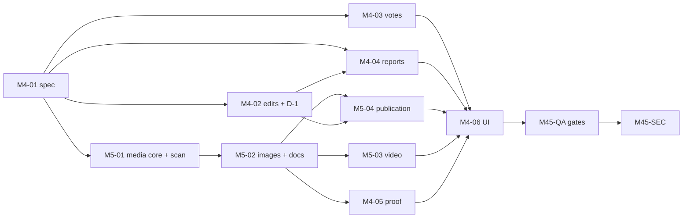
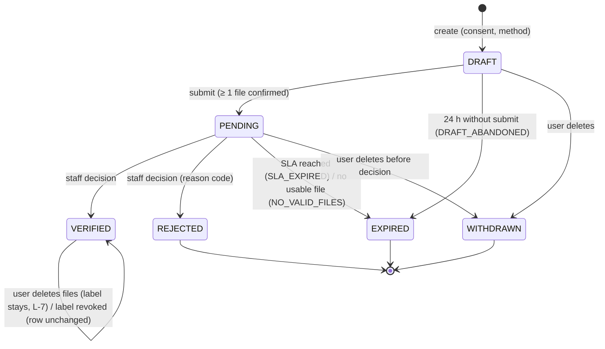

# M4 + M5 Spec: Votes, Edits, Reports, Verified Buyer Proof, Full Media Pipeline

| | |
|---|---|
| **Status** | Proposed. Task #67 (M4-01). Becomes binding when merged with CEO approval. **This one document covers both M4 and M5. No separate M5 spec task is needed** |
| **Owner** | Software Architect |
| **Implements** | Threats F-2, F-4, F-9 (report side), R-1…R-7, R-10, U-1…U-12 ([threat-model.md](../security/threat-model.md)). Every M4 and M5 case in [test-case-catalogue.md](../qa/test-case-catalogue.md) (§13 maps each one) |
| **Decisions** | [ADR-0008](../adr/0008-verified-buyer-approach.md) verified buyer (implemented here) · [ADR-0006](../adr/0006-media-storage-and-processing.md) / [ADR-0012](../adr/0012-media-job-decomposition.md) media (implemented here) · **new** [ADR-0022](../adr/0022-in-house-proof-redaction.md): proof redaction in-house in the `media` group · **new** [ADR-0023](../adr/0023-ingest-least-privilege-and-publication-gate.md): confirm without `HEAD`, publication gate enforced in the DB |
| **Builds on** | [media-pipeline.md](./media-pipeline.md), [job-catalogue.md](./job-catalogue.md), [moderation-lifecycle.md](./moderation-lifecycle.md) (T11 as changed, T13–T18, R1–R8), [data-model.md §6.2/§7](./data-model.md#62-verified-buyer-proof-redaction-and-deletion) |
| **Open items** | [open-questions.md §6](./open-questions.md#6-m4--m5-votes-edits-reports-proof-media-task-67) (M45-Q1 … M45-Q22). Every item has a default decision |

This spec is documentation only. Code shapes are given as Prisma or TypeScript signatures so the implementing tasks share one contract.

---

## 0. Scope, baseline and assumptions

### 0.1 Scope

| In M4 (this spec) | In M5 (this spec) | Not in M4/M5 |
|---|---|---|
| §2 Helpful / not-helpful votes: limits, self-vote ban, seller-member ban, anti-abuse | §6 Upload slots for review media (photo + video) and evidence (image + PDF) | Trust-weighted votes, vote maturity, velocity freezes (M7: TRS-001/002) |
| §3 Review edits of `PUBLISHED` reviews, immutable revision history (R1–R8), media per revision | §7 `media.scan`: ClamAV `clamd` sidecar, banned hash, verified staging copy (ADR-0012) | AI re-scan on reports (T11 rescan, T15 hide) (M6) |
| §4 Reporting reviews **and seller replies** (closes M3b-Q10). Report cases. Staff dismiss and remove (T17, T18) | §8 `media.image`: sanitise and verify (exiftool on outputs), variants, PDF rasterise, hash-match hook, sandbox | Appeals of removals, label revocations and proof rejections (M6) |
| §5 Verified Buyer proof per ADR-0008: upload, in-house redaction, AI hints on redacted copies only, staff decision, label rules, revocation, retention | §9 `media.transcode`: 720p H.264, probe limits, poster | `proof.view_original` break-glass (M6, PRV-003). Until then **nobody** on staff can open an original |
| | §10 Promote/demote with CDN purge, public bucket, media headers, **no public object before scan + moderation (MED-037)** | In-app notification inbox (M7). M4/M5 send mandatory notices by email |
| | §11 ClamAV signature freshness alert (INF-003), bucket access (INF-002), retention and purge | Resumable multipart upload (MD-2), managed transcoding (T-12), audio moderation |

### 0.2 Code baseline (read at `b7d3bf6`)

| Area | Today | Consequence for this spec |
|---|---|---|
| Votes | **Not present.** Only `Review.helpfulCount` / `notHelpfulCount` (`schema.prisma:224`) and an unused `EnforcementType.VOTING_RESTRICTION` | §2 adds the model, endpoints and limits |
| Review edits | `updateOwnReview` (`apps/web/src/server/reviews.ts:75`) works **only while `PENDING`**. It marks the old revision `SUPERSEDED` and writes a new one. Other statuses return 409 `not_editable` | §3 adds editing of `PUBLISHED` reviews (R1–R8). The `PENDING` path stays as it is |
| **Defect D-1** | `createReview` and `updateOwnReview` write the outbox payload `{reviewId, version}` (`reviews.ts:55`, `:92`). The worker parses `moderationJobSchema` `{subjectType, subjectId, version}` (`processors.ts:38`). So **every review moderation job fails validation**. Seller replies use the right shape. Tests use the right shape, so the bug is not caught | M4-02 fixes this first (§1). New case REV-001 pins it. E2E-001 cannot pass until it is fixed |
| Verified buyer | MVP fields `Review.verifiedBuyer`, `verifiedAt`, `verifiedOrderId`. `markVerifiedBuyer` and `StubPurchaseLookup` (`packages/core/src/verified-buyer.ts`) are called from the **moderation job** (`processors.ts:41`) | This conflicts with ADR-0008 ("humans decide"). §5.10 removes it and replaces the fields with `verifiedPurchaseAt` / `verificationMethod` / `verifiedProofId` |
| Reports, `PurchaseProof`, `TrustSignal` | **Not present** | §4, §5 and §12 add them |
| ModerationCase | One case per `(reviewId, version)`. `ModerationState` {PENDING, AI_REVIEW, NEEDS_HUMAN, APPROVED, REJECTED}. No lanes, no `SUPERSEDED`. Admin list, detail, approve and reject exist (`/api/admin/moderation/*`). There is no staff removal of a `PUBLISHED` review | §3.4 and §4.3 add `trigger`, `seq`, `SUPERSEDED` and report cases. Full lanes and leases stay in M6 |
| Media (MVP, M2-3) | Images only (jpeg/png/webp, 10 MiB, **5** per review). `POST /api/reviews/:id/media` presigns a PUT to `rp-ingest`. `POST /api/media/:id/confirm` runs `HEAD`, then emits `media.uploaded`. One worker job (`apps/worker/src/media.ts`) sniffs the type, re-encodes with sharp in-process (`thumb` 256, `medium` 1024 WebP) into `rp-private`, deletes the ingest object, and sets `READY`/`FAILED`. Public reads return **presigned GETs of the private bucket** (TTL 900 s). `failureReason` is a string. There is no scan, video, promote/demote, public bucket use, `chk_media_public_bucket` or clamd | §6–§11 replace the single job with the ADR-0012 step jobs. The routes stay, with extended contracts |
| Already on `main`, **not redone** (CEO note) | #61 (QA-M3B-01, 03, 04, 05), #62 ingest bucket 24 h lifecycle and app-origin CORS on MinIO plus the R2 runbook (`docs/security/ingest-bucket-hardening.md`, `scripts/t08-minio-check.sh`), #63, #64 (AUT-022, SEL-023/024, SEL-035). From M2: content-length-signed presign (SEC-013), the MVP EXIF strip and MED-039 test, the 10-min upload sweep (`expireStaleUploads`, SEC-03) | Reused as-is. The ingest lifecycle is **1 day** (from #62), which is stricter than the 2 days in ADR-0006. The 1-day rule stands |
| Outbox relay | Unrouted event types are logged and **marked published** (`outbox.ts:47`). This contradicts ADR-0007 §3 | Every event added here has a route. New case OUT-008 checks that every emitted type literal has a route (M45-Q21) |
| Errors | `HttpError(status, code, message?, headers?, details?)` produces `{error:{code,message,…}}`. Codes are lower snake case. Authz codes are UPPER_SNAKE | §14 follows this |
| Rate limits | `limitReviewWrite` (10/h, 30/d), `limitUploadSlot` (20/h) plus `MEDIA_DAILY_QUOTA` 50 per 24 h (`apps/web/src/server/ratelimit.ts`). No limits yet for vote, report or proof | §15 adds them |

### 0.3 Assumptions (cheap to reverse)

- **D-A1.** Pre-launch, so there are no production users (as B-1 in the M3b spec). Migrations may drop the MVP verified-buyer fields. Existing `MediaAsset` rows are mapped (§12.2), not reprocessed.
- **D-A2.** The PM maps work-package labels (§1) to task ids.
- **D-A3.** Until M7 trust bands exist, a **NEW** account is one created less than `VOTE_NEW_ACCOUNT_DAYS` (7) days ago. The same definition halves the vote and upload limits (M45-Q6).
- **D-A4.** Every new table follows ADR-0004 and ADR-0010: cuid ids, UTC `DATETIME(3)`, snake_case plural `@@map`. FKs used by CHECKs are `Restrict` (MySQL ER 3823). CHECKs are written by hand in migration SQL as `chk_<table>_<rule>`.
- **D-A5.** Notifications are sent by email only, through the existing `notifications` processor and mail templates. In-app rows come in M7 (M45-Q20).
- **D-A6.** Libraries: `file-type` (magic bytes) behind our own allow-list; the clamd TCP `INSTREAM` protocol (a small in-repo client, no npm wrapper); `sharp` (in a sandboxed child process); system binaries `ffmpeg`/`ffprobe`, `exiftool`, `pdfinfo`/`pdftoppm` (poppler), `tesseract` (eng), `zbarimg`, `bwrap`. All of them are pinned in the worker image (INF-004).

---

## 1. Work packages and dependencies

| WP | Title | Contents | Migration |
|---|---|---|---|
| **M4-01** | This spec (#67) | Spec, ADR-0022, ADR-0023, open questions | none |
| **M4-02** | Edits and revisions | **D-1 fix first.** §3: edits of `PUBLISHED` reviews, worker revision branch (R2–R4), staff approve/reject of `HELD` revisions (R5, R6), case `trigger`/`seq`/`SUPERSEDED`, media per revision | `20261214000000_review_edits` |
| **M4-03** | Votes | §2 | `20261215000000_review_votes` |
| **M4-04** | Reports | §4: `Report`, report cases, staff dismiss/remove, `review.removed` notice | `20261216000000_reports` |
| **M5-01** | Media core and scan | §6, §7, §11.1–§11.3: `MediaAsset` rework, `MediaProcessingLog`, `BannedMediaHash`, `TrustSignal`, slot and confirm contracts, confirm without `HEAD`, `media.scan` with clamd sidecar, freshness check, MinIO users and policies (INF-002), worker image, `media` worker group | `20261220000000_media_pipeline` |
| **M5-02** | Images and documents | §8: `media.image` (review variants, evidence master, PDF rasterise), sandbox, exiftool verification, hash-match hook | none |
| **M5-03** | Video | §9: `media.transcode` on `media-video` | none |
| **M5-04** | Publication | §10, §11.4: promote/demote/purge, public URLs, CDN purger, media headers, retention sweeps, moderation media wait (MED-030) | none (the CHECK ships in M5-01) |
| **M4-05** | Verified Buyer proof | §5: `PurchaseProof`, endpoints, `media.redact`, `verification.assess-proof`, staff queue and decision, revocation, proof retention, label and filter | `20261222000000_purchase_proofs` |
| **M4-06** | UI | Vote control, edit with history, report dialog, proof flow, staff proof queue, reports lane, methodology page, video upload and failure states | none |
| **M45-QA** | QA gates | M4 gate and M5 gate (test-strategy §M4/§M5). They can run as one combined run | none |
| **M45-SEC** | Security review | F-2, F-4, R-1…R-10, U-1…U-12 against M4-02 … M4-06 | none |



**Ordering note.** The proof flow (M4-05) uploads evidence through the M5 pipeline, so M5-01 and M5-02 must merge before M4-05. That is why one spec covers both milestones. The M4 gate cannot close before M5-02.

---

## 2. Helpful votes (F-2, SEC-009, AZ-012)

### 2.1 Rules

| Rule | Detail |
|---|---|
| One vote per user per review | `ReviewVote` primary key `(reviewId, userId)`. Value `HELPFUL` or `NOT_HELPFUL` |
| Change and retract | `PUT` with the other value switches it. `DELETE` retracts it. `PUT` with the same value is a no-op (200, no write, no limit charge) |
| Target | The review must be `PUBLISHED`. Any other status, or a missing review → 404 `not_found` (AZ-022 same-404 rule) |
| Self-vote ban | `review.authorId = caller` → 403 `SELF_VOTE` |
| Seller members | An active `SellerMember` of `product.sellerId` → 403 `CONFLICT_OF_INTEREST` (AZ-012, ADR-0003 §3.6) |
| Account | Signed in, email verified (`requireVerifiedUser`), status `ACTIVE`, 2FA gate as for any action. An active `VOTING_RESTRICTION` `EnforcementAction` → 403 `VOTING_RESTRICTED` |
| Limits | 60 vote writes per hour per user (NEW: 20). 300 per hour per `ipHash`. Over the limit → 429 `rate_limited` with `Retry-After` |
| After the review leaves `PUBLISHED` | Votes are kept and cannot be changed (404). If the review is restored, the votes count again |
| After an edit | Votes are kept (M45-Q5) |
| Counts | `Review.helpfulCount` / `notHelpfulCount` are a cache. They are updated in the **same transaction** as the vote with relative increments (`+1`/`−1`, never read-modify-write). The daily sweeper `maintenance.vote-counts` recomputes them and logs any drift |
| Anti-abuse data for M7 | `ipHash` (keyed hash, nulled after 90 days, L-11) and `createdAt` are stored. M7 adds weights, maturity gating and velocity freezes (TRS-001/002). **M4 counts every vote with weight 1** |
| Public display | Counts only. Who voted is never shown and never returned to anyone except the voter (own vote) |

### 2.2 API

| Method and path | Body | Success | Errors |
|---|---|---|---|
| `PUT /api/reviews/:id/vote` | `{ value: "HELPFUL" \| "NOT_HELPFUL" }` | 200 `{ value, helpfulCount, notHelpfulCount }` | 400 `validation_error` · 401 `unauthenticated` · 403 `EMAIL_NOT_VERIFIED` / `SELF_VOTE` / `CONFLICT_OF_INTEREST` / `VOTING_RESTRICTED` · 404 `not_found` · 429 `rate_limited` |
| `DELETE /api/reviews/:id/vote` | — | 200 `{ value: null, helpfulCount, notHelpfulCount }` (also when there was no vote) | as above |
| Review DTOs (`GET /api/products/:id/reviews`, `GET /api/reviews/:id`) | — | `myVote: "HELPFUL" \| "NOT_HELPFUL" \| null` for a signed-in caller | — |

### 2.3 Server shape

```ts
// packages/core/src/votes.ts (pure)
export type VoteDeny = "SELF_VOTE" | "CONFLICT_OF_INTEREST" | "VOTING_RESTRICTED" | "EMAIL_NOT_VERIFIED" | "NOT_FOUND";
export function authorizeVote(ctx: {
  callerId: string; emailVerified: boolean; votingRestricted: boolean;
  review: { authorId: string; status: ContentStatus; sellerId: string | null } | null;
  callerSellerIds: readonly string[];
}): { ok: true } | { ok: false; deny: VoteDeny };
// Delta of the cached counters for (old → new): e.g. (null → HELPFUL) = {h:+1,n:0}, (HELPFUL → NOT_HELPFUL) = {h:-1,n:+1}
export function voteDelta(prev: VoteValue | null, next: VoteValue | null): { h: -1 | 0 | 1; n: -1 | 0 | 1 };
```

The web module `apps/web/src/server/votes.ts` runs the upsert or delete and the counter update in one transaction. It writes **no** audit row per vote (volume). The vote row itself is the record. No outbox event in M4.

---

## 3. Review edits and revision history (MOD-019, moderation-lifecycle §4.2)

### 3.1 Which status may be edited

| Review status | Edit | Path | Moderation |
|---|---|---|---|
| `PENDING`, `HIDDEN` | allowed | **T14 (existing code path).** The row is updated in place with `currentVersion + 1`. The old open revision and the old open case become `SUPERSEDED` | new case `(reviewId, v, trigger EDIT)` |
| `PUBLISHED` | allowed (**new**) | **R1.** A new `ReviewRevision(v, PENDING)` is written. The review row stays `PUBLISHED` and keeps the live text of `publishedVersion`. An earlier `PENDING`/`HELD` revision and its open case become `SUPERSEDED` in the same transaction | new case `(reviewId, v, EDIT)`. R2–R8 below |
| `REJECTED`, `REMOVED` | refused, 409 `not_editable` | ADR-0003 rule. T20 (resubmit) comes with M6 appeals (M45-Q3) | — |
| `DELETED` | refused, 404 | — | — |

**Where the live text lives.** While a review is `PUBLISHED`, `reviews.rating/title/body/incentive` hold the text of `publishedVersion`. A pending edit exists only in `review_revisions` until it is approved. On approval (R2, R5, R8) the revision is copied onto the row in the same transaction. Public reads therefore never see unapproved text, and need no join.

### 3.2 Revision transitions in M4

| # | From | Event | Actor | To | Effect |
|---|---|---|---|---|---|
| R1 | — | author edits a `PUBLISHED` review | AUTHOR | `PENDING` | `currentVersion = v`, `editedAt` unchanged until approval. Outbox `review.edited` |
| R2 | `PENDING` | assessment CLEAN | AI | `APPROVED` | copy to row, `publishedVersion = v`, `editedAt = now`. M5: promote newly visible media, demote media detached in `v`. The `POST_REVIEW` +24 h item is M6 |
| R3 | `PENDING` | VIOLATION | AI / RULE | `REJECTED` | live version unchanged. Email `REVISION_REJECTED` with the reason |
| R4 | `PENDING` | UNSURE / AI failure / media timeout | AI / RULE | `HELD` | case `NEEDS_HUMAN`, live version unchanged. The 7-day hold timer (R7) is M6 |
| R5 | `HELD` | staff approve (`POST /api/admin/moderation/:id/approve`, existing) | MOD | `APPROVED` | as R2 |
| R6 | `HELD` | staff reject (existing reject route) | MOD | `REJECTED` | as R3 |
| — | `PENDING`/`HELD` | author edits again | AUTHOR | `SUPERSEDED` | the case also becomes `SUPERSEDED`. A late job for it is a no-op (version guard) |

The worker's moderation job branches on `review.status`: `PUBLISHED` with `case.version > publishedVersion` takes the revision path, and anything else takes the existing T2–T4 path. Every write is guarded with `WHERE status = … AND currentVersion = case.version`. A zero-row result is a no-op (moderation-lifecycle §4).

### 3.3 Rules and limits

- **Fields.** `rating`, `title`, `body` and `incentive` may change. `productId` may not. Validation is the same as for create (`reviewInput`).
- **Optimistic lock.** The request carries `expectedVersion`. A mismatch → 409 `version_conflict` (the existing PENDING path keeps returning `not_editable` for the same case; both codes are accepted by the UI).
- **Limits.** Edits of `PUBLISHED` reviews: **5 per user per day** (`review:edit:u:d`, threat-model §5). `PENDING` edits keep the existing `limitReviewWrite`.
- **The verified label survives edits.** It is about the purchase, not the text (ADR-0008).
- **Votes survive edits** (M45-Q5).
- **Revision history** is visible to the author and to staff only. The public sees an "Edited" marker with `editedAt` (M45-Q4). Revisions are immutable. No API updates or deletes them.
- **Ownership.** A caller who is not the author gets 404 `not_found`. The authz result records the deny reason `NOT_OWNER`, which AZ-023 asserts (§13). Guessed ids behave the same way.

### 3.4 Media per revision

Today SEC-02 allows attachments only while the review is `PENDING`, and public media is "assets created before `publishedAt`". With live edits that rule is replaced by explicit version columns on `MediaAsset`:

- `attachedInVersion Int?`: the first review version whose moderation covered this asset. `NULL` means staged: a slot was issued for a `PUBLISHED` review and the next edit has not yet claimed it.
- `detachedInVersion Int?`: the first version that no longer shows it.
- **Visible in version `v`** ⇔ `attachedInVersion ≤ v AND (detachedInVersion IS NULL OR detachedInVersion > v)`.
- **Public** ⇔ visible in `publishedVersion` AND `bucket = PUBLIC` (M5; in M4 the MVP rule "READY and review PUBLISHED" applies to visible assets).
- Edit body `{ …, addMediaIds?: string[], removeMediaIds?: string[] }`. Added assets must belong to the caller, have purpose `REVIEW_MEDIA`, be staged on this review, and be `PROCESSING` or `READY`. Otherwise → 409 `media_not_attachable`. The per-review limits (§6.1) apply to the set visible in the new version.
- The moderation case for version `v` assesses exactly the assets visible in `v`. Staged assets that no edit claims within 24 h are purged (`maintenance.media-orphans`).
- An asset that is not `READY` when its version is approved is detached in that version (`detachedInVersion = v`) in the approving transaction. So media that no moderator saw can never become public later.

### 3.5 API

| Method and path | Body | Success | Errors |
|---|---|---|---|
| `PATCH /api/reviews/:id` (extended) | `{ expectedVersion, rating?, title?, body?, incentive?, addMediaIds?, removeMediaIds? }` | 200 own DTO with `currentVersion`, `publishedVersion`, `pendingRevision: {version, status} \| null` | 400 `validation_error` · 404 `not_found` · 409 `not_editable` / `version_conflict` / `media_not_attachable` / `media_limit` · 429 `rate_limited` |
| `GET /api/reviews/:id/revisions` (new) | — | 200 `[{version, status, rating, title, body, createdAt}]`, newest first. Author and staff (`requireAdmin`) only | 404 `not_found` |
| `DELETE /api/reviews/:id` (extended) | — | 204. Now allowed from `PENDING`, `HIDDEN`, `PUBLISHED` (T13), plus `REJECTED`/`REMOVED` (T19). Every open case → `SUPERSEDED`. M5: `media.demote_requested` per public asset. M4-05: proof files purged | 404 `not_found` |

---

## 4. Reporting (reviews and seller replies)

### 4.1 Rules

| Rule | Detail |
|---|---|
| Targets | `PUBLISHED` reviews and `PUBLISHED` seller replies. **This closes M3b-Q10.** Other targets in the draft arc (comment, post, user, seller, product, media) are added later as additive columns |
| Reporter | Signed in, email verified, `ACTIVE`. Reporting your own content → 403 `SELF_REPORT` |
| Reason | `ReportReason` enum (draft list). `details` is optional plain text, at most 1 000 characters, stored as typed and rendered escaped (SEC-006). It is **never** written to logs, outbox payloads, job payloads or AI requests |
| Duplicates | One report per reporter per target (unique index). A repeat returns the same 202 body and changes nothing |
| Limits | 20 per user per day, 50 per `ipHash` per day (`report:u:d`, `report:ip:d`) |
| Effect | **Content always stays live** (moderation-lifecycle T11 as changed, F-9). The report joins the target's open report case, or opens one (§4.3). In M4 a human decides. The AI re-scan is M6 |
| Priority | `ModerationCase.reportCount` counts distinct reporters, and `reportWeight` sums `Report.weight`: 0 for NEW accounts, 1 otherwise. The staff list sorts by `reportWeight`, then by age |
| Reporter feedback | `GET /api/me/reports` lists the caller's reports with status. No notification in M4 (M7) |

### 4.2 API

| Method and path | Body | Success | Errors |
|---|---|---|---|
| `POST /api/reviews/:id/reports` | `{ reason, details? }` | 202 `{ status: "received" }` | 400 `validation_error` · 401 · 403 `EMAIL_NOT_VERIFIED` / `SELF_REPORT` · 404 `not_found` · 429 `rate_limited` |
| `POST /api/seller-replies/:id/reports` | same | same | same |
| `GET /api/me/reports` | — | 200 `[{id, targetType, targetId, reason, status, createdAt, resolvedAt}]` | 401 |
| `GET /api/admin/moderation?trigger=USER_REPORT` (extended) | — | report cases with `reportCount`, `reportWeight`, reason histogram. Detail adds the reports (reason, details, reporter id only, `createdAt`) | existing |
| `POST /api/admin/moderation/:id/dismiss-reports` (new, T18) | `{ note? }` | 200. Case `APPROVED` (`decisionReason = REPORTS_DISMISSED`). Reports → `NO_ACTION` | 409 `invalid_transition` · 403 `CONFLICT_OF_INTEREST` |
| `POST /api/admin/moderation/:id/remove` (new, T17) | `{ reasonCode, publicReason }` | 200. Target `PUBLISHED → REMOVED`. Case `REJECTED`. Reports → `ACTION_TAKEN`. Other open cases on the target → `SUPERSEDED`. Outbox `review.removed` (email `CONTENT_REMOVED` with the statement of reasons). M5: `media.demote_requested` per public asset | 400 `reason_required` / `validation_error` · 409 `invalid_transition` · 403 `CONFLICT_OF_INTEREST` |
| `POST /api/admin/reports/:id/reject` (new) | `{ note? }` | 200. That report → `REJECTED` (abusive). It no longer counts toward the case | 409 `invalid_transition` |

Staff routes use `requireAdmin` + `requireTwoFactor` (the staff gate) and the COI guard. Removal targets a seller reply through the existing `seller_reply.removed` path. `reasonCode` comes from `REMOVAL_REASON_CODES` in `packages/core`: the `ReportReason` values except `OTHER`, plus `POLICY_OTHER`.

### 4.3 Report cases on the existing `ModerationCase`

M6 will add lanes and leases. M4 needs only "one open report case per target, many over time", which the current `@@unique([reviewId, version])` cannot hold. Changes (M4-02 migration, see §12.1):

- `trigger ModerationTrigger @default(SUBMISSION)` with values `SUBMISSION | EDIT | USER_REPORT`.
- `seq Int @default(1)`. It is 1 for `SUBMISSION`/`EDIT`. For report cases it is 1 + the number of earlier report cases on the same `(target, version)`.
- The unique keys become `(reviewId, version, trigger, seq)` and `(sellerReplyId, version, trigger, seq)`.
- `openReportKey String? @unique`. It is `R:<reviewId>` or `S:<sellerReplyId>` while the report case is open (`NEEDS_HUMAN`), and `NULL` once it is resolved. MySQL allows many NULLs. Two concurrent first reports race on this key: the loser catches P2002 and joins the winner's case.
- `ModerationState` gains `SUPERSEDED`.
- Existing approve and reject routes refuse report cases (409 `invalid_transition`). Dismiss and remove refuse non-report cases.

Alternatives considered: a separate `ReportCase` table (M6 would have to merge it back into `ModerationCase`), and a nullable `version` for report cases (changes the type of every existing reader). Both were rejected (M45-Q1).

---

## 5. Verified Buyer proof (ADR-0008, PRV-*)

### 5.1 What the label means and how it is shown

- Label text: **"Verified purchase · receipt"**, **"· order confirmation"** or **"· marketplace order"**, by `verificationMethod`. A tooltip links to the methodology page `/trust/verified-purchases` (copy pending Legal L-2, M45-Q22).
- Products show the verified share ("38 of 120 reviews verified"). `GET /api/products/:id/reviews?verified=true` filters on it. Both are computed at read time from index `(productId, status, verifiedPurchaseAt)`. A cache comes with M7 aggregates. Rating averages include all published reviews (C-6).
- The label is set **only** by a staff decision (§5.6). No job sets it. `proof.autoVerify` is reserved: when `PROOF_AUTO_VERIFY=true` the worker and web refuse to start until a CEO decision (C-3).

### 5.2 Proof states



- `DRAFT` is new compared with the draft schema. It keeps incomplete proofs out of the staff queue.
- `EXPIRED` and `WITHDRAWN` are not decisions. They do not count as attempts. `NO_VALID_FILES` (every file rejected or failed) ends as `EXPIRED`, not `REJECTED`, because ADR-0008 §4 forbids automatic rejection (M45-Q10).
- A queue item is a `PENDING` proof with `filesReadyAt` set.

### 5.3 Eligibility and limits

| Rule | Default | Error |
|---|---|---|
| Only the review author, review in `PENDING`, `HIDDEN` or `PUBLISHED` | — | 404 `not_found` (others) |
| The review has no label yet | — | 409 `already_verified` |
| No active `VERIFIED_LABEL_REVOKED` on this review | — | 409 `label_revoked` (M45-Q11) |
| At most one open (`DRAFT`/`PENDING`) proof per review | `openKey` unique | 409 `proof_open_exists` |
| Attempts: count of `REJECTED` proofs on the review | `PROOF_MAX_ATTEMPTS` = 3 | 409 `proof_attempts_exhausted` |
| Proof creations per user per day | 5 (`proof:u:d`) | 429 `rate_limited` |
| Files per proof | `PROOF_MAX_FILES` = 5 | 409 `proof_file_limit` |
| File types | JPEG, PNG, WebP (HEIC per M45-Q17), PDF ≤ 20 pages, each ≤ 10 MiB | 413 / 415 at slot, `REJECTED` in the pipeline |
| Consent (L-6 working assumption) | `consentVersion` must equal the current `PROOF_CONSENT_VERSION` | 400 `consent_required` |
| `MARKETPLACE_ORDER_LINK` | needs `marketplace` (`AMAZON`, `EBAY`, `ETSY`, `OTHER`) and `orderReference` (1–64 chars). The web app hashes it at once (§5.5). The raw value is never stored or logged | 400 `validation_error`; 503 `service_unavailable` if the HMAC key is missing (fail closed) |

### 5.4 Flow

```mermaid
sequenceDiagram
  autonumber
  participant U as Author
  participant W as Web
  participant I as rp-ingest
  participant MQ as media group (no external network)
  participant VQ as verification (core)
  participant S as Staff (MODERATOR+, 2FA)
  U->>W: POST /api/reviews/:id/proofs {method, consentVersion}
  W->>W: tx: PurchaseProof(DRAFT, openKey=reviewId) + audit proof.created
  loop 1..5 files
    U->>W: POST /api/proofs/:id/files {kind, mimeType, sizeBytes}
    W-->>U: presigned PUT (purpose PURCHASE_PROOF, visibility PRIVATE)
    U->>I: PUT bytes
    U->>W: POST /api/media/:assetId/confirm
  end
  U->>W: POST /api/proofs/:id/submit
  W->>W: tx: DRAFT→PENDING, submittedAt, slaDueAt = +72 h
  MQ->>MQ: media.scan → media.image (evidence master, PDF pages)
  MQ->>MQ: media.redact: OCR in sandbox, PII mask (fail closed), order number → HMAC, forgery booleans. OCR text discarded
  MQ->>MQ: tx: redacted derivative assets; when every file is terminal: filesReadyAt + outbox proof.files_ready
  VQ->>VQ: verification.assess-proof: AI extraction on REDACTED pages only (or skipped on budget), duplicate checks
  S->>W: GET /api/admin/proofs, /:id (redacted pages only, audited)
  S->>W: POST /api/admin/proofs/:id/decide
  W->>W: tx: status, label fields, TrustSignal, audit, outbox proof.decided
  W-->>U: email PROOF_VERIFIED / PROOF_REJECTED
  MQ->>MQ: media.purge originals (AT_DECISION); redacted copies at decision + 90 d
```

### 5.5 Redaction (`media.redact`, ADR-0022)

Runs in the `media` group, which has no external network. Originals never leave our infrastructure (R-3). Input: the sanitised evidence `master` pages written by `media.image` (§8.3).

1. **OCR** each page with `tesseract` (eng, `--psm 3`, TSV output with word boxes and confidences), inside the sandbox (§8.4).
2. **Detect PII** in the word boxes: email addresses; phone numbers (`libphonenumber-js`); card numbers (13–19 digits passing Luhn, and masked forms such as `**** 1234`); IBANs; postcode-bearing address lines and the 3 lines after labels such as *Ship to*, *Bill to*, *Deliver to*, *Customer*, *Name*; order, invoice and account numbers (after hashing, step 4); barcodes and QR codes (`zbarimg` regions).
3. **Mode.**
   - `AUTO`: mean word confidence ≥ `PROOF_OCR_MIN_CONFIDENCE` (0.80), at least 20 words, and the detector ran without error. Every PII box is masked with an 8 px margin.
   - `FULL_MASK` (fail closed, PRV-005): any of those conditions is false. Everything is masked **except** the boxes classified as merchant (top lines matched to the merchant list, or the largest text line), date (date patterns), and totals (lines containing *total*, *amount*, *sum*). If none of those is found, the whole page is masked (`FULL_MASK` with flag `REDACTION_UNREADABLE`).
   - Masks are solid black. The page is re-encoded from pixels as PNG, so there are no layers.
4. **Order reference.** The detected order number is normalised (upper case, `[A-Z0-9]` only) and hashed in memory: `orderReferenceHash = HMAC-SHA256(key[keyId], merchantSlug + ":" + normalised)`. The key comes from `ORDER_REF_HMAC_KEYS`, a list `keyId:base64`, newest first (R-6). The raw value is dropped. `merchantSlug` is `unknown` when no merchant is matched.
5. **Forgery signals** (booleans only, values never kept): `PRODUCER_EDITOR` (PDF producer or creator in the editor list), `PDF_MODIFIED` (ModDate more than 1 day after CreationDate), `IMAGE_EDITOR_TAG` (EXIF `Software` in the editor list, read before the strip in `media.image` and passed on as a boolean), `ELA_ANOMALY` (error-level analysis score above threshold; a signal only).
6. **Output.** One derived `MediaAsset` per original file: `isRedacted = true`, `derivedFromId` = the original, purpose `PURCHASE_PROOF`, `variants.pages[]`. `PurchaseProof.redactionMode` is the worst mode over all files. `redactedAt` is set. Then, in the same transaction, if every file of the proof is terminal: `filesReadyAt`, plus outbox `proof.files_ready`. If no file is usable: `EXPIRED (NO_VALID_FILES)` plus outbox `proof.expired`.
7. **Never persisted:** OCR text, word boxes, the raw order number, EXIF values. The job log records counts and the mode only (PRV-001).

### 5.6 Assessment and staff decision

**`verification.assess-proof`** (core group, `verification` queue). It reads the redacted pages through the private bucket, and sends only redacted page images plus the product's name and brand to the `ProofExtractor` provider (zero-retention flag, EU region per L-6). It writes `aiAssessment` (schema below), `merchantName`, `purchaseDate`, `assessedAt`. Duplicate checks:

| Check | Result |
|---|---|
| Same `sha256` as a file of another proof (tombstones included) | flag `DUPLICATE_FILE`; other account → `TrustSignal DUPLICATE_PROOF_DETECTED` |
| pHash distance ≤ 6 to another proof's page | flag `NEAR_DUPLICATE_IMAGE` |
| Same `orderReferenceHash` on another account | flag `DUPLICATE_ORDER_OTHER_ACCOUNT` + `TrustSignal DUPLICATE_PROOF_DETECTED` (PRV-008). Never auto-verified |
| Same `orderReferenceHash`, same account, other review | flag `DUPLICATE_ORDER_SAME_ACCOUNT` (an order can contain several products; a flag only) |
| `purchaseDate` in the future, or after `review.createdAt` | flag `DATE_IN_FUTURE` / `DATE_AFTER_REVIEW` |
| Product match score < 0.5, merchant not matched | flag `PRODUCT_MISMATCH` / `MERCHANT_UNKNOWN` |

If the daily budget `PROOF_AI_DAILY_BUDGET` (500 calls) is spent, or the provider fails after 3 attempts, the job writes `aiAssessment.skipped` and the proof still enters the queue without hints (R-10). It is never decided automatically.

```ts
// packages/core/src/proofs.ts. Allow-list schema; parse() strips everything else (PRV-001)
export const proofAssessment = z.object({
  v: z.literal(1),
  provider: z.string().max(32), model: z.string().max(64), promptVersion: z.string().max(16),
  merchant: z.object({ name: z.string().max(120), confidence: z.number().min(0).max(1) }).optional(),
  purchaseDate: z.object({ date: z.string().date(), confidence: z.number().min(0).max(1) }).optional(),
  productMatch: z.number().min(0).max(1).optional(),
  flags: z.array(ProofFlag).max(20),
  skipped: z.enum(["BUDGET", "PROVIDER_ERROR"]).optional(),
}).strict();
```

**Queue and decision.**

| Method and path | Who | Behaviour |
|---|---|---|
| `GET /api/admin/proofs?status=PENDING` | MODERATOR+ with a 2FA-verified session | Items with `filesReadyAt`, ordered by `slaDueAt`, then flag weight. Shows method, flags, extracted fields, the author's earlier proof outcomes (counts only) |
| `GET /api/admin/proofs/:id` | same + COI | Signed GET URLs (300 s) for **redacted pages only**. Writes `AuditLog proof.view_redacted` on every call. The UI overlays a watermark with the moderator id (R-2) |
| `POST /api/admin/proofs/:id/decide` `{ outcome: "VERIFIED" \| "REJECTED", reasonCode?, note? }` | same + COI | Conditional update `PENDING → outcome` where `filesReadyAt IS NOT NULL`. REJECTED needs a `ProofDecisionReason`. VERIFIED sets the three label fields where `verifiedProofId IS NULL` and the review is not `DELETED`/`REMOVED`. Writes `TrustSignal VERIFIED_PURCHASE` (or `PROOF_REJECTED_FRAUD` for `SUSPECTED_FORGERY` / `DUPLICATE_PROOF`), audit `proof.verified` / `proof.rejected`, and outbox `proof.decided` |
| `POST /api/admin/reviews/:id/verified-label/revoke` `{ reasonCode, publicReason }` | SENIOR_MODERATOR+, step-up within 10 min, COI | One transaction: `EnforcementAction(VERIFIED_LABEL_REVOKED, subjectUserId = author, subjectReviewId)`; the three label fields cleared together; proof row unchanged. Audit `review.verified_label_revoked`. Outbox `review.verified_label_revoked` (email). The verified share changes at once because it is computed at read time (PRV-013) |

COI for every proof route: the staff member is not the review author and not a member of the product's seller (ADR-0003 guard 6). Errors: 409 `invalid_transition` (not `PENDING`), 409 `proof_not_ready`, 409 `review_not_verifiable`, 400 `reason_required`, 403 `CONFLICT_OF_INTEREST`, 403 `FORBIDDEN_ROLE`, 401 `STEP_UP_REQUIRED`, 403 `TWO_FACTOR_REQUIRED`.

`ProofDecisionReason`: `UNREADABLE`, `NOT_A_PURCHASE_DOCUMENT`, `PRODUCT_MISMATCH`, `MERCHANT_UNVERIFIABLE`, `DATE_INVALID`, `DUPLICATE_PROOF`, `SUSPECTED_FORGERY`, `OTHER`. Fraud handling beyond the trust signal (a case and enforcement) is M6.

### 5.7 Author API

| Method and path | Body | Success | Errors |
|---|---|---|---|
| `POST /api/reviews/:id/proofs` | `{ method, consentVersion, marketplace?, orderReference? }` | 201 `{ id, status: "DRAFT" }` | §5.3 |
| `POST /api/proofs/:id/files` | `{ kind: "IMAGE" \| "DOCUMENT", mimeType, sizeBytes }` | 201 slot (§6.3) | 409 `proof_not_draft` / `proof_file_limit`, §6.3 |
| `POST /api/proofs/:id/submit` | — | 200 `{ status: "PENDING", slaDueAt }` | 409 `proof_not_draft` / `proof_files_missing` |
| `GET /api/reviews/:id/proofs` | — | 200 own proofs: status, method, dates, `decisionReasonCode`, `closeReason`. No staff identity, no flags | 404 |
| `DELETE /api/proofs/:id` | — | 204. `DRAFT`/`PENDING` → `WITHDRAWN`. Any status: files purged within 24 h, `filesPurgedAt` set after verification. **A VERIFIED label stays** (L-7, PRV-007) | 404 |

The author can view their own original files through signed GET until the files are purged. No staff route returns an original in M4 (M45-Q12).

### 5.8 Retention

| Data | Default (all OPEN(LEGAL) L-5) | Mechanism |
|---|---|---|
| Original files | **At decision** (`PROOF_ORIGINAL_RETENTION=AT_DECISION`, C-4 recommendation, G-10). `APPEAL_WINDOW` (decision + 30 d) is the alternative setting | `proof.decided` → `media.purge (PROOF_ORIGINAL)` per original. `originalPurgedAt` |
| Redacted copies | decision + `PROOF_REDACTED_RETENTION_DAYS` (90) → `retainFilesUntil` | `maintenance.proof-retention` daily → `media.purge (PROOF_REDACTED)` |
| `EXPIRED`, `WITHDRAWN`, user deletion, review deletion | within 24 h | `media.purge (PROOF_USER_DELETE)` |
| `PurchaseProof` row | indefinitely, unlinked from the person on erasure (R-8) | — |
| `MediaAsset` tombstones | kept: `sha256`, pHash, no objects | — |

`filesPurgedAt` is set only after a `HEAD` returns 404 for every key of every file and derivative (PRV-006). `legalHold` blocks every purge and only ADMIN can set it (PRV-010, M6).

### 5.9 Notifications (email, mandatory)

`PROOF_VERIFIED`, `PROOF_REJECTED` (reason code mapped to user copy), `PROOF_EXPIRED` (`SLA_EXPIRED` or `NO_VALID_FILES`; the user may submit again), `VERIFIED_LABEL_REVOKED` (statement of reasons).

### 5.10 Removal of the MVP path

- Delete `markVerifiedBuyer`, `StubPurchaseLookup` and the `verifyBuyer` hook in `processors.ts`.
- Replace `Review.verifiedBuyer/verifiedAt/verifiedOrderId` with `verifiedPurchaseAt`, `verificationMethod`, `verifiedProofId` (§12.1). D-A1: existing `true` values are cleared because they have no provenance.

---

## 6. Media: limits, slots and confirm (M5)

### 6.1 Limits (media-pipeline §1, exact bytes)

| Purpose | Kinds | Per-file limit | Per-parent limit |
|---|---|---|---|
| `REVIEW_MEDIA` | IMAGE (JPEG, PNG, WebP, HEIC per M45-Q17); VIDEO (MP4, MOV) | image ≤ 10 485 760 B, ≤ 50 MP, long side ≤ 4096 px for video; video ≤ 52 428 800 B, ≤ 30.5 s | **10 photos + 2 videos** visible per review version (up from 5, MED-031) |
| `PURCHASE_PROOF` | IMAGE; DOCUMENT (PDF) | ≤ 10 485 760 B; PDF ≤ 20 pages | 5 per proof |

Per user: `upload:u:h` (20 per hour) and `MEDIA_DAILY_QUOTA` (50 per rolling 24 h) stay at the current code defaults, which are stricter than threat-model §5 (M45-Q19). Proof files count toward the same quota. Video slots also need `durationMs` from the browser, which is used only for early refusal. The server re-checks with ffprobe.

### 6.2 Slot routes

| Method and path | Purpose | Parent rule |
|---|---|---|
| `POST /api/reviews/:id/media` (existing, extended) | `REVIEW_MEDIA` | Review `PENDING` → `attachedInVersion = currentVersion`. Review `PUBLISHED` → staged (`attachedInVersion = NULL`), claimed by the next edit (§3.4). Other statuses → 409 `not_editable` |
| `POST /api/proofs/:id/files` (new) | `PURCHASE_PROOF` | Proof `DRAFT` |

Body: `{ kind, mimeType, sizeBytes, durationMs? }`. The declared type must be in the allow-list for the purpose and kind (415 `unsupported_media_type`). Size over the kind limit → 413 `too_large`. Per-parent limit → 409 `media_limit`. Quota → 429 `upload_quota` / `rate_limited`.

### 6.3 Slot response and presign

```jsonc
// 201
{ "assetId": "c…", "uploadUrl": "https://…", "method": "PUT",
  "headers": { "content-type": "image/jpeg", "content-length": "123456" },
  "expiresAt": "2026-12-20T10:10:00.000Z" }
```

- Key `in/{yyyy}/{mm}/{dd}/{assetId}`. It is server-generated. The user's file name is never stored.
- **`content-type` and `content-length` are both signed** (MED-025). Today only `content-length` is signed (SEC-07 observation, SEC-013). The presigner must pass `signableHeaders: new Set(["content-type", "content-length"])`. MED-025 asserts that MinIO refuses a PUT with a different type.
- `if-none-match: *` is signed when `MEDIA_PUT_IF_NONE_MATCH=true`. The M5-01 spike verifies MinIO and R2 support. The design does not depend on it, because the staging copy (ADR-0012) already closes U-5.
- TTL `MEDIA_PUT_TTL_SECONDS` = 600 (existing). A log row `SLOT_ISSUED` is written.

### 6.4 Confirm without `HEAD` (ADR-0023, INF-002)

`POST /api/media/:id/confirm` keeps its path and its 202 response, but **no longer calls `HEAD`**. A `HEAD` needs `s3:GetObject` on ingest, and INF-002 requires that the web credential has no GET on ingest.

- Conditional update `UPLOADING → PROCESSING` where `id = :id AND ownerId = caller AND createdAt > now − PUT TTL`. Log `UPLOAD_CONFIRMED`. Outbox `media.uploaded`, all in one transaction.
- Not the owner, or unknown id → 404 `not_found` (MED-027 "refused"). Slot expired → 409 `slot_expired`. A repeat confirm → 202 with the current status and no event.
- Rate limit `upload:confirm:u:h` 120.
- Existence, size and type checks move to `media.scan` (§7). The object is missing → `REJECTED (NOT_CONFIRMED)`. Size differs from the declared size → `REJECTED (TYPE_MISMATCH)`. Over the kind limit → `REJECTED (TOO_LARGE)`. The UI polls `GET /api/reviews/:id/media` (existing) for the outcome.
- `DELETE /api/media/:id` (new, owner): a staged or `PENDING`-review asset is detached and purged. For a published review, removal goes through the edit (`removeMediaIds`).

### 6.5 Read path

| Caller | URL |
|---|---|
| Public | `MEDIA_PUBLIC_BASE_URL + variants[v].key`, only when `bucket = PUBLIC` and the asset is visible in `publishedVersion`. The MVP presigned GET for public readers is removed |
| Author, staff | Signed GET from `rp-private`, TTL **300 s** (`MEDIA_GET_TTL_SECONDS` lowered from 900, ADR-0001) |

---

## 7. `media.scan` (validate, banned hash, ClamAV, staging copy)

Queue `media`, job id `scan__<assetId>`, 9 attempts with the `scanner` back-off (≈ 6 h), timeout 2 min. Every step writes a `MediaProcessingLog` row.

1. **Guard.** `status = PROCESSING AND bucket = INGEST`, otherwise no-op.
2. **Fetch once.** Stream `GET` of the ingest object into `$JOB_TMP/original`, aborting at `min(declared, kindMax) + 1` bytes. Missing → `REJECTED (NOT_CONFIRMED)`. More than the declared size → `TOO_LARGE`. Fewer bytes than declared → `TYPE_MISMATCH`. Compute `sha256` while streaming.
3. **Validate.** `file-type` on the first 4 100 bytes, checked against our allow-list for the purpose and kind. Not allowed → `TYPE_NOT_ALLOWED` (GIF, BMP, TIFF, SVG, executables, WebM: MED-008/009/010/022). Detected type differs from the declared kind → `TYPE_MISMATCH`. **Polyglot check:** a second container signature anywhere after offset 0 (`PK\x03\x04`, `%PDF-`, `<svg`, `<script`, `<?xml`, `MZ` at a PE header offset, `Rar!`, `7z\xBC\xAF`) → `TYPE_MISMATCH` (MED-007). The declared MIME of a correctly detected allowed type does not matter (MED-008: PNG named `.jpg` → `READY` as `image/png`).
4. **Banned hash.** `BannedMediaHash` by sha256 → `REJECTED (BANNED_HASH)` before the scanner runs (MED-016).
5. **Scan.** `clamd` `zINSTREAM` over TCP (`CLAMD_HOST:CLAMD_PORT`, timeout 60 s) from the temp file. Before each scan, `zVERSION` returns `ClamAV <engine>/<sigVersion>/<sigDate>`. The engine version, signature version and signature date are logged on the `VIRUS_SCAN` row (INF-003). If the signatures are older than `CLAMAV_HARD_SIGNATURE_AGE_HOURS` (72 h), the scanner counts as unavailable (retryable, fail closed, M45-Q14).
   - `stream: OK` → clean.
   - `stream: <name> FOUND` → **infected**: PUT the temp file to `rp-private/quarantine/{yyyy}/{mm}/{assetId}`, delete the ingest object, set `REJECTED (MALWARE)`, write `TrustSignal MALWARE_UPLOAD`, emit `media.rejected {reason: MALWARE}`, and apply the parent effect (§7.1). The threat name is logged on the scan row only, never shown to the user (E2E-006).
   - Error, timeout, `INSTREAM size limit exceeded` → retryable. On the last attempt (in-band, job-catalogue §3.1): `FAILED (SCAN_UNAVAILABLE)`, ingest deleted, `media.failed`.
6. **Staging copy.** PUT the same temp file to `rp-private/staging/{assetId}/original` with `ChecksumSHA256`. Delete the ingest object. In one transaction: `bucket = PRIVATE`, `storageKey`, `sha256`, `detectedMimeType`, `virusScannedAt`, log, and outbox `media.image_requested` (IMAGE, DOCUMENT) or `media.transcode_requested` (VIDEO) with `{assetId, sha256, processingRev}`.

**clamd configuration** (`infra/clamav/clamd.conf`, used by the compose service and the pod sidecar): `StreamMaxLength 64M`, `MaxScanSize 64M`, `MaxFileSize 64M`, `MaxRecursion 16`, `MaxFiles 10000`, `AlertExceedsMax yes`, `PCREMaxFileSize 64M`, `TCPSocket 3310`, `TCPAddr 0.0.0.0` (pod-local). `freshclam` runs inside the same image (`clamav/clamav:1.4`, pinned by digest) with `Checks 24`. The compose service `clamav` sits behind the profile `media`, because it needs about 1.5 GB RAM and a first signature download. CI enables the profile for the MED integration suite. Unit tests use a fake clamd (an in-process TCP server).

### 7.1 Effect of a rejected or failed file on its parent

| Parent | Effect |
|---|---|
| Review in `PENDING` (or a pending revision) | The asset is not visible in any approved version. `MALWARE` or `BANNED_HASH` → RULE decision on the open case: at least `NEEDS_HUMAN` (`MEDIA_MALWARE`). Other reasons: the text is assessed alone (MED-012, MED-030) |
| Proof | The file is excluded. `MALWARE` → flag + `TrustSignal`. If no file remains usable → `EXPIRED (NO_VALID_FILES)` |
| Always | Email `MEDIA_REJECTED` with generic copy per reason ("could not be processed", "file type not allowed", "try again later"). No signature name and no storage path (E2E-006) |

---

## 8. `media.image` (sanitise, variants, documents, sandbox)

Queue `media`, job id `image__<assetId>__r<processingRev>`, 3 attempts `exp30s`, timeout 60 s.

### 8.1 Steps (photos)

1. Guard `status = PROCESSING`. GET staging. **Recompute sha256 and compare with the payload.** A mismatch → `FAILED (PROCESSING_ERROR)` + `security-channel` alert `STAGING_HASH_MISMATCH` (U-5, MED-028).
2. Decode in the sandboxed decode child (§8.4): sharp with `limitInputPixels: 50_000_000`, `failOn: "error"`, `animated: false` (only the first frame, MED-011). Over the pixel limit → `TOO_MANY_PIXELS`, read from the header before the full decode (MED-006). A decode error → `CORRUPT` (unrecoverable, MED-023).
3. Before stripping, record which metadata groups exist (`exif`, `gps`, `xmp`, `iptc`, `icc`) from sharp's `metadata()`: group names only. `IMAGE_EDITOR_TAG` is computed here as a boolean for evidence.
4. `rotate()` (applies Orientation), convert to sRGB, write without metadata (sharp writes no metadata unless `withMetadata` is called; the code never calls it).
5. Variants (never upscaled): `thumb` 320 WebP q75, `medium` 960 WebP q80, `large` 1920 WebP q82, `large_jpg` 1920 JPEG q82, keys `media/{assetId}/{variant}.r{rev}.{ext}` in `rp-private`.
6. **Verify with exiftool** on every output (trusted bytes): `exiftool -j -G1 -a -u -ee`. Allowed groups are `File`, `ExifTool`, `Composite` and the codec's own technical group (`RIFF`/`PNG`/`JFIF` dimensions). Anything else (EXIF, GPS, XMP, IPTC, MakerNotes, ICC_Profile, Comment) → `FAILED (PROCESSING_ERROR)` + alert (a code defect, not user input). On success `metadataStripped = true` (MED-001/002/003/039).
7. pHash (`perceptualHash`) on the `medium` variant. **Hash-match hook** `HashMatcher.check({sha256, pHash})` (MED-036): CI and dev use a stub that matches `BannedMediaHash`. A real provider is pending L-17. A match → `REJECTED (BANNED_HASH)` + `legalHold = true` + `security-channel` alert.
8. Delete the staging original. One transaction: `READY`, `variants`, `width`, `height`, `processedAt`, logs `SANITIZE` and `VARIANTS`.

exiftool **never** parses the untrusted original (CVE history of metadata parsers). Detection on originals uses sharp and ffprobe (M45-Q15).

### 8.2 HEIC

If `sharp.format.heif.input.file` is true at worker start (libvips built with libheif, T-13), HEIC is accepted and converted like any photo (MED-004, P1). Otherwise HEIC is not in the allow-list (`TYPE_NOT_ALLOWED`). The slot route reads the same capability flag from config, so the browser is told before the upload (M45-Q17).

### 8.3 Evidence (purpose `PURCHASE_PROOF`)

- Images: steps 1–6, but the single output is `master` (long side ≤ 4096, PNG, lossless for OCR). No web variants and no pHash hook beyond step 7.
- PDF: `pdfinfo` in the sandbox. More than 20 pages → `REJECTED (TOO_LONG)` with `detail.subReason = "PDF_PAGES"` (MED-024). Encrypted → `CORRUPT`. `pdftoppm -r 150 -png` per page in the sandbox, then each page goes through steps 2–6 → `master.p{n}.png`. Producer, creator and date booleans (§5.5 step 5) are taken from `pdfinfo` output in memory.
- Keys: `rp-private/evidence/PURCHASE_PROOF/{yyyy}/{mm}/{assetId}/master[.p{n}].png`. Never promoted (`chk_media_sensitive_private`, `chk_media_public_bucket`).
- The final transaction emits `media.redact_requested {assetId, proofId}` instead of entering moderation.

### 8.4 Parser sandbox (U-1, MED-035)

Every decoder of untrusted bytes runs as a child process: the sharp decode child (`apps/worker/src/media/decode-child.ts`), `ffprobe`, `ffmpeg`, `pdfinfo`, `pdftoppm`, `tesseract` and `zbarimg`. Each is wrapped as follows:

```
bwrap --unshare-all --die-with-parent --new-session --cap-drop ALL \
      --ro-bind /usr /usr --ro-bind /lib /lib --ro-bind /lib64 /lib64 --ro-bind /app /app \
      --bind "$JOB_TMP" /job --tmpfs /tmp --proc /proc --dev /dev \
      --chdir /job -- prlimit --as=$MEM --cpu=$CPU --fsize=$FSIZE --nofile=64 <cmd>
```

- `--unshare-all` includes the network namespace: no network. The filesystem is read-only except `/job` (its own temp dir) and `/tmp` (tmpfs).
- Limits: images 1.5 GB AS, 30 s CPU; video 2 GB, 280 s; PDF/OCR 1 GB, 60 s per page.
- `media` and `media-video` containers run with `readOnlyRootFilesystem`, an `emptyDir` for job temp, and the seccomp profile `infra/worker/seccomp-media.json` (Docker default plus unprivileged user namespaces for bwrap).
- **Startup self-test:** run `bwrap … /app/sandbox-probe`, which tries a TCP connect to `S3_ENDPOINT` and a write to `/usr`. If either succeeds, or bwrap is missing: exit 1 when `MEDIA_SANDBOX_REQUIRED=true` (the default in production and CI), else log a warning (dev).
- The 200-file malformed corpus (MED-035) runs in CI against the real image. A crash or limit kill is reported as `CORRUPT` or as a retryable error, and the worker process survives.

---

## 9. `media.transcode` (video)

Queue `media-video` (its own deployment, concurrency 1–2, `lockDuration` 60 s). Job id `transcode__<assetId>__r<rev>`, 3 attempts `exp1m`, timeout 5 min. Steps follow media-pipeline §4.3 exactly. The deltas and decisions here:

1. Guard and sha256 check as in §8.1 step 1.
2. `ffprobe -v error -show_format -show_streams -of json` in the sandbox. Container ISO-BMFF/QuickTime with an allowed major brand. Duration ≤ 30.5 s on both container and video stream (MED-017). Exactly 1 video stream and ≤ 1 audio stream, otherwise `UNSUPPORTED_CODEC` with `detail.subReason = "STREAM_LAYOUT"` (MED-019). Video codec in {h264, hevc, mpeg4}, otherwise `UNSUPPORTED_CODEC` (MED-022). Long side ≤ 4096 px, otherwise `TOO_MANY_PIXELS` (MED-020).
3. ffmpeg with the media-pipeline §4.3 settings (`-map_metadata -1 -map_chapters -1 -sn -dn`, `-t 30`, `-movflags +faststart`, `-protocol_whitelist file`, `-nostdin`, tone-mapping for HDR, rotation applied). Output `video_720p.r{rev}.mp4`.
4. Verify the output: ffprobe (H.264 High, AAC or no audio, ≤ 1280×720 or 720×1280, ≤ 30.0 s, faststart `moov` before `mdat`) **and** `exiftool -ee -G1` showing no `GPS`, `UserData`, `ItemList`, `Keys` location or `com.apple.quicktime.*` tags (MED-021). Then `metadataStripped = true`.
5. `poster` (frame at 1 s, or 0 s for clips under 2 s) and `poster_thumb` 320 px, from the **transcoded** output, through §8.1 steps 4–6.
6. **Moderation frames are not extracted in M5** (`MEDIA_VIDEO_EXTRACT_FRAMES=false`). AI image moderation does not exist yet (moderation-pipeline §2.4 rule 5). Staff review the poster and play the private video (M45-Q18).
7. Delete staging. `READY`.

---

## 10. Publication: promote, demote, purge (MED-037, MED-029, MED-034)

### 10.1 Publication gate

A media object may be in the public bucket only if **all** of these hold: `status = READY`, `visibility = PUBLIC`, `virusScannedAt` set, `metadataStripped = true`, and `moderationClearedAt` set. `moderationClearedAt` is a new column, written only by `media.promote` after it has read the approving decision. The gate is enforced twice:

- **Service guard** in `media.promote` (below).
- **DB CHECK** `chk_media_public_bucket` (replaces the draft rule, ADR-0023):

```sql
ALTER TABLE `media_assets` ADD CONSTRAINT `chk_media_public_bucket`
  CHECK (`bucket` <> 'PUBLIC'
     OR (`visibility` = 'PUBLIC' AND `status` = 'READY' AND `virusScannedAt` IS NOT NULL
         AND `metadataStripped` = 1 AND `moderationClearedAt` IS NOT NULL AND `promotedAt` IS NOT NULL));
```

MED-037 asserts both: promote refuses, and a raw insert or update that breaks the rule fails with ER 3819.

### 10.2 Jobs

| Job | Trigger (outbox) | Job id | Attempts | Behaviour |
|---|---|---|---|---|
| `media.promote` | `media.promote_requested {assetId, caseId}`: emitted in the transaction that publishes the review (T2, T5, existing approve) or approves a revision (R2, R5), one row per asset visible in the new `publishedVersion` and `READY` | `promote__<assetId>__<caseId>` | 5 `exp10s` | Re-read: review `PUBLISHED`, asset visible in `publishedVersion`, case `APPROVED` and its version equals `publishedVersion`, asset passes §10.1 except the moderation field. Otherwise no-op (logged `SKIPPED`). Copy each variant `rp-private/media/…` → `rp-public/m/{assetId}/{variant}.r{rev}.{ext}` with the headers below, then `HEAD` each. One transaction: `bucket = PUBLIC`, `promotedAt`, `moderationClearedAt`, public `variants` keys. Then delete the private copies. Final failure → alert `PROMOTE_FAILED` (content live without media) |
| `media.demote` | `media.demote_requested {assetId, reason}`: the review leaves `PUBLISHED` (T13, T17, staff reject or hide), an approved version detaches the asset, erasure | `demote__<assetId>__<reason>__<n>` (n = demote count) | **10** `exp10s` | 1) ensure private copies exist (copy public → private if missing); 2) **delete public objects (origin first)**; 3) transaction `bucket = PRIVATE`, `moderationClearedAt = NULL`, private keys; 4) CDN purge by URL through `CdnPurger`. Already private → steps 1–3 are skipped and the purge still runs. Final failure → **page** (`DEMOTE_FAILED`). The app stops rendering the URLs as soon as the review status changes, before the job runs (MED-029, E2E-010) |
| `media.purge` | `media.purge_requested {assetId, rule}` | `purge__<assetId>` | 5 `exp1m` | `legalHold` → `SKIPPED`. Delete every key in `storageKey` and `variants` in every bucket. CDN purge if the asset was ever public. `HEAD` each key → 404 required. Then `PURGED`, `purgedAt`, `variants = NULL`. For proof files, the proof's `originalPurgedAt` / `filesPurgedAt` are updated when its last file is verified (PRV-006) |

**Headers on public objects** (MED-034): `Content-Type` from our table by detected type (`image/webp`, `image/jpeg`, `video/mp4`), `Cache-Control: public, max-age=31536000, immutable`, `Content-Disposition: inline` (no file name). `X-Content-Type-Options: nosniff` and `Content-Security-Policy: sandbox; default-src 'none'` are added by the CDN response-header rule on the media hostname (`infra/cdn/media-headers.json`, applied by DevOps; R2 cannot store arbitrary response headers). CI checks the object metadata on MinIO and the rule file.

`CdnPurger` interface: `purgeUrls(urls: string[]): Promise<void>`. Production uses the Cloudflare zone purge API (token in the `media` group only). Dev and CI use a recording fake.

### 10.3 Moderation waits for media (MED-030)

`moderation.assess` (and the revision branch) checks the assets visible in the case version. If any is `UPLOADING`/`PROCESSING`, the job calls `moveToDelayed(now + 30 s)` without spending an attempt, for up to `MEDIA_MAX_WAIT_MINUTES` (30) after the case was created. After that the verdict is UNSURE (`MEDIA_TIMEOUT`) → `NEEDS_HUMAN`. `REJECTED`/`FAILED` assets are ignored (§7.1). No `media.processed` event is emitted in M5: it would have no consumer, and the 30 s re-delay is enough (an event without a route is not allowed).

---

## 11. Storage, credentials, ClamAV freshness, retention

### 11.1 Buckets and access (INF-002)

Bucket names come from env (`S3_BUCKET_INGEST/PRIVATE/PUBLIC`). Locally they are `rp-ingest`, `rp-private` and `rp-public` (the existing `minio-init`).

| Principal | `rp-ingest` | `rp-private` | `rp-public` |
|---|---|---|---|
| Anonymous | none | none | GET through the CDN hostname only (`r2.dev` off; locally `mc anonymous set download`, existing) |
| Web (`rp-web` user/token) | **PutObject on `in/*` only. No GET, no HEAD, no List** | GetObject on `media/*`, `evidence/*` (signed GETs for author and staff) | none |
| Worker `media` / `media-video` | Get, Delete | Get, Put, Delete | Put, Delete |
| Worker `core` (assess-proof) | none | GetObject on `evidence/*` | none |

- `minio-init` (M5-01) creates the MinIO users `rp-web`, `rp-media` and `rp-core` with these policies (`infra/minio/policies/*.json`). The services use them instead of the root credentials.
- `scripts/inf002-bucket-check.sh` (new, next to `t08-minio-check.sh`) asserts: anonymous GET on ingest and private → 403; `rp-web` GET and HEAD on an ingest object → 403; `rp-web` PUT to public → 403; anonymous GET of a public object → 200.
- **R2.** If R2 API tokens cannot express write-only access to one bucket, the web token gets Object Read & Write on `rp-ingest` only. This residual is recorded (M45-Q13). Compensating controls: a static test that `apps/web` never issues `GetObject`/`HeadObject`/`ListObjects` against the ingest bucket (INF-006), and ingest objects live only until `media.scan` (minutes) plus the 1-day lifecycle (#62).

### 11.2 ClamAV signature freshness (INF-003)

- The `media` worker process runs `zVERSION` every 10 min and on each scan, and exports the gauge `clamav_signature_age_seconds`.
- Worker health endpoint (new): `GET /healthz` on `WORKER_HEALTH_PORT` (default 9464, pod-local). It returns 200 `{status:"ok", clamav:{engine, signatureVersion, signatureAgeHours}}`, or **503** `{status:"degraded", reason:"clamav_stale" | "clamav_unreachable" | "sandbox_unavailable"}` when the age is above `CLAMAV_MAX_SIGNATURE_AGE_HOURS` (24) or clamd does not answer.
- Alert: `notifications.security-channel` kind `CLAMAV_STALE`, at most one per 6 h while stale, plus the metric alert rule `clamav_signature_age_seconds > 86400 for 15m`.
- Policy (M45-Q14): above 24 h, alert and degraded health, but scans continue (media is always re-encoded, MD-3). Above 72 h, scans fail closed (§7 step 5).
- The scanner error-rate alert (> 5 % for 15 min) and the "ingest object older than 6 h" alert from media-pipeline §7 are part of M5-04.

### 11.3 Worker deployment groups

`apps/worker/src/media-main.ts` (new) consumes `media` and `media-video` (in production these are two deployments with the same image and `WORKER_QUEUES`). It runs the freshness check and the health endpoint. Its environment has the storage credentials, `CLAMD_*`, `ORDER_REF_HMAC_KEYS` (ADR-0022), `CDN_PURGE_TOKEN`, `DATABASE_URL` and Redis, and **no** AI provider key, SMTP or 2FA secrets (startup assertion, like the egress group). The `core` group stops consuming the `media` queue. In dev, `core-main.ts` may consume all queues when `WORKER_QUEUES=all`.

Worker image `infra/worker/Dockerfile` (new, INF-004): `node:20-bookworm-slim` + `ffmpeg`, `libimage-exiftool-perl`, `poppler-utils`, `tesseract-ocr`, `tesseract-ocr-eng`, `zbar-tools`, `bubblewrap`, `libvips` with `libheif` if T-13 allows it. Versions pinned, and printed by a CI check.

### 11.4 Retention sweeps (media-pipeline §6, existing intervals pattern)

Run as intervals in `core-main.ts`, like the existing `expireStaleUploads`, until the `maintenance` queue processor exists:

| Sweep | Every | Rule |
|---|---|---|
| `expireStaleUploads` (existing) | 60 s | unchanged (`FAILED (UPLOAD_EXPIRED)`) |
| `maintenance.media-orphans` | hourly | `UPLOADING` > 24 h → `FAILED (NOT_CONFIRMED)`; staged or never-attached `READY` > 24 h → purge; `PROCESSING` whose step job is missing or failed → re-emit once, then `FAILED (PROCESSING_ERROR)`; `PROCESSING` > 7 h → `FAILED` |
| `maintenance.media-retention` | daily 03:00 UTC | media of `REJECTED`/`REMOVED` reviews: `updatedAt` + 30 d + 60 d; `DELETED`: `deletedAt` + 90 d; quarantine objects: 30 d; `REJECTED`/`FAILED` assets: 30 d (MED-032) |
| `maintenance.purge-media-logs` | daily | `MediaProcessingLog` > 13 months deleted; `ipHash` nulled at 90 d |
| `maintenance.proof-retention` | daily | §5.8 |
| `maintenance.proof-sla` | hourly | `PENDING` with `slaDueAt ≤ now` → `EXPIRED (SLA_EXPIRED)`; `DRAFT` > 24 h → `EXPIRED (DRAFT_ABANDONED)` |
| `maintenance.vote-counts` | daily | recompute cached counters (§2.1) |
| `maintenance.ip-hash-purge` (extended) | daily | `review_votes.ipHash`, `reports.ipHash` nulled at 90 d |

---

## 12. Schema changes (Prisma deltas)

### 12.1 Diff on existing models

```prisma
model Review {
  // removed (M4-05): verifiedBuyer, verifiedAt, verifiedOrderId
  verifiedPurchaseAt DateTime?            @db.DateTime(3)
  verificationMethod PurchaseProofMethod?
  verifiedProofId    String?              @unique
  verifiedProof      PurchaseProof?       @relation("ReviewVerifiedProof", fields: [verifiedProofId], references: [id], onDelete: Restrict, onUpdate: Restrict)
  votes              ReviewVote[]
  reports            Report[]
  proofs             PurchaseProof[]      @relation("ReviewProofs")
  revocations        EnforcementAction[]  @relation("EnforcementSubjectReview")
  @@index([productId, status, verifiedPurchaseAt])
}

enum ModerationTrigger { SUBMISSION EDIT USER_REPORT }             // M4-02
enum ModerationState { PENDING AI_REVIEW NEEDS_HUMAN APPROVED REJECTED SUPERSEDED } // + SUPERSEDED

model ModerationCase {                                             // M4-02
  trigger       ModerationTrigger @default(SUBMISSION)
  seq           Int               @default(1)
  openReportKey String?           @unique @db.VarChar(40)
  reportCount   Int               @default(0)
  reportWeight  Int               @default(0)
  reports       Report[]
  // @@unique([reviewId, version])       → @@unique([reviewId, version, trigger, seq])
  // @@unique([sellerReplyId, version])  → @@unique([sellerReplyId, version, trigger, seq])
  @@index([trigger, state, reportWeight])
}

model SellerReply { reports Report[] }                             // M4-04

model EnforcementAction {                                          // M4-05
  subjectReviewId String?
  subjectReview   Review? @relation("EnforcementSubjectReview", fields: [subjectReviewId], references: [id], onDelete: Restrict, onUpdate: Restrict)
  @@index([subjectReviewId, type, status])
}

enum MediaStatus { UPLOADING PROCESSING READY REJECTED FAILED PURGED } // M5-01: + REJECTED, PURGED

model MediaAsset {                                                 // M5-01 rework (M4-02 adds the two version columns)
  id                  String              @id @default(cuid())
  ownerId             String
  purpose             MediaPurpose
  kind                MediaKind
  visibility          MediaVisibility
  status              MediaStatus         @default(UPLOADING)
  bucket              StorageBucket       @default(INGEST)
  storageKey          String              @unique @db.VarChar(255)   // replaces ingestKey; key in `bucket`
  declaredMime        String              @db.VarChar(64)            // kept name
  detectedMime        String?             @db.VarChar(64)            // kept name
  sizeBytes           Int
  width               Int?
  height              Int?
  durationMs          Int?
  pageCount           Int?                @db.TinyInt
  sha256              String?             @db.Char(64)
  perceptualHash      String?             @db.VarChar(32)
  processingRev       Int                 @default(1)
  variants            Json?               // { thumb:{key,width,height,bytes,mime}, …, pages:[…] } replaces thumbKey/mediumKey
  failureReason       MediaFailureReason?                            // enum, replaces VarChar
  metadataStripped    Boolean             @default(false)
  isRedacted          Boolean             @default(false)
  derivedFromId       String?
  legalHold           Boolean             @default(false)
  position            Int                 @default(0)
  reviewId            String?                                        // now optional (exclusive arc)
  purchaseProofId     String?
  attachedInVersion   Int?                                           // M4-02, §3.4
  detachedInVersion   Int?                                           // M4-02, §3.4
  virusScannedAt      DateTime?           @db.DateTime(3)
  processedAt         DateTime?
  moderationClearedAt DateTime?           @db.DateTime(3)            // §10.1, set by media.promote only
  promotedAt          DateTime?           @db.DateTime(3)
  purgedAt            DateTime?           @db.DateTime(3)
  createdAt           DateTime            @default(now())
  updatedAt           DateTime            @updatedAt

  owner         User           @relation("MediaOwner", fields: [ownerId], references: [id], onDelete: Restrict)
  review        Review?        @relation(fields: [reviewId], references: [id], onDelete: Restrict, onUpdate: Restrict)   // was Cascade
  purchaseProof PurchaseProof? @relation(fields: [purchaseProofId], references: [id], onDelete: Restrict, onUpdate: Restrict)
  derivedFrom   MediaAsset?    @relation("MediaDerivation", fields: [derivedFromId], references: [id], onDelete: Restrict, onUpdate: Restrict)
  derivatives   MediaAsset[]   @relation("MediaDerivation")

  @@index([reviewId, status])
  @@index([purchaseProofId])
  @@index([ownerId, createdAt])
  @@index([status, createdAt])
  @@index([sha256])
  @@index([bucket, status])
  @@map("media_assets")
}
```

### 12.2 Data migration for existing `media_assets` rows (D-A1)

`purpose = REVIEW_MEDIA`, `kind = IMAGE`, `visibility = PUBLIC`. `bucket = PRIVATE` when `READY` (the variants are in `rp-private`), else `INGEST`. `storageKey = ingestKey`. `variants` built from `thumbKey`/`mediumKey`. `processingRev = 0` (the old variant set). `failureReason`: `UNSUPPORTED_TYPE → TYPE_NOT_ALLOWED`, `MISSING_OBJECT → NOT_CONFIRMED`, the rest by the same name. `attachedInVersion = reviews.currentVersion` (MVP media can only be attached while the review is `PENDING`, so it belongs to the current version). `virusScannedAt = NULL`, so **MVP assets can never be promoted** without re-processing (`maintenance.media-orphans` may re-emit `media.uploaded` for them; pre-launch, deleting them is equally acceptable).

### 12.3 New enums and models

```prisma
enum VoteValue { HELPFUL NOT_HELPFUL }
enum ReportReason { SPAM FAKE_OR_MISLEADING CONFLICT_OF_INTEREST OFF_TOPIC HARASSMENT_OR_HATE SEXUAL_CONTENT VIOLENCE_OR_THREATS PERSONAL_INFORMATION INTELLECTUAL_PROPERTY ILLEGAL_CONTENT IMPERSONATION OTHER }
enum ReportStatus { OPEN ACTION_TAKEN NO_ACTION REJECTED }
enum PurchaseProofMethod { RECEIPT_UPLOAD ORDER_CONFIRMATION MARKETPLACE_ORDER_LINK }
enum ProofStatus { DRAFT PENDING VERIFIED REJECTED EXPIRED WITHDRAWN }
enum ProofCloseReason { DRAFT_ABANDONED SLA_EXPIRED NO_VALID_FILES USER_WITHDRAWN }
enum ProofDecisionReason { UNREADABLE NOT_A_PURCHASE_DOCUMENT PRODUCT_MISMATCH MERCHANT_UNVERIFIABLE DATE_INVALID DUPLICATE_PROOF SUSPECTED_FORGERY OTHER }
enum ProofRedactionMode { AUTO FULL_MASK }
enum Marketplace { AMAZON EBAY ETSY OTHER }
enum MediaPurpose { REVIEW_MEDIA PURCHASE_PROOF }          // more values added with their features (AVATAR … APPEAL_EVIDENCE)
enum MediaKind { IMAGE VIDEO DOCUMENT }
enum MediaVisibility { PUBLIC PRIVATE }
enum StorageBucket { INGEST PRIVATE PUBLIC }
enum MediaFailureReason { TYPE_NOT_ALLOWED TYPE_MISMATCH TOO_LARGE TOO_LONG TOO_MANY_PIXELS UNSUPPORTED_CODEC CORRUPT MALWARE BANNED_HASH POLICY_VIOLATION NOT_CONFIRMED UPLOAD_EXPIRED SCAN_UNAVAILABLE PROCESSING_ERROR }
enum MediaProcessingStep { SLOT_ISSUED UPLOAD_CONFIRMED VALIDATE VIRUS_SCAN SANITIZE TRANSCODE VARIANTS REDACT PROMOTE DEMOTE QUARANTINE PURGE }
enum MediaProcessingOutcome { OK REJECTED INFECTED ERROR SKIPPED }
enum TrustSignalType { MALWARE_UPLOAD DUPLICATE_PROOF_DETECTED VERIFIED_PURCHASE PROOF_REJECTED_FRAUD }

model ReviewVote {                                   // M4-03
  reviewId  String
  userId    String
  value     VoteValue
  ipHash    String?   @db.Char(64)
  createdAt DateTime  @default(now()) @db.DateTime(3)
  updatedAt DateTime  @updatedAt @db.DateTime(3)
  review Review @relation(fields: [reviewId], references: [id], onDelete: Restrict)
  user   User   @relation("ReviewVoter", fields: [userId], references: [id], onDelete: Restrict)
  @@id([reviewId, userId])
  @@index([userId, createdAt])
  @@map("review_votes")
}

model Report {                                       // M4-04
  id            String       @id @default(cuid())
  reporterId    String
  reason        ReportReason
  details       String?      @db.VarChar(1000)
  status        ReportStatus @default(OPEN)
  weight        Int          @default(1) @db.TinyInt  // 0 for NEW reporters (F-9)
  caseId        String?
  reviewId      String?                             // exclusive arc (chk_report_one_target)
  sellerReplyId String?
  ipHash        String?      @db.Char(64)
  createdAt     DateTime     @default(now()) @db.DateTime(3)
  resolvedAt    DateTime?    @db.DateTime(3)
  resolvedById  String?
  reporter       User            @relation("ReportReporter", fields: [reporterId], references: [id], onDelete: Restrict)
  moderationCase ModerationCase? @relation(fields: [caseId], references: [id], onDelete: Restrict, onUpdate: Restrict)
  review         Review?         @relation(fields: [reviewId], references: [id], onDelete: Restrict, onUpdate: Restrict)
  sellerReply    SellerReply?    @relation(fields: [sellerReplyId], references: [id], onDelete: Restrict, onUpdate: Restrict)
  resolvedBy     User?           @relation("ReportResolvedBy", fields: [resolvedById], references: [id], onDelete: Restrict)
  @@unique([reporterId, reviewId])
  @@unique([reporterId, sellerReplyId])
  @@index([caseId, status])
  @@index([reporterId, createdAt])
  @@map("reports")
}

model PurchaseProof {                                // M4-05
  id                    String               @id @default(cuid())
  reviewId              String
  submittedById         String
  method                PurchaseProofMethod
  marketplace           Marketplace?
  status                ProofStatus          @default(DRAFT)
  openKey               String?              @unique @db.VarChar(32)  // = reviewId while DRAFT/PENDING
  consentVersion        String               @db.VarChar(16)
  consentedAt           DateTime             @db.DateTime(3)
  submittedAt           DateTime?            @db.DateTime(3)
  slaDueAt              DateTime?            @db.DateTime(3)
  filesReadyAt          DateTime?            @db.DateTime(3)
  redactionMode         ProofRedactionMode?
  redactedAt            DateTime?            @db.DateTime(3)
  assessedAt            DateTime?            @db.DateTime(3)
  aiAssessment          Json?                                         // proofAssessment schema only
  flags                 Json?                                         // ProofFlag[]
  merchantName          String?              @db.VarChar(120)
  purchaseDate          DateTime?            @db.Date
  orderReferenceHash    String?              @db.Char(64)
  orderReferenceKeyId   Int?                 @db.TinyInt
  fileFingerprint       String?              @db.Char(64)             // sha256 of the first original file
  reviewedById          String?
  reviewedAt            DateTime?            @db.DateTime(3)
  decisionReasonCode    ProofDecisionReason?
  decisionNote          String?              @db.VarChar(500)         // staff-only, no PII by policy
  closeReason           ProofCloseReason?
  closedAt              DateTime?            @db.DateTime(3)
  originalPurgedAt      DateTime?            @db.DateTime(3)
  filesDeleteRequestedAt DateTime?           @db.DateTime(3)
  filesPurgedAt         DateTime?            @db.DateTime(3)
  retainFilesUntil      DateTime?            @db.DateTime(3)
  createdAt             DateTime             @default(now()) @db.DateTime(3)
  updatedAt             DateTime             @updatedAt @db.DateTime(3)
  review         Review       @relation("ReviewProofs", fields: [reviewId], references: [id], onDelete: Restrict, onUpdate: Restrict)
  submittedBy    User         @relation("ProofSubmittedBy", fields: [submittedById], references: [id], onDelete: Restrict)
  reviewedBy     User?        @relation("ProofReviewedBy", fields: [reviewedById], references: [id], onDelete: Restrict, onUpdate: Restrict)
  files          MediaAsset[]
  verifiedReview Review?      @relation("ReviewVerifiedProof")
  @@index([status, filesReadyAt, slaDueAt])
  @@index([reviewId, status])
  @@index([submittedById, createdAt])
  @@index([orderReferenceHash])
  @@index([fileFingerprint])
  @@index([retainFilesUntil])
  @@map("purchase_proofs")
}

model TrustSignal {                                  // M5-01 (append-only; scoring is M7)
  id          BigInt          @id @default(autoincrement())
  type        TrustSignalType
  userId      String?         @db.VarChar(32)
  sellerId    String?         @db.VarChar(32)
  sourceType  String          @db.VarChar(32)   // "MediaAsset" | "PurchaseProof"
  sourceId    String          @db.VarChar(32)
  createdAt   DateTime        @default(now()) @db.DateTime(3)
  @@unique([type, sourceType, sourceId, userId])  // written exactly once per source (TRS-008)
  @@index([userId, createdAt])
  @@map("trust_signals")
}

model BannedMediaHash {                              // M5-01
  id        String   @id @default(cuid())
  sha256    String?  @unique @db.Char(64)
  pHash     String?  @db.VarChar(32)
  category  String   @db.VarChar(32)          // e.g. ZERO_TOLERANCE, REMOVED_REPEAT
  addedById String?
  createdAt DateTime @default(now()) @db.DateTime(3)
  @@index([pHash])
  @@map("banned_media_hashes")
}

model MediaProcessingLog {                           // M5-01, as schema.draft.prisma (no FK, outlives tombstones)
  id               BigInt                 @id @default(autoincrement())
  mediaAssetId     String                 @db.VarChar(32)
  step             MediaProcessingStep
  outcome          MediaProcessingOutcome
  attempt          Int                    @default(1)
  engine           String?                @db.VarChar(64)
  engineVersion    String?                @db.VarChar(64)
  signatureVersion String?                @db.VarChar(64)
  detail           Json?                  // allow-listed keys only, no file names or metadata values
  durationMs       Int?
  actorId          String?                @db.VarChar(32)
  ipHash           String?                @db.Char(64)
  jobId            String?                @db.VarChar(128)
  createdAt        DateTime               @default(now()) @db.DateTime(3)
  @@index([mediaAssetId, createdAt])
  @@index([step, outcome, createdAt])
  @@map("media_processing_logs")
}
```

`User` gains the back-relations `votes ("ReviewVoter")`, `reports ("ReportReporter")`, `resolvedReports ("ReportResolvedBy")`, `proofsSubmitted`, `proofsReviewed`. `ProofFlag` is a TypeScript enum (`packages/core/src/proofs.ts`), stored in `flags` JSON: `DATE_IN_FUTURE DATE_AFTER_REVIEW PRODUCT_MISMATCH MERCHANT_UNKNOWN DUPLICATE_FILE NEAR_DUPLICATE_IMAGE DUPLICATE_ORDER_OTHER_ACCOUNT DUPLICATE_ORDER_SAME_ACCOUNT PRODUCER_EDITOR PDF_MODIFIED IMAGE_EDITOR_TAG ELA_ANOMALY REDACTION_FULL_MASK REDACTION_UNREADABLE MALWARE_FILE AI_SKIPPED`.

### 12.4 CHECK constraints (hand-written in the migrations)

| Name | Migration | Rule |
|---|---|---|
| `chk_case_report_key` | review_edits | `openReportKey IS NULL OR (trigger = 'USER_REPORT' AND state = 'NEEDS_HUMAN')` |
| `chk_case_seq` | review_edits | `trigger = 'USER_REPORT' OR seq = 1` |
| `chk_report_one_target` | reports | `(reviewId IS NOT NULL) + (sellerReplyId IS NOT NULL) = 1` |
| `chk_report_details_len` | reports | `details IS NULL OR CHAR_LENGTH(details) BETWEEN 1 AND 1000` |
| `chk_media_one_parent` | media_pipeline | `(reviewId IS NOT NULL) + (purchaseProofId IS NOT NULL) <= 1` |
| `chk_media_purpose_parent` | media_pipeline | `(purpose = 'REVIEW_MEDIA' AND purchaseProofId IS NULL) OR (purpose = 'PURCHASE_PROOF' AND reviewId IS NULL)` |
| `chk_media_sensitive_private` | media_pipeline | `purpose <> 'PURCHASE_PROOF' OR visibility = 'PRIVATE'` |
| `chk_media_public_bucket` | media_pipeline | §10.1 |
| `chk_media_failure_reason` | media_pipeline | `status NOT IN ('REJECTED','FAILED') OR failureReason IS NOT NULL` |
| `chk_media_redacted` | media_pipeline | `isRedacted = 0 OR derivedFromId IS NOT NULL` (FK is Restrict for this reason) |
| `chk_media_versions` | review_edits | `detachedInVersion IS NULL OR (attachedInVersion IS NOT NULL AND detachedInVersion > attachedInVersion)` |
| `chk_review_verified_label` | purchase_proofs | the three label fields are all NULL or all set (check-constraints.sql) |
| `chk_proof_open_key` | purchase_proofs | `(status IN ('DRAFT','PENDING') AND openKey = reviewId) OR (status NOT IN ('DRAFT','PENDING') AND openKey IS NULL)` |
| `chk_proof_decision` | purchase_proofs | `(status IN ('VERIFIED','REJECTED')) = (reviewedById IS NOT NULL AND reviewedAt IS NOT NULL)` |
| `chk_proof_reject_reason` | purchase_proofs | `status <> 'REJECTED' OR decisionReasonCode IS NOT NULL` |
| `chk_proof_close` | purchase_proofs | `(status IN ('EXPIRED','WITHDRAWN')) = (closeReason IS NOT NULL)` |
| `chk_proof_marketplace` | purchase_proofs | `(method = 'MARKETPLACE_ORDER_LINK') = (marketplace IS NOT NULL)` |

`check-constraints.sql` is updated by the implementing tasks to match this table. The draft `chk_media_public_bucket` there is superseded by §10.1.

### 12.5 Invariants the database cannot express (tested in `packages/core` / integration)

- `review.verifiedProof.reviewId = review.id` and that proof is `VERIFIED` (ADR-0008 §6).
- A `PUBLIC` asset is visible in its review's `publishedVersion` and the review is `PUBLISHED` (sweeper `maintenance.media-orphans` alerts on violations).
- `helpfulCount`/`notHelpfulCount` equal the vote counts (daily reconcile).
- No raw order reference, OCR text or report `details` in any log, outbox row or job payload (PRV-001 canary).

### 12.6 Migration order

1. `20261214000000_review_edits`: `ModerationTrigger`, case columns, unique-key swap, `SUPERSEDED`, `media_assets.attachedInVersion/detachedInVersion` (backfill `attachedInVersion = reviews.currentVersion`).
2. `20261215000000_review_votes`.
3. `20261216000000_reports`.
4. `20261220000000_media_pipeline`: MediaAsset rework + data migration §12.2, new enums, `media_processing_logs`, `banned_media_hashes`, `trust_signals`, media CHECKs. FK `media_assets.reviewId` changes from Cascade to Restrict.
5. `20261222000000_purchase_proofs`: `purchase_proofs`, `media_assets.purchaseProofId` FK, Review label fields (drop the MVP fields), `enforcement_actions.subjectReviewId`, proof CHECKs.

---

## 13. Test cases mapped to the catalogue

The catalogue is owned by QA. This section maps every existing M4 and M5 case to a work package and spec section, proposes milestone moves where a case cannot be met in its milestone, and proposes new ids (QA confirms ids and wording, as for the M3b spec §10). Levels: U unit, I integration, E end-to-end, S security check.

### 13.1 Existing M4 cases

| Case | WP | Spec | Note |
|---|---|---|---|
| MOD-019 (live edit CLEAN / VIOLATION / UNSURE) | M4-02 | §3.2 | The `POST_REVIEW +24 h` clause is asserted in M6 (MOD-002); M4 asserts publication of the version. **Proposed split** (M45-Q2) |
| AZ-012 (seller member cannot review or vote) | M4-03 | §2.1 | review half already enforced (SEL-013) |
| AZ-014 (block rule on comment/like/follow) | — | — | **Proposed move to M7**: blocks, comments, likes and follows are not in M4 scope (M45-Q2) |
| AZ-022 (public functions hide non-public content and private media; same 404) | M4-02, M5-04 | §2.1, §3.5, §6.5 | covers votes, reports, revisions, proofs |
| AZ-023 (no edit, delete or withdraw of another user's review or proof) | M4-02, M4-05 | §3.3, §5.7 | HTTP 404 + deny reason `NOT_OWNER` |
| PRV-001 (canary PII) | M4-05 | §5.5 step 7, §12.5 | canary in OCR fake output, order reference, report `details`, review text |
| PRV-004 (only redacted bytes to the provider) | M4-05 | §5.6 | fake `ProofExtractor` records payloads. OCR is in-house (ADR-0022) |
| PRV-005 (fail-closed redaction) | M4-05 | §5.5 step 3 | |
| PRV-006 (deletion purges every copy; `filesPurgedAt` after HEAD 404) | M4-05, M5-04 | §5.8, §10.2 | |
| PRV-007 (label survives purge) | M4-05 | §5.7, §5.8 | |
| PRV-008 (same order hash, two accounts → TrustSignal, not verified) | M4-05 | §5.6 | |
| PRV-009 (keyed HMAC with merchant, key from secret store) | M4-05 | §5.5 step 4 | |
| PRV-013 (label revoked: cleared, aggregate, notified, step-up + senior role) | M4-05 | §5.6 | |
| SEC-004 (limits) | M4-03/04/05 | §15 | vote, report, proof rows added; upload values per M45-Q19 |
| SEC-006 (XSS corpus) | M4-06 | §4.1 | adds report `details` and revision bodies |
| SEC-009 (vote unique, own review refused, rate limit) | M4-03 | §2 | |
| SEL-013 (seller member cannot review own seller's product; incentive disclosure) | M4-02 | §3.3 | edits re-validate incentive |
| A11Y-003 (write review by keyboard incl. media attach) | M4-06 | — | includes edit, report dialog, proof flow |
| A11Y-010 (24 × 24 px targets) | M4-06 | — | vote buttons |
| E2E-001 (CLEAN review visible; POST_REVIEW item) | M4-02 | §0.2 D-1 | needs D-1. POST_REVIEW clause → M6 (M45-Q2) |
| E2E-010 (removed review: media URL 404 after demote) | M5-04 | §10.2 | **Proposed move to M5**: M4 has no public bucket; MVP presigned URLs live until TTL (M45-Q2) |

### 13.2 Existing M5 cases

| Case | WP | Spec | | Case | WP | Spec |
|---|---|---|---|---|---|---|
| MED-001, 002, 003, 039 | M5-02 | §8.1 | | MED-021 | M5-03 | §9 |
| MED-004 (P1) | M5-02 | §8.2 | | MED-022 (P1) | M5-01/03 | §7, §9 |
| MED-005, MED-018 | M5-01 | §6.1, §7 | | MED-023 (P1) | M5-02 | §8.1 |
| MED-006 | M5-02 | §8.1 | | MED-024 | M5-01/02 | §6.1, §8.3 |
| MED-007, 008, 009, 010 | M5-01 | §7 step 3 | | MED-025 | M5-01 | §6.3 |
| MED-011 (P1) | M5-02 | §8.1 | | MED-026 | M5-01 | §11.4 |
| MED-012, MED-013 | M5-01 | §7 step 5, §7.1 | | MED-027 | M5-01 | §6.4 (**wording**: the size/type rejection now happens in `media.scan`, not at confirm) |
| MED-014, MED-015 | M5-01 | §7 step 5 | | MED-028 | M5-01/02 | §7 step 6, §8.1 step 1 |
| MED-016 | M5-01 | §7 step 4 | | MED-029 | M5-04 | §10.2 |
| MED-017 | M5-03 | §9 | | MED-030 | M5-04 | §10.3 |
| MED-019, MED-020 (P1) | M5-03 | §9 | | MED-031 | M5-01, M4-02 | §6.1, §3.4 |
| MED-032 (P1) | M5-04 | §11.4 | | MED-034 | M5-04 | §10.2 |
| MED-035 | M5-02 | §8.4 | | MED-036 | M5-02 | §8.1 step 7 |
| MED-037 | M5-01/04 | §10.1 | | MED-038 | M5-01 | §6 (no URL-fetch input exists; static check) |
| OUT-004 | M5-01…04 | §7–§10 (every media job run twice) | | E2E-006 | M4-06, M5-01 | §7.1 |
| INF-002 | M5-01 | §11.1 | | INF-003 | M5-01 | §11.2 |
| INF-004 (P1) | M5-01 | §11.3 | | MED-033 (M6, standalone avatar) | — | not in scope |

### 13.3 New cases: votes (`VOT`)

| Id | Lvl | M | Pri | Case → expected | Threat |
|---|---|---|---|---|---|
| VOT-001 | U | M4 | P0 | `authorizeVote` matrix: author → `SELF_VOTE`; seller member → `CONFLICT_OF_INTEREST`; restricted → `VOTING_RESTRICTED`; unverified → `EMAIL_NOT_VERIFIED`; non-PUBLISHED or missing → `NOT_FOUND` | F-2 |
| VOT-002 | I | M4 | P0 | PUT HELPFUL → counts +1/0; switch → −1/+1; DELETE → 0/0; same value twice → one row, counts unchanged, no limit charge | F-2 |
| VOT-003 | I | M4 | P0 | 50 concurrent PUT/DELETE from 10 users → counters equal `COUNT(*)` per value (relative increments) | — |
| VOT-004 | I | M4 | P0 | 61st vote write in an hour → 429 with `Retry-After`; NEW account (age < 7 d) → 21st refused | F-2 |
| VOT-005 | I | M4 | P1 | Review moved to REMOVED: vote PUT → 404; restored → earlier votes count again | — |
| VOT-006 | I | M4 | P1 | Public DTO exposes counts only; `myVote` only for the caller; `ipHash` nulled at 90 d (fake clock) | L-11 |
| VOT-007 | I | M4 | P1 | Reconcile sweeper fixes a corrupted counter and logs the drift | — |

### 13.4 New cases: edits and revisions (`REV`)

| Id | Lvl | M | Pri | Case → expected | Threat |
|---|---|---|---|---|---|
| REV-001 | I | M4 | P0 | **D-1 regression:** `createReview` and `updateOwnReview` outbox payloads parse with `moderationJobSchema`; a relayed job reaches `processModeration` | — |
| REV-002 | I | M4 | P0 | Edit of a PUBLISHED review: public read still returns the old text; revision v PENDING; outbox `review.edited` with `trigger: EDIT` | MOD-019 |
| REV-003 | I | M4 | P0 | Second edit before moderation → first revision and its case `SUPERSEDED`; the late job for v is a no-op | — |
| REV-004 | I | M4 | P0 | `expectedVersion` stale → 409 `version_conflict`; 6th live edit in a day → 429 | threat §5 |
| REV-005 | I | M4 | P0 | Edit of REJECTED / REMOVED → 409 `not_editable`; DELETED → 404 | ADR-0003 |
| REV-006 | I | M4 | P0 | Revisions visible to author and staff only; public route has none; non-author gets 404 | AZ-022 |
| REV-007 | I | M4/M5 | P0 | Media per revision: asset added in v is not public until v is approved; asset removed in v stays public until v is approved; asset not READY at approval is detached in v and never becomes public | SEC-02 |
| REV-008 | I | M4 | P1 | The verified label and votes survive an approved edit; rating change updates the row only on approval | ADR-0008 |

### 13.5 New cases: reports (`RPT`)

| Id | Lvl | M | Pri | Case → expected | Threat |
|---|---|---|---|---|---|
| RPT-001 | I | M4 | P0 | Report on a PUBLISHED review and on a PUBLISHED seller reply → 202; own content → `SELF_REPORT`; non-public target → 404 | — |
| RPT-002 | I | M4 | P0 | Repeat report by the same user → same 202, one row; 21st in a day → 429 | F-9 |
| RPT-003 | I | M4 | P0 | 50 reports from NEW accounts → content stays PUBLISHED, one open report case, `reportCount` 50, `reportWeight` 0 | F-9 (MOD-022) |
| RPT-004 | I | M4 | P0 | Two first reports at once → exactly one open case (`openReportKey`), both reports linked | — |
| RPT-005 | I | M4 | P0 | Staff remove → REMOVED, reports `ACTION_TAKEN`, other open cases `SUPERSEDED`, `CONTENT_REMOVED` email with reasons; dismiss → reports `NO_ACTION`, content live; COI refused | T17, T18 |
| RPT-006 | I | M4 | P0 | Approve/reject routes refuse report cases; dismiss/remove refuse submission cases (`invalid_transition`) | — |
| RPT-007 | I | M4 | P0 | Report `details` with canary text and an XSS payload: escaped in staff UI; absent from logs, outbox and job payloads | R-4, P-8 |
| RPT-008 | I | M4 | P1 | A new report after a resolved case opens a new case with `seq` + 1 | — |

### 13.6 New cases: proofs (`PRV-014…`)

| Id | Lvl | M | Pri | Case → expected | Threat |
|---|---|---|---|---|---|
| PRV-014 | I | M4 | P0 | Eligibility: non-author 404; second open proof → `proof_open_exists`; 4th after 3 rejections → `proof_attempts_exhausted`; verified review → `already_verified`; revoked → `label_revoked`; 6th creation in a day → 429; missing consent → 400 | R-10 |
| PRV-015 | I | M4 | P0 | Queue shows only PENDING proofs with `filesReadyAt`; decide before ready → `proof_not_ready`; concurrent decisions → one commit, other 409 | — |
| PRV-016 | I | M4 | P0 | No job, sweeper or AI result ever sets the label; `PROOF_AUTO_VERIFY=true` → web and worker refuse to start | ADR-0008 §4 |
| PRV-017 | I | M4 | P0 | VERIFIED sets all three label fields in one tx; raw SQL setting one field only fails `chk_review_verified_label`; `verifiedProof.reviewId` invariant holds | F-4 |
| PRV-018 | I | M4 | P0 | Staff detail returns redacted pages only, audited per view; no route returns an original to staff | R-2, P-5 |
| PRV-019 | I | M4 | P0 | All files rejected → EXPIRED (`NO_VALID_FILES`), not REJECTED, not an attempt; SLA reached → EXPIRED (fake clock) | ADR-0008 |
| PRV-020 | I | M4 | P0 | AI budget spent or provider down → queue item without hints, `aiAssessment.skipped`; never decided | R-10 |
| PRV-021 | U | M4 | P0 | `proofAssessment` strips unknown keys (e.g. `ocrText`, `name`, `address`) | R-4 |
| PRV-022 | I | M4 | P0 | Original purged at decision (`AT_DECISION`), redacted copy at +90 d; `APPEAL_WINDOW` setting keeps originals 30 d; legal hold blocks | G-10, L-5 |
| PRV-023 | I | M4 | P0 | `media.redact` runs in the `media` group with no network (sandbox probe); OCR text, boxes and raw order number never persisted | R-3 |
| PRV-024 | U | M4 | P1 | HMAC key rotation: new proofs use the newest `keyId`; a match against an older key's hash is still found | R-6 |
| PRV-025 | I | M4 | P1 | Duplicate signals: same file sha256 on another account, pHash near-duplicate, same order same account → flags as in §5.6 | R-5 |

### 13.7 New cases: media (`MED-040…`, `INF`, `OUT`)

| Id | Lvl | M | Pri | Case → expected | Threat |
|---|---|---|---|---|---|
| MED-040 | I | M5 | P0 | Confirm does not call HEAD (storage spy); object never uploaded → `media.scan` → `REJECTED (NOT_CONFIRMED)`; 1 byte short of declared size → `TYPE_MISMATCH` | U-4, ADR-0023 |
| MED-041 | I | M5 | P0 | Every `VIRUS_SCAN` log row has `engineVersion` and `signatureVersion`; signatures older than 72 h → scan treated as unavailable (retry) | INF-003 |
| MED-042 | I | M5 | P0 | exiftool verification gate: a variant written with metadata (fault injected) → `FAILED (PROCESSING_ERROR)` + alert, never READY | U-6 |
| MED-043 | I | M5 | P0 | Staging sha256 mismatch → `FAILED (PROCESSING_ERROR)` + `STAGING_HASH_MISMATCH` alert; nothing decoded | U-5 |
| MED-044 | I | M5 | P0 | Promote guard: review not PUBLISHED, asset not visible in `publishedVersion`, or case version stale → `SKIPPED`, bucket unchanged | MED-037 |
| MED-045 | I | M5 | P0 | Demote is idempotent: crash after public delete, retry completes; CDN purge runs again when already private | U-12 |
| MED-046 | I | M5 | P0 | PDF evidence: 20 pages → 20 master pages; encrypted PDF → `CORRUPT`; PDF never in a public key | — |
| MED-047 | I | M5 | P0 | Sandbox startup self-test: bwrap missing or network reachable with `MEDIA_SANDBOX_REQUIRED=true` → exit 1 | U-1 |
| MED-048 | I | M5 | P1 | HEIC capability flag off → slot 415 for `image/heic` and scan `TYPE_NOT_ALLOWED` | MD-1 |
| MED-049 | I | M5 | P1 | Moderation waits for media: asset PROCESSING → assess re-delays without spending attempts; at 30 min → NEEDS_HUMAN (`MEDIA_TIMEOUT`) | MED-030 |
| INF-006 | S | M5 | P0 | Static check: `apps/web` has no `GetObject`/`HeadObject`/`ListObjects` call on the ingest bucket; `scripts/inf002-bucket-check.sh` passes on MinIO | R-1 |
| INF-007 | I | M5 | P0 | Worker `/healthz`: fresh → 200; signature date 25 h old (fake clamd) → 503 `clamav_stale` + one `CLAMAV_STALE` alert per 6 h; clamd down → 503 `clamav_unreachable` | INF-003 |
| INF-008 | S | M5 | P0 | `media` group environment has no AI key, SMTP URL or 2FA secrets (startup assertion exits 1) | R-3 |
| OUT-008 | S | M4 | P0 | Every outbox `type` literal emitted in `apps/web` and `apps/worker` has a route in `outbox.ts` | ADR-0007 §3 |

---

## 14. Error codes

| HTTP | Code | Where |
|---|---|---|
| 400 | `validation_error` | any body (existing) |
| 400 | `consent_required` | §5.3 |
| 400 | `reason_required` | staff remove, proof reject, label revoke |
| 401 | `unauthenticated` / `STEP_UP_REQUIRED` | existing |
| 403 | `EMAIL_NOT_VERIFIED` / `TWO_FACTOR_REQUIRED` / `FORBIDDEN_ROLE` | existing gates |
| 403 | `SELF_VOTE` / `VOTING_RESTRICTED` | §2 |
| 403 | `SELF_REPORT` | §4 |
| 403 | `CONFLICT_OF_INTEREST` | votes (seller member), staff report, proof and label actions |
| 404 | `not_found` | missing, non-public or not owned (deny reason `NOT_OWNER` recorded internally) |
| 409 | `not_editable` | edit of REJECTED/REMOVED; slot on a non-editable parent (existing) |
| 409 | `version_conflict` | §3.3 |
| 409 | `media_not_attachable` / `media_limit` | §3.4, §6.2 |
| 409 | `invalid_transition` | staff actions in the wrong state |
| 409 | `proof_open_exists` / `proof_attempts_exhausted` / `already_verified` / `label_revoked` | §5.3 |
| 409 | `proof_not_draft` / `proof_files_missing` / `proof_file_limit` / `proof_not_ready` / `review_not_verifiable` | §5.6, §5.7 |
| 409 | `slot_expired` | §6.4 |
| 413 | `too_large` · 415 `unsupported_media_type` | §6.2 (existing) |
| 429 | `rate_limited` / `upload_quota` | §15 (existing codes) |
| 503 | `service_unavailable` | HMAC key missing (fail closed) |

Media outcomes are not HTTP errors. They are `status` + `failureReason` on the asset DTO, mapped to user copy by the UI. Signature names and storage keys are never in a DTO.

---

## 15. Limits and configuration

| Key | Default | Notes |
|---|---|---|
| `vote:u:h` / `vote:ip:h` | 60 (NEW 20) / 300 | fail open on limiter outage (as other content limits) |
| `review:edit:u:d` | 5 | live edits |
| `report:u:d` / `report:ip:d` | 20 / 50 | + 1 per target (unique) |
| `proof:u:d` | 5 | proof creations |
| `upload:u:h`, `MEDIA_DAILY_QUOTA` | 20, 50 (unchanged) | M45-Q19 |
| `upload:confirm:u:h` | 120 | |
| `VOTE_NEW_ACCOUNT_DAYS` | 7 | D-A3 |
| `MEDIA_MAX_PHOTOS_PER_REVIEW` / `MEDIA_MAX_VIDEOS_PER_REVIEW` | 10 / 2 | |
| `MEDIA_PHOTO_MAX_BYTES` / `MEDIA_VIDEO_MAX_BYTES` / `MEDIA_DOC_MAX_BYTES` | 10485760 / 52428800 / 10485760 | bytes |
| `MEDIA_VIDEO_MAX_DURATION_MS` / `MEDIA_DOC_MAX_PAGES` / `MEDIA_MAX_PIXELS` | 30500 / 20 / 50000000 | |
| `MEDIA_PUT_TTL_SECONDS` / `MEDIA_GET_TTL_SECONDS` | 600 / **300** (was 900) | |
| `MEDIA_PUT_IF_NONE_MATCH` | false | true after the M5-01 spike |
| `MEDIA_PUBLIC_BASE_URL` | — | cookieless media hostname |
| `MEDIA_MAX_WAIT_MINUTES` | 30 | §10.3 |
| `MEDIA_VIDEO_EXTRACT_FRAMES` | false | M45-Q18 |
| `MEDIA_SANDBOX_REQUIRED` | true (prod, CI) | §8.4 |
| `CLAMD_HOST` / `CLAMD_PORT` | `clamav` / 3310 | |
| `CLAMAV_MAX_SIGNATURE_AGE_HOURS` / `CLAMAV_HARD_SIGNATURE_AGE_HOURS` | 24 / 72 | §11.2 |
| `WORKER_HEALTH_PORT` | 9464 | |
| `PROOF_SLA_HOURS` / `PROOF_MAX_ATTEMPTS` / `PROOF_MAX_FILES` | 72 / 3 / 5 | |
| `PROOF_CONSENT_VERSION` | `2026-12` | copy reviewed by Legal (L-6) |
| `PROOF_ORIGINAL_RETENTION` / `PROOF_REDACTED_RETENTION_DAYS` | `AT_DECISION` / 90 | L-5, C-4 |
| `PROOF_OCR_MIN_CONFIDENCE` / `PROOF_AI_DAILY_BUDGET` | 0.80 / 500 | |
| `PROOF_AUTO_VERIFY` | false (true refuses start) | C-3 |
| Secrets: `ORDER_REF_HMAC_KEYS` (web + media + core), `CDN_PURGE_TOKEN` (media), `PROOF_EXTRACTOR_API_KEY` (core) | — | never logged; startup assertions per group |

---

## 16. Job catalogue additions

Conventions per [job-catalogue.md §1](./job-catalogue.md#1-conventions) (ids through `jobId()`, ids-only payloads ≤ 4 KB, idempotent handlers, every handler tested by running it twice: OUT-004).

### 16.1 Event types and routes

| Event type | Emitted by | Payload | Routes → job (queue) |
|---|---|---|---|
| `review.submitted` (**payload fixed, D-1**) | create, PENDING edit | `{subjectType:"REVIEW", subjectId, version, trigger:"SUBMISSION"}` | `moderation.assess` (moderation) |
| `review.edited` (new) | R1 | same, `trigger:"EDIT"` | `moderation.assess` (moderation) |
| `review.removed` (new) | T17 | `{reviewId, caseId}` | `notifications.dispatch` (email `CONTENT_REMOVED`) |
| `media.uploaded` (existing) | confirm | `{assetId}` | `media.scan` (media) |
| `media.image_requested` / `media.transcode_requested` | `media.scan` | `{assetId, sha256, processingRev}` | `media.image` (media) / `media.transcode` (media-video) |
| `media.redact_requested` (new) | `media.image` (evidence) | `{assetId, proofId}` | `media.redact` (media) |
| `media.rejected`, `media.failed` | any media step | `{assetId, reason}` | `notifications.dispatch` (email `MEDIA_REJECTED`) |
| `media.promote_requested` | publish / revision approve | `{assetId, caseId}` | `media.promote` (media) |
| `media.demote_requested` | leaving PUBLISHED, detach, erasure | `{assetId, reason, n}` | `media.demote` (media) |
| `media.purge_requested` | sweeps, proof decision, deletes | `{assetId, rule}` | `media.purge` (media) |
| `proof.files_ready` (new) | `media.redact` final tx | `{proofId}` | `verification.assess-proof` (verification) |
| `proof.decided` (new) | staff decision | `{proofId, outcome}` | `notifications.dispatch`; plus `media.purge_requested` rows written in the same tx for originals when `AT_DECISION` |
| `proof.expired` (new) | sweep, NO_VALID_FILES | `{proofId, closeReason}` | `notifications.dispatch` |
| `review.verified_label_revoked` (new) | revoke | `{reviewId, enforcementId}` | `notifications.dispatch` |
| `security.alert` (extends M3b `notifications.security-channel` kinds) | media jobs, freshness check | `{kind: CLAMAV_STALE \| STAGING_HASH_MISMATCH \| DEMOTE_FAILED \| PROMOTE_FAILED \| BANNED_HASH_MATCH, subjectId}` | `notifications.security-channel` |

### 16.2 Jobs

| Job | Queue (group) | Job id | Attempts / back-off | Timeout |
|---|---|---|---|---|
| `media.scan` | media (media) | `scan__<assetId>` | 9 / `scanner` | 2 min |
| `media.image` | media (media) | `image__<assetId>__r<rev>` | 3 / `exp30s` | 60 s (PDF: 60 s per page, max 10 min) |
| `media.transcode` | media-video (media) | `transcode__<assetId>__r<rev>` | 3 / `exp1m` | 5 min |
| `media.redact` (new) | media (media) | `redact__<assetId>` | 3 / `exp30s` | 60 s per page, max 10 min |
| `media.promote` | media (media) | `promote__<assetId>__<caseId>` | 5 / `exp10s` | 60 s |
| `media.demote` | media (media) | `demote__<assetId>__<reason>__<n>` | 10 / `exp10s` (page) | 60 s |
| `media.purge` | media (media) | `purge__<assetId>` | 5 / `exp1m` | 60 s |
| `verification.assess-proof` (new) | verification (core) | `assessproof__<proofId>` | 3 / `ai` | 60 s |
| `moderation.assess` (extended) | moderation (core) | existing | existing | revision branch, media wait (§10.3) |

### 16.3 Payload schemas (additions to `packages/core/src/queues.ts`)

```ts
const id = z.string().min(1).max(32);
const sha = z.string().regex(/^[0-9a-f]{64}$/);
export const moderationJobSchema = z.object({          // extended, backward compatible
  subjectType: z.enum(["REVIEW", "SELLER_REPLY", "COMMENT", "POST", "MEDIA"]),
  subjectId: z.string().min(1), version: z.number().int().nonnegative(),
  trigger: z.enum(["SUBMISSION", "EDIT", "USER_REPORT"]).default("SUBMISSION"),
});
export const mediaScanJob = z.object({ assetId: id });                         // replaces mediaJobSchema {assetId, step}
export const mediaImageJob = z.object({ assetId: id, sha256: sha, processingRev: z.number().int().min(0) });
export const mediaTranscodeJob = mediaImageJob;
export const mediaRedactJob = z.object({ assetId: id, proofId: id });
export const mediaPromoteJob = z.object({ assetId: id, caseId: id });
export const mediaDemoteJob = z.object({ assetId: id, n: z.number().int().min(1),
  reason: z.enum(["MODERATION", "AUTHOR_DELETE", "DETACHED", "ERASURE"]) });
export const mediaPurgeJob = z.object({ assetId: id, rule: z.enum(["ORPHAN", "RETENTION_REJECTED", "RETENTION_DELETED",
  "QUARANTINE", "PROOF_ORIGINAL", "PROOF_REDACTED", "PROOF_USER_DELETE", "ERASURE"]) });
export const proofAssessJob = z.object({ proofId: id });
export const proofNotifyJob = z.object({ proofId: id, outcome: z.enum(["VERIFIED", "REJECTED", "EXPIRED"]) });
// payloadSchemas becomes keyed by job name (job-catalogue §8 delta) because media and media-video carry several jobs
```

---

## 17. Audit actions added

| Action | Entity | Metadata (PII-free) |
|---|---|---|
| `review.revision_submit` / `.revision_auto_publish` / `.revision_auto_reject` / `.revision_auto_hold` / `.revision_approve` / `.revision_reject` | `Review` | `version`, `caseId` |
| `review.delete` | `Review` | `fromStatus` |
| `review.remove` / `review.dismiss_reports` | `Review` | `caseId`, `reasonCode`, `reportCount` |
| `report.created` | `Report` | `targetType`, `reason`. **Never `details`** |
| `report.rejected` | `Report` | `caseId` |
| `proof.created` / `.submitted` / `.withdrawn` / `.expired` | `PurchaseProof` | `reviewId`, `method`, `closeReason` |
| `proof.view_redacted` | `PurchaseProof` | `fileCount` |
| `proof.verified` / `proof.rejected` | `PurchaseProof` | `reviewId`, `reasonCode`, flag names |
| `proof.files_purged` | `PurchaseProof` | `rule`, object count |
| `review.verified_label_revoked` | `Review` | `proofId`, `enforcementId`, `reasonCode` |
| `media.legal_hold_set` (BANNED_HASH auto) | `MediaAsset` | `category` |

Votes write no audit rows (§2.3). Media pipeline steps are logged in `MediaProcessingLog`, not `AuditLog` (media-pipeline §7).

---

## 18. Acceptance check for this task

| Item | API | Schema | Jobs | Errors / limits | Tests |
|---|---|---|---|---|---|
| Votes (limits, self-vote ban, anti-abuse) | §2.2 | §12.3 `ReviewVote` | §11.4 reconcile | §14, §15 | §13.1, §13.3 |
| Edits and revision history | §3.5 | §12.1 case columns, media versions | §16.1 `review.edited` | §14 | MOD-019, §13.4 |
| Reporting | §4.2 | §12.3 `Report`, §12.1 case | §16.1 `review.removed` | §14, §15 | §13.5 |
| Verified Buyer proof (upload, redaction, retention, decision states, label rules) | §5.7, §5.6 | §12.3 `PurchaseProof`, `TrustSignal` | `media.redact`, `verification.assess-proof`, sweeps | §5.3, §14 | PRV-*, §13.6 |
| Upload slots, ClamAV, sanitise/exiftool, transcode, promotion | §6 | §12.1 `MediaAsset`, §12.3 logs | §7–§10, §16 | §6, §14, §15 | §13.2, §13.7 |
| MED-037, ClamAV freshness, INF-002, INF-003 | §11 | §10.1 CHECK | §11.2 | — | MED-037, INF-002/003/006/007 |
| Open questions with defaults | [open-questions.md §6](./open-questions.md#6-m4--m5-votes-edits-reports-proof-media-task-67) | | | | |
