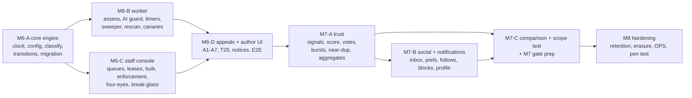

# M6–M8 Spec: Moderation and Staff, Trust / Social / Comparison, Hardening

| | |
|---|---|
| **Status** | Proposed. Task #77. Becomes binding when merged with CEO approval. **One document for M6, M7 and M8**: no separate spec task is needed |
| **Owner** | Software Architect |
| **Builds on** | [moderation-lifecycle.md](./moderation-lifecycle.md) (authoritative transition table T1–T21, R1–R8, A1–A7, audit contract) · [moderation-pipeline.md](./moderation-pipeline.md) (verdicts, timers, thresholds, queues) · [job-catalogue.md](./job-catalogue.md) (jobs, payloads, retries) · [threat-model.md](../security/threat-model.md) · [m4-m5-spec.md](./m4-m5-spec.md) (votes, reports, proofs, media) · wireframes [05](../../design/wireframes/05-comparison.md), [06](../../design/wireframes/06-profile-social.md), [07](../../design/wireframes/07-admin-queues.md), [11](../../design/wireframes/11-appeal-flow.md) |
| **Implements** | Every M6 and M7 P0 case in [test-case-catalogue.md](../qa/test-case-catalogue.md) (§14, §21.4), the M8 `OPS-*` list (§25.3), threats F-1/F-2/F-7/F-8/F-9, P-3/P-4/P-5/P-7/P-8/P-9, AP-1…AP-7, MT-1…MT-6, R-7, R-9, D-4/D-5 |
| **New decisions** | [ADR-0024](../adr/0024-clock-interface-and-no-runtime-test-clock.md) clock · [ADR-0025](../adr/0025-moderation-engine-baseline-for-m6.md) moderation engine · [ADR-0026](../adr/0026-four-eyes-approval-requests.md) four-eyes · [ADR-0027](../adr/0027-break-glass-original-proof-access.md) break-glass · [ADR-0028](../adr/0028-ai-verdict-contract-and-injection-canaries.md) AI verdict contract · [ADR-0029](../adr/0029-trust-score-v1.md) trust score · [ADR-0030](../adr/0030-fake-review-and-vote-defences.md) fake-review defences · [ADR-0031](../adr/0031-notification-inbox-and-mandatory-types.md) notifications · [ADR-0032](../adr/0032-m7-social-and-comparison-scope.md) social/comparison scope · [ADR-0033](../adr/0033-erasure-retention-and-deletion-ledger.md) erasure and retention |
| **Open items** | [open-questions.md §7](./open-questions.md#7-m6m8-moderation-trust-social-hardening-task-77) (M68-Q1 … M68-Q20). Every item has a default decision |

This spec is documentation only. Code shapes are Prisma or TypeScript signatures so the implementing tasks share one
contract. Where this document and an older design document differ, the older one is right **unless** the row here says
"changes" and names an ADR.

---

## 0. Scope, baseline and assumptions

### 0.1 Scope

| M6 Moderation and staff (Part A) | M7 Trust, social, comparison (Part B) | M8 Hardening (Part C) |
|---|---|---|
| Content state machine T1–T21, R1–R8, A1–A7 in one `transition()` (§3) | Trust score v1, bands, snapshots (§15) | Retention framework, account erasure, SEC-M4-09 (§22) |
| `Clock` / `FakeClock`, test-clock decision (§2) | Vote maturity and weights, velocity freeze (§16) | `OPS-001…006` (§23) |
| Timers, sweeper, races (§4) | Near-duplicate and product-burst routing (§16) | Pen-test scope (§24) |
| AI verdicts, breaker, `AIF-008`, injection canaries (§5) | Aggregates (§16.5) | Lint sweep of `Date` call sites (ADR-0024) |
| Staff queues, leases, bulk (§6) · enforcement and strikes (§7) | In-app notifications, mandatory types (§17) | Audit archive export (§23) |
| Four-eyes on config, role grants, 2FA reset (§8) | Profile, follows, blocks (§18) · comparison (§19) | |
| Break-glass `proof.view_original` (§9) · appeals (§10) | No-messaging scope test (§20) | |

**Not in M6–M8:** comments, posts, likes, wishlist, saved comparisons (ADR-0032, Phase 1.x); messaging (Phase 2);
video audio moderation (pipeline M-4); CSAM hash-matching provider integration (L-17, hook exists from M5).

### 0.2 Code baseline (read at `9df168c`)

| Area | Today | Consequence |
|---|---|---|
| Moderation case | `ModerationCase.state` {PENDING, AI_REVIEW, NEEDS_HUMAN, APPROVED, REJECTED, SUPERSEDED}; decision on the row (`decidedById`, `decisionReason`); one `aiScore`; `trigger`/`seq`; M4 report cases via `openReportKey` (`schema.prisma:306`) | Replaced by status + lane + `ModerationDecision` (ADR-0025, §12) |
| State logic | `packages/core/src/moderation-state.ts` (6-state map), `moderation-service.ts` (`transitionCase`) | Replaced by the transition table (§3) |
| AI | `moderation-provider.ts`: `{score, confidence, reasons}`, scalar thresholds, `MockModerationProvider` | Replaced by the scores-only contract and the zod config (ADR-0028, §5) |
| Worker moderation | `apps/worker/src/moderation.ts` `processModeration`; dead-letter escalation; **does not wait for media** (QA-M5-04, `MED-030`) | Rewritten as `moderation.assess` (§13). The media wait is a prerequisite (§0.4) |
| Staff routes | `/api/admin/moderation` list/detail, `approve`, `reject`, `remove`, `dismiss-reports`; `/api/admin/reports/:id/reject`; enforcement only for reply restrictions and seller suspension | Kept as paths; all call `transition()` (§11) |
| Role grants | `apps/web/src/server/staff-roles.ts`: SUPER_ADMIN only, no self-grant, ≥ 2 SUPER_ADMIN on revoke, target needs 2FA | Four-eyes added for SENIOR_MODERATOR/ADMIN/SUPER_ADMIN (ADR-0026) |
| Clock | None. About 85 non-test `new Date()`/`Date.now()` call sites | ADR-0024 |
| Appeals, config table, notifications table, trust scores, follows, blocks | **Not present** | Added here |
| Trust signals | `TrustSignal` append-only, 4 types, unique `(type, sourceType, sourceId, userId)` | Extended in M7 (§21.2) |

### 0.3 Assumptions (cheap to reverse)

- **B-1.** Pre-launch, no production users (as D-A1 in M4/M5). The M6 migration may drop `ModerationState` and the
  legacy case columns after back-fill.
- **B-2.** The PM maps work packages (§1) to the remaining tasks of plan #12.
- **B-3.** Notifications stay e-mail-only through M6 (D-A5). The in-app inbox arrives in M7 and re-uses the same
  dispatcher.
- **B-4.** New tables follow ADR-0004/0010 (cuid, `DATETIME(3)` UTC, snake_case plural `@@map`, hand-written
  `chk_<table>_<rule>` CHECKs, `Restrict` FKs where a CHECK reads the column).
- **B-5.** Policy reason codes and public-reason templates are still placeholders (pipeline M-2). The code reads them
  from the ACTIVE `ModerationConfig.policy.reasonCodes`, so T&S can replace them without a release.

### 0.4 Prerequisites carried from the M5 gate

The M5 gate (task #76) is FAIL with seven P0 gaps. Two of them block M6 behaviour and are scheduled **inside** M6-B:

| Gap | Why M6 needs it | Where |
|---|---|---|
| QA-M5-04 / `MED-030` (assess does not wait for media; no `MEDIA_TIMEOUT`) | Pipeline §2.4 and the AI pending guard (40 min with media) | §13, `moderation.assess` |
| QA-M5-08 / `MED-012` parent effects (`MALWARE_UPLOAD` signal, parent forced UNSURE, `MEDIA_REJECTED`) | Classification step 1 and `TRS-008` | §5.1, §13 |

The other M5 gaps (sandbox, hash-matcher hook, PDF evidence, content-type signing, CDN headers) stay with their M5
fix task and are pen-test focus items (§24).

---

## 1. Work packages and dependencies



| WP | Contents | Main modules | Gate cases |
|---|---|---|---|
| **M6-A** | `Clock`; zod config + hard floors + versions; `classify()`; transition table + engine; `lifecycleState()`; system principal; migration | `packages/core/src/{clock.ts,testing/,moderation/,authz/system-principal.ts}`, `packages/db` migration | `MOD-001…018`, `CLS-*`, `CFG-001…003`, `AZ-017` |
| **M6-B** | `moderation.assess` rewrite with media wait; provider adapter, breaker, spend cap; rescan; timers; sweeper; bulk apply; canaries; DLQ relay fail-loud | `apps/worker/src/moderation/*`, `packages/core/src/ai/*` | `AIF-*`, `TMR-*`, `MOD-020/021`, `SEC-008`, `OUT-007` |
| **M6-C** | Queue API, leases, COI filter, bulk; enforcement + strikes; four-eyes; break-glass; config admin; staff anomaly job | `apps/web/src/server/{moderation-queue,moderation-decide,enforcement,approvals,break-glass,config-admin}.ts` | `CFG-004`, `AZ-011/015/024`, `PRV-002/003`, `SEC-010/011`, `A11Y-004` |
| **M6-D** | Appeals (user + staff), decision notice page, T20 resubmit, statement-of-reasons mails, E2E journeys | `apps/web/src/server/appeals.ts`, `apps/web/src/app/(site)/appeals/*`, `decisions/*` | `MOD-013`, `TMR-011`, `E2E-002…005/008` |
| **M7-A** | Trust signals v2, score/bands, snapshots, vote weights and freeze, near-duplicate, burst, aggregates | `packages/core/src/trust/*`, `packages/core/src/catalog/aggregate.ts`, `apps/worker/src/trust/*` | `TRS-001…005/007/008` |
| **M7-B** | Notification inbox and preferences; follows; blocks; public and own profile | `apps/web/src/server/{notifications,social,profile}.ts`, `apps/worker/src/notifications/*` | `TRS-009`, `AZ-014` (follow) |
| **M7-C** | Comparison endpoint and page; public-read rate limit; `SCOPE-001` re-run; M7 gate prep | `apps/web/src/server/compare.ts`, `apps/web/src/scope.test.ts` | `TRS-006`, `TRS-010`, `SCOPE-001` |
| **M8** | Retention rules, erasure, ledger, ipHash purge, tombstones; OPS checks; key rotation drill; audit export; pen test | `packages/core/src/retention/*`, `apps/worker/src/maintenance/*`, `scripts/ops*` | `OPS-*`, `PRV-011/012` |

---

# Part A: M6 Moderation and staff

## 2. Clock, FakeClock and the test-clock decision (ADR-0024)

Resolves test-strategy §10 item 4 ("implement the `Clock` interface and the `FakeClock` … decide the test-clock hook
for E2E and add the production-absence check").

```ts
// packages/core/src/clock.ts
export interface Clock { now(): Date }
export const systemClock: Clock = { now: () => new Date() };
export const addMs = (t: Date, ms: number) => new Date(t.getTime() + ms);
export const addHours = (t: Date, h: number) => addMs(t, h * 3_600_000);
export const addDays = (t: Date, d: number) => addHours(t, d * 24); // always 24 h steps, UTC (TMR-004)

// packages/core/src/testing/fake-clock.ts   (contains the sentinel "__RP_TEST_ONLY__")
export class FakeClock implements Clock {
  constructor(start: Date | string = "2027-01-04T09:00:00.000Z") {}
  now(): Date; set(t: Date | string): void; advance(ms: number): void;
}
```

| Rule | Detail |
|---|---|
| Injection | Every service/handler gets `deps.clock`. Composition roots pass `systemClock` |
| Deadlines | Computed in the app and stored as absolute UTC `DATETIME(3)`. Delays for BullMQ = `deadline − clock.now()` (min 0) |
| No DB time in guards | No `NOW()` in `WHERE`; sweepers bind `:now`. `ModerationCase.createdAt`, `Appeal.submittedAt`, `BreakGlassAccess.createdAt` are written from `clock.now()` because guards read them (`TMR-014`) |
| Boundaries | A timer fires when `now ≥ deadline` (`TMR-003`) |
| Lint | `Date.now()` / `new Date()` banned outside `clock.ts` (error in M6 modules, warning elsewhere until M8) |
| E2E | **No runtime hook.** Seed deadlines in the past via `apps/web/e2e/support/seed.ts` (direct DB writes in the test process), run the stack with `MODERATION_SWEEP_INTERVAL_MS=5000`, wait for the sweeper. Playwright `page.clock` only for countdown text |
| `OPS-003` | `scripts/ops003-no-test-hooks.mjs` after both builds: no `__RP_TEST_ONLY__`, no `FakeClock`, no `/api/(__test__|test|e2e)` route in the manifest |

Integration tests that need a delayed job assert the **computed delay and `jobId`**, then call the handler with the
`FakeClock` advanced past the deadline. The sweeper path (`TMR-007`) is tested the same way with the queue flushed.

---

## 3. Content state machine and transition engine

### 3.1 The table is the specification

`packages/core/src/moderation/transitions.ts` encodes moderation-lifecycle §4 (T1–T21), §4.2 (R1–R8) and §5
(A1–A7) as data. Side effects of T1–T14 come from moderation-pipeline §3.2, of T15–T21 from lifecycle §4.1.

```ts
export type Event =
  | "SUBMIT" | "ASSESS_CLEAN" | "ASSESS_VIOLATION" | "ASSESS_UNSURE"
  | "STAFF_APPROVE" | "STAFF_REJECT" | "HOLD_EXPIRE" | "POST_REVIEW_CONFIRM" | "POST_REVIEW_REMOVE"
  | "POST_REVIEW_LAPSE" | "FLAG" | "RESCAN_VIOLATION" | "STAFF_HIDE" | "STAFF_RESTORE" | "STAFF_REMOVE"
  | "DISMISS_REPORTS" | "APPEAL_OVERTURN" | "AUTHOR_DELETE" | "AUTHOR_EDIT" | "AUTHOR_RESUBMIT";

export interface Row {
  id: `T${number}` | `R${number}` | `A${number}`;
  from: readonly (ContentStatus | RevisionStatus | AppealStatus | null)[];
  event: Event; actors: readonly ActorKind[];          // AUTHOR | AI | RULE | TIMER | MOD | SMOD | APPEAL_REVIEWER
  guard: GuardId[];                                    // e.g. "caseOpen", "versionCurrent", "leaseHeld", "coi", "reasonCode", "deadlineReached"
  to: ContentStatus | RevisionStatus | AppealStatus;
  decision?: { source: DecisionSource | "ACTOR"; outcome: DecisionOutcome; verdict?: ModerationVerdict; resolutionCode?: string };
  auditAction: string;                                 // "<e>.auto_publish" …
  effects: EffectId[];                                 // "openPostReview", "openHold", "resolveCase", "appealWindow", "notify:CONTENT_REJECTED", "promoteMedia", "demoteMedia", "strike", "trust:REVIEW_PUBLISHED", "supersedeOtherOpenCases" …
}
export const ROWS: readonly Row[];
```

`transition(deps, { target, event, actor, input })`:

1. Looks up the rows for `(currentStatus, event)`; none → `InvalidTransition` (no writes, `MOD-016`).
2. Runs guards that need no lock (permission via `authorize()`, COI, reason code in the ACTIVE policy list).
3. Opens one transaction and runs the conditional update
   `UPDATE <content> SET status = :to WHERE id = :id AND status IN (:from) [AND currentVersion = :v]` and, for case
   rows, `UPDATE moderation_cases SET … WHERE id = :caseId AND status <> 'RESOLVED' [AND lane = :lane]
   [AND assignedToId = :actor AND leaseExpiresAt > :now]`. Zero rows on either → roll back, return
   `{applied:false, reason}` (idempotent no-op, `MOD-017`, `MOD-021`, `TMR-006`, `TMR-013`).
4. Writes the `ModerationDecision` (non-author rows), case changes, **exactly one** `AuditLog` row
   (lifecycle §6), and the outbox rows of the effects, then commits. A fault anywhere rolls back everything (`MOD-020`).
5. The cross-cutting rule "leaving `PUBLISHED` supersedes every other open case on the target" is the effect
   `supersedeOtherOpenCases` on every row whose `from` contains `PUBLISHED` and `to` does not.

**Generated tests.** `transitions.test.ts` produces one test per row (target status, decision tuple, lane, timer
fields, outbox topics, notification type) and the negative matrix of every `ContentStatus × Event` pair not in
`ROWS` (`MOD-016`). The event list is checked against the `Event` union so a new event cannot skip the matrix.

### 3.2 Changes against the older tables

| Row | Change | Source |
|---|---|---|
| T11 | Never hides content. Lane `REPORTED`, `slaDueAt = now + timers.reportedSlaHours (48)`, `moderation.rescan` enqueued | Confirms ADR-0011 / QA §9.11. `MOD-012` to be rewritten, `MOD-022` stands |
| T2 | `postReview.sampleRate` per trust band: not sampled → case `RESOLVED` with `resolutionCode NOT_SAMPLED` (`MOD-003`) | pipeline §2.1, A-3 |
| T3 / T6 / T9 / T17 | Strike rule per §7.2; zero-tolerance categories take the §7.3 path | pipeline §9, ADR-0025 |
| T5 / T16 | `ESCALATED` cases need SMOD | lifecycle §4 |
| T20 | Enabled in M6 (was refused in M4, M45-Q3). Force-UNSURE when the deciding decision was `HUMAN` | lifecycle §4.1 |
| A4 on `BAN` / `SELLER_SUSPENSION` | Needs a `ENFORCEMENT_OVERTURN_MAJOR` approval (ADR-0026, AP-1) | threat-model AP-1 |
| A4 | Re-checks `appeal.contentVersion = case.version` inside the transaction, else `409 version_superseded` (AP-2) | threat-model AP-2 |

### 3.3 Author edit limit

`MOD-015`: edits of `PENDING`/`HIDDEN` content (T14) and resubmits (T20) share the limiter
`content.edit` = **5 per rolling 24 h per user** (threat-model §5), which also closes SEC-M4-06. The 6th returns
`429 rate_limited`.

---

## 4. Cases, lanes, timers and the sweeper

### 4.1 Lanes and case fields

| Lane | Opened by | Content | Deadline column | Closed by |
|---|---|---|---|---|
| `HOLD` | T4, R4, T20 force-UNSURE | `HIDDEN` / held revision | `holdExpiresAt = now + holdDays × 24 h` | T5, T6, T7, T13, T14 (`SUPERSEDED`), R5–R7 |
| `POST_REVIEW` | T2, R2 (if sampled) | `PUBLISHED` | `postReviewDueAt = publishedAt + postReviewSlaHours` | T8, T9, T10, T13, leave-`PUBLISHED` supersede |
| `REPORTED` | T11 (reports, staff flag, M7 near-duplicate flag) | `PUBLISHED` or `HIDDEN` (after T15) | `slaDueAt = now + reportedSlaHours` | T16, T17, T18, T13 |
| `INTEGRITY` (M7) | vote anomaly (§16.2) | unchanged | `slaDueAt = now + 72 h` | Release / Discard |

`openKey = "<lane>:<R|S|M>:<targetId>"` while not `RESOLVED`, `NULL` after: the unique index makes a second open case
per (target, lane) impossible (lifecycle invariant 5). Report cases from M4 are migrated into lane `REPORTED`.

### 4.2 Timer catalogue (frozen deadlines)

| Timer | Start | Deadline (config key, default) | Effect | Job | Cases |
|---|---|---|---|---|---|
| Post-review SLA | T2/R2 | `postReviewDueAt` (`timers.postReviewSlaHours` 24) | `postReviewBreachedAt` set once, metric +1, priority +100. Not a state change | sweeper | `TMR-001` |
| Post-review lapse | `postReviewDueAt` | `+ postReview.lapseAfterHours` (144) | T10 | `moderation.post-review-lapse` + sweeper | `TMR-002`, `MOD-011` |
| Hold expiry | T4/R4 | `holdExpiresAt` (`timers.holdDays` 7 → 168 h) | T7 / R7 | `moderation.hold-expire` + sweeper | `TMR-003/004/006/007/008/010` |
| Hold reminder | `holdExpiresAt − holdReminderHours` (48) | — | priority +1000 (top of lane), idempotent | sweeper | `TMR-005` |
| AI pending guard | case `createdAt` | `+ ai.maxPendingMinutes` (10), or `+ media.maxWaitMinutes + 10` (40) with pending media | T4 `AI_UNAVAILABLE`, `failureCode lost_job` | sweeper | `AIF-006` |
| Appeal window | T3/T6/T7/T9/T17/T18/T21 | `appealableUntil = now + appealWindowDays` (30) | A1 refused after; deferred AI strikes created | sweeper | `TMR-011` |
| Appeal SLA | A1 | `slaDueAt` (72 h for `HOLD_EXPIRED`, else 168 h) | A7: priority bump + alert, never an outcome | sweeper | `TMR-012` |
| Lease | claim | `leaseExpiresAt = now + 15 min` (renew on heartbeat every 60 s) | others may claim | — | `MOD-021` |
| Approval expiry | approval request | `+ 24 h` | `EXPIRED` | sweeper | `CFG-004` |

The deadline is captured when the timer starts; a later config change never moves it (`TMR-008`). A recovery re-scan
never changes `holdExpiresAt` (`TMR-009`). An author edit supersedes the case; the old delayed job finds
`SUPERSEDED` and is a no-op (`TMR-010`).

### 4.3 Delayed job + sweeper

Unchanged from pipeline §4.2 and job-catalogue §4.1/§5, with two precisions:

- The delayed-job id embeds the deadline (`hold-expire__<caseId>__<epochMs>`); the handler re-reads the case and runs
  `transition(HOLD_EXPIRE)` only if `lane = HOLD`, not resolved, and `holdExpiresAt` equals the payload value
  (`TMR-013`, MT-1).
- `maintenance.moderation-sweep` runs every `MODERATION_SWEEP_INTERVAL_MS` (default 300 000, bounds 5 000–600 000) and
  processes, in order and in batches of 200: AI pending guard, hold expiry, hold reminder, post-review SLA breach,
  post-review lapse, `REPORTED` older than SLA (alert), appeal SLA, appeal-window close (deferred strikes),
  approval expiry, protective-suspension SLA (alert). Every action goes through `transition()` or a conditional
  update, so the sweeper and the delayed job cannot both apply an effect (`TMR-006`, `TMR-007`).

### 4.4 Races

As pipeline §4.3. Additionally: a staff decision requires the lease **at commit time** (`assignedToId = actor AND
leaseExpiresAt > now` in the conditional update; `leaseHeld: true` in audit, AP-5). Losing the race returns
`409 already_resolved` (case resolved) or `409 lease_not_held`.

---

## 5. AI verdicts, failure handling and prompt injection (ADR-0028)

### 5.1 Classification

`classify(input, scoresOrFailure, config, ruleHits)` in `packages/core/src/moderation/classify.ts` implements
pipeline §2.2 exactly:

1. Deterministic rules (blocklist, known-bad URL, exact duplicate text hash, banned media sha256, malware media on the
   parent) → `VIOLATION (RULE, reasonCode = rule id)` (`CLS-005`). A malware attachment makes the parent at least
   `UNSURE (MEDIA_MALWARE)`; it is a violation only if another rule says so.
2. Provider failure → `UNSURE (RULE, AI_UNAVAILABLE, failureCode)`.
3. Any category `score ≥ violation` (with `violation ≠ null`) → `VIOLATION` (`CLS-002`, `CLS-006`).
4. Any force-unsure rule → `UNSURE` (`CLS-004` violation first, `CLS-007…010`).
5. All categories `score < clean` → `CLEAN` (`CLS-001`: equal to `clean` is **not** clean).
6. Otherwise `UNSURE` (`CLS-003`).

Lookup order for thresholds: `contentTypes.<TYPE>.categories.<cat>` → `categories.<cat>` → `defaults` (`CLS-011`).
Trust band for `trustBands.NEW` comes from M4's account-age rule until M7 bands exist (M45-Q6), then from
`User.trustBand`.

**Force-unsure rules (pipeline §5.3), M6 set:** unsupported language; trust band NEW and any category > 0.10; external
link in `REVIEW`; extreme rating (1 or 5) and the **product** received > `velocity.reviewsPerHour` (20) reviews in the
last hour (`CLS-010`, see M68-Q2); media timeout; malware media; T20 after a human decision. M7 adds
`NEAR_DUPLICATE` and `PRODUCT_BURST` (§16).

### 5.2 Config (zod, hard floors, versions)

`packages/core/src/moderation/config.ts` exports `moderationConfigSchema` (from
[moderation-config.example.json](./moderation-config.example.json)) and `HARD_FLOORS`:

| Bound / floor | Rule | Case |
|---|---|---|
| `timers.holdDays` | integer 1–30 | `CFG-001` |
| `timers.postReviewSlaHours` | 1–168 | `CFG-001` |
| `timers.appealWindowDays` | 14–90 | `CFG-001` |
| `timers.reportedSlaHours` | 1–168 (default 48, LC-2) | — |
| `postReview.sampleRate` | 0–1 per trust band | `MOD-003` |
| Categories | all 13 present; `0 ≤ clean < violation ≤ 1` or `violation: null` | `CFG-005` |
| Zero tolerance | `strikes.zeroTolerance ⊇ ["sexual_minors"]`; its `violation ≤ 0.5` | `CFG-002` |
| Force-unsure floors | `unsupportedLanguage`, `mediaTimeout`, `malwareMedia`, `resubmitAfterHuman` are always true | `CFG-002` |

Validation rejects configs that try to weaken a floor (`422 config_floor_violation`). Independently, `classify()`
reads the floors from `HARD_FLOORS`, not from the config object, so a config that bypassed validation (raw SQL) still
cannot disable them (`CFG-002` second clause). Every decision stores `configVersion` and `policyVersion`; activating a
version never rewrites earlier decisions (`CFG-003`). Activation is four-eyes (§8). Shadow mode as pipeline §5.1.

### 5.3 Provider contract, retries and breaker

As ADR-0028. Summary for the implementer:

| Failure | Retry | Final verdict | `failureCode` | Case |
|---|---|---|---|---|
| Timeout (`ai.timeoutMs` 15 s) | yes, `ai` back-off (5 s, 20 s at 3 attempts) | UNSURE | `timeout` | `AIF-001` |
| 5xx / network | yes | UNSURE | `http_5xx` / `network` | `AIF-002` |
| 429 / quota | yes, `max(backoff, Retry-After)` | UNSURE | `http_429` | `AIF-002` |
| Schema invalid, missing category, out-of-range score, extra key | no | UNSURE | `schema` | `AIF-003`, `CLS-013` |
| Unsupported language | no | UNSURE (`UNSUPPORTED_LANGUAGE`) | `unsupported_language` | `AIF-004`, `CLS-007` |
| Breaker open (≥ 50 % of last 20 calls failed; half-open after 60 s) or daily call cap reached | skip call | UNSURE immediately | `breaker` | `AIF-005` |
| Lost job | sweeper | UNSURE | `lost_job` | `AIF-006` |

Re-scan on recovery (`AIF-007`, `TMR-009`): `moderation.rescan-failed` every 10 min, only while the breaker is closed,
for `HOLD` cases whose decisions are all `AI_UNAVAILABLE` with no `HUMAN` decision and `rescanCount < ai.maxRescans`
(3). It increments `rescanCount` and applies the new verdict "exactly as if it were the first one" (pipeline §2.3).
Because the content is already `HIDDEN`, this needs two AI-actor rows that the lifecycle table did not list, added
here: **`T4r`** (`HIDDEN·HOLD` → `PUBLISHED`, AI / APPROVE / CLEAN, opens `POST_REVIEW` +24 h) and **`T4v`**
(`HIDDEN·HOLD` → `REJECTED`, AI / REMOVE / VIOLATION, appeal window, deferred strike). A re-scan `UNSURE` changes
nothing. Lifecycle invariant 3 still holds: no automatic row targets `REMOVED`, and `T4r` publishes only on a full
CLEAN verdict. Provider limiter `{max: 50, duration: 1000}` (`AIF-009`).

**`AIF-008` property** (fast-check, every PR, zero counter-examples): for every generated
`ProviderResult | thrown error`, `assess()` returns `CLEAN` only if the result is a complete, in-range score map
below all clean thresholds with no rule hit.

### 5.4 Prompt-injection canaries (`SEC-008`)

Corpus `test/fixtures/moderation/injection-canaries.json` (≥ 30 pairs). CI asserts with the fake provider:
(a) the canary text appears only inside the JSON-escaped data field of the request; (b) the `obedient` fake mode,
which answers injected text with `{"verdict":"CLEAN"}` or other extra keys, yields `UNSURE (schema)`; (c) with equal
scripted scores, `verdict(canary) = verdict(twin)`; (d) the system prompt hash equals the pinned value. The staff UI
renders `aiReason`/`rationale` as escaped text (P-8). An "instruction-like text" detector is a **rule hit shown to
staff only** (no verdict effect).

---

## 6. Staff queues, leases and bulk (wireframe 07)

### 6.1 Queue read model

`GET /api/admin/moderation/queue` is a repository query over `moderation_cases` joined to the subject, returning a
**staff DTO allow-list** (MT-4, `PRV-002`): case id, lane, status, priority, countdown fields, AI verdict, `aiScore`,
`aiTopCategory`, escaped `aiReason`, category scores, rule hits, decision source, report count, language, content
type and excerpt (≤ 280 chars), signed thumbnail URLs (blurred by default in the UI, `A11Y-008`), author handle and
trust band, prior strike count. **Never** e-mail, raw IP, `ipHash` of other users beyond the hashed value, proof
originals or internal notes of other cases.

| Filter | Values |
|---|---|
| `lane` | `HOLD`, `POST_REVIEW`, `REPORTED`, `ESCALATED` (status filter, SMOD+ only), `INTEGRITY` (M7) |
| `type`, `verdict`, `category`, `scoreMin/Max`, `failureCode`, `trustBand`, `language`, `ageHours` | as pipeline §6.1 |
| Sort | lane default (pipeline §6.1), or `priority desc` |
| Paging | cursor, `pageSize ≤ 50` |

**COI filter (`AZ-011`):** the query excludes cases whose subject author is the viewer, whose product's seller has the
viewer as a member, and (appeals) whose case has the viewer as a human decider. The decide path re-checks the same
guard (`CONFLICT_OF_INTEREST`), so a direct API call is refused too (`E2E-008`).

### 6.2 Leases

`POST /api/admin/moderation/next?lane=` claims the first unleased, COI-free case in the lane order with a conditional
update (`assignedToId = :me, leaseExpiresAt = now + 15 min, status = IN_REVIEW` where `assignedToId IS NULL OR
leaseExpiresAt < now`). `POST …/:caseId/claim`, `…/renew` (every 60 s while the page is open), `…/release`. An expired
lease returns the case to `OPEN`/`ESCALATED` on the next claim.

### 6.3 Bulk

As pipeline §6.1: `POST /api/admin/moderation/bulk` `{lane, action, caseIds[1..100], reasonCode?, publicReason?}` →
`202 {bulkOperationId}`; one `moderation.bulk` audit row; `moderation.bulk-apply` applies each item through
`transition()` (each with its own lease taken by the job on behalf of the requester, released after) and records
`APPLIED | SKIPPED:<reason> | FAILED` per item; `GET /api/admin/moderation/bulk/:id` polls. 101 items →
`422 bulk_limit` (`E2E-007`). MODERATOR: approve/confirm only; reject/remove needs SMOD.

### 6.4 Staff anomaly detection (`SEC-012`, P-4)

`staff.anomaly-scan` (hourly) computes per moderator over the last 24 h: removals concentrated on one seller
(`> anomaly.removalsPerSellerPerDay`, 10), decisions disagreeing with the AI verdict (`> 30 %` over ≥ 50 decisions),
bulk operations (`> 5`). Each breach → alert + a row in the weekly SENIOR_MODERATOR report. No automatic sanction.

---

## 7. Enforcement actions and strikes

### 7.1 Issuing and revoking

| Route | Permission (ADR-0003) | Extra guards |
|---|---|---|
| `POST /api/admin/users/:id/enforcements` `{type, reasonCode, publicReason, endsAt?, caseId?}` | `enforcement.issue.minor` (WARNING, CONTENT_REMOVAL, POSTING/VOTING_RESTRICTION ≤ 7 d) or `.major` (SUSPENSION, BAN, VERIFIED_LABEL_REVOKED, longer restrictions) | COI; step-up for BAN; target not staff of higher rank |
| `POST /api/admin/sellers/:id/enforcements` | `.major` (SELLER_SUSPENSION, SELLER_REPLY_RESTRICTION) | step-up for SELLER_SUSPENSION (existing routes are kept and re-pointed) |
| `POST /api/admin/enforcements/:id/revoke` `{note}` | `enforcement.revoke` | step-up for BAN/SELLER_SUSPENSION |
| `GET /api/admin/users/:id` | `user.manage` or `moderation.queue.read` (reduced DTO) | strikes, enforcement history, open cases |

Every issue writes `EnforcementAction`, `AuditLog(enforcement.issue)`, outbox `enforcement.issued`
(→ `ENFORCEMENT_ISSUED` mandatory notice with the statement of reasons and appeal link,
`appealableUntil = startsAt + 30 d`) and `trust.signal ENFORCEMENT_ACTION`. `User.status` follows the active
SUSPENSION/BAN (guard 2 still reads `EnforcementAction` as the source of truth, `AZ-006`).

### 7.2 Strike ladder (pipeline §9)

`strikes.ts` counts `EnforcementAction` rows with `strike = true` and status `ACTIVE`/`EXPIRED` in the last 180 days,
then applies the configured ladder in the same transaction as the striking decision:

| Strikes | Action (issued by the system principal, `issuedById = null`, `reasonCode STRIKE_LADDER_<n>`) |
|---|---|
| 1–2 | `WARNING` |
| 3 | `POSTING_RESTRICTION` 7 d |
| 4 | `POSTING_RESTRICTION` 30 d |
| 5+ | `POSTING_RESTRICTION` indefinite + case `ESCALATED`; a SMOD decides `SUSPENSION`/`BAN` |

A strike is recorded for: human REMOVE (T6, T9, T17, T21); AI/RULE `VIOLATION` (T3, T4v) **when the appeal window
closes without an overturn** (sweeper) or immediately after an `UPHELD` appeal past the window (A3). Never for
`HOLD_EXPIRED`, `POST_REVIEW_LAPSED`, author deletes, overturned decisions, or an AI-only rejection the author fixed
by T20 (`MOD-008`). Overturn (A4) sets the strike row `OVERTURNED` and recomputes the ladder (`MOD-013`).

### 7.3 Zero tolerance (`CLS-012`)

A `VIOLATION` whose top category is in `strikes.zeroTolerance`: content `REJECTED` (T3), case `ESCALATED`,
`ModerationCase.legalHold = true` and `MediaAsset.legalHold = true` on attachments, and a protective
`SUSPENSION (ZERO_TOLERANCE_HOLD, endsAt null)` by the system principal (the single exception in ADR-0025). A SMOD
must confirm (convert to BAN or keep) or lift within 24 h; the sweeper alerts at the SLA. `legalHold` blocks every
purge and can be cleared only by `legal_hold.manage` (ADMIN, step-up) (`PRV-010`).

### 7.4 System principal (`AZ-017`)

`authorizeSystem(action)` in `packages/core/src/authz/system-principal.ts` is a closed allow-list (ADR-0025 §3).
`AZ-017` tests: decision write allowed; WARNING and CONTENT_REMOVAL allowed; ladder restrictions allowed; protective
SUSPENSION allowed only with a zero-tolerance verdict; any other SUSPENSION, BAN, SELLER_*, VERIFIED_LABEL_REVOKED,
`role.*`, `config.*` denied.

---

## 8. Four-eyes approvals (ADR-0026)

| Action | Before M6 | M6 flow | Cases |
|---|---|---|---|
| Activate a `ModerationConfig` version | none | `POST /api/admin/config/moderation/:version/activation-requests` → request; second ADMIN approves → `ACTIVE`, previous → `RETIRED`, audit with diff | `CFG-004`, `SEC-010` |
| Grant `SENIOR_MODERATOR`, `ADMIN`, `SUPER_ADMIN` | SUPER_ADMIN alone | `POST /api/admin/staff/:id/roles` returns `202 {approvalRequestId}`; a second SUPER_ADMIN approves | `AZ-015` (unchanged rules), `SEC-010` |
| Grant `MODERATOR` | SUPER_ADMIN alone | SUPER_ADMIN or ADMIN, step-up, single actor | `AZ-015` |
| Reset 2FA of an ADMIN/SUPER_ADMIN | runbook only (M3b-Q4) | `POST /api/admin/users/:id/2fa-reset-requests`; second ADMIN/SUPER_ADMIN approves; TOTP and recovery codes deleted, all sessions revoked, `SECURITY_ALERT` to the target | `AZ-024` |
| Overturn an appeal against `BAN`/`SELLER_SUSPENSION` | — | A4/A5 creates `ENFORCEMENT_OVERTURN_MAJOR`; a second non-deciding SMOD approves | AP-1 |
| Repeated break-glass on one submitter | — | `BREAK_GLASS_REPEAT` (§9) | `PRV-003` |

Shared routes: `GET /api/admin/approvals?status=PENDING`, `POST /api/admin/approvals/:id/approve` (step-up),
`POST /api/admin/approvals/:id/reject` `{note}`, `POST /api/admin/approvals/:id/cancel` (requester only). Self-approval
→ `403 approval_self`; expired → `409 approval_expired`; precondition changed → `409 approval_stale`; second pending
request for the same target → `409 approval_pending`.

---

## 9. Break-glass `proof.view_original` (ADR-0027)

Deferred from M4 (m4-m5-spec §0.1, M45-Q12).

```
SMOD on /admin/proofs/{id} ─▶ [View original…] ─▶ step-up (if > 10 min) ─▶ dialog: reason code ▾ + reason text (20–500)
   ─▶ POST /api/admin/proofs/:proofId/files/:fileId/original-access
        guards: proof.view_original · step-up · COI · original exists (else 410 original_purged)
                daily cap 20/staff (alert at 10, 21st → 429 break_glass_cap + alert)
                same submitter within 7 d → 202 {approvalRequestId} (BREAK_GLASS_REPEAT)
        writes: BreakGlassAccess(expiresAt = now + 60 s) + AuditLog(proof.view_original)
   ◀─ 201 {accessId, expiresAt}
   ─▶ GET /api/admin/break-glass/:accessId/content   (same session; single use by conditional update)
        streams private-bucket bytes; Cache-Control: no-store; Content-Disposition: inline;
        CSP: sandbox; default-src 'none'; nosniff; Referrer-Policy: no-referrer
        writes: AuditLog(proof.view_original.served)
```

Static test (replaces the SEC-M4-10 assertion): `proof/*/orig` keys are read only in
`apps/web/src/server/break-glass.ts` and are never passed to `presignGet`. Redacted views get a per-staff limit of
200/h with an alert (SEC-M4-08). `maintenance.break-glass-digest` mails SUPER_ADMINs daily at 07:00 UTC.

---

## 10. Appeals (wireframe 11) and decision notices

### 10.1 Appealable decisions

| Target (`Appeal` arc) | Appellant | Window | Reviewer | Outcome effect |
|---|---|---|---|---|
| `caseId` of T3/T6/T7/T9/T17/T21/T4v, revision R3/R6/R7 | author (or seller member for a reply) | `case.appealableUntil` | SMOD ∉ human deciders, COI-free | A4 → T12 / R8; A5 → strike voided |
| `caseId` of T18 (reports dismissed) | a reporter on that case, not `NEW` band (AP-3) | `case.appealableUntil` | as above | A4 → T21 |
| `enforcementActionId` | the subject user, or an OWNER of the subject seller | `startsAt + 30 d` | SMOD ∉ issuer; `BAN`/`SELLER_SUSPENSION` four-eyes | A4 → action `OVERTURNED`; A5 → shortened `endsAt` |
| `purchaseProofId` (rejection, label revocation, M45-Q11) | the submitter | decision + 30 d | SMOD ∉ proof reviewer | A4 → proof `VERIFIED` / revocation `OVERTURNED` and label restored |
| `ownershipClaimId` (claim rejection, M3-Q5) | the claiming seller's OWNER | decision + 30 d | ADMIN ∉ claim reviewer (`seller.claim.review`) | A4 → claim re-opened as `PENDING` for a different reviewer |

### 10.2 Rules

- A1 guards (lifecycle §5): `now < window` (`TMR-011`: −1 s accepted, +1 s refused, control hidden after),
  one appeal per appellant per target (`409 appeal_exists`), appellant derived from the session only (AP-7),
  deciding case for the current `contentVersion`, limiter `appeal.create` 3/day/user (AP-3).
- `statement` 10–2 000 chars; up to 3 evidence files uploaded before submit through
  `POST /api/appeals/evidence-slots` (purpose `APPEAL_EVIDENCE`, private, scanned by the M5 pipeline; unattached
  slots purged at 24 h by the orphan sweep). Files are attached on submit; any file not `READY` is dropped with a
  message.
- `slaDueAt = submittedAt + 72 h` for `HOLD_EXPIRED`, else `+ 168 h`; `HOLD_EXPIRED` appeals sort first.
- Staff claim (A2) takes a 15-minute lease like cases; decisions need the lease at commit and a `decisionNote`
  (immutable after commit, AP-6).
- DTOs (AP-4): the appellant sees `publicReason`, decision date, decision source (`AUTOMATED` / `HUMAN` /
  `NOT_REVIEWED_IN_TIME`), strike yes/no, deadline, status and `decisionNote`; never reporter ids, staff ids, AI
  scores or internal notes.
- A6 withdraw by the appellant; T19 (author deletes content) withdraws open appeals automatically.
- A7 never decides (human-only, pipeline A-6).

### 10.3 Decision notice and resubmit

`GET /api/decisions/:caseId` (author or appellant only; others 404) returns the statement of reasons DTO used by
`/decisions/{id}` (wireframe 11.1): content title and product, decided date, source, policy name, explanation,
strike flag, `appealableUntil`, `canAppeal`, `canResubmit` (T20 guards: no open appeal, edit limit, not zero tolerance,
no `legalHold`). `POST /api/reviews/:id/resubmit` runs T20 (`PUT /api/reviews/:id` with a body on a `REJECTED`/`REMOVED`
review also routes to T20).

---

## 11. M6 API routes

All routes use `defineAction()`/route registry with a permission and a rate-limit entry (`AZ-020`, `SEC-003`).
Staff routes require the 2FA-verified staff session (`requireAdmin()`), CSRF origin check, and are under `/api/admin`
(`AZ-025`, `SEC-011`). "Existing" routes keep their path and change their implementation.

| Method · path | Permission | Notes |
|---|---|---|
| `GET /api/admin/moderation/queue` | `moderation.queue.read` | §6.1. Replaces `GET /api/admin/moderation` (kept as alias for one milestone) |
| `GET /api/admin/moderation/:caseId` (existing) | `moderation.queue.read` | detail: snapshot, decision timeline, reports, media, author summary, lease |
| `POST /api/admin/moderation/next` | `moderation.decide` | claim next in lane |
| `POST /api/admin/moderation/:caseId/{claim,renew,release}` | `moderation.decide` | §6.2 |
| `POST /api/admin/moderation/:caseId/approve` (existing) | `moderation.decide` | T5 / R5 / T4r-like staff release |
| `POST /api/admin/moderation/:caseId/reject` (existing) | `moderation.decide` | T6 / R6; `reasonCode`, `publicReason` |
| `POST /api/admin/moderation/:caseId/confirm` | `moderation.decide` | T8 |
| `POST /api/admin/moderation/:caseId/remove` (existing) | `moderation.decide` | T9 / T17 |
| `POST /api/admin/moderation/:caseId/hide` | `moderation.decide` | T15 (staff) / POST_REVIEW "Hide" → T11 + T15 |
| `POST /api/admin/moderation/:caseId/restore` | `moderation.decide` | T16 |
| `POST /api/admin/moderation/:caseId/dismiss-reports` (existing) | `moderation.decide` | T18 |
| `POST /api/admin/moderation/:caseId/escalate` | `moderation.decide` | status `ESCALATED` (no content change) |
| `POST /api/admin/moderation/:caseId/rescan` | `moderation.decide` | outbox `moderation.rescan_requested` |
| `POST /api/admin/moderation/bulk` · `GET …/bulk/:id` | `moderation.bulk_decide` | §6.3 |
| `POST /api/admin/reports/:id/reject` (existing) | `moderation.decide` | marks one report abusive (`REJECTED`), COI + case-state guard (closes SEC-M4-04) |
| `POST /api/admin/users/:id/enforcements` · `POST /api/admin/sellers/:id/enforcements` · `POST /api/admin/enforcements/:id/revoke` · `GET /api/admin/users/:id` | §7.1 | §7.1 |
| `POST /api/admin/legal-holds` `{targetType, targetId, on}` | `legal_hold.manage` | step-up; case, media, proof |
| `GET /api/admin/config/moderation` · `POST …` (new draft from JSON) · `POST …/:version/validate` · `POST …/:version/shadow` · `POST …/:version/activation-requests` | `config.manage` | validate returns zod errors, diff and shadow counts |
| `GET /api/admin/approvals` · `POST /api/admin/approvals/:id/{approve,reject,cancel}` | per kind (§8) | step-up on approve |
| `POST /api/admin/staff/:id/roles` (existing) | `role.grant.*` | `202` for four-eyes kinds |
| `POST /api/admin/users/:id/2fa-reset-requests` | `user.manage` | §8 |
| `POST /api/admin/proofs/:proofId/files/:fileId/original-access` · `GET /api/admin/break-glass/:accessId/content` | `proof.view_original` | §9 |
| `GET /api/admin/appeals` · `GET /api/admin/appeals/:id` · `POST /api/admin/appeals/:id/{claim,renew,release}` · `POST /api/admin/appeals/:id/decide` `{outcome, decisionNote, enforcementChange?}` | `appeal.decide` | §10 |
| `GET /api/decisions/:caseId` | owner | §10.3 |
| `POST /api/appeals/evidence-slots` | `appeal.create.own` | max 3 per draft; image/PDF limits from M5 |
| `POST /api/appeals` · `GET /api/appeals` · `GET /api/appeals/:id` · `POST /api/appeals/:id/withdraw` | `appeal.create.own` | §10 |
| `POST /api/reviews/:id/resubmit` | `review.update.own` | T20 |

---

## 12. M6 Prisma schema deltas

Migration `20270105000000_moderation_m6` (two steps in one migration: add + back-fill, then drop legacy columns).

### 12.1 Enums

```prisma
enum ModerationSubjectType { REVIEW SELLER_REPLY MEDIA }                         // + MEDIA (standalone media, MED-033)
enum ModerationTrigger     { SUBMISSION EDIT USER_REPORT STAFF_FLAG STAFF_INITIATED } // M7 adds VOTE_ANOMALY
enum CaseStatus            { OPEN IN_REVIEW ESCALATED RESOLVED }
enum ModerationLane        { HOLD POST_REVIEW REPORTED }                         // M7 adds INTEGRITY
enum ModerationVerdict     { CLEAN VIOLATION UNSURE }
enum DecisionSource        { AI RULE HUMAN }
enum DecisionOutcome       { APPROVE RESTRICT REMOVE ESCALATE }
enum AppealStatus          { SUBMITTED IN_REVIEW UPHELD OVERTURNED PARTIALLY_OVERTURNED WITHDRAWN }
enum ModerationConfigStatus { DRAFT SHADOW ACTIVE RETIRED }
enum ApprovalKind          { CONFIG_ACTIVATION ROLE_GRANT TWO_FACTOR_RESET ENFORCEMENT_OVERTURN_MAJOR BREAK_GLASS_REPEAT }
enum ApprovalStatus        { PENDING EXECUTED REJECTED EXPIRED CANCELLED }
enum BulkItemResult        { PENDING APPLIED SKIPPED FAILED }
// removed: enum ModerationState
// MediaPurpose: add APPEAL_EVIDENCE if absent
```

### 12.2 `ModerationCase` (diff)

```prisma
model ModerationCase {
  // kept: id, subjectType, reviewId, sellerReplyId, version (= contentVersion), aiScore, aiProvider, trigger, seq,
  //       reportCount, reportWeight, createdAt (now written from clock.now()), updatedAt, reports, review, sellerReply,
  //       enforcementActions
  // removed after back-fill: state, aiConfidence, aiReasons, decisionReason, decidedById, decidedAt, openReportKey
  mediaAssetId    String?
  status          CaseStatus         @default(OPEN)
  lane            ModerationLane?
  priority        Int                @default(0)
  assignedToId    String?
  leaseExpiresAt  DateTime?          @db.DateTime(3)
  slaDueAt        DateTime?          @db.DateTime(3)
  outcome         DecisionOutcome?
  resolutionCode  String?            @db.VarChar(64)   // HOLD_EXPIRED, POST_REVIEW_LAPSED, SUPERSEDED, WITHDRAWN_BY_AUTHOR, APPEAL_OVERTURNED, REPORTS_DISMISSED, NOT_SAMPLED …
  resolvedAt      DateTime?          @db.DateTime(3)
  contentSnapshot Json?                                // as assessed; retention 2 y (§22)
  aiVerdict       ModerationVerdict?
  aiTopCategory   String?            @db.VarChar(64)
  aiReason        String?            @db.VarChar(500)
  configVersion   String?            @db.VarChar(32)
  holdExpiresAt   DateTime?          @db.DateTime(3)
  postReviewDueAt DateTime?          @db.DateTime(3)
  postReviewBreachedAt DateTime?     @db.DateTime(3)   // TMR-001: counted once
  appealableUntil DateTime?          @db.DateTime(3)
  legalHold       Boolean            @default(false)
  rescanCount     Int                @default(0)
  openKey         String?            @unique @db.VarChar(48) // "<lane>:<R|S|M>:<id>" while not RESOLVED

  mediaAsset MediaAsset?         @relation(fields: [mediaAssetId], references: [id], onDelete: Restrict, onUpdate: Restrict)
  assignedTo User?               @relation("CaseAssignee", fields: [assignedToId], references: [id], onDelete: SetNull)
  decisions  ModerationDecision[]
  appeals    Appeal[]

  @@unique([mediaAssetId, version, trigger, seq])
  @@index([lane, status, holdExpiresAt])
  @@index([lane, status, postReviewDueAt])
  @@index([lane, status, priority, createdAt])
  @@index([assignedToId, status])
  @@index([status, appealableUntil])
}
```

Back-fill: `PENDING`/`AI_REVIEW` → `OPEN`, no lane; `NEEDS_HUMAN` + `SUBMISSION`/`EDIT` → `OPEN`, lane `HOLD`,
`holdExpiresAt = migration time + 168 h` (no instant auto-rejects); `NEEDS_HUMAN` + `USER_REPORT` → lane `REPORTED`,
`openKey` from `openReportKey`; `APPROVED` → `RESOLVED/APPROVE`; `REJECTED` → `RESOLVED/REMOVE`,
`appealableUntil = decidedAt + 30 d`; `SUPERSEDED` → `RESOLVED`, `resolutionCode SUPERSEDED`. One
`ModerationDecision` is created per legacy decided case (`source HUMAN` when `decidedById` is set, else `AI`).

### 12.3 New models

```prisma
model ModerationDecision {                       // append-only (app role: INSERT/SELECT)
  id              String             @id @default(cuid())
  caseId          String
  transition      String             @db.VarChar(8)    // "T6", "R4", "A4", "T4r"
  contentVersion  Int
  source          DecisionSource
  moderatorId     String?                              // = HUMAN actor
  outcome         DecisionOutcome
  verdict         ModerationVerdict?
  reasonCode      String?            @db.VarChar(64)
  publicReason    String?            @db.Text          // statement of reasons (REJECT/REMOVE)
  publicReasonLocale String          @default("en") @db.VarChar(16)
  labels          Json?                                // category -> score
  ruleHits        Json?                                // rule ids only
  rationale       String?            @db.VarChar(280)  // provider display text, escaped on render
  policyVersion   String             @db.VarChar(32)
  configVersion   String?            @db.VarChar(32)
  aiProvider      String?            @db.VarChar(64)
  aiModel         String?            @db.VarChar(128)
  failureCode     String?            @db.VarChar(32)   // timeout|http_5xx|http_429|network|schema|unsupported_language|breaker|lost_job
  latencyMs       Int?
  bulkOperationId String?            @db.VarChar(32)
  approvalRequestId String?
  createdAt       DateTime           @db.DateTime(3)   // from clock.now()

  moderationCase ModerationCase @relation(fields: [caseId], references: [id], onDelete: Restrict)
  moderator      User?          @relation("DecisionModerator", fields: [moderatorId], references: [id], onDelete: Restrict)

  @@index([caseId, createdAt])
  @@index([moderatorId, createdAt])
  @@index([bulkOperationId])
  @@map("moderation_decisions")
}

model Appeal {
  id                  String       @id @default(cuid())
  appellantId         String
  caseId              String?                          // exclusive arc (chk_appeal_one_target)
  enforcementActionId String?
  purchaseProofId     String?
  ownershipClaimId    String?
  contentVersion      Int?                             // AP-2
  statement           String       @db.Text
  status              AppealStatus @default(SUBMITTED)
  reviewerId          String?
  leaseExpiresAt      DateTime?    @db.DateTime(3)
  decisionNote        String?      @db.Text
  priority            Int          @default(0)
  slaDueAt            DateTime     @db.DateTime(3)
  submittedAt         DateTime     @db.DateTime(3)     // from clock.now()
  decidedAt           DateTime?    @db.DateTime(3)
  updatedAt           DateTime     @updatedAt @db.DateTime(3)

  appellant         User                  @relation("AppealAppellant", fields: [appellantId], references: [id], onDelete: Restrict)
  reviewer          User?                 @relation("AppealReviewer", fields: [reviewerId], references: [id], onDelete: SetNull)
  moderationCase    ModerationCase?       @relation(fields: [caseId], references: [id], onDelete: Restrict, onUpdate: Restrict)
  enforcementAction EnforcementAction?    @relation(fields: [enforcementActionId], references: [id], onDelete: Restrict, onUpdate: Restrict)
  purchaseProof     PurchaseProof?        @relation(fields: [purchaseProofId], references: [id], onDelete: Restrict, onUpdate: Restrict)
  ownershipClaim    SellerOwnershipClaim? @relation(fields: [ownershipClaimId], references: [id], onDelete: Restrict, onUpdate: Restrict)
  evidence          MediaAsset[]          @relation("AppealEvidence")   // MediaAsset.appealId (new nullable FK)

  @@unique([appellantId, caseId])
  @@unique([appellantId, enforcementActionId])
  @@unique([appellantId, purchaseProofId])
  @@unique([appellantId, ownershipClaimId])
  @@index([status, priority, slaDueAt])
  @@index([reviewerId, status])
  @@map("appeals")
}

model ModerationConfig {
  id            String                 @id @default(cuid())
  version       String                 @unique @db.VarChar(32)
  status        ModerationConfigStatus @default(DRAFT)
  config        Json
  checksum      String                 @db.Char(64)
  note          String?                @db.Text
  createdById   String
  activatedById String?
  approvedById  String?                                 // four-eyes approver (CFG-004)
  activatedAt   DateTime?              @db.DateTime(3)
  retiredAt     DateTime?              @db.DateTime(3)
  createdAt     DateTime               @db.DateTime(3)
  @@index([status])
  @@map("moderation_configs")
}

model StaffApprovalRequest {
  id            String         @id @default(cuid())
  kind          ApprovalKind
  status        ApprovalStatus @default(PENDING)
  requestedById String
  decidedById   String?
  targetKey     String         @db.VarChar(80)          // "role:<userId>:<role>", "config:<version>", "2fa:<userId>", "appeal:<id>", "bg:<submitterId>"
  openKey       String?        @unique @db.VarChar(80)  // = targetKey while PENDING
  payload       Json                                    // ids/enums/numbers only
  payloadHash   String         @db.Char(64)
  note          String?        @db.VarChar(500)
  expiresAt     DateTime       @db.DateTime(3)
  decidedAt     DateTime?      @db.DateTime(3)
  executedAt    DateTime?      @db.DateTime(3)
  createdAt     DateTime       @db.DateTime(3)
  requestedBy User  @relation("ApprovalRequester", fields: [requestedById], references: [id], onDelete: Restrict)
  decidedBy   User? @relation("ApprovalDecider", fields: [decidedById], references: [id], onDelete: Restrict)
  @@index([status, expiresAt])
  @@index([kind, status])
  @@map("staff_approval_requests")
}

model BreakGlassAccess {
  id                String    @id @default(cuid())
  staffId           String
  sessionId         String    @db.VarChar(64)
  proofId           String
  fileId            String
  submitterId       String                               // for the 7-day repeat rule
  reasonCode        String    @db.VarChar(32)
  reasonText        String    @db.VarChar(500)
  approvalRequestId String?
  expiresAt         DateTime  @db.DateTime(3)
  usedAt            DateTime? @db.DateTime(3)
  createdAt         DateTime  @db.DateTime(3)
  staff User          @relation("BreakGlassStaff", fields: [staffId], references: [id], onDelete: Restrict)
  proof PurchaseProof @relation(fields: [proofId], references: [id], onDelete: Restrict)
  @@index([staffId, createdAt])
  @@index([submitterId, createdAt])
  @@map("break_glass_accesses")
}

model BulkOperation {
  id          String   @id @default(cuid())
  requestedById String
  lane        ModerationLane
  action      String   @db.VarChar(16)
  reasonCode  String?  @db.VarChar(64)
  publicReason String? @db.Text
  size        Int
  createdAt   DateTime @db.DateTime(3)
  completedAt DateTime? @db.DateTime(3)
  items       BulkOperationItem[]
  @@map("moderation_bulk_operations")
}
model BulkOperationItem {
  bulkOperationId String
  caseId          String
  result          BulkItemResult @default(PENDING)
  reason          String?        @db.VarChar(32)       // resolved|leased|coi|legal_hold|invalid_transition
  bulk BulkOperation @relation(fields: [bulkOperationId], references: [id], onDelete: Cascade)
  @@id([bulkOperationId, caseId])
  @@map("moderation_bulk_items")
}
```

`EnforcementAction` gains `strike Boolean @default(false)`, `decisionId String?`, `appealableUntil DateTime? @db.DateTime(3)`
and `@@index([subjectUserId, strike, startsAt])`. `MediaAsset` gains `appealId String?` (relation `AppealEvidence`).
`User` gains the back-relations.

### 12.4 CHECK constraints (hand-written)

| Name | Rule |
|---|---|
| `chk_case_one_subject` | exactly one of `reviewId`, `sellerReplyId`, `mediaAssetId` is not null |
| `chk_case_hold_expiry` | `lane <> 'HOLD' OR status = 'RESOLVED' OR holdExpiresAt IS NOT NULL` |
| `chk_case_post_review_due` | `lane <> 'POST_REVIEW' OR status = 'RESOLVED' OR postReviewDueAt IS NOT NULL` |
| `chk_case_open_key` | `(status = 'RESOLVED') = (openKey IS NULL)` |
| `chk_case_ai_score` | `aiScore IS NULL OR aiScore BETWEEN 0 AND 1` |
| `chk_decision_human` | `(source = 'HUMAN') = (moderatorId IS NOT NULL)` (moderator FK `Restrict`) |
| `chk_appeal_one_target` | exactly one of the four arc columns is not null |
| `chk_approval_distinct` | `decidedById IS NULL OR decidedById <> requestedById` |
| `chk_approval_open_key` | `(status = 'PENDING') = (openKey IS NOT NULL)` |
| `chk_break_glass_reason` | `CHAR_LENGTH(reasonText) BETWEEN 20 AND 500` |

App DB role: `INSERT`/`SELECT` only on `moderation_decisions` and `audit_logs` (`SEC-005` pattern).

---

## 13. M6 worker jobs and events

### 13.1 Events (additions and changes to job-catalogue §2)

| Event | Emitted by | Routes |
|---|---|---|
| `review.submitted`, `seller_reply.submitted`, `*.edited`, `media.standalone_ready` | T1, T14, T20, R1 | `moderation.assess` (payload `{caseId, subjectType, subjectId, contentVersion, trigger}`; fixes D-1 for good) |
| `moderation.decided` | every committed non-author row | `notifications.dispatch`, `trust.signal` |
| `moderation.hold_started` / `moderation.post_review_opened` | T4/R4/T20 · T2/R2/T4r | delayed `moderation.hold-expire` / `moderation.post-review-lapse` |
| `moderation.rescan_requested` | T11, staff rescan | `moderation.rescan` |
| `moderation.bulk_requested` | bulk route | `moderation.bulk-apply` |
| `enforcement.issued`, `enforcement.revoked` | §7 | `notifications.dispatch`, `trust.signal` |
| `appeal.submitted`, `appeal.decided` | A1, A3–A5 | `notifications.dispatch` (`APPEAL_RECEIVED`, `APPEAL_DECIDED`), `trust.signal` |
| `approval.requested`, `approval.executed` | §8 | `notifications.dispatch` (staff mail) |
| `media.promote_requested` / `media.demote_requested` | transitions into / out of `PUBLISHED` | existing M5 jobs |

**Relay fail-loud (closes M45-Q21):** an event type with no route is **not** marked published; the relay logs, alerts
and retries it (ADR-0007 §3). `OUT-008` stays the static check.

### 13.2 Jobs

| Job | Queue | Id | Attempts / back-off | Notes |
|---|---|---|---|---|
| `moderation.assess` | moderation | `assess__<caseId>__<v>` | 3 / `ai` | media wait (`DelayedError`, 30 s, ≤ 30 min, `MEDIA_TIMEOUT`); rules; provider; `classify`; `transition(ASSESS_*)`; version check discards superseded results |
| `moderation.rescan` | moderation | `rescan__<caseId>__<n>` | 3 / `ai` | T15 on VIOLATION; UNSURE bumps priority |
| `moderation.rescan-failed` | moderation (scheduler 10 min) | — | 1 | §5.3 |
| `moderation.media-ready` | moderation | `media-ready__<assetId>` | 3 / `exp10s` | promotes the waiting assess job |
| `moderation.hold-expire` | moderation (delayed) | `hold-expire__<caseId>__<ms>` | 5 / `exp30s` | T7 / R7 |
| `moderation.post-review-lapse` | moderation (delayed) | `pr-lapse__<caseId>__<ms>` | 5 / `exp30s` | T10 |
| `moderation.bulk-apply` | moderation | `bulk__<id>` | 3 / `exp30s` | §6.3 |
| `maintenance.moderation-sweep` | maintenance | scheduler | 1 | §4.3 |
| `notifications.dispatch` | notifications | `notif__<eventId>` | 5 / `exp30s` | e-mail templates for every mandatory type (M6); in-app from M7 |
| `trust.signal` | trust | `trust__<eventId>` | 5 / `exp30s` | appends signals (M6); scoring from M7 |
| `staff.anomaly-scan` | maintenance (hourly) | scheduler | 1 | §6.4 |
| `maintenance.break-glass-digest` | maintenance (daily 07:00 UTC) | scheduler | 1 | §9 |

Payloads stay id-only and pass the `OUT-007` allow-list test (no text, no PII, no scores).

---

## 14. M6 test-case mapping

Every M6 P0 case in the catalogue, plus the M6 P1/P2 cases and the clauses moved from M4 (M45-Q2). "Module" is the
code under test; "WP" the work package that must make it pass.

### 14.1 State machine, classification, AI, config

| ID | Pri | Module (test file) | WP | Note |
|---|---|---|---|---|
| MOD-001, 002, 004, 005, 006, 007, 008, 009, 010, 014, 015, 017, 018 | P0 | `packages/core/src/moderation/transitions.ts` (`transitions.test.ts`, generated per row) | M6-A | MOD-015 limiter in `content.edit` |
| MOD-013 | P0 | `transitions.ts` A4/T12 + `appeals.ts` COI | M6-D | |
| MOD-016 | P0 | `transitions.test.ts` negative matrix | M6-A | generated |
| MOD-020 | P0 | `moderation/transition.int.test.ts` (fault injection between writes) | M6-A | |
| MOD-021 | P0 | `apps/web/src/server/moderation-decide.int.test.ts` (two concurrent decides) | M6-C | |
| MOD-022 | P0 | `apps/web/src/server/reports.int.test.ts` + T11 row | M6-B | content stays live |
| MOD-019 (POST_REVIEW clause), E2E-001 (POST_REVIEW clause) | P0 | R2 row `openPostReview` | M6-A | moved from M4 |
| MOD-011 | P1 | T10 + `apps/worker/src/moderation/timers.ts` | M6-B | |
| MOD-012 | P1 | T11/T15/T16 rows | M6-B | **catalogue text to be rewritten** (§27) |
| MOD-003 | P2 | T2 `NOT_SAMPLED` | M6-A | |
| CLS-001…010, 012, 013 | P0 | `packages/core/src/moderation/classify.ts` (`classify.test.ts`, truth table) | M6-A | CLS-010 per §5.1 (M68-Q2); CLS-012 also `strikes.ts`, `system-principal.ts` |
| CLS-011 | P1 | `classify.ts` threshold lookup | M6-A | |
| AIF-001, 002, 005, 009 (P1) | P0 | `packages/core/src/ai/{provider,breaker}.ts`, `apps/worker/src/moderation/assess.int.test.ts` with scripted fake | M6-B | AIF-001: two back-offs at 3 attempts (M68-Q1) |
| AIF-003, 004 | P0 | `ai/provider.ts` zod parse (`provider.test.ts`) | M6-B | |
| AIF-006 | P0 | `apps/worker/src/moderation/sweep.int.test.ts` | M6-B | 10 / 40 min |
| AIF-007 | P0 | `apps/worker/src/moderation/rescan-failed.int.test.ts` | M6-B | T4r/T4v rows |
| AIF-008 | P0 | `packages/core/src/moderation/assess.property.test.ts` (fast-check) | M6-B | zero counter-examples, every PR |
| CFG-001, 002 | P0 | `moderation/config.ts` (`config.test.ts`), `HARD_FLOORS` | M6-A | |
| CFG-003 | P0 | `transition.int.test.ts` (`configVersion` per decision) | M6-A | |
| CFG-004 | P0 | `apps/web/src/server/approvals.int.test.ts` + `config-admin.ts` | M6-C | |

### 14.2 Timers

| ID | Pri | Module (test file) | WP |
|---|---|---|---|
| TMR-001, 002, 003, 004, 008, 009, 010, 011, 013, 014 | P0 | `packages/core/src/moderation/timers.ts` + `apps/worker/src/moderation/{timers,sweep}.int.test.ts` with `FakeClock` | M6-B |
| TMR-006 | P0 | `sweep.int.test.ts` race (approve vs. expire, same `FakeClock` instant) | M6-B |
| TMR-007 | P0 | `sweep.int.test.ts` with flushed queue | M6-B |
| TMR-011 | P0 | `apps/web/src/server/appeals.int.test.ts` (−1 s / +1 s) + E2E-005 | M6-D |
| TMR-005, 012 | P1 | `sweep.int.test.ts` | M6-B |

### 14.3 Authorization, privacy, security, outbox, accessibility, E2E

| ID | Pri | Module (test file) | WP | Note |
|---|---|---|---|---|
| AZ-011 | P0 | `packages/core/src/authz` guard 6 + queue COI filter (`moderation-queue.test.ts`) | M6-C | |
| AZ-015 | P0 (M2, re-asserted) | `staff-roles.ts` + `approvals.ts` | M6-C | rules unchanged, four-eyes added |
| AZ-017 | P0 | `authz/system-principal.ts` (`system-principal.test.ts`) | M6-A | wording per ADR-0025 |
| AZ-024 | P0 | `approvals.int.test.ts` (`TWO_FACTOR_RESET`) | M6-C | |
| PRV-002 | P0 | `moderation-queue.ts` DTO snapshot test | M6-C | no email, no raw IP |
| PRV-003 | P0 | `apps/web/src/server/break-glass.int.test.ts` + static read-path test | M6-C | |
| PRV-010 | P1 | `legal-holds` route, retention exclusion | M6-C | |
| SEC-008 | P0 | `packages/core/src/ai/prompt.test.ts` + canary corpus | M6-B | |
| SEC-010 | P0 | `approvals.int.test.ts` (config + role grants) | M6-C | |
| SEC-011 | P0 | `apps/web/e2e/m6-staff-csrf.spec.ts` + step-up tests | M6-C | |
| SEC-012 | P1 | `apps/worker/src/maintenance/staff-anomaly.test.ts` | M6-C | |
| OUT-007 | P0 | `packages/core/src/queues.test.ts` payload allow-list for every new job | M6-B | |
| OUT-005, 006 | P1 | relay lag alert, DLQ retention | M6-B | |
| A11Y-004 | P0 | `apps/web/e2e/m6-queue-keyboard.spec.ts` | M6-C | |
| A11Y-008 | P1 | queue blur default | M6-C | |
| E2E-002, 003, 004, 005 | P0 | `apps/web/e2e/m6-hold-appeal.spec.ts` (seeded deadlines, ADR-0024) | M6-D | |
| E2E-008 | P0 | `apps/web/e2e/m6-coi.spec.ts` | M6-C | |
| E2E-007, 011 | P1 | `m6-bulk.spec.ts`, `m6-queue-keyboard.spec.ts` | M6-C | |
| MED-033 | P1 | standalone avatar case (`subjectType MEDIA`) | M6-B | |

### 14.4 New cases proposed for QA (ids reserved)

| ID | Lvl | Pri | Case → expected |
|---|---|---|---|
| MOD-023 | U | P0 | T15–T21, R1–R8, A1–A7 each have a generated row test (completes ADR-0011 follow-up) |
| MOD-024 | U | P0 | T4r/T4v: a re-scan of a held item can publish (with POST_REVIEW) or reject, never remove |
| MOD-025 | I | P0 | A4 with a changed `contentVersion` → `409 version_superseded`, nothing published (AP-2) |
| APL-001 | I | P0 | Appellant cannot read, file or withdraw another user's appeal by id (AP-7) |
| APL-002 | I | P0 | Appeal DTO has no reporter id, staff id, AI score or internal note (AP-4) |
| APL-003 | I | P1 | 4th appeal in 24 h → 429 (AP-3); a NEW reporter cannot appeal T18 |
| APL-004 | I | P0 | Overturn of a BAN appeal without a second approver is refused (AP-1) |
| CLK-001 | S | P0 | Lint: no `Date.now()`/`new Date()` in M6 modules; no `@rp/core/testing` import outside tests |
| BGL-001 | I | P0 | Break-glass access is single-use, session-bound and expires after 60 s |
| STR-001 | U | P0 | Strike ladder 1–5+ and the never-strike list (pipeline §9) |

---

# Part B: M7 Trust, social, comparison

## 15. Trust score v1 (ADR-0029)

### 15.1 Inputs and computation

`scoreUser(inputs, clock)` and `scoreSeller(inputs, clock)` in `packages/core/src/trust/score.ts` are pure functions
over (a) live state (account age, email verified, 2FA enabled, active enforcements; for sellers: verification and
claim age, reply rate, verified share) and (b) the subject's non-voided `TrustSignal` rows. Weights, caps and
half-lives are the tables in ADR-0029 §1/§3, held in `trust/weights.ts` under `algorithmVersion = "trust-v1"`.

```ts
export interface TrustResult {
  score: number;               // 0..100, 2 decimals, half-even
  band: "NEW" | "LOW" | "MEDIUM" | "HIGH";
  gates: { ageOk: boolean; emailOk: boolean; actionsOk: boolean };   // maturity (TRS-001)
  caps: ("ACTIVE_RESTRICTION" | "RECENT_NEGATIVE")[];
  components: Record<string, { raw: number; contribution: number; capped: boolean }>;
}
```

### 15.2 Signals written exactly once (`TRS-008`)

`trust.signal` maps events to signals. Uniqueness is the DB key `(type, sourceType, sourceId, subjectKey)`; a retry
or a duplicate event hits the key and is a no-op.

| Event / transition | Signal | sourceType · sourceId | Subject |
|---|---|---|---|
| T2, T5, T12, T16, T4r, R2/R5/R8 on a review | `REVIEW_PUBLISHED` | `Review` · reviewId (once per review, not per version) | author |
| T9, T17, T21 on any content (not T15: a hide is reversible by T16) | `CONTENT_ACTIONED_AGAINST` | `ModerationDecision` · decisionId | author |
| `media.rejected (MALWARE)` | `MALWARE_UPLOAD` | `MediaAsset` · assetId | uploader |
| `enforcement.issued` | `ENFORCEMENT_ACTION` | `EnforcementAction` · id | subject |
| A4 overturn | voids the signal of the overturned decision (`voidedAt`), writes `APPEAL_OVERTURNED` (weight 0, audit only) | `Appeal` · appealId | appellant |
| T18 report marked abusive / T17 report upheld | `REPORT_REJECTED` / `REPORT_UPHELD` | `Report` · reportId | reporter |
| Proof `VERIFIED` (existing) | `VERIFIED_PURCHASE` | `PurchaseProof` · id | submitter |
| Daily vote aggregation | `HELPFUL_VOTE_RECEIVED` (value = weighted net votes that day) | `VoteDay` · `yyyymmdd` | review author |
| §16 detectors | `VELOCITY_ANOMALY`, `NEAR_DUPLICATE_TEXT`, `LINKED_ACCOUNT_SUSPECTED` | detector run id | user or seller |
| Seller-reply T2 / T9 | `SELLER_REPLY_PUBLISHED` / `SELLER_REPLY_REMOVED` | `SellerReply` · id / decisionId | seller |

Not written: `HOLD_EXPIRED` (T7, R7), `POST_REVIEW_LAPSED` (T10), author deletes (T13, T19).

### 15.3 Recompute

`trust.recompute` (debounced 60 s per subject via job id `trust-rc__<subjectKey>__<minuteBucket>`) and
`trust.nightly-decay` (02:00 UTC, all subjects with signals or state changes in the last 400 days). Each run writes a
`TrustScoreSnapshot` only when score or band changed, and updates `User.trustScore/trustBand/trustComputedAt` or the
seller equivalents. A band change of a voter re-weights their votes of the last 30 days (§16.1).

### 15.4 Where the band is used

| Use | Rule |
|---|---|
| Vote weight | §16.1 |
| Force-unsure | `trustBands.NEW.unsureIfAnyAbove` (0.10) |
| Post-review sampling | `postReview.sampleRate` per band (1.0 everywhere at launch) |
| Report weight | M4 rule (NEW → weight 0) now reads the band |
| Queue display | author band column |
| Public | user band on profile; seller band on seller page and in comparison; plain-language explanation from `components` (names and direction only); numeric score never public (ADR-0029 §4) |

## 16. Votes, bursts and near-duplicates (ADR-0030)

### 16.1 Vote maturity and weights (`TRS-001`)

`ReviewVote.weight` is set at write time from the voter's band: NEW 0, LOW 0.5, MEDIUM 1.0, HIGH 1.5. Maturity
gates (ADR-0029 §2): age ≥ 7 d, verified e-mail, ≥ 3 qualifying actions. `TRS-001` asserts that a NEW voter's vote has
weight 0 and is not counted until all three gates pass, after which `trust.recompute` re-weights that voter's votes
of the last 30 days. `Review.helpfulCount` / `notHelpfulCount` become **counted votes** (`weight > 0 AND frozen =
false`); `Review.helpfulWeighted` holds the weighted net for ranking. The M4 vote API is unchanged.

### 16.2 Velocity freeze (`TRS-002`)

| Trigger (sliding windows on the injected clock) | Default |
|---|---|
| votes on one review in 60 min | > 20 (`votes.freeze.perHour`) |
| share of last-24 h votes from NEW/LOW voters | > 50 % with ≥ 10 votes |
| votes sharing one `ipHash` in 24 h | ≥ 3 |

Effect: `Review.votesFrozenAt = now`; later votes stored with `frozen = true`; public counts stay at the pre-freeze
value; an `INTEGRITY` case (trigger `VOTE_ANOMALY`, `slaDueAt` +72 h) opens. Staff actions
`POST /api/admin/integrity/:caseId/release` (frozen votes counted) and `…/discard` (frozen votes weight 0 for good,
`VELOCITY_ANOMALY` on each voter); both clear `votesFrozenAt`, resolve the case and recompute counts. Content status
never changes.

### 16.3 Near-duplicates (`TRS-003`)

Inside `moderation.assess` (step 1, rules), for reviews: normalise, MinHash (128 × 32-bit, word 3-shingles), LSH
32 bands × 4 rows, bucket key = first 8 bytes of sha256 of the band. Candidates from **other authors** with estimated
Jaccard ≥ 0.5 → rule hit `NEAR_DUPLICATE` (force-UNSURE while in moderation; for live content a T11 RULE flag) and
`NEAR_DUPLICATE_TEXT` on both authors. Fingerprints are written for every assessed version. Fixture set for the test:
20 copies/light paraphrases over 5 accounts (all flagged) and 20 unrelated reviews of the same products (none flagged).

### 16.4 Product bursts (`TRS-004`)

Inside `moderation.assess`: count reviews on the product created in the last 60 min (index `(productId, createdAt)`),
and of those by NEW/LOW authors. Above `burst.perProductPerHour` (10) or `burst.lowTrustPerProductPerHour` (5), open or
extend a `ProductBurst` row (`endsAt = lastReviewAt + 60 min`) and force-UNSURE (`PRODUCT_BURST`). `trust.product-burst`
(on `ProductBurst` opened) sets `aggregateExcludedAt` on reviews of the window that are already `PUBLISHED` and bumps
their `POST_REVIEW` priority; T8/T5 clear the exclusion. `VELOCITY_ANOMALY` for the product's seller. `TRS-004`
asserts: burst reviews end in lane `HOLD` (human) and none of the window's reviews counts in the aggregate until a
human decision.

### 16.5 Aggregates (`TRS-007`)

`catalog.aggregate` (job id `agg__<productId>__<eventId>`, coalesced) recomputes from scratch:

```sql
SELECT COUNT(*), AVG(rating), SUM(rating = 1) … SUM(rating = 5),
       SUM(verifiedPurchaseAt IS NOT NULL), AVG(CASE WHEN verifiedPurchaseAt IS NOT NULL THEN rating END)
FROM reviews WHERE productId = ? AND status = 'PUBLISHED' AND aggregateExcludedAt IS NULL;
```

Rounded half-even to 2 decimals in TypeScript (not SQL), written to `Product.ratingAverage`, `ratingCount`,
`verifiedRatingAverage`, `verifiedRatingCount`, `ratingHistogram`, `aggregateComputedAt`. Deterministic and
order-independent by construction; `PENDING`, `HIDDEN`, `REJECTED`, `REMOVED`, `DELETED` never counted.

## 17. Notifications (ADR-0031)

| Route | Permission | Notes |
|---|---|---|
| `GET /api/me/notifications?cursor&unread=` | signed-in | grouped by day in the UI; DTO renders from `type` + `data` |
| `POST /api/me/notifications/read` `{ids[] \| all:true}` | signed-in | |
| `GET /api/me/notification-preferences` | signed-in | every type × channel with `{enabled, mandatory}` |
| `PUT /api/me/notification-preferences` `{type, channel, enabled}` | signed-in | mandatory type → `422 mandatory_notification` |

Dispatcher order: resolve recipients → for each, skip only if (type not mandatory **and** preference disabled) →
insert in-app row (unique `(recipientId, groupKey)`) → enqueue e-mail with the job id as idempotency key. `TRS-009`
(E2E): a user who tries to disable `CONTENT_REMOVED` gets the refusal; a direct DB row `enabled = false` for
`CONTENT_REMOVED` still yields both the in-app row and the e-mail. New M7 types used: `REVIEW_VOTED_HELPFUL` (daily
group), `SELLER_REPLIED` (closes M3b-Q9), `NEW_FOLLOWER` (daily group), `FOLLOWED_PRODUCT_REVIEWED`,
`REPORT_RESOLVED`, `ENFORCEMENT_ISSUED`, `SECURITY_ALERT` (moves SEC-M3B-01 mail into the inbox too).

## 18. Social: profile, follows, blocks (ADR-0032)

| Route | Permission | Rules |
|---|---|---|
| `GET /api/users/:handle` | `content.read.public` | public DTO: handle, display name, avatar (public variant), bio, band, member-since year, counts (published reviews, counted helpful votes received, followers, following). `SUSPENDED`/`BANNED`/`DELETED`, or the target blocked the viewer → `404` with the neutral copy |
| `GET /api/users/:handle/reviews?sort&verified=` | public | published reviews, product-first card DTO |
| `GET /api/users/:handle/{followers,following}?cursor` | public | handles only, page ≤ 50 |
| `PUT /api/follows` `{targetType: USER\|SELLER\|PRODUCT, targetId}` · `DELETE /api/follows/:id` | `follow.create` | not self (`422 self_follow`); target blocked the actor → `403 BLOCKED` (`AZ-014` follow clause); 200 follows/day |
| `PUT /api/blocks/:userId` · `DELETE /api/blocks/:userId` · `GET /api/me/blocks` | signed-in | removes follows both ways in the same transaction; blocked user's votes on the blocker's reviews stay (votes are not social contact) |
| `GET /api/me/profile` · `PATCH /api/me/profile` `{displayName, bio(≤300), handle}` | signed-in | handle change 1 per 30 d; avatar via the M5 slot flow (`AVATAR`, standalone moderation) |

Private fields (e-mail, status, numeric trust score, `ipHash`) never appear in public DTOs (X-5). `TRS-010`:
public list endpoints (`/api/users/*`, `/api/products/*/reviews`, `/api/compare`) are limited to 120/min/IP.

## 19. Comparison (wireframe 05)

`GET /api/compare?ids=a,b[,c[,d]]` (`content.read.public`):

| Rule | Detail |
|---|---|
| Size (`TRS-006`) | 2–4 distinct ids; otherwise `422 compare_size` / `compare_duplicate` |
| Products | `ACTIVE` returned; `MERGED` resolved to the target (with `mergedFrom`); `ARCHIVED`/`REMOVED` returned as `{id, unavailable:true}` |
| Fields | name, slug, image, `ratingAverage`, `ratingCount`, `verifiedRatingAverage`, `verifiedRatingCount`, histogram %, verified share, `lowSample: ratingCount < 50`, specs (from `Product.specs`, grouped by key, canonical SI values, ADR-0009/G-9), `best` markers computed server-side per numeric spec with a declared direction, seller trust band, category id (UI warns when categories differ) |
| Not shown in Phase 1 | price range, pros/cons themes (M68-Q11) |
| Query cost (`TRS-006`, D-4) | one product query + one seller query, all aggregates read from the cached columns (§16.5), no review scans; 2 s statement timeout; response cached 5 min keyed by the sorted id list; extra limiter 30/min/IP |
| Tray | client-side (`localStorage`, max 4, announcements per wireframe 05); share link = the URL |

## 20. No-messaging scope test (`SCOPE-001`)

`apps/web/src/scope.test.ts` (unit, no services) fails when any of these exist: a permission matching `^message\.`;
a route file path matching `/messag|conversation|\/dm\b|inbox\/thread/i`; a Prisma model or `@@map` matching
`/message|conversation|thread/i`; a `NotificationType` starting with `MESSAGE`; a UI message key matching
`/message\.(send|compose)|\.message_button/`; a "Message" button test id on the profile page. Run in every PR and named
in the M7 gate. The inbox path is `/notifications` by design (ADR-0032 §4).

## 21. M7 routes, schema deltas, jobs and test mapping

### 21.1 Routes

§16.2 (integrity actions, `moderation.decide`), §17, §18, §19. Staff: `GET /api/admin/users/:id/trust` (score,
components, snapshot history; `user.manage` or SMOD).

### 21.2 Prisma deltas (migration `20270201000000_trust_social`)

```prisma
enum TrustBand { NEW LOW MEDIUM HIGH }
enum TrustSignalType {   // existing 4 + 
  MALWARE_UPLOAD DUPLICATE_PROOF_DETECTED VERIFIED_PURCHASE PROOF_REJECTED_FRAUD
  REVIEW_PUBLISHED REVIEW_REMOVED HELPFUL_VOTE_RECEIVED NOT_HELPFUL_VOTE_RECEIVED REPORT_UPHELD REPORT_REJECTED
  CONTENT_ACTIONED_AGAINST ENFORCEMENT_ACTION APPEAL_OVERTURNED SELLER_REPLY_PUBLISHED SELLER_REPLY_REMOVED
  VELOCITY_ANOMALY NEAR_DUPLICATE_TEXT LINKED_ACCOUNT_SUSPECTED
}
enum NotificationType   { /* draft list, without POST_*, COMMENT_*, *_LIKED, FOLLOWED_*_POSTED (ADR-0032) */ }
enum NotificationChannel { IN_APP EMAIL }
enum FollowTargetType   { USER SELLER PRODUCT }
// ModerationLane += INTEGRITY ; ModerationTrigger += VOTE_ANOMALY

model TrustSignal {                       // diff
  userId     String?   @db.VarChar(32)    // now nullable
  sellerId   String?   @db.VarChar(32)
  subjectKey String    @db.VarChar(40)    // "U:<id>" | "S:<id>"  (chk_trust_signal_subject)
  value      Decimal   @default(1) @db.Decimal(8, 2)
  occurredAt DateTime  @db.DateTime(3)
  voidedAt   DateTime? @db.DateTime(3)
  @@unique([type, sourceType, sourceId, subjectKey])   // replaces the userId-based unique
  @@index([subjectKey, occurredAt])
}
model TrustScoreSnapshot {
  id String @id @default(cuid())
  subjectUserId String?  subjectSellerId String?          // exclusive arc
  score Decimal @db.Decimal(5, 2)  band TrustBand  algorithmVersion String @db.VarChar(32)
  components Json  computedAt DateTime @db.DateTime(3)
  @@index([subjectUserId, computedAt]) @@index([subjectSellerId, computedAt]) @@map("trust_score_snapshots")
}
// User   += trustScore Decimal? @db.Decimal(5,2), trustBand TrustBand @default(NEW), trustComputedAt DateTime? @db.DateTime(3)
// Seller += trustScore Decimal? @db.Decimal(5,2), trustBand TrustBand @default(LOW), trustComputedAt DateTime? @db.DateTime(3)
// ReviewVote += weight Decimal @default(0) @db.Decimal(3,2), frozen Boolean @default(false)
// Review += votesFrozenAt DateTime? @db.DateTime(3), aggregateExcludedAt DateTime? @db.DateTime(3),
//           helpfulWeighted Decimal @default(0) @db.Decimal(10,2), @@index([productId, createdAt])
// Product += verifiedRatingAverage Decimal? @db.Decimal(3,2), verifiedRatingCount Int @default(0),
//            ratingHistogram Json?, aggregateComputedAt DateTime? @db.DateTime(3)

model ReviewFingerprint { reviewId String  version Int  minhash Bytes @db.VarBinary(512)  createdAt DateTime @db.DateTime(3)
  @@id([reviewId, version]) @@map("review_fingerprints") }
model ReviewLshBucket  { band Int @db.TinyInt  bucket String @db.Char(16)  reviewId String  authorId String  createdAt DateTime @db.DateTime(3)
  @@id([band, bucket, reviewId]) @@index([reviewId]) @@map("review_lsh_buckets") }
model ProductBurst     { id String @id @default(cuid())  productId String  startedAt DateTime @db.DateTime(3)  lastReviewAt DateTime @db.DateTime(3)
  endsAt DateTime @db.DateTime(3)  reviewCount Int  lowTrustCount Int  @@index([productId, endsAt]) @@map("product_bursts") }

model Follow { id String @id @default(cuid())  followerId String  targetType FollowTargetType
  followedUserId String?  followedSellerId String?  followedProductId String?  createdAt DateTime @db.DateTime(3)
  @@unique([followerId, followedUserId]) @@unique([followerId, followedSellerId]) @@unique([followerId, followedProductId])
  @@index([followedUserId]) @@index([followedSellerId]) @@index([followedProductId]) @@map("follows") }   // chk_follow_one_target, chk_follow_not_self
model UserBlock { blockerId String  blockedId String  createdAt DateTime @db.DateTime(3)
  @@id([blockerId, blockedId]) @@index([blockedId]) @@map("user_blocks") }                                // chk_block_not_self
model Notification { /* as schema.draft.prisma */  @@unique([recipientId, groupKey]) }
model NotificationPreference { /* as schema.draft.prisma */ }
```

CHECKs: `chk_trust_signal_subject` (exactly one of `userId`/`sellerId`, and `subjectKey` matches), `chk_snapshot_one_subject`,
`chk_follow_one_target` (and `targetType` matches the non-null column), `chk_follow_not_self`, `chk_block_not_self`,
`chk_vote_weight` (0–1.5).

### 21.3 Jobs and events

| Job | Trigger | Id | Notes |
|---|---|---|---|
| `trust.signal` (extended) | `moderation.decided`, `appeal.decided`, `enforcement.*`, `media.rejected`, `report.resolved`, `proof.decided`, `seller_reply.*` | `trust__<eventId>` | §15.2 |
| `trust.recompute` | after a signal; band-change hooks | `trust-rc__<subjectKey>__<minute>` | §15.3 |
| `trust.nightly-decay` | scheduler 02:00 UTC | — | §15.3 |
| `trust.votes-daily` | scheduler 00:30 UTC | — | `HELPFUL_VOTE_RECEIVED` per author per day |
| `trust.vote-anomaly` | `vote.changed` (new event from the M4 vote write) | `vanom__<reviewId>__<30s bucket>` | §16.2 |
| `trust.product-burst` | `product.burst_opened` | `burst__<burstId>` | §16.4 |
| `catalog.aggregate` | transitions into/out of `PUBLISHED`, exclusion or label change | `agg__<productId>__<eventId>` | §16.5 |
| `notifications.dispatch` (extended) | as M6 + `follow.created`, `seller_reply.published`, `vote.changed` (daily group) | `notif__<eventId>` | in-app + e-mail |
| `notifications.fanout` | `review.published` for followers of the product | `fanout__<eventId>__<batch>` | 500 per batch, cap 10 000 |

### 21.4 M7 test-case mapping

| ID | Pri | Module (test file) | WP | Note |
|---|---|---|---|---|
| TRS-001 | P0 | `packages/core/src/trust/{score,votes}.ts` (`votes.test.ts`) | M7-A | maturity gates + 30-day re-weight |
| TRS-002 | P0 | `apps/worker/src/trust/vote-anomaly.int.test.ts` + integrity routes | M7-A | freeze and release/discard |
| TRS-003 | P0 | `packages/core/src/trust/minhash.ts` (`minhash.test.ts`, fixture set) | M7-A | |
| TRS-004 | P0 | `apps/worker/src/moderation/assess.int.test.ts` (burst) + `trust/product-burst.int.test.ts` | M7-A | **fake-review burst routing verified** (gate text) |
| TRS-008 | P0 | `apps/worker/src/trust/signal.int.test.ts` (each mapping row; duplicate event → one row) | M7-A | |
| TRS-005 | P1 | `trust/score.test.ts` (caps, decay bounds, determinism) | M7-A | |
| TRS-006 | P1 | `apps/web/src/server/compare.int.test.ts` | M7-C | |
| TRS-007 | P1 | `packages/core/src/catalog/aggregate.int.test.ts` (shuffled insert order, every status) | M7-A | |
| TRS-009 | P1 (gate item) | `apps/web/e2e/m7-notifications.spec.ts` + `notifications.int.test.ts` | M7-B | named in the M7 gate |
| TRS-010 | P1 | rate-limit registry entries + `ratelimit.int.test.ts` | M7-C | |
| SCOPE-001 | P0 (M2, re-run) | `apps/web/src/scope.test.ts` | M7-C | §20 |
| AZ-014 | P0 (moved from M4) | `packages/core/src/authz` block rule for `follow.create` | M7-B | comment/like clauses deferred (ADR-0032) |
| New FOL-001 | P0 | Follow/unfollow idempotent; self-follow 422; block removes follows both ways | M7-B | proposed |
| New PRF-001 | P0 | Public profile DTO has no private fields; blocked/suspended/deleted → neutral 404 | M7-B | proposed |
| New NTF-001 | P0 | Dispatcher ignores a DB preference row for a mandatory type (server-side guarantee) | M7-B | proposed |

---

# Part C: M8 Hardening and launch

## 22. Retention and privacy jobs

### 22.1 Rules (ADR-0033 §2; values from data-model §7, all Legal-pending)

| Rule id | Data | Rule | Action | Case |
|---|---|---|---|---|
| `RET-PROOF-ORIG` | proof originals | at decision (`AT_DECISION`) or decision + 30 d (`APPEAL_WINDOW`), env parsed by zod enum, unknown → refuse boot | purge + verify | SEC-M4-09 gap 2 |
| `RET-PROOF-RED` | redacted copies | decision + 90 d | purge + verify | PRV-006 |
| `RET-PROOF-TOMB` | `PurchaseProofFile.sha256`, `PurchaseProof.orderReferenceHash` | `filesPurgedAt` + 12 months | null columns | SEC-M4-09 gap 3 |
| `RET-CLAIM-EVID` | ownership evidence | decision + 90 d (unless the only evidence of an active claim) | purge | M3-Q11 |
| `RET-APPEAL-EVID` | appeal evidence | appeal decided + 90 d | purge | — |
| `RET-CONTENT-DEL` | soft-deleted content | `deletedAt` + 90 d, no open case/appeal, no `legalHold` | purge row bodies, keep tombstone ids | — |
| `RET-MEDIA-REJ` | media of `REJECTED`/`REMOVED` content | `appealableUntil` + 60 d | purge | media §6 |
| `RET-SNAPSHOT` | `ModerationCase.contentSnapshot` | 2 years | null | — |
| `RET-SESSIONS` / `RET-TOKENS` | sessions, verification tokens | +30 d / +7 d after expiry | delete | — |
| `RET-IPHASH` | every `ipHash` column (votes, reports, media logs, audit metadata excluded) | 90 d | null | `PRV-011` |
| `RET-NOTIF` | notifications | read 180 d, unread 365 d | delete | ADR-0031 |
| `RET-OUTBOX` | outbox | dispatched + 7 d | delete | existing |
| `RET-AUDIT` | `AuditLog` | 2 years online | export to `rp-audit-archive` (object lock), then delete with a separate archive DB role | P-6 |
| `RET-BREAKGLASS` | `BreakGlassAccess.reasonText` | 2 years | null | — |
| `RET-LSH` | fingerprints of reviews no longer `PUBLISHED`/`PENDING`/`HIDDEN` | 90 d | delete | — |

All rules exclude rows with `legalHold`. `OPS-006` runs each rule with a `FakeClock` one second before and after its
boundary and asserts the action happens only after.

### 22.2 Account erasure (`PRV-012`, SEC-M4-09 gap 1)

`DELETE /api/account` `{confirm: "<handle>"}` (step-up) → `202 {erasureRequestId}`. `account.erase` runs the steps
in ADR-0033 §1, recording each on `ErasureRequest.steps`:

```prisma
model ErasureRequest {
  id          String    @id @default(cuid())
  userId      String    @unique
  requestedAt DateTime  @db.DateTime(3)
  steps       Json                          // {anonymise, sessions, proofs, media, social, notifications, ipHash}: ISO time
  completedAt DateTime? @db.DateTime(3)     // only after every purge verified (HEAD 404)
  user User @relation(fields: [userId], references: [id], onDelete: Restrict)
  @@map("erasure_requests")
}
```

Public DTOs render an erased author as "Former user" with no link. A seller OWNER cannot erase while they are the
only OWNER of a seller with other members (`409 last_owner`, transfer first). Open appeals by the user are withdrawn;
open cases about their content are resolved `WITHDRAWN_BY_AUTHOR` unless `legalHold`.

### 22.3 Deletion ledger and restore (`OPS-001`)

ADR-0033 §4. Ledger lines are written by `media.purge` and the proof purge after the HEAD-404 verification.
`maintenance.replay-deletions --since` is a one-shot job started by the restore runbook. `OPS-001` (integration, MinIO):
purge a proof → restore the DB dump taken before the purge → run replay → HEAD on every key returns 404 and
`filesPurgedAt` is set again.

## 23. OPS list

| ID | Pri | What | How it is verified | Owner |
|---|---|---|---|---|
| OPS-001 | P0 | Restore then re-delete: no resurrection | §22.3 integration test + runbook `docs/ops/restore-runbook.md` | Backend + DevOps |
| OPS-002 | P0 | TOTP key rotation drill | `security.totp-reencrypt` job: re-encrypts `TwoFactorTotp` rows to the new `keyId` in batches, verifies decrypt, then reports rows per `keyId`; the old key is removed from the secret store only when its count is 0 (job refuses to report "done" otherwise). Same pattern for the recovery-code pepper (new codes use the new `keyId`; old keys kept while rows use them) and the IP-hash key (rotate at 90 d: old hashes expire with `RET-IPHASH`) | Backend + Security |
| OPS-003 | P0 | No test hooks in production builds | `scripts/ops003-no-test-hooks.mjs` (§2) in CI after `next build` and the worker build | Backend |
| OPS-004 | P0 | Log scrubber and error-tracker `beforeSend` scrubbing on in production config | Unit test loads the production env schema defaults: `LOG_SCRUB=on` is not overridable to off when `NODE_ENV=production`; canary PII through logger and `beforeSend` is redacted (reuses the `PRV-001` canary) | Backend + Security |
| OPS-005 | P0 | External pen test, zero open S1/S2 at launch | §24; vendor report + retest letter attached to the M8 gate | Security + CEO |
| OPS-006 | P1 | Every retention rule runs under a fake clock | §22.1 | Backend |
| OPS-007 (new) | P1 | Audit archive export with daily manifest hash, object lock | `maintenance.audit-export` integration test against MinIO with object lock | Backend + DevOps |
| OPS-008 (new) | P1 | Lint sweep: `Date` call sites migrated, rule is an error everywhere | `pnpm lint` | Backend |
| OPS-009 (new) | P1 | Live-provider run of the injection canary corpus recorded | report in `docs/security/` | Security |
| OPS-010 (new) | P1 | Runbooks: incident response, staff 2FA reset (four-eyes), zero-tolerance reporting (L-17), break-glass review | doc review | Security + T&S |

## 24. Pen-test scope

**Objective.** Independent black-box and grey-box test of the Phase 1 build before launch (ADR-0002 pre-launch review,
threat-model §6 M8). Exit criterion: **zero open S1 or S2** findings after retest (`OPS-005`).

| Item | Scope |
|---|---|
| Environment | Dedicated staging with the **production build** (passes `OPS-003`), production-like config (`OPS-004`), synthetic data only, its own buckets, AI provider fake or a sandbox key with a spend cap |
| Accounts | One per role column of ADR-0003 (anonymous, member NEW, member HIGH, seller RESPONDER/MANAGER/OWNER, MODERATOR, SENIOR_MODERATOR, ADMIN, SUPER_ADMIN), each with TOTP where required; two sellers and two members for cross-tenant tests |
| In scope | Web app and all `/api/*` routes; staff console `/admin/*`; auth (password, Google OIDC, TOTP, recovery codes, step-up, sessions); upload pipeline end to end (slots, presigned PUT, confirm, scan, sanitise, transcode, promote); public media host/CDN headers; e-mail links (verification, ownership transfer cancel, appeal); outbox/worker effects observable through the app |
| Focus (Critical/High threats) | P-1 IDOR/BOLA across every route (owner and seller scoping, appeals AP-7); P-3 privilege escalation and four-eyes bypass; P-5/R-9 break-glass and proof data; P-7 config tampering; P-8 staff-console XSS/CSRF; A-* account takeover, 2FA bypass, pending-2FA sessions; X-1 stored XSS corpus on every rendered field; O-5 SSRF through the seller website fetcher; U-1…U-8 malicious uploads (bombs, polyglots, parser exploits, metadata leaks); F-7 prompt injection against the classifier (sandbox key); F-1/F-2/F-9 abuse economics (vote rings, report floods, bursts) at a rate the environment allows; MT-1 job forgery through any user-controlled input; D-4 expensive queries (comparison, pagination) |
| Out of scope | Volumetric DDoS; physical and social engineering of staff; third-party provider infrastructure (R2, AI provider, mail provider); Phase 2 messaging (must not exist: testers confirm `SCOPE-001`) |
| Rules of engagement | Window agreed with the CEO; named contacts; stop-test on any real PII exposure; no persistence beyond the test window; findings shared through a private channel; severity mapped to test-strategy §7 (S1–S4) |
| Deliverables | Report with reproduction steps, CVSS and S-level per finding; retest of every S1/S2/S3; a statement that no S1/S2 remain open |
| Inputs given to the vendor | ADR-0003 matrix, threat-model §3 tables, this spec's route lists (§11, §21.1, §22.2), the M3/M3b/M4 security reviews (known residuals), the M5 gate gaps still open |

## 25. M8 routes, schema, jobs and test mapping

### 25.1 Routes

`DELETE /api/account` (§22.2), `GET /api/account/export` (download my data, wireframe 06: JSON of the user's own
profile, reviews, votes, reports, appeals, notifications; no other users' data; 1/day), `GET /api/admin/erasures`
(ADMIN, status only).

### 25.2 Schema and jobs

Schema: `ErasureRequest` (§22.2). Make sure `PurchaseProofFile.sha256` and `PurchaseProof.orderReferenceHash` are
nullable (they are at `9df168c`). Jobs: `maintenance.retention` (daily 03:30 UTC, iterates the rule table),
`account.erase`, `maintenance.replay-deletions` (manual), `security.totp-reencrypt` (manual), `maintenance.audit-export`
(daily 04:00 UTC), `maintenance.notifications-retention` (part of `maintenance.retention`).

### 25.3 M8 test-case mapping

| ID | Pri | Module (test file) | WP |
|---|---|---|---|
| OPS-001 | P0 | `apps/worker/src/maintenance/replay-deletions.int.test.ts` + runbook | M8 |
| OPS-002 | P0 | `apps/worker/src/security/totp-reencrypt.int.test.ts` | M8 |
| OPS-003 | P0 | `scripts/ops003-no-test-hooks.mjs` (CI job `ops003`) | M6-A (script), M8 (gate) |
| OPS-004 | P0 | `packages/core/src/env.test.ts` production defaults + scrubber canary | M8 |
| OPS-005 | P0 | external report (§24) | M8 |
| OPS-006 | P1 | `packages/core/src/retention/rules.int.test.ts` | M8 |
| PRV-011 | P1 | `RET-IPHASH` rule test | M8 |
| PRV-012 | P1 | `apps/worker/src/account/erase.int.test.ts` (reviews anonymised, proofs and media purged, verified 404) | M8 |

---

## 26. Error codes and limits

### 26.1 Error codes (lower snake case; authz codes UPPER_SNAKE as today)

| Code | HTTP | Where |
|---|---|---|
| `invalid_transition` | 409 | any `transition()` with no row for the pair |
| `already_resolved` | 409 | decision on a resolved case (race lost) |
| `lease_not_held` / `leased` | 409 | decide without lease / claim of a leased case |
| `reason_code_required` / `unknown_reason_code` / `public_reason_required` | 422 | staff decisions |
| `bulk_limit` / `bulk_mixed_lanes` | 422 | bulk |
| `legal_hold` | 409 | purge, resubmit or bulk item under legal hold |
| `appeal_window_closed` / `appeal_exists` / `appeal_not_allowed` / `version_superseded` | 409 / 409 / 403 / 409 | appeals |
| `approval_self` / `approval_expired` / `approval_stale` / `approval_pending` | 403 / 409 / 409 / 409 | four-eyes |
| `config_invalid` / `config_floor_violation` | 422 | config drafts |
| `break_glass_cap` / `original_purged` / `break_glass_used` | 429 / 410 / 410 | break-glass |
| `mandatory_notification` | 422 | preferences |
| `compare_size` / `compare_duplicate` | 422 | comparison |
| `self_follow` | 422 | follows |
| `last_owner` | 409 | erasure |
| `CONFLICT_OF_INTEREST`, `STEP_UP_REQUIRED`, `BLOCKED`, `NOT_OWNER` | 403 | authz (existing) |
| `rate_limited` | 429 | limiter |

### 26.2 Limits and config (new keys; all in the config or env schema with bounds)

| Key | Default | Bounds |
|---|---|---|
| `MODERATION_SWEEP_INTERVAL_MS` | 300 000 | 5 000–600 000 |
| `timers.reportedSlaHours` | 48 | 1–168 |
| `ai.dailyCallCap` | 200 000 | ≥ 1 000 |
| lease minutes | 15 | fixed |
| `appeal.create` | 3 / 24 h / user | — |
| `content.edit` | 5 / 24 h / user | — |
| `proof.view_original` | 20 / UTC day / staff, alert at 10 | fixed (PRV-003) |
| `proof.view_redacted` | 200 / h / staff | — |
| `anomaly.removalsPerSellerPerDay` | 10 | 1–100 |
| `votes.freeze.perHour` | 20 | 5–500 |
| `burst.perProductPerHour` / `burst.lowTrustPerProductPerHour` | 10 / 5 | 2–1 000 |
| `nearDuplicate.threshold` | 0.5 | 0.3–0.95 |
| follows | 200 / day / user | — |
| public reads | 120 / min / IP; comparison 30 / min / IP | — |
| account export | 1 / day / user | — |

## 27. Catalogue and document corrections requested

Owned by QA (catalogue, strategy) and the named document owners; listed here so the gates assert the spec.

| Item | Change | Reason |
|---|---|---|
| `MOD-012` | Rewrite to T11 (stays live, REPORTED lane, rescan) → T15 (hide on AI violation or staff) → T16 (restore) | ADR-0011, ADR-0025 §4 |
| test-strategy §9.11 | Mark resolved: count alone never hides (ADR-0011) | — |
| test-strategy §3 "Server-side test clock" | Replace with "seeded deadlines, no runtime hook" | ADR-0024 |
| `AIF-001` | "up to 3 attempts with back-off 5 s / 20 s" (60 s only at 4 attempts) | job-catalogue §3.2 |
| `CLS-010` | "Extreme rating and the **product** received > 20 reviews in the last hour → UNSURE" | pipeline §5.3; per-account reviews are capped at 5/day |
| `AZ-017` | Add the zero-tolerance protective-suspension exception and the ladder restrictions | ADR-0025 §3 |
| `AZ-014` | Follow clause in M7; comment/like clauses move with those features | ADR-0032 |
| `TRS-009` | Raise to P0 (it is named in the M7 gate) or keep P1 with the gate naming it | test-strategy §6 |
| New ids | `MOD-023…025`, `APL-001…004`, `CLK-001`, `BGL-001`, `STR-001` (§14.4), `FOL-001`, `PRF-001`, `NTF-001` (§21.4), `OPS-007…010` (§23) | — |
| SEC-M4-10 static test | "original keys read only in `break-glass.ts`, never presigned" | ADR-0027 |
| job-catalogue | Add the M6/M7/M8 jobs of §13, §21.3, §25.2 | — |

## 28. Acceptance check for this task

| Requirement (task #77) | Where |
|---|---|
| Content state machine | §3 (+ moderation-lifecycle §4/§5 as the source table), ADR-0025 |
| AI verdict handling and the failure-to-CLEAN property (`AIF-008`) | §5, ADR-0028 |
| `Clock`/`FakeClock` and the test-clock hook decision (test-strategy §9 item 11 at line 299 and §10 item 4 at line 312) | §2, ADR-0024; §3.2 and §27 for §9.11 |
| Timers (`TMR`) | §4, §14.2 |
| Staff queues | §6 |
| Enforcement actions | §7 |
| Appeals (wireframe 11) | §10 |
| Four-eyes on config and role grants (`CFG-004`, `AZ-015`) | §8, ADR-0026 |
| Prompt-injection canaries (`SEC-008`) | §5.4, ADR-0028 |
| `proof.view_original` break-glass deferred from M4 | §9, ADR-0027 |
| Trust score formula (`TRS-001…004`, `TRS-008`) | §15, §16, ADR-0029, ADR-0030 |
| Vote maturity, fake-review burst routing | §16.1, §16.4 |
| Notifications, mandatory types cannot be disabled (`TRS-009`) | §17, ADR-0031 |
| Comparison (wireframe 05), profile/social (wireframe 06) | §19, §18, ADR-0032 |
| No-messaging scope test (`SCOPE-001`) | §20 |
| Retention and privacy jobs incl. SEC-M4-09 proof erasure | §22, ADR-0033 |
| OPS-* list, pen-test scope | §23, §24 |
| API routes, Prisma deltas, worker jobs per milestone | M6 §11–§13 · M7 §21 · M8 §25 |
| Every M6/M7 P0 case mapped to a module | §14, §21.4 |
| `open-questions.md` updated | [§7](./open-questions.md#7-m6m8-moderation-trust-social-hardening-task-77) |
| An ADR for each new decision | ADR-0024 … ADR-0033 |
