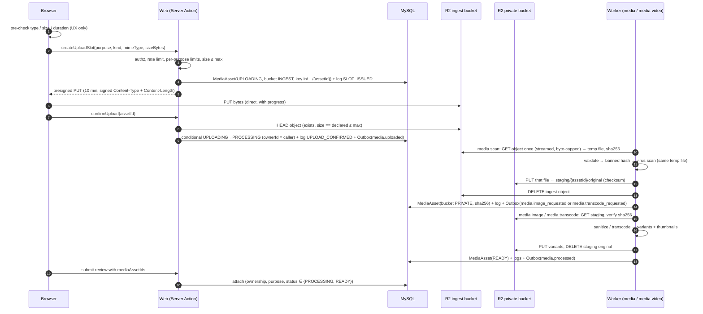
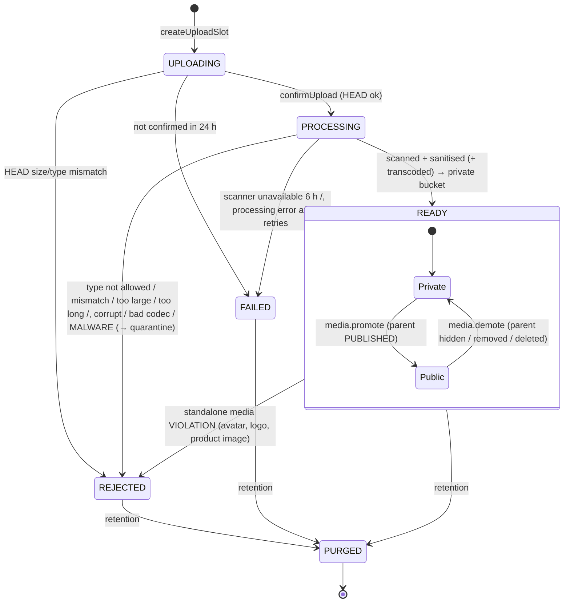

# Media Upload, Processing and Storage

| | |
|---|---|
| **Status** | Draft for review (task #19, milestone M1.2) |
| **Owner** | Software Architect |
| **Decision record** | [ADR-0006 Media storage and processing](../adr/0006-media-storage-and-processing.md) |
| **Jobs (M1-T2)** | Step jobs, payloads and retry policy: [job-catalogue.md §4.2](./job-catalogue.md#42-media-queues-media-and-media-video-deployments) ([ADR-0012](../adr/0012-media-job-decomposition.md)) |
| **Related** | [moderation-pipeline.md](./moderation-pipeline.md) · [data-model.md](./data-model.md) (§6.2 proofs, §7 retention) · [ADR-0001](../adr/0001-technology-stack.md) §5 (upload path, amended here) |

How photos and videos get from the browser into object storage, how they are checked (type, size, malware),
sanitised (EXIF/GPS stripped), transcoded, moderated and published, where every object lives, and when it is deleted.
The same pipeline also ingests private evidence files (purchase proofs, ownership documents, appeal evidence); their
redaction and retention are defined in data-model.md §6.2 and §7 and are not repeated here.

---

## 1. Limits

| Kind | Accepted formats (verified by magic bytes, not by extension or declared type) | Max size | Other limits |
|---|---|---|---|
| **Photo** | JPEG, PNG, WebP, HEIC/HEIF | **10 MB** | ≤ 50 megapixels decoded (decompression-bomb guard). Only the first frame of animated images is kept. **No SVG, GIF, BMP, TIFF** |
| **Video** | **MP4** (`video/mp4`), **MOV** (`video/quicktime`) | **50 MB** | **≤ 30 s** (container and stream duration; 0.5 s tolerance for container rounding). Exactly 1 video stream, ≤ 1 audio stream. Video codecs H.264, HEVC, MPEG-4 Part 2. Audio AAC, MP3, ALAC, PCM. Input ≤ 4096 px on the long side. Output: **720p** H.264 MP4 |
| **Document** (evidence only) | PDF, JPEG, PNG, WebP, HEIC | 10 MB | PDF ≤ 20 pages. Private bucket only. Never promoted |

Per-parent and per-user limits (config, enforced when the upload slot is issued and again when the parent is submitted):

| Purpose | Max attachments |
|---|---|
| `REVIEW_MEDIA` | 10 photos + 2 videos per review |
| `POST_MEDIA` | 10 items, ≤ 2 videos |
| `PRODUCT_IMAGE` | 20 per product |
| `AVATAR` / `SELLER_LOGO` | 1 (replacing one releases the old one) |
| `PURCHASE_PROOF` / `OWNERSHIP_EVIDENCE` / `APPEAL_EVIDENCE` | 5 per parent |
| **Per user** | 60 upload slots per hour, 300 per day; halved for trust band `NEW` |

The browser pre-checks type, size and video duration (via a `<video>` element's metadata) for fast feedback only.
**Every limit is re-checked server-side.**

**Exact boundaries** (answers test-strategy §9.3/§9.4). "MB" means MiB: photo and document ≤ **10 485 760** bytes,
video ≤ **52 428 800** bytes. Video duration is accepted up to **30.5 s** inclusive, measured on both the container and
the video stream, and rejected above that. The output is still hard-capped at 30 s. The config stores byte counts,
not "MB".

---

## 2. Upload flow (direct browser → object storage)

Application servers never proxy file bytes (ADR-0001). This design **amends ADR-0001 §5**: uploads go to a separate
private **ingest** bucket, never directly to the public bucket, so that unscanned files and files still carrying
EXIF/GPS metadata are never publicly reachable.



Rules:

1. **Keys are server-generated** (`in/{yyyy}/{mm}/{dd}/{assetId}`). The user's file name is never stored or used in
   any key, header or log.
2. **Presigned PUT** (R2 and S3 both support it; R2 does not support presigned POST policies). `Content-Type` and
   `Content-Length` are part of the signature, so the client must send exactly the declared type and size, and the
   server has already checked the size against the limit. TTL 10 min. One object per slot. If the provider supports
   it, the client also sends `x-amz-checksum-sha256` and the signature includes it.
3. **Confirm is mandatory and one-shot.** `confirmUpload` is a conditional update `UPLOADING → PROCESSING` with
   `ownerId = caller` and an unexpired slot, so a user cannot confirm someone else's slot (threat U-4). A repeated
   confirm returns the current status and emits nothing. A slot that is not confirmed within 24 h is cleaned up
   (`maintenance.media-orphans`). A confirm whose `HEAD` shows
   a missing object or a size mismatch marks the asset `REJECTED (TYPE_MISMATCH / TOO_LARGE)` and deletes the object.
4. **Attaching** happens when the parent is submitted: the asset must belong to the submitter, match the parent's
   purpose, not be attached elsewhere, and be `PROCESSING` or `READY`. A parent can be submitted before processing
   finishes; moderation waits for it ([moderation-pipeline.md §2.4](./moderation-pipeline.md#24-content-with-media)).
5. **Scanned bytes are the processed bytes** (threat U-5, ADR-0012). `media.scan` reads the ingest object exactly
   once, scans that copy and uploads it to `staging/`. Later steps decode only the staging copy, and only after its
   sha256 matches. A later PUT to the ingest key, which the presigned URL allows until it expires, is never read.
   Where the provider supports it, the slot also signs `If-None-Match: *` (to verify for R2 and MinIO in M5).
6. **Client retries:** the browser retries a failed PUT up to 3 times with the same URL while it is valid, and after
   that requests a new slot. The abandoned slot is cleaned up as unconfirmed.
7. 50 MB is sent as a single PUT in Phase 1. Resumable multipart upload is a follow-up if mobile failure rates
   demand it (§12).

---

## 3. Media state machine



`Private`/`Public` are not separate `MediaStatus` values; they are tracked by `MediaAsset.bucket` (`PRIVATE` /
`PUBLIC`) and `promotedAt`. `PURGED` rows stay as tombstones (sha256 kept for duplicate and banned-hash detection).

---

## 4. Processing pipeline

### 4.1 Common steps (every file)

| Step | What happens | On failure |
|---|---|---|
| **VALIDATE** | (`media.scan`) Stream from ingest **once** to a per-job temp dir, aborting at `max + 1` bytes. Compute sha256. Detect the real type from magic bytes. It must be in the allow-list for the purpose and match the declared kind. Reject polyglots (multiple valid signatures) and known-banned hashes | `REJECTED` with `failureReason` |
| **VIRUS_SCAN** | ClamAV `clamd` (sidecar container in the worker pod) via `INSTREAM`. Signatures updated hourly by `freshclam`; the signature version is logged per scan. `StreamMaxLength`, `MaxScanSize` and `MaxFileSize` raised to **64 MB** (ClamAV's 25 MB default would silently skip part of a 50 MB video) | **INFECTED** → copy to `quarantine/`, delete from ingest, `REJECTED (MALWARE)`, `TrustSignal MALWARE_UPLOAD`, parent forced to UNSURE, uploader gets `MEDIA_REJECTED`. **Scanner error** → retry; **fail closed**: after ~6 h of retries → `FAILED (SCAN_UNAVAILABLE)` |

Nothing is decoded by image or video libraries before the virus scan passes.

### 4.2 Photos: metadata strip and variants (`media` queue)

1. **Decode** with `sharp` (libvips) with `limitInputPixels = 50_000_000` and `failOn: 'error'`. HEIC needs libvips
   built with libheif (the worker image must provide it; sharp's prebuilt binaries do not decode HEIC).
2. **Auto-orient** using the EXIF `Orientation` tag, then **drop all metadata**: EXIF (incl. **GPS**), XMP, IPTC,
   maker notes, comments, embedded thumbnails. Convert colour to sRGB and drop the ICC profile afterwards.
   Re-encoding from pixels guarantees nothing from the original container survives.
3. **Verify the strip**: re-read every output with an EXIF/XMP parser and assert that there are no metadata blocks.
   Set `MediaAsset.metadataStripped = true`. The log records which tag *groups* were present in the original
   (e.g. `["exif","gps","xmp"]`), never their values.
4. **Variants** (never upscaled), written to the private bucket:

| Variant | Size (long side) | Format | Use |
|---|---|---|---|
| `thumb` | 320 px | WebP q75 | grids, queue thumbnails |
| `medium` | 960 px | WebP q80 | review cards |
| `large` | 1920 px | WebP q82 | lightbox |
| `large_jpg` | 1920 px | JPEG q82 | email / Open Graph fallback |

5. Compute a perceptual hash (`perceptualHash`) for near-duplicate detection. Delete the staging original.
   `READY`, emit `media.processed`. Steps 1–5 are the `media.image` job; `thumb` is the thumbnail and is produced from
   the same decode as the other sizes.

Evidence purposes (proof, ownership, appeal) use the same steps 1–3 but keep a single full-resolution `master`
(max 4096 px) instead of web variants, and PDFs are rasterised for redaction (data-model.md §6.2).

### 4.3 Videos: probe and transcode (`media-video` queue)

After VALIDATE and VIRUS_SCAN pass, the job is handed to the `media-video` queue (separate worker deployment, low
concurrency) so transcodes cannot starve moderation or image jobs.

1. **Probe** with `ffprobe -v error -show_format -show_streams -of json`. Checks: container is the ISO-BMFF / QuickTime
   family with an allowed major brand; duration ≤ 30.5 s on both container and video stream; 1 video stream; ≤ 1
   audio stream; codecs in the allow-list; ≤ 4096 px. Data and timed-metadata tracks (common in iPhone MOVs) are
   allowed in the input and dropped on output. Failures → `REJECTED (TOO_LONG | UNSUPPORTED_CODEC | CORRUPT)`.
2. **Transcode** to the single delivery rendition:

| Setting | Value |
|---|---|
| Container | MP4, `-movflags +faststart` |
| Video | H.264 High, `yuv420p`, CRF 23, `maxrate 2.5M`, `bufsize 5M`, keyframe every 2 s, ≤ 30 fps |
| Resolution | Fit inside 1280×720 (landscape) or 720×1280 (portrait), keep aspect, never upscale, even dimensions |
| Rotation | Display-matrix rotation applied to the pixels, then rotation metadata removed |
| HDR | HLG/PQ/Dolby Vision input tone-mapped to SDR BT.709 |
| Audio | AAC-LC 128 kbit/s, 48 kHz, stereo (or none if the input has none) |
| Metadata | `-map_metadata -1 -map_chapters -1 -sn -dn`: removes all global and stream tags, including QuickTime location atoms (`©xyz`, `com.apple.quicktime.location.ISO6709`) |
| Hard cap | `-t 30` |
| Hardening | `-nostdin`, `-protocol_whitelist file`, no network in the transcode container, CPU/memory cgroup limits, 5 min job timeout, per-job temp dir deleted afterwards |

   Expected output size ≤ ~10 MB for 30 s.
3. **Verify** the output with ffprobe: duration, resolution ≤ 720p, codecs, and **no format/stream tags besides
   technical ones** → `metadataStripped = true`.
4. **Poster** frame at 1 s (or 0 s for shorter clips) → `poster` WebP (sanitised like a photo) + `poster_thumb` 320 px.
5. **Moderation frames**: 1 fps, at most 30, 512 px WebP in `frames/{assetId}/` (private). Deleted by the moderation
   job after assessment; a 2-day lifecycle rule is the safety net.
6. Delete the staging original. `READY`, emit `media.processed`. Steps 1–6 are the `media.transcode` job.

### 4.4 Moderation and publication (visibility gating)

- **Attached media** (review, post) is moderated together with its parent (moderation-pipeline.md §2.4). Its public
  visibility follows the parent's `ContentStatus`:

| Parent transition | Media job | Effect |
|---|---|---|
| → `PUBLISHED` | `media.promote` | Copy variants to the public bucket, delete private copies, `bucket = PUBLIC`, `promotedAt` |
| `PUBLISHED` → `HIDDEN` / `REMOVED` / `DELETED` | `media.demote` | Copy variants back to private, delete public objects, **purge CDN URLs**, `bucket = PRIVATE` |
| → `REJECTED` (never published) | none | Stays private until purge |

- **Standalone media** (avatar, seller logo, product image) is a moderation target itself: `CLEAN` → promote + post-review;
  `UNSURE` → stays private (default avatar shown) in the HOLD lane; `VIOLATION` → `REJECTED (POLICY_VIOLATION)`.
- **Evidence** purposes are never promoted (CHECK constraint `chk_media_public_bucket` + `chk_media_sensitive_private`).
- `media.demote` is safety-critical (content that must not be public). It has 10 attempts and pages on-call on final
  failure.
- Authors and staff view non-public media through signed GET URLs (TTL ≤ 5 min, ADR-0001). Staff access to
  evidence is audited (data-model.md §6.2).

---

## 5. Storage layout

### 5.1 Buckets

Three buckets per environment (`{env}` = `dev` / `staging` / `prod`). Separate buckets give separate credentials and
lifecycle rules, so a leaked web-app credential can at worst write raw files into a quarantine-like ingest bucket.

| Bucket | Access | Encryption | Lifecycle safety net | Purpose |
|---|---|---|---|---|
| `rp-{env}-ingest` | Private. Browsers write via presigned PUT only | Provider SSE | Delete objects older than **2 days** | Raw, untrusted uploads |
| `rp-{env}-private` | Private. Signed GET ≤ 5 min | Provider SSE | `staging/` 2 days, `frames/` 2 days, `quarantine/` 30 days | Processed media not (or no longer) public, evidence, quarantine |
| `rp-{env}-public` | Public read **through the CDN custom domain only** (`r2.dev` access disabled, no listing) | Provider SSE | none (deletion is driven by the app) | Published media |

### 5.2 Key layout

```
rp-{env}-ingest/
  in/{yyyy}/{mm}/{dd}/{assetId}                          raw upload; no extension, never served

rp-{env}-private/
  media/{assetId}/{variant}.{ext}                         processed UGC media while not public
                                                          (pending, hidden, rejected, removed, deleted)
  staging/{assetId}/original                              scanned upload, exact bytes that passed the scan (transient)
  frames/{assetId}/{nnn}.webp                             video frames for AI moderation (transient)
  evidence/{purpose}/{yyyy}/{mm}/{assetId}/master.{ext}   PURCHASE_PROOF | OWNERSHIP_EVIDENCE | APPEAL_EVIDENCE
                                                          (redacted copies are their own MediaAsset row/key)
  quarantine/{yyyy}/{mm}/{assetId}                        malware hits, as uploaded

rp-{env}-public/
  m/{assetId}/{variant}.{rev}.{ext}                       published media; immutable
```

- `{assetId}` is the `MediaAsset` cuid. `{variant}` ∈ `thumb | medium | large | large_jpg | video_720p | poster | poster_thumb | master`.
- `{rev}` is a short processing revision (e.g. `r1`). Re-processing writes new keys, so public objects can be cached
  forever: `Cache-Control: public, max-age=31536000, immutable`.
- The worker sets an explicit `Content-Type` and `X-Content-Type-Options: nosniff` on every public object, and
  `Content-Disposition: inline` with no file name.
- `MediaAsset.storageKey` holds the key of the primary object in its **current** bucket (`MediaAsset.bucket`);
  `variants` holds `{ variant: { key, width, height, bytes, mimeType } }`. Both are rewritten on promote/demote.
  This replaces the `{visibility}/{purpose}/{yyyy}/{mm}/{cuid}` format sketched in data-model.md §4.

### 5.3 Credentials (least privilege)

| Principal | ingest | private | public |
|---|---|---|---|
| Web app | presign PUT, HEAD | presign GET (author/staff views) | — |
| Worker (`media`, `media-video`, `moderation`) | GET, DELETE | GET, PUT, DELETE | PUT, DELETE |
| CDN | — | — | read |
| Humans / CI | none in prod (break-glass only, audited) | none | none |

Each principal gets a bucket-scoped R2 API token stored in the secrets manager (threat-model task).

### 5.4 CORS and delivery

- **Ingest:** `AllowedOrigins` = the app origin(s) per environment, `AllowedMethods: PUT`,
  `AllowedHeaders: content-type, x-amz-checksum-sha256`, `MaxAgeSeconds: 3600`.
- **Public:** served from a dedicated media hostname with **no app cookies** scoped to it (ideally a separate
  registrable domain). `GET`/`HEAD` from any origin. Video uses HTTP range requests (supported by R2 + CDN).
- CDN purge by URL on demote (Cloudflare API, called from `media.demote`).

---

## 6. Retention rules

All periods are configuration and are **OPEN(LEGAL)** (L-5), consistent with data-model.md §7.
`MediaAsset.legalHold = true` blocks every deletion below.

| Data | Retention | Mechanism |
|---|---|---|
| Raw upload in ingest | Deleted as soon as processing finishes (any outcome) | Worker delete; **bucket lifecycle 2 days** as a backstop |
| Unconfirmed slot (`UPLOADING`) | 24 h → `FAILED`, then tombstone | `maintenance.media-orphans` (hourly) |
| Processed but never attached (`READY`, no parent) | 24 h | `maintenance.media-orphans` |
| Video moderation frames | Until assessment finishes | Moderation job; lifecycle 2 days |
| Published media | Lifetime of the parent while `PUBLISHED` | — |
| Media of `PENDING`/`HIDDEN` parents | While pending or held (≤ 7 days hold) | — |
| Media of `REJECTED`/`REMOVED` parents | Until `appealableUntil` + 60 days (≈ 90 days); if an appeal is open, until decided + 60 days | `maintenance.media-retention` (daily) |
| Media of author-`DELETED` parents | Demoted immediately; purged 90 days after `deletedAt` | `maintenance.media-retention` |
| Replaced avatar / logo | Demoted immediately; purged after 7 days | `maintenance.media-retention` |
| Account erasure | Demoted immediately; purged within 30 days (L-4) | Erasure job |
| Quarantined malware | 30 days (investigation) | Sweeper + lifecycle |
| Evidence (proof, ownership, appeal) | data-model.md §7 (unchanged) | Existing purge jobs |
| `MediaAsset` row | Kept as `PURGED` tombstone (sha256 / perceptual hash kept for duplicate and banned-content detection; no object behind it) | — |
| `MediaProcessingLog` rows | 13 months; `ipHash` nulled after 90 days (L-11) | `maintenance.purge-media-logs` (daily) |
| Structured app logs for media jobs | 30 days | Log platform retention |

**Purge semantics:** a purge deletes every object in `variants` + `storageKey` from all buckets, purges CDN URLs if the
asset was ever public, sets `status = PURGED`, `purgedAt`, clears `variants`, and writes a `PURGE` log row. R2 has no
object versioning enabled for these buckets, so a delete is final. Database backups (which contain no media bytes)
follow the DB backup retention.

---

## 7. Scan and upload logs

Every step writes one append-only row to **`MediaProcessingLog`** (high volume, so separate from `AuditLog`; no FK, so
rows outlive tombstones, like `AuditLog`).

| Step | Logged detail (no PII, no file names, no metadata values) |
|---|---|
| `SLOT_ISSUED` | actor, purpose, kind, declared mime/size, `ipHash`, user agent family |
| `UPLOAD_CONFIRMED` | actual size, checksum match |
| `VALIDATE` | detected mime, sha256 prefix, dimensions/duration, banned-hash hit |
| `VIRUS_SCAN` | engine `clamav`, engine version, **signature version**, result, threat name if infected, scan duration |
| `SANITIZE` | tag groups found and removed (`["exif","gps","xmp","iptc"]`), verification result |
| `TRANSCODE` | input codec/resolution/duration, output codec/resolution/bytes, ffmpeg version, duration |
| `VARIANTS` | variant names and byte sizes |
| `AI_MODERATION` | verdict and case id (scores live on `ModerationDecision`) |
| `PROMOTE` / `DEMOTE` | bucket move, CDN purge result |
| `QUARANTINE` / `PURGE` | keys deleted, trigger (retention rule / erasure / user action) |

Columns: `id` (BIGINT), `mediaAssetId`, `step`, `outcome` (`OK`, `REJECTED`, `INFECTED`, `ERROR`, `SKIPPED`),
`attempt`, `engine`, `engineVersion`, `signatureVersion`, `detail` (JSON), `durationMs`, `actorId`, `ipHash`, `jobId`,
`createdAt`. Indexed by `(mediaAssetId, createdAt)` and `(step, outcome, createdAt)`.

Access: staff with `moderation.queue.read` see an asset's log in the media detail panel. Ops dashboards aggregate it
(infection rate, rejection reasons, processing latency). Alerts: ClamAV signatures older than 24 h; scanner error rate
> 5 % for 15 min; any `DEMOTE` failure; ingest objects older than 6 h (pipeline stuck).

---

## 8. Jobs

Moved to [job-catalogue.md §4.2](./job-catalogue.md#42-media-queues-media-and-media-video-deployments) (M1-T2,
[ADR-0012](../adr/0012-media-job-decomposition.md)). The former `media.process` job is split into `media.scan`
(validate, banned hash, virus scan, staging copy) and `media.image` (sanitise, resize, thumbnails). `media.transcode`
now starts from the staging copy. The same section has payloads, job ids, retry budgets (scanner: 9 attempts ≈ 6 h,
fail closed), unrecoverable-error mapping and the failure-handling matrix. Sweepers and schedules are in §5 of that
document.

Every handler is idempotent: it re-reads the asset and checks `status`/`bucket` before acting, and object copies
are "copy then delete", so a retry after a crash finds the object in one place or both and finishes the move.

---

## 9. Security notes (input to the threat-model task)

- Untrusted bytes are touched only by the worker, only after the virus scan, and only by libvips/ffmpeg running with
  resource limits and no network. Decompression bombs: pixel limit, byte cap, duration cap, transcode timeout.
- No SVG (script injection), no user-controlled `Content-Type` or file names on served objects, `nosniff` everywhere.
- Media is served from a cookieless hostname; no app session can leak to it.
- Ingest credentials can only write to ingest; promotion to public is a worker-only action, gated on moderation.
- Banned-hash list (sha256 + perceptual hash of previously removed zero-tolerance content) is checked at VALIDATE.
  Integration with an industry hash-matching service for CSAM is OPEN(LEGAL) and recommended before launch.

---

## 10. Data model changes

Applied to [schema.draft.prisma](./schema.draft.prisma):

| Change | Purpose |
|---|---|
| `StorageBucket { INGEST PRIVATE PUBLIC }` + `MediaAsset.bucket` | Where the object currently lives (§5) |
| `MediaFailureReason` + `MediaAsset.failureReason` | Why `REJECTED` / `FAILED` |
| `MediaAsset.detectedMimeType`, `virusScannedAt`, `promotedAt` | Validation result, scan time, public since |
| `MediaProcessingLog` + `MediaProcessingStep`, `MediaProcessingOutcome` | Scan/upload logs (§7) |
| `TrustSignalType.MALWARE_UPLOAD` | Abuse signal |
| CHECK `chk_media_public_bucket` | Only `visibility = PUBLIC` assets may be in the public bucket |

---

## 11. Test plan (for the implementation tasks)

1. Fixture corpus: valid JPEG/PNG/WebP/HEIC with GPS EXIF, a PNG with XMP, a polyglot (JPEG+ZIP), a 10 MB + 1 byte
   photo, a decompression bomb, an MP4 of 30.4 s and one of 31 s, an iPhone MOV (HEVC, HDR, location atom, rotation),
   a 50 MB + 1 byte video, a file with a wrong extension, and the EICAR test file.
2. Assert: EICAR → `REJECTED (MALWARE)` + quarantine + log with signature version; every output image and video has no
   GPS/EXIF/XMP/location atoms (checked with exiftool in CI); videos are ≤ 720p H.264/AAC MP4 with faststart and ≤ 30 s.
3. Presign tests: wrong `Content-Length`/`Content-Type` is refused by storage; unconfirmed slots are cleaned up after 24 h.
4. Promote/demote: a published-then-removed review's public URLs return 404 after demote (MinIO in CI; CDN purge mocked).
5. Retention sweeps with a fake clock, including legal hold blocking a purge.

---

## 12. Risks and follow-ups

| ID | Risk / follow-up | Mitigation |
|---|---|---|
| MD-1 | HEIC decoding needs libvips + libheif in the worker image (licensing/patents of HEVC decoders) | Build the image in the scaffold task; fallback: reject HEIC and ask iOS to send JPEG (`accept="image/jpeg,…"` makes Safari convert) |
| MD-2 | 50 MB single PUT on mobile networks may fail | Retry from the client; resumable multipart upload as follow-up |
| MD-3 | ClamAV detection is signature-based and weak against novel malware | Media is never served raw (always re-encoded), which neutralises most media-borne exploits; scanner is defence in depth |
| MD-4 | Transcode cost and latency at volume | Separate `media-video` deployment, autoscale on queue depth; managed transcoding (e.g. Cloudflare Stream) can replace the job behind the same interface |
| MD-5 | CDN purge failure leaves removed media cached | Demote deletes the origin object first; purge retried; alert |
| MD-6 | Retention periods are proposals | OPEN(LEGAL) L-5 |
