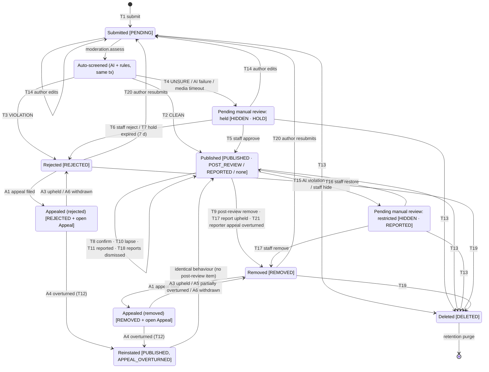
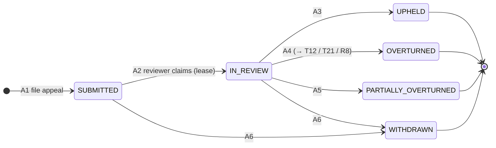

# Moderation Lifecycle: States, Transitions, Actors and Audit

| | |
|---|---|
| **Status** | Draft for review (task #25, M1-T2) |
| **Owner** | Software Architect |
| **Decision record** | [ADR-0011 Moderation lifecycle completion and audit contract](../adr/0011-moderation-lifecycle-and-audit.md) (amends [ADR-0005](../adr/0005-moderation-state-machine.md)) |
| **Related** | [moderation-pipeline.md](./moderation-pipeline.md) (verdicts, timers, thresholds, queues) · [job-catalogue.md](./job-catalogue.md) (jobs, payloads, retries) · [media-pipeline.md](./media-pipeline.md) · [schema.draft.prisma](./schema.draft.prisma) (M1-T1) · [test-strategy.md](../qa/test-strategy.md) §5.1 |

This document is the **single transition table** for moderated content. It gives the product lifecycle names
(*submitted, auto-screened, pending manual review, published, rejected, appealed, reinstated, removed*) an exact
storage mapping in the M1-T1 schema, and lists every allowed transition with its actor, guard and audit record.

How the rows are split between the documents:

- **Verdicts, timers, thresholds and queue mechanics** stay in [moderation-pipeline.md](./moderation-pipeline.md).
- **Side effects of T1–T14** (notifications, trust signals, counters) are in moderation-pipeline.md §3.2. That table
  keeps its IDs, so the test IDs `MOD-001`…`MOD-015` stay valid.
- **T15–T21, the revision rows R1–R8 and the appeal rows A1–A7** are new in this document. They are fully specified
  here, side effects included.

---

## 1. Lifecycle states and how they are stored

The product vocabulary has eight states. Only five of them are values of `ContentStatus`. The other three are
derived from other rows, and we do not add them to the enum (rationale in §1.1).

| # | Lifecycle state | Stored as (M1-T1 schema) | Public? | Persisted? |
|---|---|---|---|---|
| L1 | **Submitted** | `ContentStatus.PENDING` + `ModerationCase(status OPEN, trigger SUBMISSION\|EDIT)` with no AI or RULE decision yet | no | yes |
| L2 | **Auto-screened** | A `ModerationDecision(source AI\|RULE, verdict …)`. It is written **in the same transaction** as the next transition (T2/T3/T4), so the content is never observed "auto-screened but undecided" | no | transient (the decision row persists) |
| L3 | **Pending manual review** | `ContentStatus.HIDDEN` + open case in lane `HOLD` (before publication, 7-day hold) **or** lane `REPORTED` (restricted after it was live) | no | yes |
| L4 | **Published** | `ContentStatus.PUBLISHED`. Sub-states come from open cases: lane `POST_REVIEW` (awaiting the 24 h human post-review), lane `REPORTED` (live with reports), or no open case | **yes** | yes |
| L5 | **Rejected** | `ContentStatus.REJECTED`: blocked before it was ever public (AI/RULE violation, staff reject, or hold expiry) | no | yes |
| L6 | **Appealed** | `REJECTED` or `REMOVED` content, plus an `Appeal(status SUBMITTED\|IN_REVIEW)` whose `caseId` is the deciding case. A reporter's appeal against a "no action" decision (L-3) can also be attached to `PUBLISHED` content | no (or yes, for a reporter appeal) | derived |
| L7 | **Reinstated** | `ContentStatus.PUBLISHED`, where the deciding case has `resolutionCode = APPEAL_OVERTURNED` and the `Appeal` is `OVERTURNED`. It behaves exactly like *Published*, except that no post-review item is opened | **yes** | derived |
| L8 | **Removed** | `ContentStatus.REMOVED`: taken down after it was public | no | yes |
| — | *Deleted* (not in the brief) | `ContentStatus.DELETED`: withdrawn by the author (soft delete, purged by retention) | no | yes |

Derived states are computed by `packages/core` `lifecycleState(content, cases, appeals)`. The admin UI, author UI and
transparency reports use that one function, so no screen re-derives them on its own.

### 1.1 Why *appealed* and *reinstated* are not `ContentStatus` values

- **An appeal does not change visibility.** Appealed content stays non-public until a human decides. A status value
  would also lose the information *what* was appealed (`REJECTED` or `REMOVED`). User copy, the strike rules and DSA
  transparency counts need that, and an `UPHELD` outcome would have to restore it.
- **Appeals are not only about content.** They can also target enforcement actions, proofs and ownership claims
  (`Appeal` exclusive arc). The appeal has its own state machine (§5), so we do not copy its state into four content
  tables.
- **A reinstated item is a published item.** Every published-content rule applies to it (reports, author delete,
  promotion of media). A separate status value would force every `status = 'PUBLISHED'` query (feeds, counts, search)
  to also match `REINSTATED`. That would be a whole class of bugs for no gain.

---

## 2. State diagram

Labels are `Tn` IDs from §4. `[STATUS · lane]` gives the stored form.



Notes:

- *Auto-screened* is drawn as a state for readability. It has no `ContentStatus` value: the decision and the outgoing
  transition commit together (§1, L2).
- *Reinstated* and *Published* share one stored status. The arrow between them shows that they behave the same: no
  transition starts from *Reinstated* that does not also start from *Published*.
- A `PARTIALLY_OVERTURNED` appeal (A5) keeps the content where it is and only changes the sanction (for example,
  it voids the strike). Content changes always come from `OVERTURNED`.

---

## 3. Actors

| Actor | Who | `AuditLog.actorType` | `actorId` | Typical permission (ADR-0003) |
|---|---|---|---|---|
| `AUTHOR` | Owner of the content (user, or seller member for `SellerReply` / seller posts) | `USER` | user id | create/update permission for the content type; ownership |
| `REPORTER` | Any signed-in user who files a `Report` | `USER` | user id | `report.create` (rate-limited, threat-model §5) |
| `APPELLANT` | The author, or the reporter for a no-action decision (L-3) | `USER` | user id | owner of the decision being appealed |
| `AI` | `moderation.assess` / `moderation.rescan` applying a provider verdict | `AI` | `null` (provider and model in `metadata`) | — |
| `RULE` | Deterministic rules inside `moderation.assess` (blocklist, banned hash, velocity, AI-failure fallback, media timeout) | `SYSTEM` | `null` | — |
| `TIMER` | Delayed timer jobs and the `maintenance.moderation-sweep` backstop | `SYSTEM` | `null` (job name and job id in `metadata`) | — |
| `MOD` | `MODERATOR` or `SENIOR_MODERATOR` | `STAFF` | staff user id | `moderation.decide` (COI guard), `moderation.bulk_decide` |
| `SMOD` | `SENIOR_MODERATOR` only | `STAFF` | staff user id | `moderation.decide` on `ESCALATED` cases, bulk reject/remove |
| `APPEAL_REVIEWER` | `SENIOR_MODERATOR` who is **not** a human decider on the case | `STAFF` | staff user id | `appeal.decide` |

All staff rows also record `actorRoles`, `requestId`, `ipHash` and `userAgent`. AI, RULE and TIMER rows record
`metadata.job` and `metadata.jobId` instead.

---

## 4. Transition table (content)

Common guard on every row: `transition()` runs `UPDATE … SET status = :to WHERE id = :id AND status IN (:from)`
(plus the case or version guard named in the row) inside the transaction. Zero affected rows is a **no-op**: no
decision, no audit row, no outbox row (moderation-pipeline.md §4.3).

**Audit action** is the `AuditLog.action` value. `<e>` is the entity prefix: `review`, `seller_reply`, `comment`,
`post`, or `media` (for standalone media). `entityType` is the model name (`Review`, `SellerReply`, `Comment`, `Post`,
`MediaAsset`).

| # | From | Event | Actor | Guard (in addition to the common guard) | To | Decision written (source / outcome / verdict) | Audit action |
|---|---|---|---|---|---|---|---|
| T1 | — | submit | AUTHOR | create permission, not restricted, rate limit, attachments valid (media-pipeline §2 rule 4) | `PENDING` | — | `<e>.submit` |
| T2 | `PENDING` | assessment CLEAN | AI | case `OPEN`, `case.contentVersion = currentVersion` | `PUBLISHED` | AI / APPROVE / CLEAN | `<e>.auto_publish` |
| T3 | `PENDING` | assessment VIOLATION | AI or RULE | as T2 | `REJECTED` | AI\|RULE / REMOVE / VIOLATION | `<e>.auto_reject` |
| T4 | `PENDING` | assessment UNSURE, AI failure, media timeout | AI or RULE | as T2 | `HIDDEN` (lane `HOLD`) | AI\|RULE / ESCALATE / UNSURE | `<e>.auto_hold` |
| T5 | `HIDDEN` (HOLD) | staff approve | MOD | lease held, COI, case not resolved; `ESCALATED` needs SMOD | `PUBLISHED` | HUMAN / APPROVE | `<e>.approve` |
| T6 | `HIDDEN` (HOLD) | staff reject | MOD | as T5, `reasonCode` from the policy list, `publicReason` | `REJECTED` | HUMAN / REMOVE | `<e>.reject` |
| T7 | `HIDDEN` (HOLD) | hold timer | TIMER | `now ≥ holdExpiresAt`, lane `HOLD`, case not resolved | `REJECTED` | RULE / REMOVE (`HOLD_EXPIRED`) | `<e>.hold_expire` |
| T8 | `PUBLISHED` | post-review confirm | MOD | lane `POST_REVIEW`, not resolved | `PUBLISHED` | HUMAN / APPROVE | `<e>.post_review_confirm` |
| T9 | `PUBLISHED` | post-review remove | MOD | as T8 + `reasonCode`, `publicReason` | `REMOVED` | HUMAN / REMOVE | `<e>.remove` |
| T10 | `PUBLISHED` | post-review lapse | TIMER | `now ≥ postReviewDueAt + lapseAfterHours` | `PUBLISHED` | RULE / APPROVE (`POST_REVIEW_LAPSED`) | `<e>.post_review_lapse` |
| T11 | `PUBLISHED` | report threshold reached / staff flag | RULE or MOD | **Changed (resolves QA §9.11 / threat F-9):** content **stays live**. The case moves to lane `REPORTED`, `slaDueAt = now + 48 h`, and `moderation.rescan` is enqueued (trigger `USER_REPORT`). A report count alone never hides content | `PUBLISHED` | RULE / ESCALATE (`REPORT_THRESHOLD`) or HUMAN / ESCALATE | `<e>.flag` |
| T12 | `REJECTED` / `REMOVED` | appeal overturned (A4) | APPEAL_REVIEWER | `appeal.decide`, reviewer ∉ human deciders on the case, appeal `IN_REVIEW` with a lease held | `PUBLISHED` | HUMAN / APPROVE (`APPEAL_OVERTURNED`), appended to the **original** case | `<e>.reinstate` |
| T13 | `PENDING` / `HIDDEN` / `PUBLISHED` | author deletes | AUTHOR | owner | `DELETED` | — | `<e>.delete` |
| T14 | `PENDING` / `HIDDEN` | author edits | AUTHOR | owner, edit limit 5/day | `PENDING` | — (old case `SUPERSEDED`) | `<e>.edit` |
| **T15** | `PUBLISHED` (REPORTED) | re-scan VIOLATION, or staff "Hide" | AI or MOD | lane `REPORTED`, case not resolved. A re-scan UNSURE does **not** hide; it only bumps priority | `HIDDEN` (lane `REPORTED`) | AI / RESTRICT / VIOLATION, or HUMAN / RESTRICT | `<e>.hide` |
| **T16** | `HIDDEN` (REPORTED) | staff restore ("Keep") | MOD | lease, COI, lane `REPORTED` | `PUBLISHED` | HUMAN / APPROVE | `<e>.restore` |
| **T17** | `PUBLISHED` / `HIDDEN` (REPORTED) | staff remove (report upheld) | MOD | as T16 + `reasonCode`, `publicReason` | `REMOVED` | HUMAN / REMOVE | `<e>.remove` |
| **T18** | `PUBLISHED` (REPORTED) | staff dismisses reports | MOD | as T16 | `PUBLISHED` | HUMAN / APPROVE (`REPORTS_DISMISSED`) | `<e>.dismiss_reports` |
| **T19** | `REJECTED` / `REMOVED` | author deletes | AUTHOR | owner | `DELETED` | — | `<e>.delete` |
| **T20** | `REJECTED` / `REMOVED` | author resubmits an edited version | AUTHOR | owner, edit limit 5/day, **no open appeal** on the deciding case, not zero-tolerance, no `legalHold` | `PENDING` | — | `<e>.resubmit` |
| **T21** | `PUBLISHED` | reporter's appeal against T18 overturned (A4) | APPEAL_REVIEWER | as T12 | `REMOVED` | HUMAN / REMOVE (`APPEAL_OVERTURNED`) | `<e>.remove` |

### 4.1 Side effects of the new rows

| # | Case / timers | Notifications | Media | Other |
|---|---|---|---|---|
| T11 | Reports link to one open `REPORTED` case per target (they collapse). `priority` comes from reporter-weighted report count (F-9) | none | none | outbox `moderation.rescan_requested` |
| T15 | stays in lane `REPORTED`; `slaDueAt = now + 48 h`. **No automatic outcome**: a removal of content that was live is always a human decision, and auto-restoring content the AI scored as a violation would reward abuse. The sweeper alerts when a restricted item is older than 48 h | `CONTENT_HELD` (author) | `media.demote_requested` per asset | — |
| T16 | case `RESOLVED`; reports → `NO_ACTION` | `CONTENT_RESTORED` (author), `REPORT_RESOLVED` (reporters) | `media.promote_requested` per asset | — |
| T17 | case `RESOLVED`, `appealableUntil = now + 30 d`; reports → `ACTION_TAKEN`; other open cases on the target → `SUPERSEDED` | `CONTENT_REMOVED` (author, statement of reasons), `REPORT_RESOLVED` | `media.demote_requested` (if public) | strikes (pipeline §9); trust `CONTENT_ACTIONED_AGAINST` |
| T18 | case `RESOLVED`; reports → `NO_ACTION`; `appealableUntil = now + 30 d` (reporters may appeal, L-3) | `REPORT_RESOLVED` | none | reporter trust signal only if reports are marked `REJECTED` (abusive) |
| T19 | open appeals → `WITHDRAWN` (A6); no case is opened | none | `media.demote_requested` (no-op if private); retention per media-pipeline §6 | a pending deferred strike (AI `VIOLATION`) still applies when the window closes |
| T20 | new case (trigger `EDIT`, new `contentVersion`). **Force-UNSURE** when the last deciding decision was `HUMAN`, so a human who rejected or removed it must also approve the new version. Appeals on the superseded decision are refused afterwards | `CONTENT_HELD` only if the verdict is UNSURE (through T4) | new attachments follow media-pipeline §2; old rejected media stays detached | an AI/RULE-only rejection that the author fixes by resubmitting creates **no** deferred strike. Human strikes stand |
| T21 | the T18 case gets a HUMAN / REMOVE decision, `resolutionCode = APPEAL_OVERTURNED`; the **author** now has a fresh 30-day appeal window against this removal | `CONTENT_REMOVED` (author), `APPEAL_DECIDED` (reporter) | `media.demote_requested` | strike per pipeline §9 |

Cross-cutting rule: **any transition that leaves `PUBLISHED`** resolves every other open case on the same target
with `resolutionCode = SUPERSEDED` in the same transaction. This covers, for example, a `POST_REVIEW` case that is
still open when a `REPORTED`-lane removal happens. One target therefore never has two cases that could both publish it.

### 4.2 Review revisions (edits of live reviews)

A review that is `PUBLISHED` keeps that status while an edit is moderated (pipeline §3.3). These rows change
`ReviewRevision.status` and, on approval, `Review.publishedVersion`.

| # | From (revision) | Event | Actor | To | Effect on the review | Audit action |
|---|---|---|---|---|---|---|
| R1 | — | author edits a `PUBLISHED` review | AUTHOR | `PENDING` | stays `PUBLISHED` on `publishedVersion`; an earlier `PENDING`/`HELD` revision becomes `SUPERSEDED` in the same transaction | `review.revision_submit` |
| R2 | `PENDING` | CLEAN | AI | `APPROVED` | `publishedVersion = v`, `POST_REVIEW` +24 h | `review.revision_auto_publish` |
| R3 | `PENDING` | VIOLATION | AI / RULE | `REJECTED` | live version unchanged; appealable | `review.revision_auto_reject` |
| R4 | `PENDING` | UNSURE / AI failure | AI / RULE | `HELD` | live version unchanged; `HOLD` +7 d | `review.revision_auto_hold` |
| R5 | `HELD` | staff approve | MOD | `APPROVED` | as R2, without a post-review item | `review.revision_approve` |
| R6 | `HELD` | staff reject | MOD | `REJECTED` | live version unchanged | `review.revision_reject` |
| R7 | `HELD` | hold timer (**confirms QA §9.7**) | TIMER | `REJECTED` | live version unchanged; no strike (A-5) | `review.revision_hold_expire` |
| R8 | `REJECTED` | appeal overturned | APPEAL_REVIEWER | `APPROVED` | `publishedVersion = v` | `review.revision_reinstate` |

A post-review **remove** of an approved revision is T9 on the review. The whole review becomes `REMOVED`, because
the live version is the one found to violate policy.

---

## 5. Appeal sub-machine (`AppealStatus`)



| # | From | Event | Actor | Guard | To | Effects | Audit action |
|---|---|---|---|---|---|---|---|
| A1 | — | file appeal | APPELLANT | `now < case.appealableUntil`; appellant is the author, or a reporter on a T18 case; unique `(appellantId, caseId)`; deciding case is for the current `contentVersion` (not superseded by T20) | `SUBMITTED` | `slaDueAt = now + 72 h` if `resolutionCode = HOLD_EXPIRED`, else `+ 7 d`; `priority`; evidence attachments (purpose `APPEAL_EVIDENCE`, media pipeline); outbox `appeal.submitted` → `APPEAL_RECEIVED` | `appeal.submit` |
| A2 | `SUBMITTED` | reviewer claims | APPEAL_REVIEWER | `appeal.decide`, reviewer ≠ appellant, reviewer ∉ human deciders, COI | `IN_REVIEW` | `reviewerId`, `leaseExpiresAt = now + 15 min` (renewed while open). An expired lease lets another reviewer claim it; the status stays `IN_REVIEW` | `appeal.claim` (first claim and every re-assignment only, not lease renewals) |
| A3 | `IN_REVIEW` | uphold | APPEAL_REVIEWER | lease held, `decisionNote` | `UPHELD` | content unchanged; `APPEAL_DECIDED` (with out-of-court dispute info, L-2); a deferred AI strike is created now if the window has passed | `appeal.uphold` |
| A4 | `IN_REVIEW` | overturn | APPEAL_REVIEWER | as A3 | `OVERTURNED` | runs **T12**, **T21** or **R8** in the same transaction; linked `EnforcementAction` → `OVERTURNED`; trust `APPEAL_OVERTURNED`; `APPEAL_DECIDED` + `CONTENT_RESTORED` (T12) | `appeal.overturn` (and the content row's own action) |
| A5 | `IN_REVIEW` | partial overturn | APPEAL_REVIEWER | as A3, and the note says what changed | `PARTIALLY_OVERTURNED` | content stays; the strike or enforcement is voided or shortened (`EnforcementAction` → `OVERTURNED`, or a new `endsAt`) | `appeal.partially_overturn` |
| A6 | `SUBMITTED` / `IN_REVIEW` | withdraw | APPELLANT, or system on T19 | owner | `WITHDRAWN` | lease cleared | `appeal.withdraw` |
| A7 | `SUBMITTED` / `IN_REVIEW` | SLA passed | TIMER | `now ≥ slaDueAt` | (unchanged) | priority bump + alert; **never** an automatic outcome (A-6, human-only appeals) | none (metric only) |

Schema note: A2 needs `Appeal.leaseExpiresAt`. It was missing in M1-T1 and is **added** in this change
(schema.draft.prisma). It mirrors `ModerationCase.leaseExpiresAt`.

---

## 6. Audit logging contract

### 6.1 Rules

1. **Exactly one `AuditLog` row per committed transition**, written by `transition()` in the **same transaction** as
   the status change, the `ModerationDecision` and the outbox rows. A no-op (zero rows updated) writes nothing. A
   rolled-back transaction leaves nothing behind, so the audit can never claim a change that did not happen.
2. `ModerationDecision` is the domain record: *what was decided and why*, with scores. `AuditLog` is the
   accountability record: *who did it, with which roles, from which request*. A reviewer reads both. They are linked
   by `metadata.decisionId`.
3. **No user content in the audit.** Never store body or title text, public-reason text, file names, emails or
   metadata values. Store only ids, codes and versions. This follows the PII allow-list in threat-model G-8. The
   statement of reasons is already kept verbatim on `ModerationDecision.publicReason` / `EnforcementAction.publicReason`.
4. **Bulk actions** write one `moderation.bulk` row (selection size, lane, `bulkOperationId`, shared `reasonCode`)
   when the bulk is requested, and then one normal row per applied item with `metadata.bulkOperationId`. Skipped items
   write no row. The per-item result is on the bulk operation record.
5. **Reads that need an audit row:** evidence and proof originals (data-model §6.2, unchanged) and the staff media
   detail panel for `REJECTED (MALWARE)` assets (`media.view_quarantined`). Normal queue browsing is not audited per
   item; that would produce noise without accountability value.
6. The app's DB user has `INSERT`/`SELECT` only on `audit_logs` (data-model §5; hash-chain or WORM export is
   threat-model G-6).

### 6.2 Row shape

| Column | Value |
|---|---|
| `actorType`, `actorId`, `actorRoles` | §3 |
| `action` | from §4, §4.2, §5 |
| `entityType` / `entityId` | content model and id (`Appeal` for A-rows) |
| `sellerId` | the seller for `SellerReply` and seller posts (lets seller-scoped audit reads filter) |
| `reason` | the `reasonCode` (e.g. `SPAM_LINK`, `HOLD_EXPIRED`, `WITHDRAWN_BY_AUTHOR`) |
| `requestId`, `ipHash`, `userAgent` | human actors only |
| `metadata` (JSON, ≤ 4 KB) | `{ "transition": "T6", "from": "HIDDEN", "to": "REJECTED", "caseId", "decisionId", "appealId?", "contentVersion", "verdict?", "source", "configVersion?", "policyVersion?", "aiProvider?", "aiModel?", "bulkOperationId?", "job?", "jobId?", "leaseHeld": true }` |

Example (T7, timer):

```json
{ "actorType": "SYSTEM", "actorId": null, "action": "review.hold_expire", "entityType": "Review",
  "entityId": "ckx…", "reason": "HOLD_EXPIRED",
  "metadata": { "transition": "T7", "from": "HIDDEN", "to": "REJECTED", "caseId": "ckc…",
                "decisionId": "ckd…", "contentVersion": 2, "source": "RULE",
                "job": "moderation.hold-expire", "jobId": "hold-expire__ckc…__1795000000000" } }
```

Media pipeline steps (scan, sanitise, transcode, promote, demote, purge) are logged in `MediaProcessingLog`
(media-pipeline §7), not in `AuditLog`. Exceptions: staff actions on media (manual reject, `legal_hold.manage`) and
moderation transitions of **standalone** media (T2–T9 with prefix `media.`) also write `AuditLog`.

---

## 7. Invariants (inputs to the `MOD-*` tests)

1. **No failure path produces `PUBLISHED`.** AI error, timeout, breaker open, media timeout and a lost job all end in
   T4 (test-strategy §5.1 property test).
2. **Public only from `PUBLISHED`.** Media is promoted only by events emitted on transitions *into* `PUBLISHED`
   (T2, T5, T12, T16, R2, R5, R8). Every transition *out of* `PUBLISHED` emits a demote.
3. **No automatic removal of live content.** No AI, RULE or TIMER row targets `REMOVED`, and no TIMER row targets
   `PUBLISHED` from a non-public state.
4. **Appeals are human-only.** A3–A5 have only `APPEAL_REVIEWER` as actor. A7 never changes state.
5. **One open case per (target, lane)**, and at most one case whose outcome could publish the target (§4.1
   cross-cutting rule).
6. **Every committed transition** has exactly one `AuditLog` row, and every non-author transition also has exactly
   one `ModerationDecision`.
7. The negative matrix (`MOD-016`) is generated from **this** table: every (status × event) pair not listed in §4 is
   an `InvalidTransition` with zero writes.

---

## 8. Consistency with the M1-T1 schema

| Concept used here | Schema element | Status |
|---|---|---|
| Content states | `ContentStatus {PENDING PUBLISHED HIDDEN REJECTED REMOVED DELETED}` | ✔ unchanged |
| Lanes, verdicts, outcomes, sources | `ModerationLane`, `ModerationVerdict`, `DecisionOutcome` (`RESTRICT` used by T15), `DecisionSource` | ✔ unchanged |
| Timers, leases, SLA | `ModerationCase.holdExpiresAt`, `postReviewDueAt`, `appealableUntil`, `leaseExpiresAt`, `slaDueAt` (REPORTED lane, T11/T15) | ✔ unchanged |
| Resolution codes | `ModerationCase.resolutionCode` (`VarChar(64)`): adds `APPEAL_OVERTURNED`, `REPORTS_DISMISSED`, `REPORT_THRESHOLD`, `RESUBMITTED` | comment updated |
| Appeal states, lease | `AppealStatus` ✔; **`Appeal.leaseExpiresAt` added**, plus `@@index([reviewerId, status])` for "my claimed appeals" (mirrors `ModerationCase(assignedToId, status)`) | additive |
| Revision states | `RevisionStatus`, `Review.publishedVersion` | ✔ unchanged |
| Strike voiding | `EnforcementStatus.OVERTURNED` | ✔ unchanged |
| Audit | `AuditLog` columns, `AuditActorType {USER STAFF SYSTEM AI}` | ✔ unchanged |
| Reports | `Report.caseId`, `ReportStatus {OPEN ACTION_TAKEN NO_ACTION REJECTED}` | ✔ unchanged |
| Notifications | `CONTENT_HELD/REJECTED/REMOVED/RESTORED`, `APPEAL_RECEIVED`, `APPEAL_DECIDED`, `REPORT_RESOLVED` | ✔ unchanged |
| `ModerationTrigger.APPEAL` | Not used by the Phase 1 lifecycle: T12 and T21 append to the **original** case, so one case holds the whole decision history shown on the appeal screen | ⚠ kept for compatibility; candidate for removal before the first migration (open point LC-1) |

## 9. Open points

| ID | Point | Working assumption |
|---|---|---|
| LC-1 | Remove the unused `ModerationTrigger.APPEAL`? | Remove it in the M6 migration unless a use appears. No data exists yet |
| LC-2 | 48 h SLA for restricted (T15) items is a proposal | Config `timers.reportedSlaHours`; T&S to confirm |
| LC-3 | T20 resubmission after a **human** removal: allow it, or require an appeal? | Allow it, forced to human review (T20 force-UNSURE). Legal/T&S may tighten this |
| LC-4 | T21: may a reporter's successful appeal remove content? | Yes, under working assumption L-3; the author then gets their own appeal |
