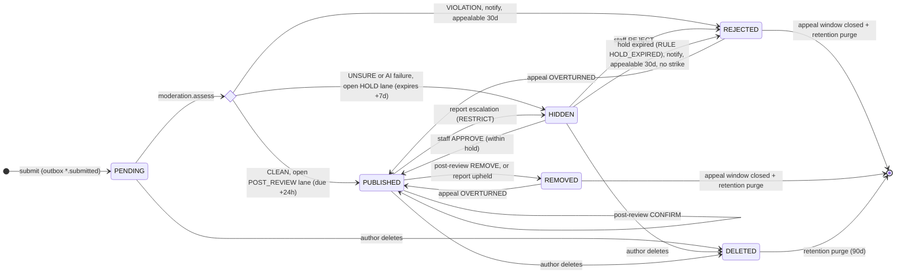
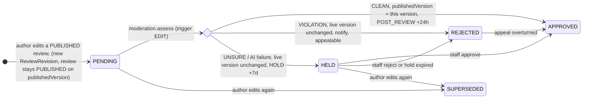
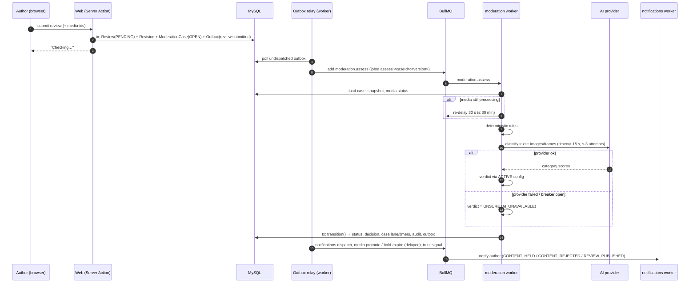

# Moderation Pipeline

| | |
|---|---|
| **Status** | Draft for review (task #19, milestone M1.2) |
| **Owner** | Software Architect |
| **Decision record** | [ADR-0005 Moderation state machine and queues](../adr/0005-moderation-state-machine.md) |
| **Related** | [data-model.md](./data-model.md) · [media-pipeline.md](./media-pipeline.md) · [moderation-config.example.json](./moderation-config.example.json) · [ADR-0001](../adr/0001-technology-stack.md) (outbox, BullMQ) · [ADR-0003](../adr/0003-multi-role-permissions.md) (permissions, COI) |
| **Supersedes** | The review lifecycle sketch in data-model.md §6.1 (M1.1). This document is now authoritative for moderation states and transitions |

This document defines how user content moves from submission to "live" or "rejected": the AI verdicts, the
content state machine, the timers, the configurable thresholds, the staff work queues (moderation, appeal,
seller verification) and the background jobs that drive all of it.

---

## 1. Scope and assumptions

**Moderated content types** (one shared pipeline, `ContentStatus`): `Review` (text + rating + attached media),
`SellerReply`, `Comment`, `Post`. Media attached to them is moderated as part of the parent (§2.4). Avatars,
seller logos and product images are moderated as standalone `MediaAsset` targets.

**Not covered here:** purchase-proof verification (data-model.md §6.2; [ADR-0008](../adr/0008-verified-buyer-approach.md) runs it as `verification.assess-proof` on the `verification` queue), the trust-score algorithm
(T-9), messaging (Phase 2).

| ID | Assumption | Why / how to reverse |
|---|---|---|
| A-1 | "Admin" in the brief means **staff with `moderation.decide`** (MODERATOR, SENIOR_MODERATOR), not only the ADMIN role. The seller verification queue is the exception and needs `seller.claim.review` (ADMIN), as ADR-0003 already says | Permission-matrix change only |
| A-2 | "Rejected" is a new `ContentStatus.REJECTED` (never shown publicly). `REMOVED` stays for content taken down **after** it was live. The two differ for user copy, transparency reporting and strikes | Additive enum value |
| A-3 | **Every** CLEAN item gets a human post-review by default (`postReview.sampleRate = 1.0` for all trust bands). Sampling is available as a config lever if staff capacity runs out | Config only |
| A-4 | Appeal window is **30 days** from the decision, which matches the proof-original retention in data-model.md §7. OPEN(LEGAL) | Config only |
| A-5 | An auto-reject caused by hold expiry is **not a finding of violation**: no strike, no `EnforcementAction`, no negative trust signal | Policy rule in `packages/core` |
| A-6 | Appeals are always decided by a human (never solely automated), as required by DSA Art. 20 under working assumption L-2 | None |
| A-7 | The AI provider and policy taxonomy remain open (T-4). This design is provider-agnostic: a `ModerationProvider` interface returns scores normalised to the platform taxonomy (§5.2) | Adapter per provider |

---

## 2. Verdicts

### 2.1 The three verdicts

Each moderation assessment ends in exactly one **verdict**:

| Verdict | Meaning | Content effect | Staff work created |
|---|---|---|---|
| `CLEAN` | No category scored at or above its *clean* threshold, and no force-unsure rule fired | **Live** (`PUBLISHED`) immediately | `POST_REVIEW` lane item, due in **24 h** |
| `VIOLATION` | At least one category scored at or above its *violation* threshold, or a deterministic rule matched | **Rejected** (`REJECTED`). Author is notified with a statement of reasons. **Appealable** for 30 days | None (appeal creates work if filed) |
| `UNSURE` | Anything in between, any force-unsure rule, **or the AI provider failed** | **Hidden** (`HIDDEN`): author and staff only | `HOLD` lane item. After **7 days** without a staff decision: auto-reject + notification + appeal window opens |

Verdicts map onto the existing `DecisionOutcome` enum: `CLEAN → APPROVE`, `VIOLATION → REMOVE`,
`UNSURE → ESCALATE`. The verdict itself is also stored (`ModerationDecision.verdict`) so queue filters and metrics
do not have to infer it.

### 2.2 Classification algorithm

```
assess(content, config):
  1. rules  = runDeterministicRules(content)      # blocklist, known-bad URL, duplicate text hash,
                                                  # velocity limits, banned media sha256
     if rules.violation: return VIOLATION (source RULE, reasonCode = rule id)
  2. scores = provider.classify(content)          # { category -> 0..1 }, normalised taxonomy
     on provider failure (§2.3): return UNSURE (source RULE, reasonCode AI_UNAVAILABLE)
  3. t = thresholds(config, contentType, category)   # most specific override wins (§5)
     if any category c: scores[c] >= t[c].violation  -> VIOLATION
  4. if any force-unsure rule fires (§5.3)            -> UNSURE
  5. if all categories c: scores[c] < t[c].clean      -> CLEAN
  6. otherwise                                         -> UNSURE
```

- **Violation wins over force-unsure.** A forced-unsure rule never lets content with a clear violation through.
- The **queue score** shown to staff (`aiScore`) is the maximum category score. `aiTopCategory` is the category that
  produced it. `aiReason` is a one-line explanation (provider rationale if it gives one, otherwise
  `"<category> <score>"` plus the rule that fired).
- `labels` (all category scores), `aiProvider`, `aiModel`, `policyVersion` and `configVersion` are written to
  `ModerationDecision` so every verdict can be reproduced and explained during an appeal.

### 2.3 AI provider failure is always UNSURE

The pipeline **never auto-approves on error** (ADR-0001). These all count as a provider failure:

| Failure | Detection | Handling |
|---|---|---|
| Timeout | No response within `ai.timeoutMs` (default 15 s) | Retry |
| 5xx / network error | HTTP status / socket error | Retry |
| 429 / quota | HTTP 429 or provider quota error | Retry, honouring `Retry-After` |
| Malformed response | Response fails the zod schema, or a category is missing | **No retry** (deterministic) → UNSURE |
| Unsupported language / media type | Provider says so, or language detector says unsupported (G-6) | **No retry** → UNSURE (`reasonCode UNSUPPORTED_LANGUAGE`) |
| Circuit breaker open | ≥ 50 % failures over the last 20 calls (configurable) | Skip the call → UNSURE immediately, so content does not wait |
| Job lost / worker crash | Sweeper finds a `PENDING` case with no decision after `ai.maxPendingMinutes` (default 10) | → UNSURE |

Retries: `ai.maxAttempts` (default 3) with exponential back-off 5 s → 20 s → 60 s, so the worst-case extra wait is
about 90 s. After the final attempt, the job's failure handler records a `ModerationDecision(source=RULE,
outcome=ESCALATE, verdict=UNSURE, reasonCode=AI_UNAVAILABLE, failureCode=<timeout|5xx|429|schema|breaker>)`.

**Re-scan on recovery** (`ai.rescanOnRecovery`, default `true`): every 10 min, while the breaker is closed, a job
re-assesses `HOLD` items whose only verdict is `AI_UNAVAILABLE` and that no human has touched yet (at most
`ai.maxRescans` = 3 times each). The new verdict is applied exactly as if it were the first one. This keeps an
outage from flooding the hold lane. The 7-day hold clock is **not** reset by a re-scan. Set the flag to `false` to
apply the brief literally (failure → stays UNSURE until a human or the timer decides).

### 2.4 Content with media

A review (or post) and its attached media are assessed as **one case**, and the verdict is the **worst** of its
components (`VIOLATION > UNSURE > CLEAN`):

1. The parent is submitted while its media may still be processing ([media-pipeline.md §4](./media-pipeline.md#4-processing-pipeline)).
2. `moderation.assess` waits for media: if any attached `MediaAsset` is still `UPLOADING`/`PROCESSING`, the job
   re-delays itself (30 s steps), up to `media.maxWaitMinutes` (default 30). The parent stays `PENDING`.
3. Media that ends `REJECTED` (malware, invalid file) or `FAILED` is **detached** from the parent and the author gets a
   `MEDIA_REJECTED` notification. The text is still assessed on its own merits. A malware hit also writes a `RULE`
   decision on the parent case (`reasonCode MEDIA_MALWARE`) and makes the parent at least `UNSURE`, because an
   intentional malware upload is a strong abuse signal.
4. If media is still not ready when the wait expires, the parent's verdict is `UNSURE`
   (`reasonCode MEDIA_TIMEOUT`).
5. Images are scored directly. Videos are scored on sampled frames (1 fps, at most 30) plus the poster frame. Audio
   transcription is out of scope for Phase 1 (risk noted in §12).

---

## 3. Content state machine

### 3.1 New submissions



Visibility per state:

| State | Public | Author | Staff | Media objects |
|---|---|---|---|---|
| `PENDING` | no | yes, "Checking…" | yes | private (staged) |
| `PUBLISHED` | yes | yes | yes | promoted to public bucket |
| `HIDDEN` | no | yes, "Under review" | yes | private (staged / demoted) |
| `REJECTED` | no | yes, with statement of reasons + appeal link | yes | private, kept for appeal window |
| `REMOVED` | no | yes, with statement of reasons + appeal link | yes | demoted to private, kept for appeal window |
| `DELETED` | no | no (gone from their profile) | yes, until purge | demoted to private, purged with the content |

### 3.2 Transition table

Every transition is applied by a single `ModerationService.transition()` call in `packages/core`, inside one MySQL
transaction that writes: the content status, a `ModerationDecision` (except author actions), the case update, an
`AuditLog` row and the `OutboxEvent`s for the side effects. **Guards are checked inside the transaction with a
conditional update** (`UPDATE … WHERE id = ? AND status IN (<allowed from-states>)`). If no row was updated, the
transition is a no-op. This is what makes timers, bulk jobs and humans safe to race (§4.3).

| # | From | Event | Guard | To | Decision (source / outcome / verdict) | Side effects |
|---|---|---|---|---|---|---|
| T1 | — | author submits | permission `content.create`, not restricted | `PENDING` | — | case `OPEN` (trigger SUBMISSION), outbox `<type>.submitted` |
| T2 | `PENDING` | assessment CLEAN | case open | `PUBLISHED` | AI / APPROVE / CLEAN | `publishedAt`; case lane `POST_REVIEW`, `postReviewDueAt = now + 24h` (or case resolved if not sampled); notify `REVIEW_PUBLISHED` (reviews only); trust `REVIEW_PUBLISHED`; counters; media promote |
| T3 | `PENDING` | assessment VIOLATION | case open | `REJECTED` | AI or RULE / REMOVE / VIOLATION | case `RESOLVED`, `appealableUntil = now + 30d`; notify `CONTENT_REJECTED` (statement of reasons); strike rules §9 |
| T4 | `PENDING` | assessment UNSURE / provider failure / media timeout | case open | `HIDDEN` | AI or RULE / ESCALATE / UNSURE | case lane `HOLD`, `holdExpiresAt = now + 7d`; notify `CONTENT_HELD`; enqueue delayed `moderation.hold-expire` |
| T5 | `HIDDEN` | staff approve | `moderation.decide`, COI guard, case not resolved | `PUBLISHED` | HUMAN / APPROVE / — | case `RESOLVED`; T2 effects **without** a post-review item (a human has already looked) |
| T6 | `HIDDEN` | staff reject | as T5 + `reasonCode` from policy list | `REJECTED` | HUMAN / REMOVE / — | as T3; strike rules §9 apply |
| T7 | `HIDDEN` | hold timer fires | `now ≥ holdExpiresAt`, case lane `HOLD` and not resolved | `REJECTED` | RULE / REMOVE / — (`HOLD_EXPIRED`) | case `RESOLVED`, `appealableUntil = now + 30d`; notify `CONTENT_REJECTED` with "not reviewed in time" reason and appeal link; **no strike, no trust penalty** |
| T8 | `PUBLISHED` | post-review confirm | lane `POST_REVIEW`, not resolved | `PUBLISHED` | HUMAN / APPROVE | case `RESOLVED` |
| T9 | `PUBLISHED` | post-review remove | as T8 + `reasonCode` | `REMOVED` | HUMAN / REMOVE | case `RESOLVED`, `appealableUntil`; notify `CONTENT_REMOVED`; media demote + CDN purge; trust `REVIEW_REMOVED`/`CONTENT_ACTIONED_AGAINST`; strikes §9 |
| T10 | `PUBLISHED` | post-review lapses | `now ≥ postReviewDueAt + postReview.lapseAfterHours` | `PUBLISHED` | RULE / APPROVE (`POST_REVIEW_LAPSED`) | case `RESOLVED`; SLA-breach metric |
| T11 | `PUBLISHED` | report threshold reached / staff flag | §6.1 REPORTED lane rules | `PUBLISHED` or `HIDDEN` | AI or HUMAN / RESTRICT | case lane `REPORTED`; if hidden: notify `CONTENT_HELD`, media demote |
| T12 | `REJECTED`/`REMOVED` | appeal overturned | `appeal.decide`, reviewer ≠ original decider | `PUBLISHED` | HUMAN / APPROVE (trigger APPEAL) | notify `APPEAL_DECIDED` + `CONTENT_RESTORED`; void strike; trust `APPEAL_OVERTURNED`; media promote |
| T13 | `PENDING`/`HIDDEN`/`PUBLISHED` | author deletes | owner | `DELETED` | — | open case `RESOLVED` with `reasonCode WITHDRAWN_BY_AUTHOR`; timers cancelled; media demote |
| T14 | `PENDING`/`HIDDEN` | author edits | owner, edit rate limit (5/day) | `PENDING` | — | open case closed `SUPERSEDED`; new case for the new version (the hold clock starts again, content stays non-public) |

### 3.3 Edits of live content

Reviews keep immutable revisions (`ReviewRevision`). Editing a **published** review never takes the review down:



- These are **revision** states (`ReviewRevision.status`). The review row stays `PUBLISHED` and readers see
  `publishedVersion`.
- `SellerReply`, `Comment` and `Post` have no revision history. An edit to one of them is moderated like a new
  submission (T1–T7) and the content is non-public while `PENDING`/`HIDDEN`. This is acceptable because those bodies
  are short and edits are rare.

---

## 4. Timers

### 4.1 Timer catalogue

| Timer | Starts at | Default (config key) | When it fires | Source of truth |
|---|---|---|---|---|
| Post-review SLA | T2 (content goes live) | 24 h (`timers.postReviewSlaHours`) | Not a state change. Case priority goes up, `moderation_post_review_sla_breached_total` increments, alert if the breached backlog > threshold | `ModerationCase.postReviewDueAt` |
| Post-review lapse | `postReviewDueAt` | +144 h, i.e. 7 days after going live (`postReview.lapseAfterHours`) | T10: auto-close, content stays live | same |
| Hold expiry | T4 (content hidden) | 7 days (`timers.holdDays`) | T7: auto-reject + notification + appeal window | `ModerationCase.holdExpiresAt` |
| Hold reminder | `holdExpiresAt − 48 h` | 48 h (`timers.holdReminderHours`) | Priority bump to top of lane; alert if lane has items < 24 h from expiry | derived |
| Appeal window | T3 / T6 / T7 / T9 | 30 days (`timers.appealWindowDays`) | Appeal button disappears; media for rejected content becomes eligible for purge | `ModerationCase.appealableUntil` |
| Appeal SLA | appeal submitted | 7 days; 72 h for `HOLD_EXPIRED` appeals (`timers.appealSlaHours*`) | Priority bump + alert | `Appeal.slaDueAt` |
| AI pending guard | T1 | 10 min (`ai.maxPendingMinutes`) | Force UNSURE (lost job) | `ModerationCase.createdAt` |

Timer durations are **captured when the timer starts** (`holdExpiresAt` is a stored timestamp), so changing the
config later does not move deadlines for items already in the queue.

### 4.2 Implementation: delayed job + sweeper

The database is the source of truth. BullMQ delayed jobs are only a fast path:

1. When a timer starts, the transaction writes the deadline column and an outbox event. The relay enqueues a
   **delayed job** (`moderation.hold-expire`, `delay = holdExpiresAt − now`, `jobId = hold-expire:<caseId>:<holdExpiresAt>`).
2. A **sweeper** (`maintenance.moderation-sweep`, repeatable every 5 min) queries
   `ModerationCase(lane, status, holdExpiresAt)` / `(lane, status, postReviewDueAt)` for overdue rows and applies the
   same transitions. Lost delayed jobs (Redis restore, deploy) therefore delay a transition by at most 5 min.
3. Cancelling a timer is never needed: the job re-reads the case and does nothing if the case was resolved,
   superseded or its deadline changed.

### 4.3 Races

| Race | Outcome |
|---|---|
| Staff approves while the hold timer fires | Both run a conditional update on `status = HIDDEN AND case not resolved`. Exactly one commits. If the human wins, the timer is a no-op. If the timer wins, the moderator's UI gets `409 already resolved` and offers "Open appeal-style review" (staff can still restore via T12 with a `STAFF_INITIATED` case) |
| Two moderators decide the same case | Lease (`assignedToId` + `leaseExpiresAt`, 15 min) prevents it in the UI. The conditional update prevents it in the DB |
| Author edits while the AI job runs | The AI job writes its decision only if `case.contentVersion` still equals the current version; otherwise it discards the result (case already `SUPERSEDED`) |
| Bulk job and single decision on the same item | Bulk applies items one by one through the same `transition()`; already-resolved items are reported as `skipped` |

---

## 5. Configurable thresholds

### 5.1 Storage, versioning and who can change it

- Config lives in the **`ModerationConfig`** table as immutable, versioned JSON (see
  [moderation-config.example.json](./moderation-config.example.json)). Exactly one row is `ACTIVE`. At most one is
  `SHADOW`.
- Editing creates a `DRAFT`. Activating it requires `config.manage` (ADMIN, SUPER_ADMIN), **step-up auth** and a
  note. It writes `AuditLog(action = moderation.config.activate)` with the diff, and emits `config.activated` so
  workers reload (they also re-read the active version every 60 s).
- Every `ModerationDecision` stores `configVersion`. A rollback is just re-activating an older version.
- **Shadow mode:** when a `SHADOW` version exists, `moderation.assess` also computes the shadow verdict (same scores,
  no extra provider call) and records it in metrics only (`moderation_shadow_verdict_total{active,shadow}`). This
  lets admins see how many items a threshold change would move before activating it.

### 5.2 Taxonomy and thresholds

Platform policy categories (normalised; each provider adapter maps its labels onto these):
`spam`, `fake_or_misleading`, `conflict_of_interest`, `off_topic`, `harassment_hate`, `sexual`, `sexual_minors`,
`violence_threats`, `self_harm`, `personal_information`, `illegal_goods`, `intellectual_property`, `malicious_link`.

Each category has a pair `{ clean, violation }` with `0 ≤ clean < violation ≤ 1`. Lookup order, most specific
first: `contentTypes.<TYPE>.categories.<cat>` → `categories.<cat>` → `defaults`. A category with
`violation: null` can **never** auto-reject: anything at or above `clean` goes to a human (used for judgement-heavy
categories such as `fake_or_misleading`, `conflict_of_interest`, `intellectual_property`, `self_harm`).
Zero-tolerance categories (`strikes.zeroTolerance`, default `sexual_minors`) use a very low `violation` threshold
and additionally follow the escalation procedure in §9.

### 5.3 Force-unsure rules

These turn a would-be CLEAN into UNSURE (never a VIOLATION into anything else):

| Rule | Default |
|---|---|
| Language not supported by the provider (G-6) | on |
| Author trust band `NEW` and any category ≥ `trustBands.NEW.unsureIfAnyAbove` | 0.10 |
| First `n` reviews of a new account | `n = 0` (off) |
| Review contains an external link | on for `REVIEW`, off elsewhere |
| Rating is extreme (1 or 5) **and** product received > `velocity.reviewsPerHour` reviews in the last hour | 20 |
| Media wait timed out / parent has malware media (§2.4) | always on (not configurable) |

### 5.4 Validation

The config is validated by a zod schema in `packages/core` before it can be saved: all categories present, ranges
valid (`violation` may be `null`), timers within safe bounds (`holdDays` 1–30, `postReviewSlaHours` 1–168, `appealWindowDays` ≥ 14,
`postReview.sampleRate` 0–1). Invalid config cannot be activated; the worker refuses to start without a valid
`ACTIVE` version and the seed migration inserts the example config as version `1`.

---

## 6. Staff work queues

Staff work queues are **database views over `ModerationCase`, `Appeal` and `SellerOwnershipClaim`**, not BullMQ
queues. BullMQ (§7) only moves work between processes. All three queues share the same mechanics:

- **Claim with lease:** "Next item" or opening an item sets `assignedToId` + `leaseExpiresAt` (15 min, renewed while
  the page is open). Others see it as locked.
- **COI filter:** items about the moderator's own content, or about a seller the moderator is a member of, are never
  shown to them (ADR-0003).
- **Every decision** needs a `reasonCode` from the active policy list, and every removal or rejection needs a
  `publicReason` (template prefilled from the reason code and editable).
- **Content snapshot:** the case shows `contentSnapshot` (content as assessed), so edits by the author cannot change
  what staff decide on.

### 6.1 Moderation queue (`moderation.queue.read`, `moderation.decide`)

| Lane | Contains | Content state | Default sort | Actions |
|---|---|---|---|---|
| `HOLD` | UNSURE items (incl. AI failure, media timeout) | `HIDDEN` (or held revision) | `holdExpiresAt` asc, then `aiScore` desc | Approve · Reject · Escalate to senior |
| `POST_REVIEW` | CLEAN items that went live | `PUBLISHED` | `postReviewDueAt` asc, then `aiScore` desc | Confirm · Remove · Hide (→ REPORTED lane) |
| `REPORTED` | Live content with user reports or staff flags (T11) | `PUBLISHED` or `HIDDEN` | `priority` desc | Keep · Hide · Remove · Dismiss reports |

`ESCALATED` (case status) cuts across lanes and is visible only to SENIOR_MODERATOR+.

**Columns shown for every item:** content type and excerpt, thumbnails (signed URLs), author handle and trust band,
**AI verdict, `aiScore`, `aiTopCategory`, `aiReason`**, all category scores (expandable), rule hits, decision source
(`AI` vs `AI_UNAVAILABLE`), countdown (hold expiry or post-review due), report count, language.

**Filters:** lane, content type, verdict, top category, score range, failure reason, trust band, language, age.

**Bulk actions:**

| Bulk action | Lanes | Permission | Limit |
|---|---|---|---|
| Bulk approve | `HOLD` | `moderation.bulk_decide` (MODERATOR+) | 100 items |
| Bulk confirm | `POST_REVIEW` | `moderation.bulk_decide` (MODERATOR+) | 100 items |
| Bulk reject / remove | `HOLD`, `POST_REVIEW` | `moderation.bulk_decide` + SENIOR_MODERATOR, one shared `reasonCode` + `publicReason` | 100 items |

Bulk flow: the Server Action validates the selection (same lane, all visible to this moderator), writes one
`AuditLog(action = moderation.bulk)` with the selection and an `OutboxEvent(moderation.bulk_requested)`, and returns a
`bulkOperationId`. The `moderation.bulk-apply` job applies each item through the same `transition()` (each gets its
own `ModerationDecision` with `bulkOperationId`), skipping items that are resolved, leased by someone else, under
legal hold or COI-blocked. The UI polls the per-item result (`applied` / `skipped:<reason>` / `failed`).

**Capacity math** (for staffing; see §12): with 100 % post-review, staff must review *all* CLEAN volume within 24 h,
plus the HOLD lane within 7 days. Bulk confirm with AI-score sort (lowest-risk first) is the main throughput tool.

### 6.2 Appeal queue (`appeal.decide`)

- **Source:** `Appeal` rows with status `SUBMITTED` / `IN_REVIEW`. Filed by the author (or reporter, L-3) while
  `now < appealableUntil`. One per appellant per decision (existing unique keys).
- **Intake:** `appeal.submitted` creates no new AI assessment (A-6). The original case is linked (`Appeal.caseId`) and
  shown with its full decision history (AI scores, reasons, who/what decided), the snapshot, the statement and any
  evidence (private, signed URLs, audited).
- **Assignment guard:** reviewer ≠ any human decider on the case (ADR-0003). For AI/RULE-only decisions any
  SENIOR_MODERATOR may decide.
- **Sort:** `HOLD_EXPIRED` appeals first (SLA 72 h, because no human ever looked), then by `slaDueAt`.
- **Outcomes:** `UPHELD` (notify `APPEAL_DECIDED`, final; out-of-court dispute info per L-2), `OVERTURNED` (T12),
  `PARTIALLY_OVERTURNED` (e.g. content stays removed but the strike is voided).

### 6.3 Seller verification queue (`seller.claim.review`)

- **Source:** `SellerOwnershipClaim` with status `PENDING`.
- **Automatic methods** (`DNS_TXT_RECORD`, `WEBSITE_META_TAG`, `BUSINESS_EMAIL_DOMAIN`) are checked by the
  `verification` job queue (§7). Success → `VERIFIED` by `RULE` and the claim enters a 10 % random **spot-check** sub-list.
  Repeated failure for 72 h → `EXPIRED` + `CLAIM_REJECTED` notification with retry instructions.
- **Manual methods** (`DOCUMENT_UPLOAD`, `MARKETPLACE_STORE_LINK`) go straight to the queue. Evidence documents
  pass the media pipeline (virus scan) and stay in the private bucket.
- **Columns:** seller, method, scope (seller/product), automated check log (last DNS/meta result), evidence links,
  age, existing claims on the same domain/product (conflict flag).
- **SLA:** 3 business days. **Actions:** Verify (sets `verifiedUntil = now + 12 months`), Reject (reason required,
  appealable through `Appeal.ownershipClaimId`), Request more info (stays `PENDING`, notifies the seller).
- Re-verification reminder 30 days before `verifiedUntil`; the `maintenance` queue expires claims and downgrades
  sellers as described in data-model.md §6.3.

---

## 7. Job and queue design (BullMQ)

### 7.1 Event flow



### 7.2 Queues

| Queue | Purpose | Concurrency (per worker process) | Rate limit | Notes |
|---|---|---|---|---|
| `moderation` | assess, re-scan, hold expiry, post-review lapse, bulk apply | 10 | Provider limiter, e.g. `{ max: 50, duration: 1000 }` (config) | AI calls are I/O-bound; the limiter protects provider quota |
| `media` | image ingest/scan/sanitize/variants, promote/demote, purge | 4 | — | See media-pipeline.md §8 |
| `media-video` | ffprobe + transcode + frame sampling | 1–2 | — | CPU-heavy; separate worker deployment so it cannot starve moderation |
| `verification` | DNS TXT / meta-tag / email-domain checks for seller claims | 5 | 1 req / domain / 10 s | SSRF-safe fetcher (ADR-0001) |
| `notifications` | in-app + email fan-out | 20 | Email provider limit | Idempotent on `(recipient, groupKey)` |
| `trust` | trust signals and recompute | 5 | — | Debounced per subject |
| `maintenance` | repeatable sweepers and purges | 1 | — | Cron schedules below |

All queues: `removeOnComplete: { age: 24h }`, `removeOnFail: { age: 14d }` (failed jobs are the DLQ, visible in the
ops dashboard), OpenTelemetry trace id propagated in job data (ADR-0001).

### 7.3 Job catalogue

`jobId` makes enqueueing idempotent (BullMQ ignores a duplicate `jobId`). Every handler is also idempotent at the
DB level through conditional transitions, so at-least-once delivery from the outbox is safe.

| Job | Queue | Triggered by (outbox topic / schedule) | `jobId` | Attempts / back-off | Timeout | On final failure |
|---|---|---|---|---|---|---|
| `moderation.assess` | moderation | `review.submitted`, `review.edited`, `comment.submitted`, `post.submitted`, `seller_reply.submitted`, `media.standalone_ready` | `assess:<caseId>:<contentVersion>` | 3, exp 5 s/20 s/60 s (provider errors only) | 60 s | Apply UNSURE (`AI_UNAVAILABLE`) |
| `moderation.rescan-failed` | moderation | repeatable every 10 min | `rescan-failed:<window>` | 1 | 5 min | Log, next run retries |
| `moderation.rescan` | moderation | report threshold, staff "re-scan", rescan-failed fan-out | `rescan:<caseId>:<n>` | 3, exp | 60 s | Leave state unchanged, alert |
| `moderation.hold-expire` | moderation | `moderation.hold_started` (delayed until `holdExpiresAt`) | `hold-expire:<caseId>:<holdExpiresAt>` | 5, exp 30 s | 30 s | Sweeper picks it up |
| `moderation.post-review-lapse` | moderation | `moderation.post_review_opened` (delayed) | `pr-lapse:<caseId>` | 5, exp 30 s | 30 s | Sweeper picks it up |
| `moderation.bulk-apply` | moderation | `moderation.bulk_requested` | `bulk:<bulkOperationId>` | 3 (resumes, skips applied items) | 5 min | Partial result + alert |
| `maintenance.moderation-sweep` | maintenance | every 5 min | repeat key | 1 | 2 min | Alert after 3 consecutive failures |
| `appeal.intake` | moderation | `appeal.submitted` | `appeal:<appealId>` | 5 | 30 s | Alert (appeal still visible in queue) |
| `verification.check-claim` | verification | `claim.submitted`, retries schedule | `claim:<claimId>:<attempt>` | Custom schedule: every 15 min for 1 h, then hourly to 72 h | 30 s | Claim `EXPIRED` + notify |
| `notifications.dispatch` | notifications | `moderation.decided`, `appeal.decided`, `claim.decided`, … | `notif:<eventId>:<recipientId>` | 5, exp | 30 s | DLQ; in-app row already written |
| `trust.signal` | trust | `moderation.decided`, `appeal.decided` | `trust:<eventId>` | 5, exp | 30 s | DLQ |
| `media.*` | media / media-video | see media-pipeline.md §8 | | | | |

### 7.4 Outbox topics written by moderation

`review.submitted`, `review.edited`, `comment.submitted`, `post.submitted`, `seller_reply.submitted`,
`content.deleted`, `moderation.decided` (payload: caseId, target, verdict, outcome, source, reasonCode),
`moderation.hold_started`, `moderation.post_review_opened`, `moderation.bulk_requested`, `appeal.submitted`,
`appeal.decided`, `claim.submitted`, `claim.decided`, `config.activated`.

### 7.5 Failure modes

| Failure | Effect | Mitigation |
|---|---|---|
| AI provider down | All new content → `HIDDEN` | Circuit breaker (no waiting), re-scan on recovery, alert on breaker open > 5 min, HOLD-lane capacity alert |
| Redis down | Outbox rows accumulate; nothing is lost | Relay resumes from `publishedAt IS NULL` (ADR-0007); sweepers cover timers; alert on outbox lag > 60 s |
| Worker crash mid-job | BullMQ stalled-job recovery re-runs it | Idempotent handlers + conditional transitions |
| Bad config activated | Mass mis-classification | Shadow mode before activation; one-click rollback to previous version; alert when the verdict mix shifts > 20 pts in 1 h |
| Staff backlog | Post-review SLA breaches; holds start auto-rejecting | Hold-reminder alert; `postReview.sampleRate` lever; metrics in §11 |

---

## 8. Notifications and statements of reasons

| Event | Notification type | Recipient | Mandatory | Content |
|---|---|---|---|---|
| T2 (reviews only) | `REVIEW_PUBLISHED` | author | no | link |
| T4, T11 (hidden) | `CONTENT_HELD` | author | **yes** | "Under review, decided within 7 days" |
| T3, T6, T7 | `CONTENT_REJECTED` | author | **yes** | statement of reasons, decision source (automated / human / not reviewed in time), appeal link + deadline |
| T9 | `CONTENT_REMOVED` | author | **yes** | as above |
| T12 | `CONTENT_RESTORED` | author | **yes** | link |
| media rejected | `MEDIA_REJECTED` | uploader | **yes** | which attachment (parent + position; original file names are never stored) and the reason |
| appeal filed | `APPEAL_RECEIVED` | appellant | **yes** | expected decision date |
| appeal decided | `APPEAL_DECIDED` (existing) | appellant | **yes** | outcome, `decisionNote` |
| report resolved | `REPORT_RESOLVED` (existing) | reporter | no | outcome only |

The statement of reasons (`EnforcementAction.publicReason` or, for rejections without an enforcement action,
`ModerationCase` decision `publicReason`) states: what was decided, the policy section, whether automated means were
used, and how to appeal. OPEN(LEGAL): exact wording per L-2.

`REVIEW_REJECTED` and `REVIEW_HIDDEN` from the M1.1 draft are replaced by the generic `CONTENT_*` types, because the
same pipeline serves four content types.

---

## 9. Strikes and enforcement

A strike is an `EnforcementAction` (`WARNING`, `POSTING_RESTRICTION`, `SUSPENSION`, `BAN`) linked to the case.
The ladder is configuration (`strikes` in the config), default:

| Strikes in rolling 180 days | Action |
|---|---|
| 1–2 | `WARNING` |
| 3 | `POSTING_RESTRICTION` 7 days |
| 4 | `POSTING_RESTRICTION` 30 days |
| 5+ | `SUSPENSION` pending SENIOR_MODERATOR review for `BAN` |

- **What counts:** a `REMOVE` by a human (T6, T9, REPORTED lane), or an AI/RULE `VIOLATION` (T3) **once the appeal
  window closes without an overturn**. The `maintenance` sweeper creates that deferred strike.
- **What never counts:** `HOLD_EXPIRED` rejections (A-5), `POST_REVIEW_LAPSED`, author deletions, overturned decisions.
- **Zero-tolerance** categories (`strikes.zeroTolerance`, default `sexual_minors`) skip the ladder: content `REJECTED`,
  account `SUSPENDED` immediately, case `ESCALATED` to SENIOR_MODERATOR, evidence preserved with `legalHold`. Any
  mandatory reporting to authorities is OPEN(LEGAL) and handled by ADMIN.

---

## 10. Data model changes (applied to the M1.1 draft)

All changes are additive to the not-yet-migrated draft in [schema.draft.prisma](./schema.draft.prisma), except the two
replaced notification types.

| Change | Purpose |
|---|---|
| `ContentStatus.REJECTED` | Pre-publication rejection (A-2) |
| `ModerationVerdict { CLEAN VIOLATION UNSURE }` | Stored verdict |
| `ModerationLane { POST_REVIEW HOLD REPORTED }` | Staff queue lanes |
| `RevisionStatus` + `ReviewRevision.status`, `Review.publishedVersion` | Edits of live reviews (§3.3) |
| `ModerationCase`: `lane`, `contentVersion`, `aiVerdict`, `aiScore`, `aiTopCategory`, `aiReason`, `holdExpiresAt`, `postReviewDueAt`, `appealableUntil`, `leaseExpiresAt`, `configVersion`, `resolutionCode` + lane indexes | Queue display/sort, timers, leases |
| `ModerationDecision`: `verdict`, `configVersion`, `failureCode`, `publicReason`, `bulkOperationId`, `latencyMs` | Explainability, failure tracking, bulk audit |
| `Appeal`: `slaDueAt`, `priority` | Appeal queue ordering |
| `ModerationConfig` model + `ModerationConfigStatus` enum | Versioned thresholds (§5) |
| `NotificationType`: + `CONTENT_HELD`, `CONTENT_REJECTED`, `CONTENT_REMOVED`, `CONTENT_RESTORED`, `MEDIA_REJECTED`, `APPEAL_RECEIVED`; − `REVIEW_REJECTED`, `REVIEW_HIDDEN` | §8 |
| CHECKs: hold lane needs `holdExpiresAt`, post-review lane needs `postReviewDueAt`, score ranges 0..1 | [check-constraints.sql](./check-constraints.sql) |
| Permission `moderation.bulk_decide` | §6.1 (ADR-0003 matrix follow-up) |

Media-side changes are listed in [media-pipeline.md §10](./media-pipeline.md#10-data-model-changes).

---

## 11. Observability

| Metric | Why | Alert |
|---|---|---|
| `moderation_verdict_total{type,verdict,source}` | Verdict mix | Mix shifts > 20 pts in 1 h |
| `moderation_ai_latency_seconds` (p50/p95) | Provider health | p95 > 10 s for 10 min |
| `moderation_ai_failure_total{code}`, `moderation_breaker_open` | Provider failures | Breaker open > 5 min |
| `moderation_lane_size{lane}`, `moderation_lane_oldest_seconds{lane}` | Backlog | HOLD oldest > 5 days; POST_REVIEW oldest > 20 h |
| `moderation_hold_expired_total` | Auto-rejects mean staff missed content (should be ~0) | > 0 per day |
| `moderation_post_review_sla_breached_total` | 24 h SLA attainment | > 1 % of the day's volume |
| `moderation_post_review_removed_ratio` | AI false negatives (CLEAN that staff removed) | > 2 % → tune thresholds |
| `moderation_hold_approved_ratio` | Share of UNSURE that staff approve → UNSURE band too wide? | informational |
| `appeal_overturn_ratio{source}` | Decision quality per source (AI / RULE / HUMAN / HOLD_EXPIRED) | AI > 10 % |
| `outbox_lag_seconds`, BullMQ waiting/failed per queue | Pipeline health | lag > 60 s; failed > 0 for `moderation` |

---

## 12. Risks and open points

| ID | Risk / open point | Mitigation / owner |
|---|---|---|
| M-1 | **Staff capacity.** 100 % post-review within 24 h scales linearly with volume | Bulk confirm, `sampleRate` lever, staffing model before launch (Product + T&S) |
| M-2 | **Policy text** (categories, reason codes, public reasons) is not written yet | T&S + Legal before M3 feature work; the seed config uses placeholder reason codes |
| M-3 | Provider choice (T-4) affects taxonomy mapping and cost | Provider spike task; `ModerationProvider` adapter isolates it |
| M-4 | Video audio is not moderated in Phase 1 | Accept for Phase 1 (30 s clips, user reports cover it); add speech-to-text later |
| M-5 | Auto-reject after 7 days with no human review may be challenged by users or regulators | Appeal SLA 72 h for these; metric alert; L-2 legal review |
| M-6 | Sending review text and images to a third-party AI provider is processing of personal data | DPA with provider, no-training clause, region pinning (L-6) |

---

## 13. Test plan (for the implementation tasks)

1. **Table-driven state-machine tests** in `packages/core`: one test per row of §3.2 (allowed transition → expected
   status, decision, lane, timers, outbox topics) plus a generated test asserting that every *other*
   (state, event) pair is rejected.
2. **Classification tests:** threshold boundaries (`score == clean`, `score == violation`), override precedence,
   force-unsure rules, violation-beats-force-unsure.
3. **Failure injection:** fake provider returning timeout / 5xx / 429 / malformed / unsupported language; breaker
   open; verify UNSURE and `failureCode`.
4. **Timer tests** with a fake clock: hold expiry via delayed job and via sweeper; race between human approve and
   expiry (exactly one wins); config change does not move existing deadlines.
5. **Bulk tests:** mixed selection with resolved, leased, COI and legal-hold items → correct per-item results.
6. **E2E (Playwright):** submit review → CLEAN → live → post-review confirm; UNSURE → hidden → expiry → rejected
   notification → appeal → overturn → live.
